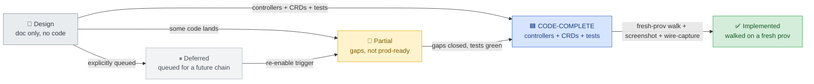

# Catalyst Implementation Status

**Status:** Authoritative. Living document. **Updated:** 2026-08-26 (re-stamped to hw305 truth: Huawei kom4dc substrate, 11-step cutover chain, Pillar-4 = Agenity + `bp-openova-mcp`, UAT ledger 286 rows / ✅246·❌12·⚠️6·⏳22 after PR #6690; live cutover-keystone + per-Sovereign env inventory still to be re-derived from the deployments API). **Staleness rule:** if this stamp is more than 14 days old, treat this file as drifted — re-derive live state before trusting any row (see §11 Re-stamp cadence).

This document is the **bridge** between the target architecture (described in [`ARCHITECTURE.md`](ARCHITECTURE.md), [`SECURITY.md`](SECURITY.md), [`RUNBOOKS.md`](RUNBOOKS.md) §3 Blueprint authoring, etc.) and the current state of the code in this repository.

The other architecture docs describe the **target**: where Catalyst is going. This document records **what exists today** and **what is design-only**. When in doubt, read this file before making any claim about Catalyst's capabilities.

> If you find a claim elsewhere in this repo that contradicts this file, this file wins until either (a) the code catches up to the claim or (b) the claim is corrected — **unless (c) the `Updated:` stamp above is more than 14 days old**, in which case this file's precedence is VOID until it is re-stamped against live state. (This file once sat frozen for ~8 weeks while still claiming to "win" — the staleness clause exists so that can never happen again.)

---

## Status legend

| Status | Meaning |
|---|---|
| ✅ **Implemented** | Code exists, tested, deployable; AND operator walked the surface on a fresh prov with screenshot evidence. |
| 🟦 **CODE-COMPLETE** | All controllers + CRDs + tests landed; awaiting fresh-prov walk to flip to ✅ per 5-pillar DoD. |
| 🚧 **Partial** | Some code exists; significant gaps; not production-ready. |
| 📐 **Design** | Documented in canonical docs; no code yet. The doc is the contract for the future implementation. |
| ⏸ **Deferred** | Mentioned in docs but explicitly queued for a future chain. |

Per [`DOD.md`](DOD.md), 🟦 CODE-COMPLETE does NOT mean shipped. A pillar is **shipped** when an operator walks a **fresh prov** through the pillar-relevant steps and produces a screenshot + non-empty wire-capture + working downstream artifact. PR merge ≠ pillar shipped.

*The legend read as a lifecycle: code review alone can carry a surface to 🟦 CODE-COMPLETE; only a fresh-prov walk with screenshot evidence flips it to ✅.*

---

## 1. Repository structure

> State: built. Evidence: docs/generated/components.md, scripts/generators/components.py

Every folder directly under `platform/` and `products/` is listed in the generated file [`docs/generated/components.md`](generated/components.md), with its charts, its Blueprint and the Blueprint's visibility. `scripts/generators/components.py` writes it from the tree, and the check `generated-docs` fails a pull request in which it is stale.

---

## 2. Catalyst control plane components (per [`ARCHITECTURE.md`](ARCHITECTURE.md) §2)

> State: built. Evidence: docs/generated/bootstrap-slots.md, scripts/generators/slots.py

The components that every Sovereign runs are installed by the slots of the bootstrap kit, the files of `clusters/_template/bootstrap-kit/`. The generated file [`docs/generated/bootstrap-slots.md`](generated/bootstrap-slots.md) lists each slot with its HelmRelease, chart, target namespace, dependencies and switches. The control plane is the slot of the umbrella chart `bp-catalyst-platform`. `scripts/generators/slots.py` writes the file from the tree, and the check `generated-docs` fails a pull request in which it is stale.

---

## 3. Per-host-cluster infrastructure (per [`ARCHITECTURE.md`](ARCHITECTURE.md) §3)

> State: built. Evidence: docs/generated/bootstrap-slots.md, docs/generated/components.md

The infrastructure of every cluster is installed by the same slots of the bootstrap kit, listed in [`docs/generated/bootstrap-slots.md`](generated/bootstrap-slots.md). A component whose folder is listed in [`docs/generated/components.md`](generated/components.md) and that has no slot is not installed by the bootstrap kit.

---

## 4. CRDs

> State: built. Evidence: docs/generated/custom-resources.md, scripts/generators/custom-resources.py

Every custom resource definition of the tree is listed in the generated file [`docs/generated/custom-resources.md`](generated/custom-resources.md), with its group, versions, scope and file, and whether Go code that is not a test names it. `scripts/generators/custom-resources.py` writes it, and the check `generated-docs` fails a pull request in which it is stale.

---

## 5. Surfaces

*(Section dated 2026-05-20.)*

Per [`CLAUDE.md`](../CLAUDE.md) §"What's user-facing": **UI / Git / API only**. There is no Terraform provider, no Pulumi SDK, no `catalystctl install` for production changes. Crossplane is platform plumbing, never a user surface.

| Surface | Status | Notes |
|---|---|---|
| **UI** (Catalyst console) | 🚧 | Astro + Svelte target stack. Multiple surfaces deployed (console, admin, marketplace); full integration pending. |
| **Git** (direct push to Application Gitea repo, branch per env_type) | 📐 | Pattern documented; depends on provisioning-service + environment-controller. |
| **API** (REST + GraphQL) | 🚧 | catalyst-api REST surfaces shipped for provisioning, BSS, voucher, sandbox; GraphQL not yet. |
| **kubectl** (debug-only inside own vcluster) | 📐 | Standard K8s; works as soon as a Sovereign exists. |

---

## 6. CI / supply-chain guards (pre-merge)

*(Section dated 2026-05-20.)*

Every guard listed here is a pre-merge check that fails the PR if violated. This is the structural defence against the anti-patterns in [`PRINCIPLES.md`](PRINCIPLES.md).

| Guard | Status | PR | Rule | Catches |
|---|---|---|---|---|
| Hollow-chart guard | ✅ SHIPPED | [#2087](https://github.com/openova-io/openova/pull/2087) (elevated from post-merge to pre-merge, Refs #2080) | Every changed `chart/Chart.yaml` MUST EITHER declare non-empty `dependencies:` OR carry annotation `catalyst.openova.io/no-upstream: "true"` | Hollow wrapper charts (overlay templates only, no upstream payload) — three real recurrences pre-2026-05-20 each dead-reserved a chart version |
| Smoke-render guard | ✅ SHIPPED | [#2093](https://github.com/openova-io/openova/pull/2093) (elevated from post-merge to pre-merge) | `helm template` with default values must produce ≥5 lines OR chart must carry `catalyst.openova.io/smoke-render-mode: "default-off"` | Dual-annotation gap — bp-network-policies:1.0.1 dead-reserve incident (2026-05-20) had `no-upstream:true` but missing `smoke-render-mode:default-off` |
| No-auto-close-keyword guard | ✅ SHIPPED | [#2082](https://github.com/openova-io/openova/pull/2082) | Reject PR bodies containing `Closes #N` / `Fixes #N` / `Resolves #N` unless the PR carries label `ci-gate-exception` | Anti-theater: `Refs #N` is the default; auto-close on PR merge is the enemy. Issue closes only after operator-walk-with-screenshot. |
| Observability-toggle test | ✅ SHIPPED | (per-chart `tests/observability-toggle.sh`) | Default render produces zero `monitoring.coreos.com/v1` references; opt-in render succeeds AND produces a ServiceMonitor; explicit-off succeeds AND produces zero references | Regressions re-introducing hardcoded `enabled: true` — verified failure mode on omantel.omani.works 2026-04-29 (issue #182) |
| Subchart guards (4-step) | ✅ SHIPPED | (`.github/workflows/blueprint-release.yaml`) | After `helm dependency build` / `helm package` / `helm push` / `helm pull`: every declared subchart must be physically present at each layer | Per-layer dropouts: dependency-build skip, packaging strip, registry path mangling, OCI manifest rewrite |
| Flux version-pin replay | ✅ SHIPPED | (`platform/flux/chart/tests/version-pin-replay.sh`) | cloud-init Flux URL pin + bp-flux umbrella `flux2` subchart `appVersion` must match | Catastrophic bp-flux double-install (2026-04-29 omantel incident — Flux controllers deleted by Helm rollback) |

---

## 7. Sovereigns running today

*(Section re-stamped 2026-07-14. Env names below are a snapshot — re-derive the live inventory from the owner-scoped deployments API + the highest `uat-hw<NNN>` branch before acting on any row.)*

| Sovereign | Status | Notes |
|---|---|---|
| `openova` Catalyst-Zero (mothership) | 🚧 | Serves `console.openova.io` (namespaces `catalyst`, `sme`, `marketplace`, `website`; pods include catalyst-{ui,api}, console, admin, marketplace, marketplace-api). The mothership IS the catalyst-provisioner that provisions every other Sovereign — canonical lifecycle API: owner-scoped `POST /sovereign/api/v1/deployments` (create) / `POST .../deployments/{id}/wipe` (destroy). The 2026-05 "Contabo k3s" substrate claim is superseded; re-derive the mothership's live substrate from the deployments API + cluster before relying on it. |
| Test/walk Sovereigns (`hw<NNN>` series) | 🚧 | Convention: `hw<NNN>.omani.works` ↔ `hw<NNN>.omantel.biz` (TLD rotation when LE-rate-limited), provisioned on **Huawei kom4dc** — the delivery substrate: 2-region `me-east-215-a`/`-b`, one VPC per region (quota 5 total), EVS 400-volume cap, ~15-min wipe-release lag ([`docs/runbooks/preflight-sovereign-provision.md`](runbooks/preflight-sovereign-provision.md)). Fired per release-train, never for one passenger. Latest walked env = the highest `uat-hw<NNN>` branch (hw305 as of 2026-08-26; furthest cutover ever = hw246). Forbidden test domains unchanged: `openova.io`, `omantel.openova.io`, `Nova Cloud`, `eventforge.io`. |
| `omantel` production Sovereign (`omantel.biz`) | ✅ | **PERMANENT production Sovereign, live on Huawei kom4dc** — current deployment env is stamp-dependent (re-verify against the live deployments API before relying on the name; production was destroyed twice by in-band quota reclaim — #4614, #4675 dep 2c3f7c34). On the never-touch protect-list: never a wipe target, never a cutover re-fire target, never an in-band reclaim victim. (The only other founder-protected shared resource is the bastion node `bastion-openova`, EIP 212.72.24.20.) |
| Customer-hosted Sovereigns | 📐 | Customers run their own Sovereigns under their own private agreements. Partner identities are intentionally not surfaced in this public catalog. |

---

## 8. Catalyst provisioner

> State: built. Evidence: products/catalyst/bootstrap/api/internal/provisioner, infra/providers, docs/generated/bootstrap-slots.md

The provisioner is Go code of catalyst-api, in `products/catalyst/bootstrap/api/internal/provisioner/`. It writes the variables file of the OpenTofu module of the chosen cloud, one folder per provider under `infra/providers/`, and runs `tofu apply`. The new cluster then installs the bootstrap kit, whose slots [`docs/generated/bootstrap-slots.md`](generated/bootstrap-slots.md) lists.

---

## 9. Pillar status (5-pillar DoD — per [`DOD.md`](DOD.md))

> State: rule. Enforced by: nothing

No pillar is proven on what `main` publishes. The verdict is printed by `python3 scripts/acceptance-gate.py verdict`.

---

## 10. What this means for newcomers

If you're reading the Catalyst architecture for the first time:

- The **architectural model** in [`ARCHITECTURE.md`](ARCHITECTURE.md) is the agreed direction. The model is settled.
- The **code in this repo** is mostly scaffold + 4 CODE-COMPLETE pillars. Significant ✅-flipping (operator walks on fresh prov) lies ahead.
- The **7 canonical docs** ([`GLOSSARY.md`](GLOSSARY.md), `STATUS.md` (this file), [`ARCHITECTURE.md`](ARCHITECTURE.md), [`DOD.md`](DOD.md), [`PRINCIPLES.md`](PRINCIPLES.md), [`RUNBOOKS.md`](RUNBOOKS.md), [`SECURITY.md`](SECURITY.md)) describe the **target**.
- Component-level READMEs under `platform/<name>/` describe the upstream technology and Catalyst's intended use of it.

If a doc says "Catalyst does X" without a 📐 / 🚧 / 🟦 marker, treat it as a target. Use this `STATUS.md` to confirm whether X is built today.

---

## Virtual-machine migration

> State: target. Decision: ADR-0032

Target, not built. Brownfield virtual-machine migration is the optional Blueprint `bp-vm-migration` ([ADR-0032](adr/0032-vm-migration-is-a-platform-product.md)). There is no product code yet: no folder `products/vm-migration/`, no chart and no image. The lab spikes MIG-020 to MIG-050 record their results under `docs/ledger/plan/spikes/`. Nothing about migration is proven until the gate checks MIG-G04, MIG-G05 and MIG-G06 are `required` in `docs/ledger/gates.yaml`.

---

## 11. How to update this file

This file is updated whenever a status changes:

- A controller is implemented + tested → flip from 📐 to 🟦 (CODE-COMPLETE)
- A pillar walks GREEN on a fresh prov with screenshot evidence → flip from 🟦 to ✅
- A component is partially shipped → 🚧 with notes on what's missing
- A target is deferred → ⏸ with a forward-pointing reference

Per [`DOD.md`](DOD.md): 🟦 means "all controllers + CRDs + tests landed". It is the **maximum** state achievable from code review alone. ✅ requires the operator walk.

Keeping this honest is the only way to prevent the kind of doc/code drift that makes the architecture text unreliable.

### Re-stamp cadence (added 2026-07-14)

This file self-declares that it "wins" over every other doc — yet it once sat frozen at *Updated: 2026-05-20* for ~8 weeks while the platform moved to the Huawei kom4dc substrate, the 11-step cutover chain, and the Agenity Pillar-4 re-scope. A stale winner is worse than no winner. Standing rules:

1. **Weekly re-stamp check**: [`docs/ledger/TRACKER.md`](ledger/TRACKER.md) must carry a weekly checklist row asserting `STATUS.md re-stamped ≤7 days` — the tracker refresh script greps this file's `**Updated:**` date and flips the row red past 7 days (wire this into the DoD-dashboard renderer when it moves into `scripts/`; until then the row is maintained by hand in the weekly sweep).
2. **Same-commit date bump**: any PR that changes a status in this file updates the header `**Updated:**` date in the same commit.
3. **>14 days = precedence void**: per the header rule, a stamp older than 14 days suspends this file's "wins over other docs" clause. A session that finds it stale must re-derive live state first (current `uat-hw<NNN>` branch, `gh issue list`/`gh pr list`, the owner-scoped deployments API, `docs/ledger/` heads) and re-stamp this file in the same session.
