# OpenOva — Status Tracker

Regenerated every 15 min by `/home/openova/bin/refresh-dod-dashboard.sh`. Every `#NNNN` is a clickable GitHub link.

|  |  |
|---|---|
| Last refreshed | `2026-11-19T16:15:03Z` |
| Deploy cron (#799) | ✓ deploy-cron healthy (image-reroll last ran 10m ago) |
| Open issues | 100 |
| Open DoD gates | 0 / 41 |
| Open TBD-* regressions | 0 |
| DoD completion |  41 / 41 = 100% |

**Legend:**  done ·  fix shipped, awaits prov ·  open ·  deferred

---

## 1. Customer journey (founder's success criterion)

| # | Step | Status | Blocking issue |
|---|---|---|---|
| 1 | Operator issues voucher |  | — |
| 2 | Email arrives in recipient inbox |  | [#1741](https://github.com/openova-io/openova/issues/1741) → blocked by [#1793](https://github.com/openova-io/openova/issues/1793) |
| 3 | Recipient hits redeem landing |  | — |
| 4 | Recipient creates org + checkout |  | — |
| 5 | tenant.created → Organization CR |  | [#1900](https://github.com/openova-io/openova/issues/1900) closed |
| 6 | Organization CR exists |  | — |
| 7 | vCluster + Keycloak + Gitea materialize |  | [#1906](https://github.com/openova-io/openova/issues/1906) [#1901](https://github.com/openova-io/openova/issues/1901) closed; t32 verifies |
| 8 | Tenant subdomain HTTPS responds |  | [#1907](https://github.com/openova-io/openova/issues/1907) closed; t32 verifies |

t32 (live now): `console.t32.omani.works` returns HTTP 200 + envoy. Handover fired 2026-05-19T05:05:24Z.

---

## 2. Open-issue blocking graph

**All 100 open issues** grouped by where they sit in the convergence sequence. Each chain runs left-to-right; chains stack vertically.

> 💡 GitHub strips click handlers from rendered mermaid for security — every node label below has a 1:1 entry in the **clickable index** that follows the diagram.

```mermaid
flowchart LR
  classDef epic fill:#1f6feb,stroke:#0d419d,color:#fff,stroke-width:3px
  classDef open  fill:#cf222e,stroke:#a40e26,color:#fff,stroke-width:2px
  classDef wait  fill:#bf8700,stroke:#9a6700,color:#fff,stroke-width:2px
  classDef done  fill:#2ea043,stroke:#1a7f37,color:#fff,stroke-width:2px
  classDef defer fill:#6e7781,stroke:#4f555c,color:#fff,stroke-width:2px

  %% === EPIC: Customer Journey (voucher → tenant → WordPress) ===
  E_CJ(("Customer Journey")):::epic
  E_CJ --> I1793["#1793 SMTP creds missing"]:::wait
  I1793 --> I1741["#1741 Voucher email in 60s"]:::open
  I1741 --> D1842["#1842 D28 Voucher UI + email"]:::wait
  E_CJ --> I1723["#1723 WordPress install"]:::open
  E_CJ --> I1724["#1724 Gitea /git/refs/heads"]:::open
  I1723 --> D1829["#1829 D29 Zero-touch tenant"]:::wait
  I1724 --> D1829

  %% === EPIC: Multi-region Sovereign ===
  E_MR(("Multi-region")):::epic
  E_MR --> I1904["#1904 Fan-out regression"]:::wait
  I1904 --> D1808["#1808 D5 /cloud 3 regions"]:::wait
  I1904 --> D1817["#1817 D16 L1/L2 fan-out"]:::wait
  I1904 --> D1820["#1820 D19 Apps/Cloud counter"]:::open
  I1904 --> D1821["#1821 D20 Jobs region filter"]:::open

  %% === EPIC: Auth & SSO ===
  E_AUTH(("Auth & SSO")):::epic
  E_AUTH --> I1905["#1905 auth.fqdn hijack"]:::open
  I1905 --> D1807["#1807 D4 Keycloak PIN-login"]:::open

  %% === EPIC: Sandbox runtime + audit trail ===
  E_SBX(("Sandbox")):::epic
  E_SBX --> I1899["#1899 Gitea mirror lag"]:::open
  I1899 --> D1747["#1747 D11 Sandbox E2E"]:::wait
  E_SBX --> I1776["#1776 NATS publisher"]:::open
  I1776 --> D1835["#1835 D35 NATS round-trip"]:::wait

  %% === EPIC: Data plane (CNPG + LLM) ===
  E_DATA(("Data plane")):::epic
  E_DATA --> D1831["#1831 D31 CNPG active-hot-standby"]:::open
  E_DATA --> D1834["#1834 D34 newapi LLM gateway"]:::open

  %% === EPIC: SME billing (gateway 503 + purchase) ===
  E_SME(("SME billing")):::epic
  E_SME --> I1748["#1748 C9 voucher list 503"]:::open
  E_SME --> I1749["#1749 C10 voucher issue 503"]:::open
  E_SME --> I1750["#1750 C15 purchase 404"]:::open

  %% === EPIC: Observability + cosmetic ===
  E_OBS(("Observability")):::epic
  E_OBS --> I1728["#1728 E4 Treemap coverage"]:::open
  E_OBS --> I1734["#1734 G5 Hubble inter-region"]:::open
  E_OBS --> I1882["#1882 A28 kubeconfig 409"]:::open

  %% === EPIC: Parked (post-MVP) ===
  E_PARK(("Parked post-MVP")):::epic
  E_PARK --> I1726["#1726 D12 Anthropic OAuth"]:::defer
  E_PARK --> I1727["#1727 D13 anti-abuse"]:::defer
  E_PARK --> I1741b["#1741 Voucher IMAP write-cov"]:::defer

  %% === EPIC: Deferred architectural ===
  E_DEF(("Deferred arch")):::epic
  E_DEF --> D1841["#1841 A6 Provider-mix"]:::defer

  %% === EPIC: Completed today (2026-05-19) ===
  E_DONE(("Completed today")):::epic
  E_DONE --> C1806["#1806 D3 PIN-login ✓"]:::done
  E_DONE --> C1815["#1815 D14 re-login ✓"]:::done
  E_DONE --> C1827["#1827 D26 CSP fonts ✓"]:::done
  E_DONE --> C1773["#1773 D0 redirect ✓"]:::done
  E_DONE --> C1795["#1795 C4-fup toggle ✓"]:::done
  E_DONE --> C1880["#1880 t27 timeout ✓"]:::done

  %% === EPIC: t31 TLS chain VICTORY (2026-05-18/19) ===
  E_TLS(("t31 TLS VICTORY")):::epic
  E_TLS --> P1888["PR #1888 cilium-gw"]:::done
  E_TLS --> P1889["PR #1889 sovereign-tls"]:::done
  E_TLS --> P1892["PR #1892 listeners"]:::done
  E_TLS --> P1894["PR #1894 IaC eval"]:::done
  E_TLS --> P1898["PR #1898 8-annot cap"]:::done

  %% === EPIC: Wave 34 PRs merged today ===
  E_W34(("Wave 34 PRs")):::epic
  E_W34 --> P1903["PR #1903 RBAC"]:::done
  E_W34 --> P1909["PR #1909 HTTPRoute"]:::done
  E_W34 --> P1910["PR #1910 Gitea path"]:::done
  E_W34 --> P1911["PR #1911 NP NS"]:::done
  E_W34 --> P1912["PR #1912 CNP 6443"]:::done
  E_W34 --> P1913["PR #1913 parent_domains"]:::done
  E_W34 --> P1914["PR #1914 SMTP code"]:::done
  E_W34 --> P1915["PR #1915 SMTP chart"]:::done
  E_W34 --> P1916["PR #1916 Gitea mirror"]:::done
  E_W34 --> P1918["PR #1918 NATS scaffold"]:::done
  E_W34 --> P1919["PR #1919 sme-gw CNP"]:::done

  %% --- Click-through to GitHub issues ---
  click I1793 "https://github.com/openova-io/openova/issues/1793" "Open #1793"
  click I1741 "https://github.com/openova-io/openova/issues/1741" "Open #1741"
  click D1842 "https://github.com/openova-io/openova/issues/1842" "Open #1842"
  click I1904 "https://github.com/openova-io/openova/issues/1904" "Open #1904"
  click D1808 "https://github.com/openova-io/openova/issues/1808" "Open #1808"
  click D1817 "https://github.com/openova-io/openova/issues/1817" "Open #1817"
  click D1820 "https://github.com/openova-io/openova/issues/1820" "Open #1820"
  click D1821 "https://github.com/openova-io/openova/issues/1821" "Open #1821"
  click I1723 "https://github.com/openova-io/openova/issues/1723" "Open #1723"
  click I1724 "https://github.com/openova-io/openova/issues/1724" "Open #1724"
  click D1829 "https://github.com/openova-io/openova/issues/1829" "Open #1829"
  click I1905 "https://github.com/openova-io/openova/issues/1905" "Open #1905"
  click D1807 "https://github.com/openova-io/openova/issues/1807" "Open #1807"
  click I1899 "https://github.com/openova-io/openova/issues/1899" "Open #1899"
  click D1747 "https://github.com/openova-io/openova/issues/1747" "Open #1747"
  click I1776 "https://github.com/openova-io/openova/issues/1776" "Open #1776"
  click D1835 "https://github.com/openova-io/openova/issues/1835" "Open #1835"
  click D1831 "https://github.com/openova-io/openova/issues/1831" "Open #1831"
  click D1834 "https://github.com/openova-io/openova/issues/1834" "Open #1834"
  click I1748 "https://github.com/openova-io/openova/issues/1748" "Open #1748"
  click I1749 "https://github.com/openova-io/openova/issues/1749" "Open #1749"
  click I1750 "https://github.com/openova-io/openova/issues/1750" "Open #1750"
  click I1726 "https://github.com/openova-io/openova/issues/1726" "Open #1726"
  click I1727 "https://github.com/openova-io/openova/issues/1727" "Open #1727"
  click I1728 "https://github.com/openova-io/openova/issues/1728" "Open #1728"
  click I1734 "https://github.com/openova-io/openova/issues/1734" "Open #1734"
  click I1741b "https://github.com/openova-io/openova/issues/1741" "Open #1741"
  click I1882 "https://github.com/openova-io/openova/issues/1882" "Open #1882"
  click D1841 "https://github.com/openova-io/openova/issues/1841" "Open #1841"
```

### 🔗 Clickable issue index (mirror of every node above)

**Voucher email:** [#1793](https://github.com/openova-io/openova/issues/1793) SMTP creds → [#1741](https://github.com/openova-io/openova/issues/1741) email reach → [#1842](https://github.com/openova-io/openova/issues/1842) D28 issuance UI

**Multi-region fan-out:** [#1904](https://github.com/openova-io/openova/issues/1904) regression → [#1808](https://github.com/openova-io/openova/issues/1808) D5 cloud · [#1817](https://github.com/openova-io/openova/issues/1817) D16 L1/L2 · [#1820](https://github.com/openova-io/openova/issues/1820) D19 Apps/Cloud counter · [#1821](https://github.com/openova-io/openova/issues/1821) D20 Jobs filter

**D29 customer journey:** [#1723](https://github.com/openova-io/openova/issues/1723) WordPress install · [#1724](https://github.com/openova-io/openova/issues/1724) Gitea path → [#1829](https://github.com/openova-io/openova/issues/1829) D29 zero-touch

**Keycloak SSO:** [#1905](https://github.com/openova-io/openova/issues/1905) auth.fqdn hijack → [#1807](https://github.com/openova-io/openova/issues/1807) D4 PIN-login flow

**Sandbox runtime:** [#1899](https://github.com/openova-io/openova/issues/1899) Gitea mirror lag → [#1747](https://github.com/openova-io/openova/issues/1747) D11 Sandbox E2E

**NATS audit:** [#1776](https://github.com/openova-io/openova/issues/1776) sandbox.requested publisher → [#1835](https://github.com/openova-io/openova/issues/1835) D35 round-trip

**CNPG / newapi:** [#1831](https://github.com/openova-io/openova/issues/1831) D31 active-hot-standby · [#1834](https://github.com/openova-io/openova/issues/1834) D34 newapi LLM gateway

**SME gateway bugs (t32):** [#1748](https://github.com/openova-io/openova/issues/1748) C9 list · [#1749](https://github.com/openova-io/openova/issues/1749) C10 issue · [#1750](https://github.com/openova-io/openova/issues/1750) C15 purchase

**TBDs needing re-walk:** [#1726](https://github.com/openova-io/openova/issues/1726) D12 Anthropic OAuth · [#1727](https://github.com/openova-io/openova/issues/1727) D13 anti-abuse · [#1728](https://github.com/openova-io/openova/issues/1728) E4 treemap · [#1734](https://github.com/openova-io/openova/issues/1734) G5 Hubble · [#1741](https://github.com/openova-io/openova/issues/1741) voucher IMAP · [#1882](https://github.com/openova-io/openova/issues/1882) A28 kubeconfig 409

**Deferred:** [#1841](https://github.com/openova-io/openova/issues/1841) A6 provider-mix canonical

**🟢 Recently completed (clickable):** [#1806](https://github.com/openova-io/openova/issues/1806) D3 PIN-login · [#1815](https://github.com/openova-io/openova/issues/1815) D14 re-login · [#1827](https://github.com/openova-io/openova/issues/1827) D26 CSP fonts · [#1773](https://github.com/openova-io/openova/issues/1773) D0 redirect · [#1795](https://github.com/openova-io/openova/issues/1795) C4-fup toggle · [#1880](https://github.com/openova-io/openova/issues/1880) t27 timeout

**🟢 t31 TLS chain VICTORY (2026-05-18/19):** [PR #1888](https://github.com/openova-io/openova/pull/1888) cilium-gw · [PR #1889](https://github.com/openova-io/openova/pull/1889) sovereign-tls · [PR #1890](https://github.com/openova-io/openova/pull/1890) bake-time secrets · [PR #1892](https://github.com/openova-io/openova/pull/1892) listener wildcards · [PR #1893](https://github.com/openova-io/openova/pull/1893) UserAccess seed · [PR #1894](https://github.com/openova-io/openova/pull/1894) IaC eval fix · [PR #1898](https://github.com/openova-io/openova/pull/1898) 8-annot cap

**🟢 Today's merged PRs (Wave 34, 2026-05-19):** [PR #1903](https://github.com/openova-io/openova/pull/1903) RBAC · [PR #1909](https://github.com/openova-io/openova/pull/1909) HTTPRoute · [PR #1910](https://github.com/openova-io/openova/pull/1910) Gitea path · [PR #1911](https://github.com/openova-io/openova/pull/1911) NP NS · [PR #1912](https://github.com/openova-io/openova/pull/1912) CNP 6443 · [PR #1913](https://github.com/openova-io/openova/pull/1913) parent_domains · [PR #1914](https://github.com/openova-io/openova/pull/1914) SMTP code · [PR #1915](https://github.com/openova-io/openova/pull/1915) SMTP chart · [PR #1916](https://github.com/openova-io/openova/pull/1916) Gitea mirror · [PR #1918](https://github.com/openova-io/openova/pull/1918) NATS scaffold · [PR #1919](https://github.com/openova-io/openova/pull/1919) sme-gateway CNP · [PR #1921](https://github.com/openova-io/openova/pull/1921) newapi DB DSN

**Concurrency cap (2026-05-19 06:59 founder ask):** max 3 parallel sub-agents. Existing 6 complete gracefully; future dispatches respect cap.

### All 100 open items (clickable table)

| # | Title | Bucket |
|---|---|---|
| [#7980](https://github.com/openova-io/openova/issues/7980) | INF-135 Lock stage machine-ops in audit | Other |
| [#7981](https://github.com/openova-io/openova/issues/7981) | NET-012 Second provider firewall to the same rule | Other |
| [#7982](https://github.com/openova-io/openova/issues/7982) | NET-040 Remove the unwired firewall and the unused SPIRE chart | Other |
| [#7983](https://github.com/openova-io/openova/issues/7983) | NET-190 Route admission by owner | Other |
| [#7984](https://github.com/openova-io/openova/issues/7984) | NET-210 Availability zone per region and a separation output | Other |
| [#7985](https://github.com/openova-io/openova/issues/7985) | SEC-096 Census limit set from the first measured census; SEC-G11 required | Other |
| [#7986](https://github.com/openova-io/openova/issues/7986) | SEC-105 Delete Sealed Secrets | Other |
| [#7987](https://github.com/openova-io/openova/issues/7987) | SEC-126 The runbook states how and when to rotate the etcd encryption key of a r | Other |
| [#7988](https://github.com/openova-io/openova/issues/7988) | SOV-010 Record the cutover result of the baseline provision and correct the life | Other |
| [#7989](https://github.com/openova-io/openova/issues/7989) | SOV-143 The Secret register lists parent-bootstrap-token, with SOV-435 as the pa | Other |
| [#7990](https://github.com/openova-io/openova/issues/7990) | SOV-145 Two node files that nothing reads leave first boot | Other |
| [#7991](https://github.com/openova-io/openova/issues/7991) | SOV-241 Follower regions pivot the image registry of the other kit workloads tha | Other |
| [#7992](https://github.com/openova-io/openova/issues/7992) | SOV-750 Spike: an auto-scaling group worker pool on the reference cloud | Other |
| [#7993](https://github.com/openova-io/openova/issues/7993) | SVC-190 Delete the Blueprint controller | Other |
| [#8035](https://github.com/openova-io/openova/issues/8035) | ACC-010 Close the default-install exposure of the access gateway | Other |
| [#8036](https://github.com/openova-io/openova/issues/8036) | CLD-064 Convert the adoption Composition to pipeline mode | Other |
| [#8037](https://github.com/openova-io/openova/issues/8037) | MIG-030 Spike: a written volume boots on the reference cloud, through a unit Wor | Other |
| [#8047](https://github.com/openova-io/openova/issues/8047) | CMP-020 The API tells the truth: live mode, no fixture data, no invented list | Other |
| [#8066](https://github.com/openova-io/openova/issues/8066) | CTL-233 Console: Git-owned objects show Managed by Git | Other |
| [#8067](https://github.com/openova-io/openova/issues/8067) | NET-212 Show the separation; refuse the claim when it is none | Other |
| [#8079](https://github.com/openova-io/openova/issues/8079) | AIP-113 Durable spool and admin routes | Other |
| [#8080](https://github.com/openova-io/openova/issues/8080) | CLD-102 Delete the dead Provision method of the provider port | Other |
| [#8083](https://github.com/openova-io/openova/issues/8083) | AIP-150 The tool server accepts agent tokens | Other |
| [#8084](https://github.com/openova-io/openova/issues/8084) | INF-132 Chart templates for the operations controller | Other |
| [#8086](https://github.com/openova-io/openova/issues/8086) | CLD-132 Remaining provider tests become injected inputs | Other |
| [#8087](https://github.com/openova-io/openova/issues/8087) | SOV-146 The child Kustomizations of first boot are also files under clusters/_te | Other |
| [#8092](https://github.com/openova-io/openova/issues/8092) | CLD-091 The local pack connects the meshes of its two regions | Other |
| [#8099](https://github.com/openova-io/openova/issues/8099) | NET-098 The Hetzner storage node plugin is allowed to read instance metadata | Other |
| [#8106](https://github.com/openova-io/openova/issues/8106) | CLD-108 Generated provider registry | Other |
| [#8107](https://github.com/openova-io/openova/issues/8107) | INF-055 Leave the kured slot out of the local reduced kit | Other |
| [#8108](https://github.com/openova-io/openova/issues/8108) | NET-150 Default-deny scaffolding and dial checks | Other |
| [#8111](https://github.com/openova-io/openova/issues/8111) | AIP-114 Scripted back end: the stub subcommand | Other |
| [#8118](https://github.com/openova-io/openova/issues/8118) | NET-096 Turn the metadata deny on in the kit | Other |
| [#8125](https://github.com/openova-io/openova/issues/8125) | CLD-109 Port interface, capability interfaces | Other |
| [#8132](https://github.com/openova-io/openova/issues/8132) | AIP-101 Axon builds against the pinned kit and gets a test rail | Other |
| [#8135](https://github.com/openova-io/openova/issues/8135) | CLD-211 Pack tokens and the additive check | Other |
| [#8138](https://github.com/openova-io/openova/issues/8138) | SVC-130 Enable function tests on the foundation slots | Other |
| [#8140](https://github.com/openova-io/openova/issues/8140) | CLD-094 Standing check CLD-G12: the plan of a provisioned deployment shows no ch | Other |
| [#8141](https://github.com/openova-io/openova/issues/8141) | SVC-150 One generator, part 1: embedded and console catalogue | Other |
| [#8145](https://github.com/openova-io/openova/issues/8145) | INF-133 Check INF-G02: node host scans, as a suite file | Other |
| [#8148](https://github.com/openova-io/openova/issues/8148) | INF-140 Vulnerability matching and daily re-matching | Other |
| [#8149](https://github.com/openova-io/openova/issues/8149) | NET-097 Gate check NET-G10: a Pod cannot reach the instance metadata address | Other |
| [#8155](https://github.com/openova-io/openova/issues/8155) | CLD-103 Credentials map, validation through the port, storage class from the pro | Other |
| [#8157](https://github.com/openova-io/openova/issues/8157) | CLD-114 Adoption map, name lists and schema enums | Other |
| [#8168](https://github.com/openova-io/openova/issues/8168) | AIP-108 Shrink Axon | Other |
| [#8169](https://github.com/openova-io/openova/issues/8169) | FND-155 The self selection run by a Job on the local provider pack | Other |
| [#8172](https://github.com/openova-io/openova/issues/8172) | SOV-148 Lab test: first-boot steps from a fetched, checksum-pinned bundle | Other |
| [#8175](https://github.com/openova-io/openova/issues/8175) | CLD-112 Credential check from the profile; one registry | Other |
| [#8182](https://github.com/openova-io/openova/issues/8182) | AIP-102 Tool calls passed through; no shared sessions | Other |
| [#8189](https://github.com/openova-io/openova/issues/8189) | FND-206 The size budget of a story leaves out the lines a registered generator w | Other |
| [#8192](https://github.com/openova-io/openova/issues/8192) | CLD-104 The engine writes neutral variables; adapters write their own | Other |
| [#8201](https://github.com/openova-io/openova/issues/8201) | AIP-103 Real streaming and real usage | Other |
| [#8204](https://github.com/openova-io/openova/issues/8204) | NET-172 Gate check NET-G07: Organization isolation, journey ISO in both regions | Other |
| [#8209](https://github.com/openova-io/openova/issues/8209) | AIP-104 Limits, queue, time-outs, admin listener | Other |
| [#8213](https://github.com/openova-io/openova/issues/8213) | AIP-105 One owner of the credential | Other |
| [#8217](https://github.com/openova-io/openova/issues/8217) | CLD-105 Post-apply and apply-error hooks become capability interfaces | Other |
| [#8223](https://github.com/openova-io/openova/issues/8223) | NET-120 Hermetic two-cluster mesh test | Other |
| [#8225](https://github.com/openova-io/openova/issues/8225) | CLD-115 The VPC pre-flight becomes the Huawei adapter's Preflighter | Other |
| [#8226](https://github.com/openova-io/openova/issues/8226) | SVC-159 The Blueprint files say what the seed says | Other |
| [#8230](https://github.com/openova-io/openova/issues/8230) | NET-153 Allow-list of the hand-over proof's deny-egress object | Other |
| [#8232](https://github.com/openova-io/openova/issues/8232) | FND-156 The conformance account exists on every Sovereign | Other |
| [#8235](https://github.com/openova-io/openova/issues/8235) | FND-207 A check stays green on the newest valid pair until a newer record says o | Other |
| [#8238](https://github.com/openova-io/openova/issues/8238) | FND-079 The gate has a scoped access to the parent | Other |
| [#8244](https://github.com/openova-io/openova/issues/8244) | CLD-111 Wipe and janitor through capabilities | Other |
| [#8247](https://github.com/openova-io/openova/issues/8247) | FND-078 The gate's cluster jobs run as a Job on the parent | Other |
| [#8254](https://github.com/openova-io/openova/issues/8254) | INF-512 Runner test task: arguments, target check and Nuclei (profile network-pa | Other |
| [#8256](https://github.com/openova-io/openova/issues/8256) | CLD-065 Crossplane 1.20 to 2.4 | Other |
| [#8257](https://github.com/openova-io/openova/issues/8257) | SVC-163 The Blueprint files carry the seed's configSchema | Other |
| [#8264](https://github.com/openova-io/openova/issues/8264) | CLD-066 provider-opentofu v1.1.11 by digest | Other |
| [#8265](https://github.com/openova-io/openova/issues/8265) | INF-513 Runner test task: the ZAP baseline scan and its SARIF report (profile we | Other |
| [#8270](https://github.com/openova-io/openova/issues/8270) | SVC-160 One generator, part 2: the seed becomes generated | Other |
| [#8273](https://github.com/openova-io/openova/issues/8273) | SVC-161 The seed sync script is deleted with its three importers and four order  | Other |
| [#8277](https://github.com/openova-io/openova/issues/8277) | SVC-162 Shelf deletion: README-only folders and scaffold Blueprint files | Other |
| [#8280](https://github.com/openova-io/openova/issues/8280) | AIP-030 Spike: agent runtime proof (kagent 1.x on k3s, Cilium, vcluster) | Other |
| [#8284](https://github.com/openova-io/openova/issues/8284) | SVC-170 Contract C1: class and lifecycle on every Blueprint, with their readers | Other |
| [#8287](https://github.com/openova-io/openova/issues/8287) | BSS-S1 Spike: suite sign-in, suite access to the engine API, and the price list  | Other |
| [#8292](https://github.com/openova-io/openova/issues/8292) | INF-710 Spike: the host security service on the operator-hosted stack | Other |
| [#8293](https://github.com/openova-io/openova/issues/8293) | NET-270 Spike: firewall attachment | Other |
| [#8298](https://github.com/openova-io/openova/issues/8298) | SVC-250 Spike: composite resources in a release; bucket provisioning for an Orga | Other |
| [#8302](https://github.com/openova-io/openova/issues/8302) | PRD-061 Spike: vector search with the readable principals on the chunk row | Other |
| [#8306](https://github.com/openova-io/openova/issues/8306) | NET-251 Decision record: firewall mechanism and the package list of epic NET-250 | Other |
| [#8311](https://github.com/openova-io/openova/issues/8311) | AIP-201 Node preparation for the sandbox class, exactly as the spike recorded | Other |
| [#8312](https://github.com/openova-io/openova/issues/8312) | BSS-060 Gate check: self-service onboarding | Other |
| [#8313](https://github.com/openova-io/openova/issues/8313) | SOV-321 Spike: the Sovereign's own mail server on a running Sovereign | Other |
| [#8316](https://github.com/openova-io/openova/issues/8316) | INF-020 Spike: hardware virtualisation on worker nodes | Other |
| [#8317](https://github.com/openova-io/openova/issues/8317) | SOV-521 The release route promotes one region per request and rolls a region bac | Other |
| [#8320](https://github.com/openova-io/openova/issues/8320) | PRD-202 cortex store: migrations, roles, trimmed query | Other |
| [#8326](https://github.com/openova-io/openova/issues/8326) | AIP-031 Spike: one sandbox substrate shared by Organizations, with grants scoped | Other |
| [#8334](https://github.com/openova-io/openova/issues/8334) | PRD-203 cortex query process: token check, gateway client, search, definitions l | Other |
| [#8341](https://github.com/openova-io/openova/issues/8341) | NET-255 Journey WAF, its corpus and gate check NET-G15 as expected-fail | Other |
| [#8346](https://github.com/openova-io/openova/issues/8346) | NET-330 Spike: a bridged secondary network for virtual machines (conditional, dr | Other |
| [#8352](https://github.com/openova-io/openova/issues/8352) | AIP-223 Judge dispatcher: lanes, deadlines, agent tokens, A2A call, validation,  | Other |
| [#8355](https://github.com/openova-io/openova/issues/8355) | NET-280 Spike: overlay profile | Other |
| [#8356](https://github.com/openova-io/openova/issues/8356) | SVC-220 Ring labels on the kit | Other |
| [#8358](https://github.com/openova-io/openova/issues/8358) | FND-076 The standing environment is updated through the release route by a workf | Other |
| [#8359](https://github.com/openova-io/openova/issues/8359) | INF-210 Spike: composite resource in an Organization's release, changed placemen | Other |
| [#8363](https://github.com/openova-io/openova/issues/8363) | AIP-151 Tool answers are fitted and made inert | Other |
| [#8364](https://github.com/openova-io/openova/issues/8364) | AIP-250 Spike: agent workspace on the Organization's own sign-in with a short-li | Other |
| [#8365](https://github.com/openova-io/openova/issues/8365) | SOV-154 First boot applies one root Kustomization; its children come from Git | Other |
| [#8368](https://github.com/openova-io/openova/issues/8368) | SOV-322 Sign-in mail from the Sovereign's own server: kit slot, settings, and th | Other |

---

## 3. Recently merged PRs (last 36h)

| Merged | PR | Issue closed | Title |
|---|---|---|---|
| 2026-11-19T16:14 | [#8372](https://github.com/openova-io/openova/pull/8372) | #7087 | docs(ledger): plan update |
| 2026-11-19T15:50 | [#8369](https://github.com/openova-io/openova/pull/8369) | #7087 | docs(ledger): plan update |
| 2026-11-19T15:46 | [#8367](https://github.com/openova-io/openova/pull/8367) | #7087 | docs(ledger): plan update |
| 2026-11-19T15:44 | [#8366](https://github.com/openova-io/openova/pull/8366) | #8355 | docs(ledger): result of the lab test NET-280, the overlay pr |
| 2026-11-19T15:39 | [#8360](https://github.com/openova-io/openova/pull/8360) | #8359 | docs(ledger): result of the spike INF-210, composite resourc |
| 2026-11-19T15:32 | [#8357](https://github.com/openova-io/openova/pull/8357) | #7087 | docs(ledger): plan update |
| 2026-11-19T15:27 | [#8354](https://github.com/openova-io/openova/pull/8354) | #7087 | docs(ledger): plan update |
| 2026-11-19T15:50 | [#8353](https://github.com/openova-io/openova/pull/8353) | #8352 | feat(ops-records): judge dispatcher with lanes, deadlines, a |
| 2026-11-19T15:07 | [#8351](https://github.com/openova-io/openova/pull/8351) | #7087 | docs(ledger): plan update |
| 2026-11-19T15:14 | [#8350](https://github.com/openova-io/openova/pull/8350) | #8083 | fix(openova-mcp): the tool server accepts agent tokens and i |
| 2026-11-19T14:46 | [#8349](https://github.com/openova-io/openova/pull/8349) | #8346 | docs(ledger): result of the spike NET-330, a bridged seconda |
| 2026-11-19T14:42 | [#8348](https://github.com/openova-io/openova/pull/8348) | #7087 | docs(ledger): plan update |
| 2026-11-19T14:36 | [#8347](https://github.com/openova-io/openova/pull/8347) | #7087 | docs(ledger): plan update |
| 2026-11-19T14:31 | [#8345](https://github.com/openova-io/openova/pull/8345) | #7087 | docs(ledger): plan update |
| 2026-11-19T15:00 | [#8344](https://github.com/openova-io/openova/pull/8344) | #8341 | test(gate): check NET-G15 runs journey WAF against each web  |
| 2026-11-19T14:43 | [#8343](https://github.com/openova-io/openova/pull/8343) | #7922 | refactor(cloud-init): first boot no longer enables the unatt |
| 2026-11-19T14:48 | [#8342](https://github.com/openova-io/openova/pull/8342) | fix(wipe): the wipe releases the record sets of the Sovereig |  |
| 2026-11-19T14:17 | [#8340](https://github.com/openova-io/openova/pull/8340) | #7087 | docs(ledger): plan update |
| 2026-11-19T14:12 | [#8339](https://github.com/openova-io/openova/pull/8339) | #7087 | docs(ledger): plan update |
| 2026-11-19T14:16 | [#8338](https://github.com/openova-io/openova/pull/8338) | fix(ci): the local pack's teardown no longer fails a run who |  |
| 2026-11-19T13:52 | [#8337](https://github.com/openova-io/openova/pull/8337) | #7087 | docs(ledger): plan update |
| 2026-11-19T13:35 | [#8336](https://github.com/openova-io/openova/pull/8336) | #7087 | docs(ledger): plan update |
| 2026-11-19T13:08 | [#8333](https://github.com/openova-io/openova/pull/8333) | #7087 | docs(ledger): plan update |
| 2026-11-19T15:52 | [#8332](https://github.com/openova-io/openova/pull/8332) | #8333 | feat(guards): Python may only shrink, and no new Python file |
| 2026-11-19T12:18 | [#8330](https://github.com/openova-io/openova/pull/8330) | #5400 | fix(auth): the sign-in broker's backchannel Service exists i |
| 2026-11-19T13:40 | [#8329](https://github.com/openova-io/openova/pull/8329) | fix(org): an Organization created through the console reache |  |
| 2026-11-19T11:16 | [#8328](https://github.com/openova-io/openova/pull/8328) | #8326 | docs(ledger): result of the lab test AIP-031, Organization-s |
| 2026-11-19T11:04 | [#8327](https://github.com/openova-io/openova/pull/8327) | #8313 | docs(ledger): result of the spike SOV-321, the own mail serv |
| 2026-11-19T11:00 | [#8325](https://github.com/openova-io/openova/pull/8325) | #7087 | docs(ledger): plan update |
| 2026-11-19T11:03 | [#8324](https://github.com/openova-io/openova/pull/8324) | #8316 | docs(ledger): result of the spike INF-020, hardware virtuali |

---

## 4. Theater-incident log

Caught "fix shipped but actually broken" events + the validation principle that emerged:

| When | Broken PR | Caught by | Resolving PR | Principle codified |
|---|---|---|---|---|
| 2026-05-18 23:19Z | PR [#1875](https://github.com/openova-io/openova/pull/1875) — HR.dependsOn -> Kustomization silently ignored | t27 empirical walk | PR [#1879](https://github.com/openova-io/openova/pull/1879) | **#14** HR.dependsOn cross-kind |
| 2026-05-19 01:08Z | PR [#1892](https://github.com/openova-io/openova/pull/1892) — Python jsonencode != tofu HCL | t29 `tofu plan` failure | PR [#1894](https://github.com/openova-io/openova/pull/1894) | **#15** validate IaC with the IaC evaluator |
| 2026-05-19 02:00Z | PR [#1889](https://github.com/openova-io/openova/pull/1889) — 10 annotations on Gateway, CRD cap 8 | t30 SSA dry-run reject | PR [#1898](https://github.com/openova-io/openova/pull/1898) | (#15 applied) |

**Pattern**: every theater event was caught by an empirical fresh-prov walk, never by static review.

---

## 5. Resources

- [INVIOLABLE-PRINCIPLES](https://github.com/openova-io/openova/blob/main/docs/INVIOLABLE-PRINCIPLES.md) — 15 principles
- Manual refresh: `bash /home/openova/bin/refresh-dod-dashboard.sh`
- Cron: every 15 minutes
