# OpenOva — Status Tracker

Regenerated every 15 min by `/home/openova/bin/refresh-dod-dashboard.sh`. Every `#NNNN` is a clickable GitHub link.

|  |  |
|---|---|
| Last refreshed | `2026-11-27T09:15:03Z` |
| Deploy cron (#799) | ✓ deploy-cron healthy (image-reroll last ran 6m ago) |
| Open issues | 100 |
| Open DoD gates | 0 / 41 |
| Open TBD-* regressions | 0 |
| DoD completion |  41 / 41 = 100% |

**Legend:**  done ·  fix shipped, awaits prov ·  open ·  deferred

---

## 1. Customer journey (founder's success criterion)

| # | Step | Status | Blocking issue |
|---|---|---|---|
| 1 | Operator issues voucher |  | — |
| 2 | Email arrives in recipient inbox |  | [#1741](https://github.com/openova-io/openova/issues/1741) → blocked by [#1793](https://github.com/openova-io/openova/issues/1793) |
| 3 | Recipient hits redeem landing |  | — |
| 4 | Recipient creates org + checkout |  | — |
| 5 | tenant.created → Organization CR |  | [#1900](https://github.com/openova-io/openova/issues/1900) closed |
| 6 | Organization CR exists |  | — |
| 7 | vCluster + Keycloak + Gitea materialize |  | [#1906](https://github.com/openova-io/openova/issues/1906) [#1901](https://github.com/openova-io/openova/issues/1901) closed; t32 verifies |
| 8 | Tenant subdomain HTTPS responds |  | [#1907](https://github.com/openova-io/openova/issues/1907) closed; t32 verifies |

t32 (live now): `console.t32.omani.works` returns HTTP 200 + envoy. Handover fired 2026-05-19T05:05:24Z.

---

## 2. Open-issue blocking graph

**All 100 open issues** grouped by where they sit in the convergence sequence. Each chain runs left-to-right; chains stack vertically.

> 💡 GitHub strips click handlers from rendered mermaid for security — every node label below has a 1:1 entry in the **clickable index** that follows the diagram.

```mermaid
flowchart LR
  classDef epic fill:#1f6feb,stroke:#0d419d,color:#fff,stroke-width:3px
  classDef open  fill:#cf222e,stroke:#a40e26,color:#fff,stroke-width:2px
  classDef wait  fill:#bf8700,stroke:#9a6700,color:#fff,stroke-width:2px
  classDef done  fill:#2ea043,stroke:#1a7f37,color:#fff,stroke-width:2px
  classDef defer fill:#6e7781,stroke:#4f555c,color:#fff,stroke-width:2px

  %% === EPIC: Customer Journey (voucher → tenant → WordPress) ===
  E_CJ(("Customer Journey")):::epic
  E_CJ --> I1793["#1793 SMTP creds missing"]:::wait
  I1793 --> I1741["#1741 Voucher email in 60s"]:::open
  I1741 --> D1842["#1842 D28 Voucher UI + email"]:::wait
  E_CJ --> I1723["#1723 WordPress install"]:::open
  E_CJ --> I1724["#1724 Gitea /git/refs/heads"]:::open
  I1723 --> D1829["#1829 D29 Zero-touch tenant"]:::wait
  I1724 --> D1829

  %% === EPIC: Multi-region Sovereign ===
  E_MR(("Multi-region")):::epic
  E_MR --> I1904["#1904 Fan-out regression"]:::wait
  I1904 --> D1808["#1808 D5 /cloud 3 regions"]:::wait
  I1904 --> D1817["#1817 D16 L1/L2 fan-out"]:::wait
  I1904 --> D1820["#1820 D19 Apps/Cloud counter"]:::open
  I1904 --> D1821["#1821 D20 Jobs region filter"]:::open

  %% === EPIC: Auth & SSO ===
  E_AUTH(("Auth & SSO")):::epic
  E_AUTH --> I1905["#1905 auth.fqdn hijack"]:::open
  I1905 --> D1807["#1807 D4 Keycloak PIN-login"]:::open

  %% === EPIC: Sandbox runtime + audit trail ===
  E_SBX(("Sandbox")):::epic
  E_SBX --> I1899["#1899 Gitea mirror lag"]:::open
  I1899 --> D1747["#1747 D11 Sandbox E2E"]:::wait
  E_SBX --> I1776["#1776 NATS publisher"]:::open
  I1776 --> D1835["#1835 D35 NATS round-trip"]:::wait

  %% === EPIC: Data plane (CNPG + LLM) ===
  E_DATA(("Data plane")):::epic
  E_DATA --> D1831["#1831 D31 CNPG active-hot-standby"]:::open
  E_DATA --> D1834["#1834 D34 newapi LLM gateway"]:::open

  %% === EPIC: SME billing (gateway 503 + purchase) ===
  E_SME(("SME billing")):::epic
  E_SME --> I1748["#1748 C9 voucher list 503"]:::open
  E_SME --> I1749["#1749 C10 voucher issue 503"]:::open
  E_SME --> I1750["#1750 C15 purchase 404"]:::open

  %% === EPIC: Observability + cosmetic ===
  E_OBS(("Observability")):::epic
  E_OBS --> I1728["#1728 E4 Treemap coverage"]:::open
  E_OBS --> I1734["#1734 G5 Hubble inter-region"]:::open
  E_OBS --> I1882["#1882 A28 kubeconfig 409"]:::open

  %% === EPIC: Parked (post-MVP) ===
  E_PARK(("Parked post-MVP")):::epic
  E_PARK --> I1726["#1726 D12 Anthropic OAuth"]:::defer
  E_PARK --> I1727["#1727 D13 anti-abuse"]:::defer
  E_PARK --> I1741b["#1741 Voucher IMAP write-cov"]:::defer

  %% === EPIC: Deferred architectural ===
  E_DEF(("Deferred arch")):::epic
  E_DEF --> D1841["#1841 A6 Provider-mix"]:::defer

  %% === EPIC: Completed today (2026-05-19) ===
  E_DONE(("Completed today")):::epic
  E_DONE --> C1806["#1806 D3 PIN-login ✓"]:::done
  E_DONE --> C1815["#1815 D14 re-login ✓"]:::done
  E_DONE --> C1827["#1827 D26 CSP fonts ✓"]:::done
  E_DONE --> C1773["#1773 D0 redirect ✓"]:::done
  E_DONE --> C1795["#1795 C4-fup toggle ✓"]:::done
  E_DONE --> C1880["#1880 t27 timeout ✓"]:::done

  %% === EPIC: t31 TLS chain VICTORY (2026-05-18/19) ===
  E_TLS(("t31 TLS VICTORY")):::epic
  E_TLS --> P1888["PR #1888 cilium-gw"]:::done
  E_TLS --> P1889["PR #1889 sovereign-tls"]:::done
  E_TLS --> P1892["PR #1892 listeners"]:::done
  E_TLS --> P1894["PR #1894 IaC eval"]:::done
  E_TLS --> P1898["PR #1898 8-annot cap"]:::done

  %% === EPIC: Wave 34 PRs merged today ===
  E_W34(("Wave 34 PRs")):::epic
  E_W34 --> P1903["PR #1903 RBAC"]:::done
  E_W34 --> P1909["PR #1909 HTTPRoute"]:::done
  E_W34 --> P1910["PR #1910 Gitea path"]:::done
  E_W34 --> P1911["PR #1911 NP NS"]:::done
  E_W34 --> P1912["PR #1912 CNP 6443"]:::done
  E_W34 --> P1913["PR #1913 parent_domains"]:::done
  E_W34 --> P1914["PR #1914 SMTP code"]:::done
  E_W34 --> P1915["PR #1915 SMTP chart"]:::done
  E_W34 --> P1916["PR #1916 Gitea mirror"]:::done
  E_W34 --> P1918["PR #1918 NATS scaffold"]:::done
  E_W34 --> P1919["PR #1919 sme-gw CNP"]:::done

  %% --- Click-through to GitHub issues ---
  click I1793 "https://github.com/openova-io/openova/issues/1793" "Open #1793"
  click I1741 "https://github.com/openova-io/openova/issues/1741" "Open #1741"
  click D1842 "https://github.com/openova-io/openova/issues/1842" "Open #1842"
  click I1904 "https://github.com/openova-io/openova/issues/1904" "Open #1904"
  click D1808 "https://github.com/openova-io/openova/issues/1808" "Open #1808"
  click D1817 "https://github.com/openova-io/openova/issues/1817" "Open #1817"
  click D1820 "https://github.com/openova-io/openova/issues/1820" "Open #1820"
  click D1821 "https://github.com/openova-io/openova/issues/1821" "Open #1821"
  click I1723 "https://github.com/openova-io/openova/issues/1723" "Open #1723"
  click I1724 "https://github.com/openova-io/openova/issues/1724" "Open #1724"
  click D1829 "https://github.com/openova-io/openova/issues/1829" "Open #1829"
  click I1905 "https://github.com/openova-io/openova/issues/1905" "Open #1905"
  click D1807 "https://github.com/openova-io/openova/issues/1807" "Open #1807"
  click I1899 "https://github.com/openova-io/openova/issues/1899" "Open #1899"
  click D1747 "https://github.com/openova-io/openova/issues/1747" "Open #1747"
  click I1776 "https://github.com/openova-io/openova/issues/1776" "Open #1776"
  click D1835 "https://github.com/openova-io/openova/issues/1835" "Open #1835"
  click D1831 "https://github.com/openova-io/openova/issues/1831" "Open #1831"
  click D1834 "https://github.com/openova-io/openova/issues/1834" "Open #1834"
  click I1748 "https://github.com/openova-io/openova/issues/1748" "Open #1748"
  click I1749 "https://github.com/openova-io/openova/issues/1749" "Open #1749"
  click I1750 "https://github.com/openova-io/openova/issues/1750" "Open #1750"
  click I1726 "https://github.com/openova-io/openova/issues/1726" "Open #1726"
  click I1727 "https://github.com/openova-io/openova/issues/1727" "Open #1727"
  click I1728 "https://github.com/openova-io/openova/issues/1728" "Open #1728"
  click I1734 "https://github.com/openova-io/openova/issues/1734" "Open #1734"
  click I1741b "https://github.com/openova-io/openova/issues/1741" "Open #1741"
  click I1882 "https://github.com/openova-io/openova/issues/1882" "Open #1882"
  click D1841 "https://github.com/openova-io/openova/issues/1841" "Open #1841"
```

### 🔗 Clickable issue index (mirror of every node above)

**Voucher email:** [#1793](https://github.com/openova-io/openova/issues/1793) SMTP creds → [#1741](https://github.com/openova-io/openova/issues/1741) email reach → [#1842](https://github.com/openova-io/openova/issues/1842) D28 issuance UI

**Multi-region fan-out:** [#1904](https://github.com/openova-io/openova/issues/1904) regression → [#1808](https://github.com/openova-io/openova/issues/1808) D5 cloud · [#1817](https://github.com/openova-io/openova/issues/1817) D16 L1/L2 · [#1820](https://github.com/openova-io/openova/issues/1820) D19 Apps/Cloud counter · [#1821](https://github.com/openova-io/openova/issues/1821) D20 Jobs filter

**D29 customer journey:** [#1723](https://github.com/openova-io/openova/issues/1723) WordPress install · [#1724](https://github.com/openova-io/openova/issues/1724) Gitea path → [#1829](https://github.com/openova-io/openova/issues/1829) D29 zero-touch

**Keycloak SSO:** [#1905](https://github.com/openova-io/openova/issues/1905) auth.fqdn hijack → [#1807](https://github.com/openova-io/openova/issues/1807) D4 PIN-login flow

**Sandbox runtime:** [#1899](https://github.com/openova-io/openova/issues/1899) Gitea mirror lag → [#1747](https://github.com/openova-io/openova/issues/1747) D11 Sandbox E2E

**NATS audit:** [#1776](https://github.com/openova-io/openova/issues/1776) sandbox.requested publisher → [#1835](https://github.com/openova-io/openova/issues/1835) D35 round-trip

**CNPG / newapi:** [#1831](https://github.com/openova-io/openova/issues/1831) D31 active-hot-standby · [#1834](https://github.com/openova-io/openova/issues/1834) D34 newapi LLM gateway

**SME gateway bugs (t32):** [#1748](https://github.com/openova-io/openova/issues/1748) C9 list · [#1749](https://github.com/openova-io/openova/issues/1749) C10 issue · [#1750](https://github.com/openova-io/openova/issues/1750) C15 purchase

**TBDs needing re-walk:** [#1726](https://github.com/openova-io/openova/issues/1726) D12 Anthropic OAuth · [#1727](https://github.com/openova-io/openova/issues/1727) D13 anti-abuse · [#1728](https://github.com/openova-io/openova/issues/1728) E4 treemap · [#1734](https://github.com/openova-io/openova/issues/1734) G5 Hubble · [#1741](https://github.com/openova-io/openova/issues/1741) voucher IMAP · [#1882](https://github.com/openova-io/openova/issues/1882) A28 kubeconfig 409

**Deferred:** [#1841](https://github.com/openova-io/openova/issues/1841) A6 provider-mix canonical

**🟢 Recently completed (clickable):** [#1806](https://github.com/openova-io/openova/issues/1806) D3 PIN-login · [#1815](https://github.com/openova-io/openova/issues/1815) D14 re-login · [#1827](https://github.com/openova-io/openova/issues/1827) D26 CSP fonts · [#1773](https://github.com/openova-io/openova/issues/1773) D0 redirect · [#1795](https://github.com/openova-io/openova/issues/1795) C4-fup toggle · [#1880](https://github.com/openova-io/openova/issues/1880) t27 timeout

**🟢 t31 TLS chain VICTORY (2026-05-18/19):** [PR #1888](https://github.com/openova-io/openova/pull/1888) cilium-gw · [PR #1889](https://github.com/openova-io/openova/pull/1889) sovereign-tls · [PR #1890](https://github.com/openova-io/openova/pull/1890) bake-time secrets · [PR #1892](https://github.com/openova-io/openova/pull/1892) listener wildcards · [PR #1893](https://github.com/openova-io/openova/pull/1893) UserAccess seed · [PR #1894](https://github.com/openova-io/openova/pull/1894) IaC eval fix · [PR #1898](https://github.com/openova-io/openova/pull/1898) 8-annot cap

**🟢 Today's merged PRs (Wave 34, 2026-05-19):** [PR #1903](https://github.com/openova-io/openova/pull/1903) RBAC · [PR #1909](https://github.com/openova-io/openova/pull/1909) HTTPRoute · [PR #1910](https://github.com/openova-io/openova/pull/1910) Gitea path · [PR #1911](https://github.com/openova-io/openova/pull/1911) NP NS · [PR #1912](https://github.com/openova-io/openova/pull/1912) CNP 6443 · [PR #1913](https://github.com/openova-io/openova/pull/1913) parent_domains · [PR #1914](https://github.com/openova-io/openova/pull/1914) SMTP code · [PR #1915](https://github.com/openova-io/openova/pull/1915) SMTP chart · [PR #1916](https://github.com/openova-io/openova/pull/1916) Gitea mirror · [PR #1918](https://github.com/openova-io/openova/pull/1918) NATS scaffold · [PR #1919](https://github.com/openova-io/openova/pull/1919) sme-gateway CNP · [PR #1921](https://github.com/openova-io/openova/pull/1921) newapi DB DSN

**Concurrency cap (2026-05-19 06:59 founder ask):** max 3 parallel sub-agents. Existing 6 complete gracefully; future dispatches respect cap.

### All 100 open items (clickable table)

| # | Title | Bucket |
|---|---|---|
| [#8586](https://github.com/openova-io/openova/issues/8586) | INF-057 Check INF-G01 requires every moved workload back within 180 seconds of l | Other |
| [#8594](https://github.com/openova-io/openova/issues/8594) | NET-185 The Sovereign's name servers answer on public port 53, over UDP and TCP, | Other |
| [#8601](https://github.com/openova-io/openova/issues/8601) | INF-054 The node maintenance window is a setting of the sovereign-admin, at nigh | Other |
| [#8604](https://github.com/openova-io/openova/issues/8604) | SEC-261 Conformance test for External Secrets against OpenBao | Other |
| [#8607](https://github.com/openova-io/openova/issues/8607) | SVC-180 Screens group by class; the dead branch goes | Other |
| [#8609](https://github.com/openova-io/openova/issues/8609) | BSS-070 BSS-G01 becomes required | Other |
| [#8613](https://github.com/openova-io/openova/issues/8613) | PRD-201 bp-bge chart to the serving rules | Other |
| [#8617](https://github.com/openova-io/openova/issues/8617) | NET-081 One producer of the Organization kubeconfig | Other |
| [#8618](https://github.com/openova-io/openova/issues/8618) | SEC-060 Keycloak secrets no longer computable | Other |
| [#8634](https://github.com/openova-io/openova/issues/8634) | SEC-190 Mounts, templated policies and generic roles | Other |
| [#8646](https://github.com/openova-io/openova/issues/8646) | SEC-211 Blueprint bp-secrets-store-csi and the injection negative check | Other |
| [#8651](https://github.com/openova-io/openova/issues/8651) | SEC-180 OpenBao snapshot backup to object storage | Other |
| [#8655](https://github.com/openova-io/openova/issues/8655) | SEC-200 Library chart and namespaced stores for platform namespaces | Other |
| [#8664](https://github.com/openova-io/openova/issues/8664) | FND-161 Row map and browser harness | Other |
| [#8665](https://github.com/openova-io/openova/issues/8665) | FND-182 Scheduled etcd snapshots to the Sovereign's object store | Other |
| [#8667](https://github.com/openova-io/openova/issues/8667) | FND-183 Scheduled backups of the platform databases | Other |
| [#8674](https://github.com/openova-io/openova/issues/8674) | CMP-032 The aggregator uses the package: subjects, one judge, seven results; dup | Other |
| [#8684](https://github.com/openova-io/openova/issues/8684) | FND-192 Remove the second matcher from the console | Other |
| [#8688](https://github.com/openova-io/openova/issues/8688) | FND-162 Console regression: applications grid, application detail, catalogue | Other |
| [#8690](https://github.com/openova-io/openova/issues/8690) | FND-201 Spike: what the telemetry pipeline delivers today, and which collector s | Other |
| [#8694](https://github.com/openova-io/openova/issues/8694) | FND-184 Scheduled Git bundles of the Sovereign's repositories | Other |
| [#8699](https://github.com/openova-io/openova/issues/8699) | CMP-022 The console stops claiming what does not exist | Other |
| [#8700](https://github.com/openova-io/openova/issues/8700) | CTL-170 Inspection: where chart-seeded Applications live and who reads them | Other |
| [#8701](https://github.com/openova-io/openova/issues/8701) | CTL-800 Decision record 0027: the region-loss contract | Other |
| [#8710](https://github.com/openova-io/openova/issues/8710) | CTL-172 Platform charts take placement from values | Other |
| [#8711](https://github.com/openova-io/openova/issues/8711) | FND-202 Decision record 0035: one telemetry pipeline, alert events, declared obj | Other |
| [#8713](https://github.com/openova-io/openova/issues/8713) | CTL-820 Region-loss gate check | Other |
| [#8716](https://github.com/openova-io/openova/issues/8716) | FND-163 Console regression: jobs, resource views, cloud and infrastructure read  | Other |
| [#8723](https://github.com/openova-io/openova/issues/8723) | FND-G21 rows 241 and 242: the live gate job passes GATE_PARENT_URL and GATE_PARE | Other |
| [#8728](https://github.com/openova-io/openova/issues/8728) | CMP-021 CMP-G02 becomes required once the pinned catalyst-api carries CMP-020 | Other |
| [#8729](https://github.com/openova-io/openova/issues/8729) | CTL-815 One Continuum definition file | Other |
| [#8730](https://github.com/openova-io/openova/issues/8730) | INF-350 Spike: change events from the reference cloud | Other |
| [#8732](https://github.com/openova-io/openova/issues/8732) | FND-164 Console regression: Organizations, users and access, settings | Other |
| [#8734](https://github.com/openova-io/openova/issues/8734) | SVC-230 The wizard shows the generated kit list | Other |
| [#8736](https://github.com/openova-io/openova/issues/8736) | INF-350 Spike: change events from the reference cloud | Other |
| [#8737](https://github.com/openova-io/openova/issues/8737) | NET-253 Lab test: the reference cloud's native firewall in front of a load balan | Other |
| [#8746](https://github.com/openova-io/openova/issues/8746) | SEC-205 Stores in Organization namespaces | Other |
| [#8749](https://github.com/openova-io/openova/issues/8749) | CMP-058 Engine to the 1.19 line | Other |
| [#8753](https://github.com/openova-io/openova/issues/8753) | FND-191 Remove the second matcher's job handling from the API | Other |
| [#8757](https://github.com/openova-io/openova/issues/8757) | FND-165 Console regression: compliance, sovereignty and hand-over pages, storefr | Other |
| [#8761](https://github.com/openova-io/openova/issues/8761) | AIP-156 Delete the long-lived bearer seed | Other |
| [#8762](https://github.com/openova-io/openova/issues/8762) | CMP-071 Policy files in every region's folder: scopes, the write functions, the  | Other |
| [#8765](https://github.com/openova-io/openova/issues/8765) | CMP-041 ComplianceModel: definition, data files, chart template, exemptions, gua | Other |
| [#8770](https://github.com/openova-io/openova/issues/8770) | SOV-721 The kit's k3s moves to v1.31.14+k3s1, whose node mirror gives up on a pe | Other |
| [#8776](https://github.com/openova-io/openova/issues/8776) | CMP-075 Policy files in every region's folder: the alignment function at start-u | Other |
| [#8779](https://github.com/openova-io/openova/issues/8779) | AIP-157 Nothing reads the long-lived bearer | Other |
| [#8783](https://github.com/openova-io/openova/issues/8783) | CMP-061 Engine values, informer kinds and mode adapter for the current policy ki | Other |
| [#8786](https://github.com/openova-io/openova/issues/8786) | PRD-304 bp-speech chart on CPU | Other |
| [#8790](https://github.com/openova-io/openova/issues/8790) | SEC-192 Producer identities and the simulation back end's own-path role | Other |
| [#8792](https://github.com/openova-io/openova/issues/8792) | CLD-121 Providers routes | Other |
| [#8793](https://github.com/openova-io/openova/issues/8793) | SVC-200 Catalogue edits may change card fields only | Other |
| [#8797](https://github.com/openova-io/openova/issues/8797) | CTL-232 Operations audited; reconciler suspend and resume refused | Other |
| [#8801](https://github.com/openova-io/openova/issues/8801) | CMP-062 Validate policies to ValidatingPolicy, batch 1 (7 policies) | Other |
| [#8806](https://github.com/openova-io/openova/issues/8806) | AIP-158 The purchase funnel's install path wires no long-lived bearer | Other |
| [#8814](https://github.com/openova-io/openova/issues/8814) | SOV-722 Spike: the k3s release that passes both registry-drain cases shared and  | Other |
| [#8819](https://github.com/openova-io/openova/issues/8819) | SEC-181 OpenBao restore drill: a known key is read back from a restored snapshot | Other |
| [#8821](https://github.com/openova-io/openova/issues/8821) | CLD-106 Operator credentials from mounted files | Other |
| [#8825](https://github.com/openova-io/openova/issues/8825) | CMP-063 Validate policies to ValidatingPolicy, batch 2 (7 policies) | Other |
| [#8826](https://github.com/openova-io/openova/issues/8826) | SEC-201 The birth Job writes a named key and an empty placeholder | Other |
| [#8831](https://github.com/openova-io/openova/issues/8831) | ACC-101 Delete the fabricated session surface in the API and the console | Other |
| [#8838](https://github.com/openova-io/openova/issues/8838) | AIP-109 The old gateway's values drop a commented channel example that names the | Other |
| [#8842](https://github.com/openova-io/openova/issues/8842) | SOV-170 The Sovereign repository is seeded at bootstrap and serves the root | Other |
| [#8845](https://github.com/openova-io/openova/issues/8845) | CMP-064 Validate policies to ValidatingPolicy, batch 3 (7 policies) | Other |
| [#8848](https://github.com/openova-io/openova/issues/8848) | ACC-102 The web application, its database, the seed Job and the CronJob leave th | Other |
| [#8857](https://github.com/openova-io/openova/issues/8857) | ACC-103 The target and grant kinds, their controller and the grant life cycle | Other |
| [#8861](https://github.com/openova-io/openova/issues/8861) | CMP-065 Mutate policies to MutatingPolicy: inject-gitea-source-secretref | Other |
| [#8865](https://github.com/openova-io/openova/issues/8865) | FND-042 An acceptance command of a ticket pipes a tested command only after set  | Other |
| [#8870](https://github.com/openova-io/openova/issues/8870) | SEC-335 Spike: injection route for each upstream chart | Other |
| [#8873](https://github.com/openova-io/openova/issues/8873) | CLD-122 The wizard renders providers, credentials, regions and flavors from the  | Other |
| [#8876](https://github.com/openova-io/openova/issues/8876) | CMP-077 Mutate policies to MutatingPolicy: stamp-cilium-enforced-label | Other |
| [#8879](https://github.com/openova-io/openova/issues/8879) | SOV-231 The settled-roll pre-flight no longer offers its annotation override for | Other |
| [#8882](https://github.com/openova-io/openova/issues/8882) | SOV-171 Check SOV-G01 retries its reads of a settling Flux and reads the registr | Other |
| [#8885](https://github.com/openova-io/openova/issues/8885) | FND-045 The pin-sync audit names the release writer for a drift of release-owned | Other |
| [#8887](https://github.com/openova-io/openova/issues/8887) | FND-046 A chart version the release writer publishes is packaged from the chart  | Other |
| [#8893](https://github.com/openova-io/openova/issues/8893) | CMP-067 The kit's own workloads pass the enforced policies, and a guard proves i | Other |
| [#8898](https://github.com/openova-io/openova/issues/8898) | NET-322 Class file, schema and conformance probe as a suite profile | Other |
| [#8904](https://github.com/openova-io/openova/issues/8904) | CMP-078 Mutate policies to MutatingPolicy: app-label-mutate | Other |
| [#8906](https://github.com/openova-io/openova/issues/8906) | FND-043 An acceptance loop of a ticket stops at its first failing pass | Other |
| [#8910](https://github.com/openova-io/openova/issues/8910) | SOV-163 The platform repositories Job runs in the primary region only and stops  | Other |
| [#8913](https://github.com/openova-io/openova/issues/8913) | CMP-084 Validate policies to ValidatingPolicy: flux-managed, and the CronJob gua | Other |
| [#8916](https://github.com/openova-io/openova/issues/8916) | FND-044 A tested command of an acceptance command is not read through a command  | Other |
| [#8922](https://github.com/openova-io/openova/issues/8922) | ACC-113 The sign-in probe no longer expects the removed remote-access web page | Other |
| [#8925](https://github.com/openova-io/openova/issues/8925) | CMP-089 The trivy operator stays within its memory in every region | Other |
| [#8928](https://github.com/openova-io/openova/issues/8928) | CLD-125 Check CLD-G07 reads the provider packs in the region the API runs in | Other |
| [#8931](https://github.com/openova-io/openova/issues/8931) | NET-222 Blueprint data without tiers | Other |
| [#8936](https://github.com/openova-io/openova/issues/8936) | CMP-023 The policies route shows the mode the engine carries after the audit win | Other |
| [#8940](https://github.com/openova-io/openova/issues/8940) | CMP-079 Validate policies to ValidatingPolicy: forbid-nodeport-service and the l | Other |
| [#8944](https://github.com/openova-io/openova/issues/8944) | NET-191 Organization listeners admit only their Organization | Other |
| [#8950](https://github.com/openova-io/openova/issues/8950) | CMP-066 Delete what is left: stub and test-only set; move the access policy home | Other |
| [#8952](https://github.com/openova-io/openova/issues/8952) | FND-132 The conformance run of a pull request installs the kit charts of that pu | Other |
| [#8956](https://github.com/openova-io/openova/issues/8956) | CMP-094 Vulnerability scanning produces reports in every region | Other |
| [#8960](https://github.com/openova-io/openova/issues/8960) | NET-192 Gate check NET-G11: route admission by owner | Other |
| [#8964](https://github.com/openova-io/openova/issues/8964) | SEC-217 secrets-lib writes a generated secret into a named namespace | Other |
| [#8967](https://github.com/openova-io/openova/issues/8967) | SVC-260 provides, requires, the contract format, the registry and the install AP | Other |
| [#8969](https://github.com/openova-io/openova/issues/8969) | SEC-216 The umbrella chart depends on secrets-lib and every renderer of it build | Other |
| [#8975](https://github.com/openova-io/openova/issues/8975) | PRD-050 Spike: client certificates on the Organization listener | Other |
| [#8977](https://github.com/openova-io/openova/issues/8977) | NET-223 Application controller without the tier pivot | Other |
| [#8980](https://github.com/openova-io/openova/issues/8980) | SEC-250 PKI engine, internal issuer and mesh issuer in the primary region and on | Other |
| [#8981](https://github.com/openova-io/openova/issues/8981) | SEC-251 Spike: how a secondary region's OpenBao has its intermediate signed by t | Other |
| [#8983](https://github.com/openova-io/openova/issues/8983) | SEC-344 Upstream pods to injection: Grafana | Other |

---

## 3. Recently merged PRs (last 36h)

| Merged | PR | Issue closed | Title |
|---|---|---|---|
| 2026-11-27T09:08 | [#8987](https://github.com/openova-io/openova/pull/8987) | #7087 | docs(ledger): plan update |
| 2026-11-27T09:06 | [#8986](https://github.com/openova-io/openova/pull/8986) | #8981 | docs(ledger): result of the spike SEC-251, the path by which |
| 2026-11-27T09:02 | [#8985](https://github.com/openova-io/openova/pull/8985) | #7087 | docs(ledger): plan update |
| 2026-11-27T08:57 | [#8982](https://github.com/openova-io/openova/pull/8982) | #7087 | docs(ledger): plan update |
| 2026-11-27T08:45 | [#8979](https://github.com/openova-io/openova/pull/8979) | #7087 | docs(ledger): plan update |
| 2026-11-27T08:30 | [#8976](https://github.com/openova-io/openova/pull/8976) | #7087 | docs(ledger): plan update |
| 2026-11-27T08:23 | [#8974](https://github.com/openova-io/openova/pull/8974) | #7087 | docs(ledger): plan update |
| 2026-11-27T07:30 | [#8972](https://github.com/openova-io/openova/pull/8972) | #7087 | docs(ledger): plan update |
| 2026-11-27T06:37 | [#8968](https://github.com/openova-io/openova/pull/8968) | #7087 | docs(ledger): plan update |
| 2026-11-27T06:23 | [#8966](https://github.com/openova-io/openova/pull/8966) | #7087 | docs(ledger): plan update |
| 2026-11-27T06:46 | [#8965](https://github.com/openova-io/openova/pull/8965) | #8964 | fix(secrets-lib): a generated secret is written into a named |
| 2026-11-27T06:10 | [#8963](https://github.com/openova-io/openova/pull/8963) | #7087 | docs(ledger): plan update |
| 2026-11-27T08:04 | [#8962](https://github.com/openova-io/openova/pull/8962) | #4993 | test(gate): check NET-G11 proves a route of one Organization |
| 2026-11-27T06:12 | [#8961](https://github.com/openova-io/openova/pull/8961) | #7087 | docs(ledger): plan update |
| 2026-11-27T05:50 | [#8959](https://github.com/openova-io/openova/pull/8959) | #7087 | docs(ledger): plan update |
| 2026-11-27T05:46 | [#8958](https://github.com/openova-io/openova/pull/8958) | #8956 | fix(trivy): vulnerability scanning produces reports in every |
| 2026-11-27T05:13 | [#8955](https://github.com/openova-io/openova/pull/8955) | #7087 | docs(ledger): plan update |
| 2026-11-27T05:50 | [#8954](https://github.com/openova-io/openova/pull/8954) | #8952 | fix(conformance): the conformance run of a pull request inst |
| 2026-11-27T05:00 | [#8951](https://github.com/openova-io/openova/pull/8951) | #7087 | docs(ledger): plan update |
| 2026-11-27T04:49 | [#8949](https://github.com/openova-io/openova/pull/8949) | #7087 | docs(ledger): plan update |
| 2026-11-27T04:29 | [#8948](https://github.com/openova-io/openova/pull/8948) | #7087 | docs(ledger): plan update |
| 2026-11-27T04:16 | [#8947](https://github.com/openova-io/openova/pull/8947) | #7087 | docs(ledger): plan update |
| 2026-11-27T04:09 | [#8946](https://github.com/openova-io/openova/pull/8946) | #8944 | fix(network): Organization listeners admit routes only from  |
| 2026-11-27T03:46 | [#8945](https://github.com/openova-io/openova/pull/8945) | #7087 | docs(ledger): plan update |
| 2026-11-27T03:35 | [#8943](https://github.com/openova-io/openova/pull/8943) | #7087 | docs(ledger): plan update |
| 2026-11-27T03:26 | [#8942](https://github.com/openova-io/openova/pull/8942) | #8940 | refactor(kyverno): forbid-nodeport-service rewritten in plac |
| 2026-11-27T03:23 | [#8941](https://github.com/openova-io/openova/pull/8941) | #7087 | docs(ledger): plan update |
| 2026-11-27T03:03 | [#8939](https://github.com/openova-io/openova/pull/8939) | #7087 | docs(ledger): plan update |
| 2026-11-27T02:46 | [#8938](https://github.com/openova-io/openova/pull/8938) | #7087 | docs(ledger): plan update |
| 2026-11-27T02:16 | [#8937](https://github.com/openova-io/openova/pull/8937) | #8936 | fix(compliance): the policies route reads the mode from the  |

---

## 4. Theater-incident log

Caught "fix shipped but actually broken" events + the validation principle that emerged:

| When | Broken PR | Caught by | Resolving PR | Principle codified |
|---|---|---|---|---|
| 2026-05-18 23:19Z | PR [#1875](https://github.com/openova-io/openova/pull/1875) — HR.dependsOn -> Kustomization silently ignored | t27 empirical walk | PR [#1879](https://github.com/openova-io/openova/pull/1879) | **#14** HR.dependsOn cross-kind |
| 2026-05-19 01:08Z | PR [#1892](https://github.com/openova-io/openova/pull/1892) — Python jsonencode != tofu HCL | t29 `tofu plan` failure | PR [#1894](https://github.com/openova-io/openova/pull/1894) | **#15** validate IaC with the IaC evaluator |
| 2026-05-19 02:00Z | PR [#1889](https://github.com/openova-io/openova/pull/1889) — 10 annotations on Gateway, CRD cap 8 | t30 SSA dry-run reject | PR [#1898](https://github.com/openova-io/openova/pull/1898) | (#15 applied) |

**Pattern**: every theater event was caught by an empirical fresh-prov walk, never by static review.

---

## 5. Resources

- [INVIOLABLE-PRINCIPLES](https://github.com/openova-io/openova/blob/main/docs/INVIOLABLE-PRINCIPLES.md) — 15 principles
- Manual refresh: `bash /home/openova/bin/refresh-dod-dashboard.sh`
- Cron: every 15 minutes
