# OpenOva — Status Tracker

Regenerated every 15 min by `/home/openova/bin/refresh-dod-dashboard.sh`. Every `#NNNN` is a clickable GitHub link.

|  |  |
|---|---|
| Last refreshed | `2026-11-24T10:15:04Z` |
| Deploy cron (#799) | ✓ deploy-cron healthy (image-reroll last ran 6m ago) |
| Open issues | 100 |
| Open DoD gates | 0 / 41 |
| Open TBD-* regressions | 0 |
| DoD completion |  41 / 41 = 100% |

**Legend:**  done ·  fix shipped, awaits prov ·  open ·  deferred

---

## 1. Customer journey (founder's success criterion)

| # | Step | Status | Blocking issue |
|---|---|---|---|
| 1 | Operator issues voucher |  | — |
| 2 | Email arrives in recipient inbox |  | [#1741](https://github.com/openova-io/openova/issues/1741) → blocked by [#1793](https://github.com/openova-io/openova/issues/1793) |
| 3 | Recipient hits redeem landing |  | — |
| 4 | Recipient creates org + checkout |  | — |
| 5 | tenant.created → Organization CR |  | [#1900](https://github.com/openova-io/openova/issues/1900) closed |
| 6 | Organization CR exists |  | — |
| 7 | vCluster + Keycloak + Gitea materialize |  | [#1906](https://github.com/openova-io/openova/issues/1906) [#1901](https://github.com/openova-io/openova/issues/1901) closed; t32 verifies |
| 8 | Tenant subdomain HTTPS responds |  | [#1907](https://github.com/openova-io/openova/issues/1907) closed; t32 verifies |

t32 (live now): `console.t32.omani.works` returns HTTP 200 + envoy. Handover fired 2026-05-19T05:05:24Z.

---

## 2. Open-issue blocking graph

**All 100 open issues** grouped by where they sit in the convergence sequence. Each chain runs left-to-right; chains stack vertically.

> 💡 GitHub strips click handlers from rendered mermaid for security — every node label below has a 1:1 entry in the **clickable index** that follows the diagram.

```mermaid
flowchart LR
  classDef epic fill:#1f6feb,stroke:#0d419d,color:#fff,stroke-width:3px
  classDef open  fill:#cf222e,stroke:#a40e26,color:#fff,stroke-width:2px
  classDef wait  fill:#bf8700,stroke:#9a6700,color:#fff,stroke-width:2px
  classDef done  fill:#2ea043,stroke:#1a7f37,color:#fff,stroke-width:2px
  classDef defer fill:#6e7781,stroke:#4f555c,color:#fff,stroke-width:2px

  %% === EPIC: Customer Journey (voucher → tenant → WordPress) ===
  E_CJ(("Customer Journey")):::epic
  E_CJ --> I1793["#1793 SMTP creds missing"]:::wait
  I1793 --> I1741["#1741 Voucher email in 60s"]:::open
  I1741 --> D1842["#1842 D28 Voucher UI + email"]:::wait
  E_CJ --> I1723["#1723 WordPress install"]:::open
  E_CJ --> I1724["#1724 Gitea /git/refs/heads"]:::open
  I1723 --> D1829["#1829 D29 Zero-touch tenant"]:::wait
  I1724 --> D1829

  %% === EPIC: Multi-region Sovereign ===
  E_MR(("Multi-region")):::epic
  E_MR --> I1904["#1904 Fan-out regression"]:::wait
  I1904 --> D1808["#1808 D5 /cloud 3 regions"]:::wait
  I1904 --> D1817["#1817 D16 L1/L2 fan-out"]:::wait
  I1904 --> D1820["#1820 D19 Apps/Cloud counter"]:::open
  I1904 --> D1821["#1821 D20 Jobs region filter"]:::open

  %% === EPIC: Auth & SSO ===
  E_AUTH(("Auth & SSO")):::epic
  E_AUTH --> I1905["#1905 auth.fqdn hijack"]:::open
  I1905 --> D1807["#1807 D4 Keycloak PIN-login"]:::open

  %% === EPIC: Sandbox runtime + audit trail ===
  E_SBX(("Sandbox")):::epic
  E_SBX --> I1899["#1899 Gitea mirror lag"]:::open
  I1899 --> D1747["#1747 D11 Sandbox E2E"]:::wait
  E_SBX --> I1776["#1776 NATS publisher"]:::open
  I1776 --> D1835["#1835 D35 NATS round-trip"]:::wait

  %% === EPIC: Data plane (CNPG + LLM) ===
  E_DATA(("Data plane")):::epic
  E_DATA --> D1831["#1831 D31 CNPG active-hot-standby"]:::open
  E_DATA --> D1834["#1834 D34 newapi LLM gateway"]:::open

  %% === EPIC: SME billing (gateway 503 + purchase) ===
  E_SME(("SME billing")):::epic
  E_SME --> I1748["#1748 C9 voucher list 503"]:::open
  E_SME --> I1749["#1749 C10 voucher issue 503"]:::open
  E_SME --> I1750["#1750 C15 purchase 404"]:::open

  %% === EPIC: Observability + cosmetic ===
  E_OBS(("Observability")):::epic
  E_OBS --> I1728["#1728 E4 Treemap coverage"]:::open
  E_OBS --> I1734["#1734 G5 Hubble inter-region"]:::open
  E_OBS --> I1882["#1882 A28 kubeconfig 409"]:::open

  %% === EPIC: Parked (post-MVP) ===
  E_PARK(("Parked post-MVP")):::epic
  E_PARK --> I1726["#1726 D12 Anthropic OAuth"]:::defer
  E_PARK --> I1727["#1727 D13 anti-abuse"]:::defer
  E_PARK --> I1741b["#1741 Voucher IMAP write-cov"]:::defer

  %% === EPIC: Deferred architectural ===
  E_DEF(("Deferred arch")):::epic
  E_DEF --> D1841["#1841 A6 Provider-mix"]:::defer

  %% === EPIC: Completed today (2026-05-19) ===
  E_DONE(("Completed today")):::epic
  E_DONE --> C1806["#1806 D3 PIN-login ✓"]:::done
  E_DONE --> C1815["#1815 D14 re-login ✓"]:::done
  E_DONE --> C1827["#1827 D26 CSP fonts ✓"]:::done
  E_DONE --> C1773["#1773 D0 redirect ✓"]:::done
  E_DONE --> C1795["#1795 C4-fup toggle ✓"]:::done
  E_DONE --> C1880["#1880 t27 timeout ✓"]:::done

  %% === EPIC: t31 TLS chain VICTORY (2026-05-18/19) ===
  E_TLS(("t31 TLS VICTORY")):::epic
  E_TLS --> P1888["PR #1888 cilium-gw"]:::done
  E_TLS --> P1889["PR #1889 sovereign-tls"]:::done
  E_TLS --> P1892["PR #1892 listeners"]:::done
  E_TLS --> P1894["PR #1894 IaC eval"]:::done
  E_TLS --> P1898["PR #1898 8-annot cap"]:::done

  %% === EPIC: Wave 34 PRs merged today ===
  E_W34(("Wave 34 PRs")):::epic
  E_W34 --> P1903["PR #1903 RBAC"]:::done
  E_W34 --> P1909["PR #1909 HTTPRoute"]:::done
  E_W34 --> P1910["PR #1910 Gitea path"]:::done
  E_W34 --> P1911["PR #1911 NP NS"]:::done
  E_W34 --> P1912["PR #1912 CNP 6443"]:::done
  E_W34 --> P1913["PR #1913 parent_domains"]:::done
  E_W34 --> P1914["PR #1914 SMTP code"]:::done
  E_W34 --> P1915["PR #1915 SMTP chart"]:::done
  E_W34 --> P1916["PR #1916 Gitea mirror"]:::done
  E_W34 --> P1918["PR #1918 NATS scaffold"]:::done
  E_W34 --> P1919["PR #1919 sme-gw CNP"]:::done

  %% --- Click-through to GitHub issues ---
  click I1793 "https://github.com/openova-io/openova/issues/1793" "Open #1793"
  click I1741 "https://github.com/openova-io/openova/issues/1741" "Open #1741"
  click D1842 "https://github.com/openova-io/openova/issues/1842" "Open #1842"
  click I1904 "https://github.com/openova-io/openova/issues/1904" "Open #1904"
  click D1808 "https://github.com/openova-io/openova/issues/1808" "Open #1808"
  click D1817 "https://github.com/openova-io/openova/issues/1817" "Open #1817"
  click D1820 "https://github.com/openova-io/openova/issues/1820" "Open #1820"
  click D1821 "https://github.com/openova-io/openova/issues/1821" "Open #1821"
  click I1723 "https://github.com/openova-io/openova/issues/1723" "Open #1723"
  click I1724 "https://github.com/openova-io/openova/issues/1724" "Open #1724"
  click D1829 "https://github.com/openova-io/openova/issues/1829" "Open #1829"
  click I1905 "https://github.com/openova-io/openova/issues/1905" "Open #1905"
  click D1807 "https://github.com/openova-io/openova/issues/1807" "Open #1807"
  click I1899 "https://github.com/openova-io/openova/issues/1899" "Open #1899"
  click D1747 "https://github.com/openova-io/openova/issues/1747" "Open #1747"
  click I1776 "https://github.com/openova-io/openova/issues/1776" "Open #1776"
  click D1835 "https://github.com/openova-io/openova/issues/1835" "Open #1835"
  click D1831 "https://github.com/openova-io/openova/issues/1831" "Open #1831"
  click D1834 "https://github.com/openova-io/openova/issues/1834" "Open #1834"
  click I1748 "https://github.com/openova-io/openova/issues/1748" "Open #1748"
  click I1749 "https://github.com/openova-io/openova/issues/1749" "Open #1749"
  click I1750 "https://github.com/openova-io/openova/issues/1750" "Open #1750"
  click I1726 "https://github.com/openova-io/openova/issues/1726" "Open #1726"
  click I1727 "https://github.com/openova-io/openova/issues/1727" "Open #1727"
  click I1728 "https://github.com/openova-io/openova/issues/1728" "Open #1728"
  click I1734 "https://github.com/openova-io/openova/issues/1734" "Open #1734"
  click I1741b "https://github.com/openova-io/openova/issues/1741" "Open #1741"
  click I1882 "https://github.com/openova-io/openova/issues/1882" "Open #1882"
  click D1841 "https://github.com/openova-io/openova/issues/1841" "Open #1841"
```

### 🔗 Clickable issue index (mirror of every node above)

**Voucher email:** [#1793](https://github.com/openova-io/openova/issues/1793) SMTP creds → [#1741](https://github.com/openova-io/openova/issues/1741) email reach → [#1842](https://github.com/openova-io/openova/issues/1842) D28 issuance UI

**Multi-region fan-out:** [#1904](https://github.com/openova-io/openova/issues/1904) regression → [#1808](https://github.com/openova-io/openova/issues/1808) D5 cloud · [#1817](https://github.com/openova-io/openova/issues/1817) D16 L1/L2 · [#1820](https://github.com/openova-io/openova/issues/1820) D19 Apps/Cloud counter · [#1821](https://github.com/openova-io/openova/issues/1821) D20 Jobs filter

**D29 customer journey:** [#1723](https://github.com/openova-io/openova/issues/1723) WordPress install · [#1724](https://github.com/openova-io/openova/issues/1724) Gitea path → [#1829](https://github.com/openova-io/openova/issues/1829) D29 zero-touch

**Keycloak SSO:** [#1905](https://github.com/openova-io/openova/issues/1905) auth.fqdn hijack → [#1807](https://github.com/openova-io/openova/issues/1807) D4 PIN-login flow

**Sandbox runtime:** [#1899](https://github.com/openova-io/openova/issues/1899) Gitea mirror lag → [#1747](https://github.com/openova-io/openova/issues/1747) D11 Sandbox E2E

**NATS audit:** [#1776](https://github.com/openova-io/openova/issues/1776) sandbox.requested publisher → [#1835](https://github.com/openova-io/openova/issues/1835) D35 round-trip

**CNPG / newapi:** [#1831](https://github.com/openova-io/openova/issues/1831) D31 active-hot-standby · [#1834](https://github.com/openova-io/openova/issues/1834) D34 newapi LLM gateway

**SME gateway bugs (t32):** [#1748](https://github.com/openova-io/openova/issues/1748) C9 list · [#1749](https://github.com/openova-io/openova/issues/1749) C10 issue · [#1750](https://github.com/openova-io/openova/issues/1750) C15 purchase

**TBDs needing re-walk:** [#1726](https://github.com/openova-io/openova/issues/1726) D12 Anthropic OAuth · [#1727](https://github.com/openova-io/openova/issues/1727) D13 anti-abuse · [#1728](https://github.com/openova-io/openova/issues/1728) E4 treemap · [#1734](https://github.com/openova-io/openova/issues/1734) G5 Hubble · [#1741](https://github.com/openova-io/openova/issues/1741) voucher IMAP · [#1882](https://github.com/openova-io/openova/issues/1882) A28 kubeconfig 409

**Deferred:** [#1841](https://github.com/openova-io/openova/issues/1841) A6 provider-mix canonical

**🟢 Recently completed (clickable):** [#1806](https://github.com/openova-io/openova/issues/1806) D3 PIN-login · [#1815](https://github.com/openova-io/openova/issues/1815) D14 re-login · [#1827](https://github.com/openova-io/openova/issues/1827) D26 CSP fonts · [#1773](https://github.com/openova-io/openova/issues/1773) D0 redirect · [#1795](https://github.com/openova-io/openova/issues/1795) C4-fup toggle · [#1880](https://github.com/openova-io/openova/issues/1880) t27 timeout

**🟢 t31 TLS chain VICTORY (2026-05-18/19):** [PR #1888](https://github.com/openova-io/openova/pull/1888) cilium-gw · [PR #1889](https://github.com/openova-io/openova/pull/1889) sovereign-tls · [PR #1890](https://github.com/openova-io/openova/pull/1890) bake-time secrets · [PR #1892](https://github.com/openova-io/openova/pull/1892) listener wildcards · [PR #1893](https://github.com/openova-io/openova/pull/1893) UserAccess seed · [PR #1894](https://github.com/openova-io/openova/pull/1894) IaC eval fix · [PR #1898](https://github.com/openova-io/openova/pull/1898) 8-annot cap

**🟢 Today's merged PRs (Wave 34, 2026-05-19):** [PR #1903](https://github.com/openova-io/openova/pull/1903) RBAC · [PR #1909](https://github.com/openova-io/openova/pull/1909) HTTPRoute · [PR #1910](https://github.com/openova-io/openova/pull/1910) Gitea path · [PR #1911](https://github.com/openova-io/openova/pull/1911) NP NS · [PR #1912](https://github.com/openova-io/openova/pull/1912) CNP 6443 · [PR #1913](https://github.com/openova-io/openova/pull/1913) parent_domains · [PR #1914](https://github.com/openova-io/openova/pull/1914) SMTP code · [PR #1915](https://github.com/openova-io/openova/pull/1915) SMTP chart · [PR #1916](https://github.com/openova-io/openova/pull/1916) Gitea mirror · [PR #1918](https://github.com/openova-io/openova/pull/1918) NATS scaffold · [PR #1919](https://github.com/openova-io/openova/pull/1919) sme-gateway CNP · [PR #1921](https://github.com/openova-io/openova/pull/1921) newapi DB DSN

**Concurrency cap (2026-05-19 06:59 founder ask):** max 3 parallel sub-agents. Existing 6 complete gracefully; future dispatches respect cap.

### All 100 open items (clickable table)

| # | Title | Bucket |
|---|---|---|
| [#8355](https://github.com/openova-io/openova/issues/8355) | NET-280 Spike: overlay profile | Other |
| [#8356](https://github.com/openova-io/openova/issues/8356) | SVC-220 Ring labels on the kit | Other |
| [#8358](https://github.com/openova-io/openova/issues/8358) | FND-076 The standing environment is updated through the release route by a workf | Other |
| [#8359](https://github.com/openova-io/openova/issues/8359) | INF-210 Spike: composite resource in an Organization's release, changed placemen | Other |
| [#8363](https://github.com/openova-io/openova/issues/8363) | AIP-151 Tool answers are fitted and made inert | Other |
| [#8364](https://github.com/openova-io/openova/issues/8364) | AIP-250 Spike: agent workspace on the Organization's own sign-in with a short-li | Other |
| [#8365](https://github.com/openova-io/openova/issues/8365) | SOV-154 First boot applies one root Kustomization; its children come from Git | Other |
| [#8368](https://github.com/openova-io/openova/issues/8368) | SOV-322 Sign-in mail from the Sovereign's own server: kit slot, settings, and th | Other |
| [#8385](https://github.com/openova-io/openova/issues/8385) | SEC-152 Shared template writes the seal key files and the seal profile; seal vol | Other |
| [#8386](https://github.com/openova-io/openova/issues/8386) | SVC-164 Delete the OpenMeter Blueprint | Other |
| [#8389](https://github.com/openova-io/openova/issues/8389) | SOV-323 Relay mode: sign-in mail through a relay with a credential for that chil | Other |
| [#8391](https://github.com/openova-io/openova/issues/8391) | AIP-225 MCP endpoint and console HTTP routes inside the service | Other |
| [#8396](https://github.com/openova-io/openova/issues/8396) | FND-157 A gate run reads the storefront's sign-in code from a mailbox on the Sov | Other |
| [#8398](https://github.com/openova-io/openova/issues/8398) | PRD-204 cortex ingestion of uploads: job table, upload and document routes, inde | Other |
| [#8402](https://github.com/openova-io/openova/issues/8402) | SOV-149 The image pre-pull leaves first boot | Other |
| [#8410](https://github.com/openova-io/openova/issues/8410) | AIP-130 Model contract conformance client | Other |
| [#8414](https://github.com/openova-io/openova/issues/8414) | SOV-341 The kubeconfig route serves the primary region's file that the parent ho | Other |
| [#8415](https://github.com/openova-io/openova/issues/8415) | SVC-166 The umbrella chart's Blueprint file moves beside its chart | Other |
| [#8418](https://github.com/openova-io/openova/issues/8418) | SOV-522 The release stage applies the provider pivot again where a candidate cha | Other |
| [#8423](https://github.com/openova-io/openova/issues/8423) | AIP-131 Model checks AIP-G02 to AIP-G05 as expected-fail | Other |
| [#8426](https://github.com/openova-io/openova/issues/8426) | CLD-133 Secondary-region suspend keys are set for every provider | Other |
| [#8427](https://github.com/openova-io/openova/issues/8427) | NET-252 Lab test: HTTPS through the front listener, and cilium-envoy memory with | Other |
| [#8433](https://github.com/openova-io/openova/issues/8433) | SOV-132 Nodes boot with a local-first registry file, a wildcard entry and the pu | Other |
| [#8436](https://github.com/openova-io/openova/issues/8436) | SVC-205 Lock stage blueprints to deny | Other |
| [#8441](https://github.com/openova-io/openova/issues/8441) | AIP-070 Delete the hollow gateway charts | Other |
| [#8445](https://github.com/openova-io/openova/issues/8445) | AIP-227 Console read path: reverse proxy /api/v1/ops/* in catalyst-api | Other |
| [#8446](https://github.com/openova-io/openova/issues/8446) | PRD-211 Document conversion parser | Other |
| [#8449](https://github.com/openova-io/openova/issues/8449) | SVC-136 The foundation function tests pass on a fresh installation | Other |
| [#8452](https://github.com/openova-io/openova/issues/8452) | SOV-242 The cutover repeats a failed step a few times with a growing pause, then | Other |
| [#8456](https://github.com/openova-io/openova/issues/8456) | SEC-162 OpenBao 2.7.2, static seal, self-initialisation and declared audit devic | Other |
| [#8466](https://github.com/openova-io/openova/issues/8466) | PRD-205 Assistants: models list, answers with citations, residency refusal | Other |
| [#8472](https://github.com/openova-io/openova/issues/8472) | PRD-206 cortex screens | Other |
| [#8475](https://github.com/openova-io/openova/issues/8475) | SEC-153 Flux renders bootstrap Secrets from one seed: robot token, pool-domain l | Other |
| [#8483](https://github.com/openova-io/openova/issues/8483) | NET-213 The console states the region separation | Other |
| [#8487](https://github.com/openova-io/openova/issues/8487) | SOV-162 The registry finds and heals a cached image index whose children are gon | Other |
| [#8490](https://github.com/openova-io/openova/issues/8490) | SOV-523 A delivery of the release route resumes after one eviction of any of its | Other |
| [#8498](https://github.com/openova-io/openova/issues/8498) | SEC-154 Flux renders bootstrap Secrets from one seed: pull login, object storage | Other |
| [#8500](https://github.com/openova-io/openova/issues/8500) | AIP-152 The tool server reads its bearer from a file at every call | Other |
| [#8501](https://github.com/openova-io/openova/issues/8501) | AIP-153 The token route admits the workspace of each Organization for its own Or | Other |
| [#8509](https://github.com/openova-io/openova/issues/8509) | AIP-154 An agent token acts for a person of tier admin, for create_application o | Other |
| [#8517](https://github.com/openova-io/openova/issues/8517) | AIP-155 Agent workspace: the Organization's own sign-in by mount and a short-liv | Other |
| [#8528](https://github.com/openova-io/openova/issues/8528) | SVC-137 The function tests wait for their subject in their own region within the | Other |
| [#8532](https://github.com/openova-io/openova/issues/8532) | SOV-136 Nodes share the images they hold: the k3s embedded registry mirror is on | Other |
| [#8533](https://github.com/openova-io/openova/issues/8533) | SOV-137 The registry pivot keeps the nodes' shared mirror first and starts with  | Other |
| [#8534](https://github.com/openova-io/openova/issues/8534) | SOV-342 The provider pod installs OpenTofu providers only from an OCI mirror of  | Other |
| [#8536](https://github.com/openova-io/openova/issues/8536) | INF-056 Check INF-G01 restarts the node of the registry's front and requires eve | Other |
| [#8538](https://github.com/openova-io/openova/issues/8538) | SOV-138 No single Pod on the registry's pull path: Harbor's front, core and regi | Other |
| [#8547](https://github.com/openova-io/openova/issues/8547) | The harbor chart's admin-secret test cannot fail on a broken pipe: six printf |  | Other |
| [#8551](https://github.com/openova-io/openova/issues/8551) | SVC-139 The function tests of bp-openbao, bp-reloader and bp-valkey wait for the | Other |
| [#8556](https://github.com/openova-io/openova/issues/8556) | SOV-343 The cutover copies the OpenTofu provider packages into the Sovereign and | Other |
| [#8557](https://github.com/openova-io/openova/issues/8557) | SVC-138 Every foundation release has a function test that check SVC-G06 can read | Other |
| [#8560](https://github.com/openova-io/openova/issues/8560) | CLD-116 The wipe removes first what its own destroy cannot remove on the referen | Other |
| [#8564](https://github.com/openova-io/openova/issues/8564) | SOV-155 A roll of the registry never removes both copies: harbor-registry rolls  | Other |
| [#8569](https://github.com/openova-io/openova/issues/8569) | SOV-344 The sovereignty proof counts the cloud Workspaces, and the tether list n | Other |
| [#8574](https://github.com/openova-io/openova/issues/8574) | SOV-139 A cloud-free harness drains the registry's node with the outside blocked | Other |
| [#8577](https://github.com/openova-io/openova/issues/8577) | NET-103 Gate check NET-G18: full-size transfers between two workers over the nod | Other |
| [#8578](https://github.com/openova-io/openova/issues/8578) | NET-121 A cloud-free test moves full-size packets between two workers through th | Other |
| [#8586](https://github.com/openova-io/openova/issues/8586) | INF-057 Check INF-G01 requires every moved workload back within 180 seconds of l | Other |
| [#8594](https://github.com/openova-io/openova/issues/8594) | NET-185 The Sovereign's name servers answer on public port 53, over UDP and TCP, | Other |
| [#8601](https://github.com/openova-io/openova/issues/8601) | INF-054 The node maintenance window is a setting of the sovereign-admin, at nigh | Other |
| [#8604](https://github.com/openova-io/openova/issues/8604) | SEC-261 Conformance test for External Secrets against OpenBao | Other |
| [#8607](https://github.com/openova-io/openova/issues/8607) | SVC-180 Screens group by class; the dead branch goes | Other |
| [#8609](https://github.com/openova-io/openova/issues/8609) | BSS-070 BSS-G01 becomes required | Other |
| [#8613](https://github.com/openova-io/openova/issues/8613) | PRD-201 bp-bge chart to the serving rules | Other |
| [#8617](https://github.com/openova-io/openova/issues/8617) | NET-081 One producer of the Organization kubeconfig | Other |
| [#8618](https://github.com/openova-io/openova/issues/8618) | SEC-060 Keycloak secrets no longer computable | Other |
| [#8634](https://github.com/openova-io/openova/issues/8634) | SEC-190 Mounts, templated policies and generic roles | Other |
| [#8646](https://github.com/openova-io/openova/issues/8646) | SEC-211 Blueprint bp-secrets-store-csi and the injection negative check | Other |
| [#8651](https://github.com/openova-io/openova/issues/8651) | SEC-180 OpenBao snapshot backup to object storage | Other |
| [#8655](https://github.com/openova-io/openova/issues/8655) | SEC-200 Library chart and namespaced stores for platform namespaces | Other |
| [#8664](https://github.com/openova-io/openova/issues/8664) | FND-161 Row map and browser harness | Other |
| [#8665](https://github.com/openova-io/openova/issues/8665) | FND-182 Scheduled etcd snapshots to the Sovereign's object store | Other |
| [#8667](https://github.com/openova-io/openova/issues/8667) | FND-183 Scheduled backups of the platform databases | Other |
| [#8674](https://github.com/openova-io/openova/issues/8674) | CMP-032 The aggregator uses the package: subjects, one judge, seven results; dup | Other |
| [#8684](https://github.com/openova-io/openova/issues/8684) | FND-192 Remove the second matcher from the console | Other |
| [#8688](https://github.com/openova-io/openova/issues/8688) | FND-162 Console regression: applications grid, application detail, catalogue | Other |
| [#8690](https://github.com/openova-io/openova/issues/8690) | FND-201 Spike: what the telemetry pipeline delivers today, and which collector s | Other |
| [#8694](https://github.com/openova-io/openova/issues/8694) | FND-184 Scheduled Git bundles of the Sovereign's repositories | Other |
| [#8699](https://github.com/openova-io/openova/issues/8699) | CMP-022 The console stops claiming what does not exist | Other |
| [#8700](https://github.com/openova-io/openova/issues/8700) | CTL-170 Inspection: where chart-seeded Applications live and who reads them | Other |
| [#8701](https://github.com/openova-io/openova/issues/8701) | CTL-800 Decision record 0027: the region-loss contract | Other |
| [#8710](https://github.com/openova-io/openova/issues/8710) | CTL-172 Platform charts take placement from values | Other |
| [#8711](https://github.com/openova-io/openova/issues/8711) | FND-202 Decision record 0035: one telemetry pipeline, alert events, declared obj | Other |
| [#8713](https://github.com/openova-io/openova/issues/8713) | CTL-820 Region-loss gate check | Other |
| [#8716](https://github.com/openova-io/openova/issues/8716) | FND-163 Console regression: jobs, resource views, cloud and infrastructure read  | Other |
| [#8723](https://github.com/openova-io/openova/issues/8723) | FND-G21 rows 241 and 242: the live gate job passes GATE_PARENT_URL and GATE_PARE | Other |
| [#8728](https://github.com/openova-io/openova/issues/8728) | CMP-021 CMP-G02 becomes required once the pinned catalyst-api carries CMP-020 | Other |
| [#8729](https://github.com/openova-io/openova/issues/8729) | CTL-815 One Continuum definition file | Other |
| [#8730](https://github.com/openova-io/openova/issues/8730) | INF-350 Spike: change events from the reference cloud | Other |
| [#8732](https://github.com/openova-io/openova/issues/8732) | FND-164 Console regression: Organizations, users and access, settings | Other |
| [#8734](https://github.com/openova-io/openova/issues/8734) | SVC-230 The wizard shows the generated kit list | Other |
| [#8736](https://github.com/openova-io/openova/issues/8736) | INF-350 Spike: change events from the reference cloud | Other |
| [#8737](https://github.com/openova-io/openova/issues/8737) | NET-253 Lab test: the reference cloud's native firewall in front of a load balan | Other |
| [#8746](https://github.com/openova-io/openova/issues/8746) | SEC-205 Stores in Organization namespaces | Other |
| [#8749](https://github.com/openova-io/openova/issues/8749) | CMP-058 Engine to the 1.19 line | Other |
| [#8753](https://github.com/openova-io/openova/issues/8753) | FND-191 Remove the second matcher's job handling from the API | Other |
| [#8757](https://github.com/openova-io/openova/issues/8757) | FND-165 Console regression: compliance, sovereignty and hand-over pages, storefr | Other |
| [#8761](https://github.com/openova-io/openova/issues/8761) | AIP-156 Delete the long-lived bearer seed | Other |
| [#8762](https://github.com/openova-io/openova/issues/8762) | CMP-071 Policy files in every region's folder: scopes, the write functions, the  | Other |
| [#8765](https://github.com/openova-io/openova/issues/8765) | CMP-041 ComplianceModel: definition, data files, chart template, exemptions, gua | Other |

---

## 3. Recently merged PRs (last 36h)

| Merged | PR | Issue closed | Title |
|---|---|---|---|
| 2026-11-24T10:09 | [#8760](https://github.com/openova-io/openova/pull/8760) | #7087 | docs(ledger): plan update |
| 2026-11-24T09:56 | [#8756](https://github.com/openova-io/openova/pull/8756) | #7087 | docs(ledger): plan update |
| 2026-11-24T09:46 | [#8755](https://github.com/openova-io/openova/pull/8755) | #7087 | docs(ledger): plan update |
| 2026-11-24T09:09 | [#8754](https://github.com/openova-io/openova/pull/8754) | #7087 | docs(ledger): plan update |
| 2026-11-24T09:22 | [#8752](https://github.com/openova-io/openova/pull/8752) | #7087 | docs(ledger): plan update |
| 2026-11-24T09:30 | [#8751](https://github.com/openova-io/openova/pull/8751) | #8749 | fix(kyverno): engine and command-line tool on v1.19.2, the n |
| 2026-11-24T08:40 | [#8750](https://github.com/openova-io/openova/pull/8750) | #7087 | docs(ledger): plan update |
| 2026-11-24T08:43 | [#8748](https://github.com/openova-io/openova/pull/8748) | #7087 | docs(ledger): plan update |
| 2026-11-24T08:48 | [#8747](https://github.com/openova-io/openova/pull/8747) | #8746 | feat(organization): every Organization namespace gets the Ex |
| 2026-11-24T07:53 | [#8745](https://github.com/openova-io/openova/pull/8745) | #7087 | docs(ledger): plan update |
| 2026-11-24T08:05 | [#8743](https://github.com/openova-io/openova/pull/8743) | #8692 | test(gate): the browser tests of the Organizations, users an |
| 2026-11-24T06:59 | [#8742](https://github.com/openova-io/openova/pull/8742) | #8737 | docs(ledger): result of the lab test NET-253, the native fir |
| 2026-11-24T06:53 | [#8741](https://github.com/openova-io/openova/pull/8741) | #8730 | docs(ledger): result of the spike INF-350, change events fro |
| 2026-11-24T06:46 | [#8740](https://github.com/openova-io/openova/pull/8740) | #7087 | docs(ledger): plan update |
| 2026-11-24T09:43 | [#8739](https://github.com/openova-io/openova/pull/8739) | #8734 | refactor(wizard): the component step shows the generated kit |
| 2026-11-24T06:54 | [#8738](https://github.com/openova-io/openova/pull/8738) | #8729 | chore(crds): keep the one Continuum definition file in the C |
| 2026-11-24T06:27 | [#8735](https://github.com/openova-io/openova/pull/8735) | #7087 | docs(ledger): plan update |
| 2026-11-24T06:42 | [#8733](https://github.com/openova-io/openova/pull/8733) | #8728 | test(gate): check CMP-G02 is required now that the pinned ca |
| 2026-11-24T06:20 | [#8731](https://github.com/openova-io/openova/pull/8731) | #7087 | docs(ledger): plan update |
| 2026-11-24T05:59 | [#8727](https://github.com/openova-io/openova/pull/8727) | #7087 | docs(ledger): plan update |
| 2026-11-24T05:31 | [#8726](https://github.com/openova-io/openova/pull/8726) | #7087 | docs(ledger): plan update |
| 2026-11-24T05:20 | [#8725](https://github.com/openova-io/openova/pull/8725) | #8636 | CMP-G01 step 5 takes its starting count after the cluster ha |
| 2026-11-24T04:03 | [#8724](https://github.com/openova-io/openova/pull/8724) | #7087 | docs(ledger): plan update |
| 2026-11-24T03:41 | [#8722](https://github.com/openova-io/openova/pull/8722) | #7087 | docs(ledger): plan update |
| 2026-11-24T03:43 | [#8721](https://github.com/openova-io/openova/pull/8721) | #8711 | docs(adr): record 0035 on one telemetry pipeline per cluster |
| 2026-11-24T05:13 | [#8720](https://github.com/openova-io/openova/pull/8720) | #8713 | test(gate): check CTL-G10 measures the region-loss bounds of |
| 2026-11-24T05:20 | [#8719](https://github.com/openova-io/openova/pull/8719) | #8692 | test(gate): the browser tests of the jobs, resource views an |
| 2026-11-24T02:59 | [#8718](https://github.com/openova-io/openova/pull/8718) | #7087 | docs(ledger): plan update |
| 2026-11-24T03:14 | [#8717](https://github.com/openova-io/openova/pull/8717) | #8702 | The registry warm-up does not try to copy the image of an un |
| 2026-11-24T02:50 | [#8715](https://github.com/openova-io/openova/pull/8715) | #7087 | docs(ledger): plan update |

---

## 4. Theater-incident log

Caught "fix shipped but actually broken" events + the validation principle that emerged:

| When | Broken PR | Caught by | Resolving PR | Principle codified |
|---|---|---|---|---|
| 2026-05-18 23:19Z | PR [#1875](https://github.com/openova-io/openova/pull/1875) — HR.dependsOn -> Kustomization silently ignored | t27 empirical walk | PR [#1879](https://github.com/openova-io/openova/pull/1879) | **#14** HR.dependsOn cross-kind |
| 2026-05-19 01:08Z | PR [#1892](https://github.com/openova-io/openova/pull/1892) — Python jsonencode != tofu HCL | t29 `tofu plan` failure | PR [#1894](https://github.com/openova-io/openova/pull/1894) | **#15** validate IaC with the IaC evaluator |
| 2026-05-19 02:00Z | PR [#1889](https://github.com/openova-io/openova/pull/1889) — 10 annotations on Gateway, CRD cap 8 | t30 SSA dry-run reject | PR [#1898](https://github.com/openova-io/openova/pull/1898) | (#15 applied) |

**Pattern**: every theater event was caught by an empirical fresh-prov walk, never by static review.

---

## 5. Resources

- [INVIOLABLE-PRINCIPLES](https://github.com/openova-io/openova/blob/main/docs/INVIOLABLE-PRINCIPLES.md) — 15 principles
- Manual refresh: `bash /home/openova/bin/refresh-dod-dashboard.sh`
- Cron: every 15 minutes
