# OpenOva — Status Tracker

Regenerated every 15 min by `/home/openova/bin/refresh-dod-dashboard.sh`. Every `#NNNN` is a clickable GitHub link.

|  |  |
|---|---|
| Last refreshed | `2026-11-14T11:45:04Z` |
| Deploy cron (#799) | ✓ deploy-cron healthy (image-reroll last ran 10m ago) |
| Open issues | 100 |
| Open DoD gates | 0 / 41 |
| Open TBD-* regressions | 0 |
| DoD completion |  41 / 41 = 100% |

**Legend:**  done ·  fix shipped, awaits prov ·  open ·  deferred

---

## 1. Customer journey (founder's success criterion)

| # | Step | Status | Blocking issue |
|---|---|---|---|
| 1 | Operator issues voucher |  | — |
| 2 | Email arrives in recipient inbox |  | [#1741](https://github.com/openova-io/openova/issues/1741) → blocked by [#1793](https://github.com/openova-io/openova/issues/1793) |
| 3 | Recipient hits redeem landing |  | — |
| 4 | Recipient creates org + checkout |  | — |
| 5 | tenant.created → Organization CR |  | [#1900](https://github.com/openova-io/openova/issues/1900) closed |
| 6 | Organization CR exists |  | — |
| 7 | vCluster + Keycloak + Gitea materialize |  | [#1906](https://github.com/openova-io/openova/issues/1906) [#1901](https://github.com/openova-io/openova/issues/1901) closed; t32 verifies |
| 8 | Tenant subdomain HTTPS responds |  | [#1907](https://github.com/openova-io/openova/issues/1907) closed; t32 verifies |

t32 (live now): `console.t32.omani.works` returns HTTP 200 + envoy. Handover fired 2026-05-19T05:05:24Z.

---

## 2. Open-issue blocking graph

**All 100 open issues** grouped by where they sit in the convergence sequence. Each chain runs left-to-right; chains stack vertically.

> 💡 GitHub strips click handlers from rendered mermaid for security — every node label below has a 1:1 entry in the **clickable index** that follows the diagram.

```mermaid
flowchart LR
  classDef epic fill:#1f6feb,stroke:#0d419d,color:#fff,stroke-width:3px
  classDef open  fill:#cf222e,stroke:#a40e26,color:#fff,stroke-width:2px
  classDef wait  fill:#bf8700,stroke:#9a6700,color:#fff,stroke-width:2px
  classDef done  fill:#2ea043,stroke:#1a7f37,color:#fff,stroke-width:2px
  classDef defer fill:#6e7781,stroke:#4f555c,color:#fff,stroke-width:2px

  %% === EPIC: Customer Journey (voucher → tenant → WordPress) ===
  E_CJ(("Customer Journey")):::epic
  E_CJ --> I1793["#1793 SMTP creds missing"]:::wait
  I1793 --> I1741["#1741 Voucher email in 60s"]:::open
  I1741 --> D1842["#1842 D28 Voucher UI + email"]:::wait
  E_CJ --> I1723["#1723 WordPress install"]:::open
  E_CJ --> I1724["#1724 Gitea /git/refs/heads"]:::open
  I1723 --> D1829["#1829 D29 Zero-touch tenant"]:::wait
  I1724 --> D1829

  %% === EPIC: Multi-region Sovereign ===
  E_MR(("Multi-region")):::epic
  E_MR --> I1904["#1904 Fan-out regression"]:::wait
  I1904 --> D1808["#1808 D5 /cloud 3 regions"]:::wait
  I1904 --> D1817["#1817 D16 L1/L2 fan-out"]:::wait
  I1904 --> D1820["#1820 D19 Apps/Cloud counter"]:::open
  I1904 --> D1821["#1821 D20 Jobs region filter"]:::open

  %% === EPIC: Auth & SSO ===
  E_AUTH(("Auth & SSO")):::epic
  E_AUTH --> I1905["#1905 auth.fqdn hijack"]:::open
  I1905 --> D1807["#1807 D4 Keycloak PIN-login"]:::open

  %% === EPIC: Sandbox runtime + audit trail ===
  E_SBX(("Sandbox")):::epic
  E_SBX --> I1899["#1899 Gitea mirror lag"]:::open
  I1899 --> D1747["#1747 D11 Sandbox E2E"]:::wait
  E_SBX --> I1776["#1776 NATS publisher"]:::open
  I1776 --> D1835["#1835 D35 NATS round-trip"]:::wait

  %% === EPIC: Data plane (CNPG + LLM) ===
  E_DATA(("Data plane")):::epic
  E_DATA --> D1831["#1831 D31 CNPG active-hot-standby"]:::open
  E_DATA --> D1834["#1834 D34 newapi LLM gateway"]:::open

  %% === EPIC: SME billing (gateway 503 + purchase) ===
  E_SME(("SME billing")):::epic
  E_SME --> I1748["#1748 C9 voucher list 503"]:::open
  E_SME --> I1749["#1749 C10 voucher issue 503"]:::open
  E_SME --> I1750["#1750 C15 purchase 404"]:::open

  %% === EPIC: Observability + cosmetic ===
  E_OBS(("Observability")):::epic
  E_OBS --> I1728["#1728 E4 Treemap coverage"]:::open
  E_OBS --> I1734["#1734 G5 Hubble inter-region"]:::open
  E_OBS --> I1882["#1882 A28 kubeconfig 409"]:::open

  %% === EPIC: Parked (post-MVP) ===
  E_PARK(("Parked post-MVP")):::epic
  E_PARK --> I1726["#1726 D12 Anthropic OAuth"]:::defer
  E_PARK --> I1727["#1727 D13 anti-abuse"]:::defer
  E_PARK --> I1741b["#1741 Voucher IMAP write-cov"]:::defer

  %% === EPIC: Deferred architectural ===
  E_DEF(("Deferred arch")):::epic
  E_DEF --> D1841["#1841 A6 Provider-mix"]:::defer

  %% === EPIC: Completed today (2026-05-19) ===
  E_DONE(("Completed today")):::epic
  E_DONE --> C1806["#1806 D3 PIN-login ✓"]:::done
  E_DONE --> C1815["#1815 D14 re-login ✓"]:::done
  E_DONE --> C1827["#1827 D26 CSP fonts ✓"]:::done
  E_DONE --> C1773["#1773 D0 redirect ✓"]:::done
  E_DONE --> C1795["#1795 C4-fup toggle ✓"]:::done
  E_DONE --> C1880["#1880 t27 timeout ✓"]:::done

  %% === EPIC: t31 TLS chain VICTORY (2026-05-18/19) ===
  E_TLS(("t31 TLS VICTORY")):::epic
  E_TLS --> P1888["PR #1888 cilium-gw"]:::done
  E_TLS --> P1889["PR #1889 sovereign-tls"]:::done
  E_TLS --> P1892["PR #1892 listeners"]:::done
  E_TLS --> P1894["PR #1894 IaC eval"]:::done
  E_TLS --> P1898["PR #1898 8-annot cap"]:::done

  %% === EPIC: Wave 34 PRs merged today ===
  E_W34(("Wave 34 PRs")):::epic
  E_W34 --> P1903["PR #1903 RBAC"]:::done
  E_W34 --> P1909["PR #1909 HTTPRoute"]:::done
  E_W34 --> P1910["PR #1910 Gitea path"]:::done
  E_W34 --> P1911["PR #1911 NP NS"]:::done
  E_W34 --> P1912["PR #1912 CNP 6443"]:::done
  E_W34 --> P1913["PR #1913 parent_domains"]:::done
  E_W34 --> P1914["PR #1914 SMTP code"]:::done
  E_W34 --> P1915["PR #1915 SMTP chart"]:::done
  E_W34 --> P1916["PR #1916 Gitea mirror"]:::done
  E_W34 --> P1918["PR #1918 NATS scaffold"]:::done
  E_W34 --> P1919["PR #1919 sme-gw CNP"]:::done

  %% --- Click-through to GitHub issues ---
  click I1793 "https://github.com/openova-io/openova/issues/1793" "Open #1793"
  click I1741 "https://github.com/openova-io/openova/issues/1741" "Open #1741"
  click D1842 "https://github.com/openova-io/openova/issues/1842" "Open #1842"
  click I1904 "https://github.com/openova-io/openova/issues/1904" "Open #1904"
  click D1808 "https://github.com/openova-io/openova/issues/1808" "Open #1808"
  click D1817 "https://github.com/openova-io/openova/issues/1817" "Open #1817"
  click D1820 "https://github.com/openova-io/openova/issues/1820" "Open #1820"
  click D1821 "https://github.com/openova-io/openova/issues/1821" "Open #1821"
  click I1723 "https://github.com/openova-io/openova/issues/1723" "Open #1723"
  click I1724 "https://github.com/openova-io/openova/issues/1724" "Open #1724"
  click D1829 "https://github.com/openova-io/openova/issues/1829" "Open #1829"
  click I1905 "https://github.com/openova-io/openova/issues/1905" "Open #1905"
  click D1807 "https://github.com/openova-io/openova/issues/1807" "Open #1807"
  click I1899 "https://github.com/openova-io/openova/issues/1899" "Open #1899"
  click D1747 "https://github.com/openova-io/openova/issues/1747" "Open #1747"
  click I1776 "https://github.com/openova-io/openova/issues/1776" "Open #1776"
  click D1835 "https://github.com/openova-io/openova/issues/1835" "Open #1835"
  click D1831 "https://github.com/openova-io/openova/issues/1831" "Open #1831"
  click D1834 "https://github.com/openova-io/openova/issues/1834" "Open #1834"
  click I1748 "https://github.com/openova-io/openova/issues/1748" "Open #1748"
  click I1749 "https://github.com/openova-io/openova/issues/1749" "Open #1749"
  click I1750 "https://github.com/openova-io/openova/issues/1750" "Open #1750"
  click I1726 "https://github.com/openova-io/openova/issues/1726" "Open #1726"
  click I1727 "https://github.com/openova-io/openova/issues/1727" "Open #1727"
  click I1728 "https://github.com/openova-io/openova/issues/1728" "Open #1728"
  click I1734 "https://github.com/openova-io/openova/issues/1734" "Open #1734"
  click I1741b "https://github.com/openova-io/openova/issues/1741" "Open #1741"
  click I1882 "https://github.com/openova-io/openova/issues/1882" "Open #1882"
  click D1841 "https://github.com/openova-io/openova/issues/1841" "Open #1841"
```

### 🔗 Clickable issue index (mirror of every node above)

**Voucher email:** [#1793](https://github.com/openova-io/openova/issues/1793) SMTP creds → [#1741](https://github.com/openova-io/openova/issues/1741) email reach → [#1842](https://github.com/openova-io/openova/issues/1842) D28 issuance UI

**Multi-region fan-out:** [#1904](https://github.com/openova-io/openova/issues/1904) regression → [#1808](https://github.com/openova-io/openova/issues/1808) D5 cloud · [#1817](https://github.com/openova-io/openova/issues/1817) D16 L1/L2 · [#1820](https://github.com/openova-io/openova/issues/1820) D19 Apps/Cloud counter · [#1821](https://github.com/openova-io/openova/issues/1821) D20 Jobs filter

**D29 customer journey:** [#1723](https://github.com/openova-io/openova/issues/1723) WordPress install · [#1724](https://github.com/openova-io/openova/issues/1724) Gitea path → [#1829](https://github.com/openova-io/openova/issues/1829) D29 zero-touch

**Keycloak SSO:** [#1905](https://github.com/openova-io/openova/issues/1905) auth.fqdn hijack → [#1807](https://github.com/openova-io/openova/issues/1807) D4 PIN-login flow

**Sandbox runtime:** [#1899](https://github.com/openova-io/openova/issues/1899) Gitea mirror lag → [#1747](https://github.com/openova-io/openova/issues/1747) D11 Sandbox E2E

**NATS audit:** [#1776](https://github.com/openova-io/openova/issues/1776) sandbox.requested publisher → [#1835](https://github.com/openova-io/openova/issues/1835) D35 round-trip

**CNPG / newapi:** [#1831](https://github.com/openova-io/openova/issues/1831) D31 active-hot-standby · [#1834](https://github.com/openova-io/openova/issues/1834) D34 newapi LLM gateway

**SME gateway bugs (t32):** [#1748](https://github.com/openova-io/openova/issues/1748) C9 list · [#1749](https://github.com/openova-io/openova/issues/1749) C10 issue · [#1750](https://github.com/openova-io/openova/issues/1750) C15 purchase

**TBDs needing re-walk:** [#1726](https://github.com/openova-io/openova/issues/1726) D12 Anthropic OAuth · [#1727](https://github.com/openova-io/openova/issues/1727) D13 anti-abuse · [#1728](https://github.com/openova-io/openova/issues/1728) E4 treemap · [#1734](https://github.com/openova-io/openova/issues/1734) G5 Hubble · [#1741](https://github.com/openova-io/openova/issues/1741) voucher IMAP · [#1882](https://github.com/openova-io/openova/issues/1882) A28 kubeconfig 409

**Deferred:** [#1841](https://github.com/openova-io/openova/issues/1841) A6 provider-mix canonical

**🟢 Recently completed (clickable):** [#1806](https://github.com/openova-io/openova/issues/1806) D3 PIN-login · [#1815](https://github.com/openova-io/openova/issues/1815) D14 re-login · [#1827](https://github.com/openova-io/openova/issues/1827) D26 CSP fonts · [#1773](https://github.com/openova-io/openova/issues/1773) D0 redirect · [#1795](https://github.com/openova-io/openova/issues/1795) C4-fup toggle · [#1880](https://github.com/openova-io/openova/issues/1880) t27 timeout

**🟢 t31 TLS chain VICTORY (2026-05-18/19):** [PR #1888](https://github.com/openova-io/openova/pull/1888) cilium-gw · [PR #1889](https://github.com/openova-io/openova/pull/1889) sovereign-tls · [PR #1890](https://github.com/openova-io/openova/pull/1890) bake-time secrets · [PR #1892](https://github.com/openova-io/openova/pull/1892) listener wildcards · [PR #1893](https://github.com/openova-io/openova/pull/1893) UserAccess seed · [PR #1894](https://github.com/openova-io/openova/pull/1894) IaC eval fix · [PR #1898](https://github.com/openova-io/openova/pull/1898) 8-annot cap

**🟢 Today's merged PRs (Wave 34, 2026-05-19):** [PR #1903](https://github.com/openova-io/openova/pull/1903) RBAC · [PR #1909](https://github.com/openova-io/openova/pull/1909) HTTPRoute · [PR #1910](https://github.com/openova-io/openova/pull/1910) Gitea path · [PR #1911](https://github.com/openova-io/openova/pull/1911) NP NS · [PR #1912](https://github.com/openova-io/openova/pull/1912) CNP 6443 · [PR #1913](https://github.com/openova-io/openova/pull/1913) parent_domains · [PR #1914](https://github.com/openova-io/openova/pull/1914) SMTP code · [PR #1915](https://github.com/openova-io/openova/pull/1915) SMTP chart · [PR #1916](https://github.com/openova-io/openova/pull/1916) Gitea mirror · [PR #1918](https://github.com/openova-io/openova/pull/1918) NATS scaffold · [PR #1919](https://github.com/openova-io/openova/pull/1919) sme-gateway CNP · [PR #1921](https://github.com/openova-io/openova/pull/1921) newapi DB DSN

**Concurrency cap (2026-05-19 06:59 founder ask):** max 3 parallel sub-agents. Existing 6 complete gracefully; future dispatches respect cap.

### All 100 open items (clickable table)

| # | Title | Bucket |
|---|---|---|
| [#7350](https://github.com/openova-io/openova/issues/7350) | CTL-030 Delete the endpoint pipeline and the two duplicate registrations | Other |
| [#7351](https://github.com/openova-io/openova/issues/7351) | CTL-060 Decision record for the write path, the lock and the backbone | Other |
| [#7352](https://github.com/openova-io/openova/issues/7352) | CTL-110 Commit library gitwrite | Other |
| [#7353](https://github.com/openova-io/openova/issues/7353) | SEC-120 etcd dump check and node hygiene check, as check files | Other |
| [#7354](https://github.com/openova-io/openova/issues/7354) | SVC-125 Blueprint proofs check: the function-test result in the gate record | Other |
| [#7356](https://github.com/openova-io/openova/issues/7356) | SOV-130 Substrate window, part 1: modules and cloud-init take the variables docu | Other |
| [#7376](https://github.com/openova-io/openova/issues/7376) | CTL-112 Region scopes of the commit library | Other |
| [#7377](https://github.com/openova-io/openova/issues/7377) | CTL-160 Package intent: validate, serialise, commit, wait | Other |
| [#7378](https://github.com/openova-io/openova/issues/7378) | CTL-240 Batch G: catalogue writers onto the library | Other |
| [#7383](https://github.com/openova-io/openova/issues/7383) | CLD-021 Delete the 24 infrastructure mutation routes and the claim writer | Other |
| [#7384](https://github.com/openova-io/openova/issues/7384) | PRD-502 Sandbox ledger | Other |
| [#7385](https://github.com/openova-io/openova/issues/7385) | SEC-030 etcd encryption on at first boot | Other |
| [#7394](https://github.com/openova-io/openova/issues/7394) | FND-011 CI bumps chart versions; pull requests may not | Other |
| [#7395](https://github.com/openova-io/openova/issues/7395) | SOV-140 Substrate window, part 2: revocable bootstrap access, peer tokens, node  | Other |
| [#7396](https://github.com/openova-io/openova/issues/7396) | SOV-150 Kit sources become substitutions, with a render-equivalence test | Other |
| [#7419](https://github.com/openova-io/openova/issues/7419) | CTL-035 Route registration leaves main() | Other |
| [#7420](https://github.com/openova-io/openova/issues/7420) | FND-095 Remove the Sandbox orchestrator, grants and cutover entries | Other |
| [#7421](https://github.com/openova-io/openova/issues/7421) | FND-099 Remove two custom resources that nothing reads | Other |
| [#7422](https://github.com/openova-io/openova/issues/7422) | SEC-080 External Secrets quick scope | Other |
| [#7423](https://github.com/openova-io/openova/issues/7423) | SOV-160 Registry projects, the Organization Git token and the two repositories a | Other |
| [#7430](https://github.com/openova-io/openova/issues/7430) | The helm lint check fails for a chart whose upstream index uses relative address | Other |
| [#7434](https://github.com/openova-io/openova/issues/7434) | CTL-040 Flux manifests to stable API versions | Other |
| [#7435](https://github.com/openova-io/openova/issues/7435) | CTL-150 Intent lock in audit mode, with its report | Other |
| [#7436](https://github.com/openova-io/openova/issues/7436) | FND-098 Remove two retired chart folders and one dead harness | Other |
| [#7437](https://github.com/openova-io/openova/issues/7437) | SOV-035 Delete the ProvisioningState kind and its unwired store | Other |
| [#7438](https://github.com/openova-io/openova/issues/7438) | SOV-320 Sign-in mail without the parent's credential | Other |
| [#7446](https://github.com/openova-io/openova/issues/7446) | CLD-113 Mesh and topology read the profile | Other |
| [#7449](https://github.com/openova-io/openova/issues/7449) | CLD-142 Neutral storage gate | Other |
| [#7450](https://github.com/openova-io/openova/issues/7450) | SEC-040 Bootstrap secret hygiene on the node and reflector scope | Other |
| [#7451](https://github.com/openova-io/openova/issues/7451) | SOV-131 Provider modules take the variables map of the upstream contract | Other |
| [#7454](https://github.com/openova-io/openova/issues/7454) | FND-018 The release writer leaves main in step: no pin goes backwards, and the u | Other |
| [#7461](https://github.com/openova-io/openova/issues/7461) | CLD-141 Protect provider releases from pruning before they move | Other |
| [#7462](https://github.com/openova-io/openova/issues/7462) | CTL-045 Publish contract C9 and its tool | Other |
| [#7468](https://github.com/openova-io/openova/issues/7468) | FND-020 A pull request is not red because main was between two commits of a rele | Other |
| [#7471](https://github.com/openova-io/openova/issues/7471) | SOV-141 Each peer region gets its own handover-peer token, given to the primary  | Other |
| [#7473](https://github.com/openova-io/openova/issues/7473) | SOV-133 The boot template and the provider contract take the variables document | Other |
| [#7477](https://github.com/openova-io/openova/issues/7477) | CLD-086 local module and reduced kit | Other |
| [#7478](https://github.com/openova-io/openova/issues/7478) | FND-013 Merge queue: aggregate check, queue triggers, rulesets and code owners a | Other |
| [#7479](https://github.com/openova-io/openova/issues/7479) | FND-096 Remove the Sandbox sources | Other |
| [#7484](https://github.com/openova-io/openova/issues/7484) | CLD-185 Hetzner control-plane cloud-init with the post-back on fits the module s | Other |
| [#7487](https://github.com/openova-io/openova/issues/7487) | CTL-041 Bootstrap-kit HelmRepository documents to source v1 | Other |
| [#7488](https://github.com/openova-io/openova/issues/7488) | SOV-120 The sovereign-ops command and its image | Other |
| [#7489](https://github.com/openova-io/openova/issues/7489) | SOV-180 The API serves the Sovereign's mode and variables, with the contract's d | Other |
| [#7494](https://github.com/openova-io/openova/issues/7494) | CLD-087 CI job conformance-local | Other |
| [#7495](https://github.com/openova-io/openova/issues/7495) | FND-015 Candidate tool and cut workflow | Other |
| [#7496](https://github.com/openova-io/openova/issues/7496) | SEC-100 Delete the abandoned OpenBao multi-region mechanisms | Other |
| [#7501](https://github.com/openova-io/openova/issues/7501) | FND-012 Stop the tracker commits | Other |
| [#7502](https://github.com/openova-io/openova/issues/7502) | FND-058 The guard-wiring meta-guard never reports a guard that a workflow runs a | Other |
| [#7506](https://github.com/openova-io/openova/issues/7506) | CMP-073 The bootstrap window follows the hand-over variable | Other |
| [#7507](https://github.com/openova-io/openova/issues/7507) | NET-321 Decision record: managed cluster class on the reference cloud | Other |
| [#7508](https://github.com/openova-io/openova/issues/7508) | SOV-134 The contract keys of the variables document land in the sovereign-variab | Other |
| [#7512](https://github.com/openova-io/openova/issues/7512) | NET-080 Pin the Organization virtual cluster chart | Other |
| [#7513](https://github.com/openova-io/openova/issues/7513) | SOV-121 The seed-repo command of sovereign-ops | Other |
| [#7515](https://github.com/openova-io/openova/issues/7515) | AIP-050 Agent-plane guards | Other |
| [#7516](https://github.com/openova-io/openova/issues/7516) | CTL-300 The running stream is the declared one | Other |
| [#7517](https://github.com/openova-io/openova/issues/7517) | FND-057 The privacy guard fails closed and runs on every branch | Other |
| [#7522](https://github.com/openova-io/openova/issues/7522) | SOV-190 The console reads the mode from the API | Other |
| [#7527](https://github.com/openova-io/openova/issues/7527) | CTL-151 Intent-lock report and the check that the lock holds | Other |
| [#7528](https://github.com/openova-io/openova/issues/7528) | FND-056 Pin the two moving actions; ratchets for actions and base images | Other |
| [#7529](https://github.com/openova-io/openova/issues/7529) | MIG-060 Guard: no vendor disk library in the repository or in public images | Other |
| [#7534](https://github.com/openova-io/openova/issues/7534) | FND-088 The event registry and the shared bus package no longer name the Sandbox | Other |
| [#7535](https://github.com/openova-io/openova/issues/7535) | FND-089 The storefront offers no Sandbox agent picks and the order request carri | Other |
| [#7536](https://github.com/openova-io/openova/issues/7536) | SEC-090 Guards | Other |
| [#7539](https://github.com/openova-io/openova/issues/7539) | CTL-700 Pull-request mode of the commit library | Other |
| [#7540](https://github.com/openova-io/openova/issues/7540) | NET-133 A local-affinity decision on every global Service | Other |
| [#7544](https://github.com/openova-io/openova/issues/7544) | SEC-010 Close the public route to OpenBao system paths | Other |
| [#7549](https://github.com/openova-io/openova/issues/7549) | AIP-040 Switch off the header-trusting metering sidecar | Other |
| [#7550](https://github.com/openova-io/openova/issues/7550) | CLD-023 Delete the Hetzner-only Compositions, their definitions and orphan manif | Other |
| [#7551](https://github.com/openova-io/openova/issues/7551) | CTL-340 Jobs store subscribe; flow stream event-driven; jobs stream route | Other |
| [#7552](https://github.com/openova-io/openova/issues/7552) | FND-017 The workflows that push to main themselves push under the release-writer | Other |
| [#7553](https://github.com/openova-io/openova/issues/7553) | FND-104 Truth patch of the canonical documents | Other |
| [#7554](https://github.com/openova-io/openova/issues/7554) | SEC-161 Reconciler: secrets mounts and accessor substitution | Other |
| [#7558](https://github.com/openova-io/openova/issues/7558) | INF-110 Kinds Machine and MachineSource; inventory controller with the node sour | Other |
| [#7568](https://github.com/openova-io/openova/issues/7568) | NET-011 API port limited to declared sources | Other |
| [#7576](https://github.com/openova-io/openova/issues/7576) | fix(ci): the secret guard for the OpenBao unseal key fails on main since two tas | Other |
| [#7634](https://github.com/openova-io/openova/issues/7634) | fix(ci): the dependency bot opened 60 pull requests at once and filled the CI qu | Other |
| [#7641](https://github.com/openova-io/openova/issues/7641) | SVC-070 Function tests: identity and secrets charts | Other |
| [#7643](https://github.com/openova-io/openova/issues/7643) | FND-035 The gate workflow | Other |
| [#7644](https://github.com/openova-io/openova/issues/7644) | FND-062 Every image and chart build signs through the action | Other |
| [#7645](https://github.com/openova-io/openova/issues/7645) | NET-135 The plane-isolation policies admit the cross-region file sync and the sn | Other |
| [#7654](https://github.com/openova-io/openova/issues/7654) | ACC-040 Access guards with their baselines | Other |
| [#7655](https://github.com/openova-io/openova/issues/7655) | FND-107 The bot that flips acceptance rows keeps the tally and provenance lines  | Other |
| [#7656](https://github.com/openova-io/openova/issues/7656) | NET-055 Canonical documents state the zone, firewall and default-deny design of  | Other |
| [#7657](https://github.com/openova-io/openova/issues/7657) | PRD-800 Adapter template for a second bank | Other |
| [#7658](https://github.com/openova-io/openova/issues/7658) | SEC-127 The k3s bootstrap-flags test pins its checkout action by commit hash and | Other |
| [#7665](https://github.com/openova-io/openova/issues/7665) | ACC-050 Truth in the access documents | Other |
| [#7666](https://github.com/openova-io/openova/issues/7666) | AIP-041 The quota model of an Organization follows the gateway Pod without the m | Other |
| [#7667](https://github.com/openova-io/openova/issues/7667) | CTL-038 The API accepts a Job's service-account token, confined to one Organizat | Other |
| [#7668](https://github.com/openova-io/openova/issues/7668) | FND-019 The release writer moves the pin of a chart that several kit slots insta | Other |
| [#7669](https://github.com/openova-io/openova/issues/7669) | FND-024 The deploy-bump action and its 20 callers push under the release-writer  | Other |
| [#7670](https://github.com/openova-io/openova/issues/7670) | FND-900 Topology soak fixes (standing package) | Other |
| [#7671](https://github.com/openova-io/openova/issues/7671) | INF-112 Chart templates and image for the inventory controller | Other |
| [#7672](https://github.com/openova-io/openova/issues/7672) | MIG-010 Decision record: migration is a platform product; correct the documents | Other |
| [#7673](https://github.com/openova-io/openova/issues/7673) | PRD-501 Resource server base: store, definitions loader, router with the token c | Other |
| [#7674](https://github.com/openova-io/openova/issues/7674) | PRD-503 Keycloak consent extension | Other |
| [#7675](https://github.com/openova-io/openova/issues/7675) | SEC-073 Remove the committed database passwords and rotate them | Other |
| [#7676](https://github.com/openova-io/openova/issues/7676) | SOV-335 The variables document carries the path of the vulnerability database | Other |
| [#7677](https://github.com/openova-io/openova/issues/7677) | SVC-080 Function tests: GitOps, registry and certificate charts | Other |
| [#7678](https://github.com/openova-io/openova/issues/7678) | SVC-090 Function tests: network, names and edge charts | Other |
| [#7689](https://github.com/openova-io/openova/issues/7689) | The admission rule for ExternalSecret keys refuses every request on a running cl | Other |

---

## 3. Recently merged PRs (last 36h)

| Merged | PR | Issue closed | Title |
|---|---|---|---|
| 2026-11-14T11:24 | [#7664](https://github.com/openova-io/openova/pull/7664) | #7087 | docs(ledger): plan update |
| 2026-11-14T11:17 | [#7663](https://github.com/openova-io/openova/pull/7663) | #7657 | feat(fingate): add a ledger adapter template and a guide to  |
| 2026-11-14T11:16 | [#7662](https://github.com/openova-io/openova/pull/7662) | #7655 | fix(uat): the SSO flip bot recomputes the tally and provenan |
| 2026-11-14T11:17 | [#7661](https://github.com/openova-io/openova/pull/7661) | #7658 | ci: pin the checkout action and the k3s image of the k3s boo |
| 2026-11-14T11:17 | [#7660](https://github.com/openova-io/openova/pull/7660) | #7656 | docs: the canonical documents state the zone, firewall and d |
| 2026-11-14T10:56 | [#7659](https://github.com/openova-io/openova/pull/7659) | #7654 | chore(ci): eight access guards whose counts may only fall (A |
| 2026-11-14T10:38 | [#7653](https://github.com/openova-io/openova/pull/7653) | #7087 | docs(ledger): plan update |
| 2026-11-14T10:39 | [#7652](https://github.com/openova-io/openova/pull/7652) | #7550 | chore(crossplane): delete the Hetzner-only Compositions, the |
| 2026-11-14T10:39 | [#7651](https://github.com/openova-io/openova/pull/7651) | #7643 | ci: the gate workflow runs the suite against a Sovereign and |
| 2026-11-14T10:40 | [#7650](https://github.com/openova-io/openova/pull/7650) | #7644 | ci: sign and attest every image and chart build through the  |
| 2026-11-14T10:41 | [#7649](https://github.com/openova-io/openova/pull/7649) | #7645 | fix(plane-isolation): render every listed namespace and admi |
| 2026-11-14T10:15 | [#7647](https://github.com/openova-io/openova/pull/7647) | #7558 | feat(machines): kinds Machine and MachineSource, and the inv |
| 2026-11-14T09:52 | [#7642](https://github.com/openova-io/openova/pull/7642) | #7087 | docs(ledger): plan update |
| 2026-11-14T09:42 | [#7640](https://github.com/openova-io/openova/pull/7640) | #7087 | docs(ledger): plan update |
| 2026-11-14T10:01 | [#7635](https://github.com/openova-io/openova/pull/7635) | #7634 | fix(ci): no version-update pull requests for Go modules and  |
| 2026-11-14T10:02 | [#7599](https://github.com/openova-io/openova/pull/7599) | #7549 | fix(newapi): switch off the metering sidecar and add gate ch |
| 2026-11-14T09:17 | [#7578](https://github.com/openova-io/openova/pull/7578) | #7576 | fix(ci): the unseal-key guard's list holds the findings of m |
| 2026-11-14T09:43 | [#7564](https://github.com/openova-io/openova/pull/7564) | #7553 | docs: point the canonical documents at the generated invento |
| 2026-11-14T08:51 | [#7562](https://github.com/openova-io/openova/pull/7562) | #7551 | feat(api): the jobs store publishes its writes, a jobs strea |
| 2026-11-14T08:50 | [#7560](https://github.com/openova-io/openova/pull/7560) | #7554 | refactor(openbao): the config reconciler enables secrets mou |
| 2026-11-14T08:50 | [#7559](https://github.com/openova-io/openova/pull/7559) | #7552 | ci: the jobs that push to main push with the release-writer  |
| 2026-11-14T08:23 | [#7557](https://github.com/openova-io/openova/pull/7557) | #7087 | docs(ledger): plan update |
| 2026-11-14T08:29 | [#7556](https://github.com/openova-io/openova/pull/7556) | #7528 | ci: pin the two moving Flux actions and ratchet unpinned act |
| 2026-11-14T08:19 | [#7555](https://github.com/openova-io/openova/pull/7555) | #7544 | fix(openbao): close the public route to the OpenBao system p |
| 2026-11-14T08:11 | [#7548](https://github.com/openova-io/openova/pull/7548) | #7087 | docs(ledger): plan update |
| 2026-11-14T08:13 | [#7547](https://github.com/openova-io/openova/pull/7547) | #7501 | docs(ledger): replace the 15-minute status board in TRACKER. |
| 2026-11-14T08:14 | [#7546](https://github.com/openova-io/openova/pull/7546) | #7539 | feat: add the pull-request mode of the commit library gitwri |
| 2026-11-14T08:14 | [#7545](https://github.com/openova-io/openova/pull/7545) | #7540 | fix(charts): record the single-region backend decision on th |
| 2026-11-14T08:00 | [#7543](https://github.com/openova-io/openova/pull/7543) | #7087 | docs(ledger): plan update |
| 2026-11-14T08:07 | [#7542](https://github.com/openova-io/openova/pull/7542) | #7536 | ci: add the secret guards with allow-lists that may only shr |

---

## 4. Theater-incident log

Caught "fix shipped but actually broken" events + the validation principle that emerged:

| When | Broken PR | Caught by | Resolving PR | Principle codified |
|---|---|---|---|---|
| 2026-05-18 23:19Z | PR [#1875](https://github.com/openova-io/openova/pull/1875) — HR.dependsOn -> Kustomization silently ignored | t27 empirical walk | PR [#1879](https://github.com/openova-io/openova/pull/1879) | **#14** HR.dependsOn cross-kind |
| 2026-05-19 01:08Z | PR [#1892](https://github.com/openova-io/openova/pull/1892) — Python jsonencode != tofu HCL | t29 `tofu plan` failure | PR [#1894](https://github.com/openova-io/openova/pull/1894) | **#15** validate IaC with the IaC evaluator |
| 2026-05-19 02:00Z | PR [#1889](https://github.com/openova-io/openova/pull/1889) — 10 annotations on Gateway, CRD cap 8 | t30 SSA dry-run reject | PR [#1898](https://github.com/openova-io/openova/pull/1898) | (#15 applied) |

**Pattern**: every theater event was caught by an empirical fresh-prov walk, never by static review.

---

## 5. Resources

- [INVIOLABLE-PRINCIPLES](https://github.com/openova-io/openova/blob/main/docs/INVIOLABLE-PRINCIPLES.md) — 15 principles
- Manual refresh: `bash /home/openova/bin/refresh-dod-dashboard.sh`
- Cron: every 15 minutes
