# North star dashboard

| Merged to main | Deployed: running on hw307, not yet tested | Validated: passed the acceptance gate twice |
|---|---|---|
| **514** of 1,016 tasks · 1,406 of 3,041 points (46%) | **479** tasks · 1,294 points; 0 needed a hand change to run there | **3** tasks · 9 points |

Gate coverage: 56 of 514 merged tasks are covered by a check.

Nothing of the deployed work counts as tested until the acceptance gate has passed twice on it; the gate tool's pair, runs [44931939476](https://github.com/openova-io/openova/actions/runs/44931939476) and [44952720479](https://github.com/openova-io/openova/actions/runs/44952720479) on candidate `rc/20261121T141543Z-58e5874`, was not made while the environment ran that candidate, so it counts for nothing here; the last gate run on candidate `rc/20261121T082107Z-da6a872`, [44903143049](https://github.com/openova-io/openova/actions/runs/44903143049), ended failure.

**Environment:** hw307 runs candidate `da6a872` since 21 Nov 09:38 UTC, installed with 0 hand changes, fired at 09:38, not ready yet.

**In the way:** 11 required checks (ACC-G01, CLD-G12, CMP-G02, FND-G03, FND-G11, FND-G12, INF-G01, NET-G07, NET-G10, NET-G19, SEC-G06) not green in the gate tool's verdict; 458 of 514 merged tasks have no check in the gate.

<table>
<tr><td colspan="4" align="center" valign="top"><a href="#burndown-in-story-points">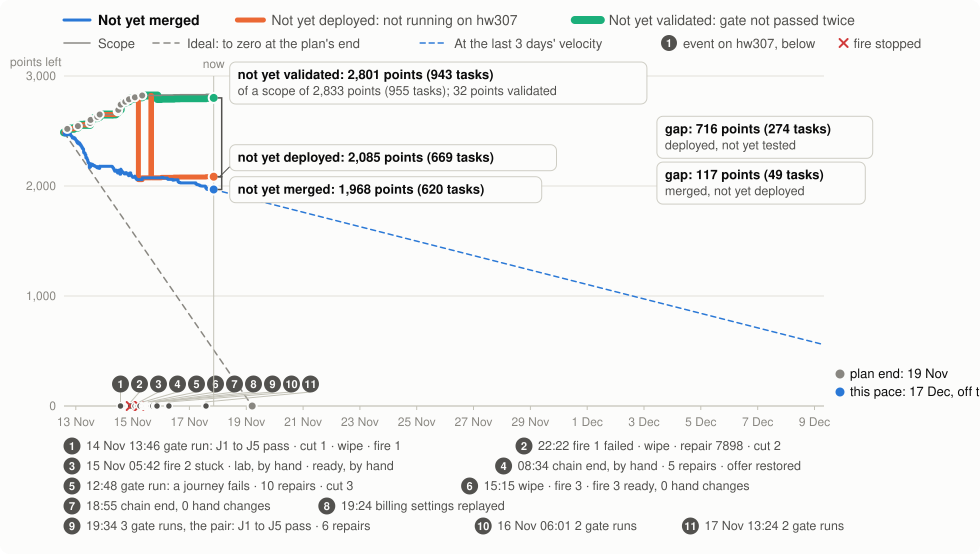</a> <a href="#burndown-in-story-points">Burndown: story points not yet merged, not yet deployed, not yet validated</a></td></tr>
<tr><td align="center" valign="top"><a href="#velocity-story-points-merged-per-day">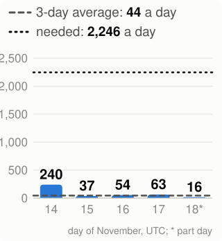</a> <a href="#velocity-story-points-merged-per-day">Velocity: points merged a day</a></td><td align="center" valign="top"><a href="#is-it-real-delivery-and-quality-measured">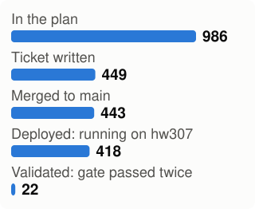</a> <a href="#is-it-real-delivery-and-quality-measured">From plan to proof</a></td><td align="center" valign="top"><a href="#is-it-real-delivery-and-quality-measured">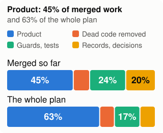</a> <a href="#is-it-real-delivery-and-quality-measured">Kind of work merged</a></td><td align="center" valign="top"><a href="#the-product-where-it-started-and-where-it-is-now">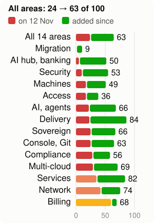</a> <a href="#the-product-where-it-started-and-where-it-is-now">Score per area: start, now</a></td></tr>
<tr><td align="center" valign="top"><a href="#where-we-started-and-where-we-are-to-scale">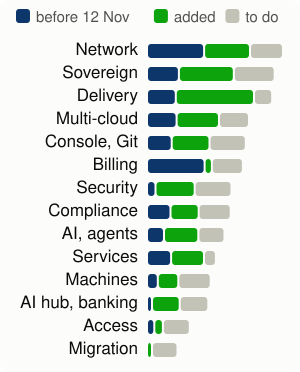</a> <a href="#where-we-started-and-where-we-are-to-scale">Size per area: built, added, to do</a></td><td align="center" valign="top"><a href="#when-each-product-area-is-worked-on">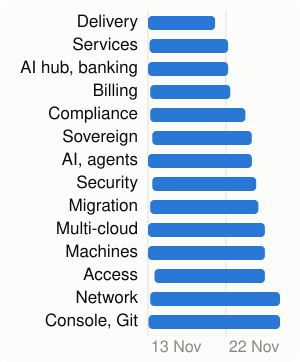</a> <a href="#when-each-product-area-is-worked-on">When each area is worked on</a></td><td colspan="2" align="center" valign="top"><a href="#every-epic-to-scale">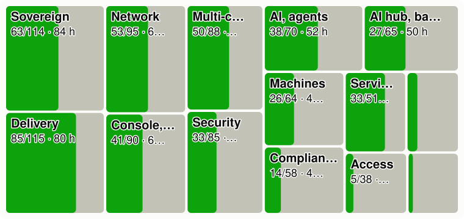</a> <a href="#every-epic-to-scale">Every area by effort, merged share in green</a></td></tr>
</table>

**Dates, and what each depends on.**

- **The plan's end, merged: target 19 Nov 05:02 UTC.** The target has passed; the last 72 hours merged 37 a day, which ends about **7 Jan** if the scope stops growing. The plan's dates count merges only. Validation has one measurement so far (the gate pair of 15 November), too few for a pace, so the dates are not yet re-based on it.
- **The new mothership on Hetzner can host new projects the standard way: likely 20 Nov 12:00 UTC** (earliest 16 Nov 02:00, could slip to 25 Nov). Depends on a Hetzner API token with raised project limits (neither exists today); a candidate that reaches a green gate on hw307 first (likely 17 Nov 12:00, could slip to 19 Nov); and how many Hetzner-only defects appear, as the Hetzner pack has not been installed since 22 May.
- **The last name has moved off the old mothership node: likely 2 Dec 18:00 UTC** (earliest 21 Nov 18:00, could slip to 20 Dec); the old node is switched off seven quiet days later, likely 9 Dec. Depends on the mothership as an installable mode, with the move of the child records (never done before); the mail move (port 25 on a new address, reverse DNS, sender reputation); and Blueprints for our own applications, two of which have no chart yet.
- The two mothership dates are those of its plan of 15 Nov 07:30 UTC.

**Today in five lines** (the 24 hours to 12:00 UTC on 24 Nov):

1. **Fires:** none in the last 24 hours.
2. **Installation:** A gate run on hw307 ended FAIL: a journey fails, 38 of 53 checks passed; it names candidate 20261123T074334Z-e46c1d8. A gate run on hw307 ended FAIL: a journey fails, 39 of 54 checks passed; it names candidate 20261123T074334Z-e46c1d8.
3. **Repairs of main merged: 0**.
4. **Plan tasks merged: 28**, 83 points: FND-183, FND-161, FND-192, FND-201, CTL-170, FND-184, FND-162, CTL-800, ACC-010, CMP-020, FND-202, CTL-172, CTL-820, FND-163 and 14 more.
5. **On the environment:** no candidate, no wipe and no restore.

# Details

## On the environment: what is deployed and what is not

Measured from git and the gate records on main at 12:00 UTC. Merged means the task's done marker is on main. Deployed means its merge commit is in the commit the environment runs: `rc/20261121T082107Z-da6a872` since 21 Nov 09:38 UTC. Validated means it passed in two gate runs on that installation.

| State of the merged tasks | Tasks |
|---|---|
| Merged in total | 514 |
| **Deployed**: in the commit the environment runs | **479** |
| — of these, needed a hand change on this installation, repaired on main since | 0 |
| **Validated**: green in the gate tool's verdict, on a pair of gate runs on the environment | **3** |
| **Merged, NOT deployed**: merged after the commit the environment runs | **35** |
| How the merged tasks are proven: on a running environment, by a fresh installation, with no environment (CI checks, guards, tests, records, lab results) | 238, 86, 190 |

**The next installation.** The environment is not updated in place: each candidate cut from main is installed fresh, after a wipe. The next one waits for the last open repair of main, then a quiet main, a new candidate, a dump of the environment's databases and the wipe; what stands in the way now is at the top of this page. On that installation the gate runs twice with the candidate's id, and only then does a task count as validated.

### Deployed (479)

Deployed counts merged tasks whose merge commit is an ancestor of the commit the environment runs: hw307 runs candidate `rc/20261121T082107Z-da6a872` since 21 Nov 09:38 UTC, which holds 479 of the 514 merged tasks. Deployed is not tested: a task counts as tested only when the gate tool's verdict calls every check it delivers green, on a pair of gate runs made while the environment ran a candidate that holds it. That installation was made with 0 hand changes. The installation work (candidates, fires, the lab run, the repairs of main) is in the burndown at the top of this page and in Today in five lines.

| Task | What it does | State on the environment |
|---|---|---|
| [AIP-040](plan/tickets/AIP-040.md) | Switch off the header-trusting metering sidecar | deployed in `rc/20261121T082107Z-da6a872`, not yet validated |
| [AIP-041](plan/tickets/AIP-041.md) | The quota model of an Organization follows the gateway Pod without the metering sidecar | deployed in `rc/20261121T082107Z-da6a872`, not yet validated |
| [AIP-042](plan/tickets/AIP-042.md) | Check AIP-G01 judges running containers only | deployed in `rc/20261121T082107Z-da6a872`, not yet validated |
| [AIP-070](plan/tickets/AIP-070.md) | Delete the hollow gateway charts | deployed in `rc/20261121T082107Z-da6a872`, not yet validated |
| [AIP-101](plan/tickets/AIP-101.md) | Axon builds against the pinned kit and gets a test rail | deployed in `rc/20261121T082107Z-da6a872`, not yet validated |
| [AIP-102](plan/tickets/AIP-102.md) | Tool calls passed through; no shared sessions | deployed in `rc/20261121T082107Z-da6a872`, not yet validated |
| [AIP-103](plan/tickets/AIP-103.md) | Real streaming and real usage | deployed in `rc/20261121T082107Z-da6a872`, not yet validated |
| [AIP-104](plan/tickets/AIP-104.md) | Limits, queue, time-outs, admin listener | deployed in `rc/20261121T082107Z-da6a872`, not yet validated |
| [AIP-105](plan/tickets/AIP-105.md) | One owner of the credential | deployed in `rc/20261121T082107Z-da6a872`, not yet validated |
| [AIP-108](plan/tickets/AIP-108.md) | Shrink Axon | deployed in `rc/20261121T082107Z-da6a872`, not yet validated |
| [AIP-111](plan/tickets/AIP-111.md) | Move the sidecar, take identity from the gateway, publish quantity | deployed in `rc/20261121T082107Z-da6a872`, not yet validated |
| [AIP-112](plan/tickets/AIP-112.md) | Streamed responses are metered | deployed in `rc/20261121T082107Z-da6a872`, not yet validated |
| [AIP-113](plan/tickets/AIP-113.md) | Durable spool and admin routes | deployed in `rc/20261121T082107Z-da6a872`, not yet validated |
| [AIP-114](plan/tickets/AIP-114.md) | Scripted back end: the stub subcommand | deployed in `rc/20261121T082107Z-da6a872`, not yet validated |
| [AIP-120](plan/tickets/AIP-120.md) | Agent tokens and the signer key set route | deployed in `rc/20261121T082107Z-da6a872`, not yet validated |
| [AIP-130](plan/tickets/AIP-130.md) | Model contract conformance client | deployed in `rc/20261121T082107Z-da6a872`, not yet validated |
| [AIP-131](plan/tickets/AIP-131.md) | Model checks AIP-G02 to AIP-G05 as expected-fail | deployed in `rc/20261121T082107Z-da6a872`, not yet validated |
| [AIP-150](plan/tickets/AIP-150.md) | The tool server accepts agent tokens | deployed in `rc/20261121T082107Z-da6a872`, not yet validated |
| [AIP-151](plan/tickets/AIP-151.md) | Tool answers are fitted and made inert | deployed in `rc/20261121T082107Z-da6a872`, not yet validated |
| [AIP-152](plan/tickets/AIP-152.md) | The tool server reads its bearer from a file at every call | deployed in `rc/20261121T082107Z-da6a872`, not yet validated |
| [AIP-153](plan/tickets/AIP-153.md) | The token route admits the workspace of each Organization for its own Organization | deployed in `rc/20261121T082107Z-da6a872`, not yet validated |
| [AIP-154](plan/tickets/AIP-154.md) | An agent token acts for a person of tier admin, for create_application only | deployed in `rc/20261121T082107Z-da6a872`, not yet validated |
| [AIP-155](plan/tickets/AIP-155.md) | Agent workspace: the Organization's own sign-in by mount and a short-lived tool identity, as the spike record says | deployed in `rc/20261121T082107Z-da6a872`, not yet validated |
| [AIP-221](plan/tickets/AIP-221.md) | Service skeleton, schema with migrations, outbox table, health | deployed in `rc/20261121T082107Z-da6a872`, not yet validated |
| [AIP-222](plan/tickets/AIP-222.md) | Signal intake, grouping, candidate scoring, rule results | deployed in `rc/20261121T082107Z-da6a872`, not yet validated |
| [AIP-223](plan/tickets/AIP-223.md) | Judge dispatcher: lanes, deadlines, agent tokens, A2A call, validation, late revision | deployed in `rc/20261121T082107Z-da6a872`, not yet validated |
| [AIP-224](plan/tickets/AIP-224.md) | Guard library agentguard and its adversarial corpus | deployed in `rc/20261121T082107Z-da6a872`, not yet validated |
| [AIP-225](plan/tickets/AIP-225.md) | MCP endpoint and console HTTP routes inside the service | deployed in `rc/20261121T082107Z-da6a872`, not yet validated |
| [AIP-227](plan/tickets/AIP-227.md) | Console read path: reverse proxy /api/v1/ops/* in catalyst-api | deployed in `rc/20261121T082107Z-da6a872`, not yet validated |
| [AIP-229](plan/tickets/AIP-229.md) | Operations records: PostgreSQL store with migration 0001 and the ops-records program | deployed in `rc/20261121T082107Z-da6a872`, not yet validated |
| [BSS-030](plan/tickets/BSS-030.md) | Order capture never prices from a second list | deployed in `rc/20261121T082107Z-da6a872`, not yet validated |
| [BSS-035](plan/tickets/BSS-035.md) | The storefront says when prices are unavailable | deployed in `rc/20261121T082107Z-da6a872`, not yet validated |
| [BSS-040](plan/tickets/BSS-040.md) | Delete core/marketplace-api | deployed in `rc/20261121T082107Z-da6a872`, not yet validated |
| [BSS-060](plan/tickets/BSS-060.md) | Gate check: self-service onboarding | deployed in `rc/20261121T082107Z-da6a872`, not yet validated |
| [CLD-021](plan/tickets/CLD-021.md) | Delete the 24 infrastructure mutation routes and the claim writer | deployed in `rc/20261121T082107Z-da6a872`, not yet validated |
| [CLD-022](plan/tickets/CLD-022.md) | Delete the infrastructure mutation dialogs from the console | deployed in `rc/20261121T082107Z-da6a872`, not yet validated |
| [CLD-061](plan/tickets/CLD-061.md) | Crossplane 1.18 to 1.19 | deployed in `rc/20261121T082107Z-da6a872`, not yet validated |
| [CLD-062](plan/tickets/CLD-062.md) | Crossplane 1.19 to 1.20 | deployed in `rc/20261121T082107Z-da6a872`, not yet validated |
| [CLD-065](plan/tickets/CLD-065.md) | Crossplane 1.20 to 2.4 | deployed in `rc/20261121T082107Z-da6a872`, not yet validated |
| [CLD-067](plan/tickets/CLD-067.md) | Gate check CLD-G06 as a suite file | deployed in `rc/20261121T082107Z-da6a872`, not yet validated |
| [CLD-091](plan/tickets/CLD-091.md) | The local pack connects the meshes of its two regions | deployed in `rc/20261121T082107Z-da6a872`, not yet validated |
| [CLD-093](plan/tickets/CLD-093.md) | Contract rule: adding a region plans only additions | deployed in `rc/20261121T082107Z-da6a872`, not yet validated |
| [CLD-094](plan/tickets/CLD-094.md) | Standing check CLD-G12: the plan of a provisioned deployment shows no change | deployed in `rc/20261121T082107Z-da6a872`, not yet validated |
| [CLD-101](plan/tickets/CLD-101.md) | Golden files for the variables the engine writes | deployed in `rc/20261121T082107Z-da6a872`, not yet validated |
| [CLD-102](plan/tickets/CLD-102.md) | Delete the dead Provision method of the provider port | deployed in `rc/20261121T082107Z-da6a872`, not yet validated |
| [CLD-103](plan/tickets/CLD-103.md) | Credentials map, validation through the port, storage class from the profile | deployed in `rc/20261121T082107Z-da6a872`, not yet validated |
| [CLD-104](plan/tickets/CLD-104.md) | The engine writes neutral variables; adapters write their own | deployed in `rc/20261121T082107Z-da6a872`, not yet validated |
| [CLD-105](plan/tickets/CLD-105.md) | Post-apply and apply-error hooks become capability interfaces | deployed in `rc/20261121T082107Z-da6a872`, not yet validated |
| [CLD-108](plan/tickets/CLD-108.md) | Generated provider registry | deployed in `rc/20261121T082107Z-da6a872`, not yet validated |
| [CLD-109](plan/tickets/CLD-109.md) | Port interface, capability interfaces | deployed in `rc/20261121T082107Z-da6a872`, not yet validated |
| [CLD-111](plan/tickets/CLD-111.md) | Wipe and janitor through capabilities | deployed in `rc/20261121T082107Z-da6a872`, not yet validated |
| [CLD-112](plan/tickets/CLD-112.md) | Credential check from the profile; one registry | deployed in `rc/20261121T082107Z-da6a872`, not yet validated |
| [CLD-115](plan/tickets/CLD-115.md) | The VPC pre-flight becomes the Huawei adapter's Preflighter | deployed in `rc/20261121T082107Z-da6a872`, not yet validated |
| [CLD-116](plan/tickets/CLD-116.md) | The wipe removes first what its own destroy cannot remove on the reference cloud, and says so | deployed in `rc/20261121T082107Z-da6a872`, not yet validated |
| [CLD-161](plan/tickets/CLD-161.md) | Installation document for the installation in use | deployed in `rc/20261121T082107Z-da6a872`, not yet validated |
| [CMP-010](plan/tickets/CMP-010.md) | Gate checks: the score moves by push; the shown mode is the engine's mode | deployed in `rc/20261121T082107Z-da6a872`, not yet validated |
| [CMP-016](plan/tickets/CMP-016.md) | An optional informer kind starts when its definition arrives | deployed in `rc/20261121T082107Z-da6a872`, not yet validated |
| [CMP-030](plan/tickets/CMP-030.md) | Package internal/compliance: types and pure score functions | deployed in `rc/20261121T082107Z-da6a872`, not yet validated |
| [CMP-073](plan/tickets/CMP-073.md) | The bootstrap window follows the hand-over variable | deployed in `rc/20261121T082107Z-da6a872`, not yet validated |
| [CTL-030](plan/tickets/CTL-030.md) | Delete the endpoint pipeline and the two duplicate registrations | deployed in `rc/20261121T082107Z-da6a872`, not yet validated |
| [CTL-035](plan/tickets/CTL-035.md) | Route registration leaves main() | deployed in `rc/20261121T082107Z-da6a872`, not yet validated |
| [CTL-038](plan/tickets/CTL-038.md) | The API accepts a Job's service-account token, confined to one Organization | deployed in `rc/20261121T082107Z-da6a872`, not yet validated |
| [CTL-039](plan/tickets/CTL-039.md) | Read routes for the region registry and the Environment list | deployed in `rc/20261121T082107Z-da6a872`, not yet validated |
| [CTL-040](plan/tickets/CTL-040.md) | Flux manifests to stable API versions | deployed in `rc/20261121T082107Z-da6a872`, not yet validated |
| [CTL-110](plan/tickets/CTL-110.md) | Commit library gitwrite | deployed in `rc/20261121T082107Z-da6a872`, not yet validated |
| [CTL-112](plan/tickets/CTL-112.md) | Region scopes of the commit library | deployed in `rc/20261121T082107Z-da6a872`, not yet validated |
| [CTL-150](plan/tickets/CTL-150.md) | Intent lock in audit mode, with its report | deployed in `rc/20261121T082107Z-da6a872`, not yet validated |
| [CTL-151](plan/tickets/CTL-151.md) | Intent-lock report and the check that the lock holds | deployed in `rc/20261121T082107Z-da6a872`, not yet validated |
| [CTL-160](plan/tickets/CTL-160.md) | Package intent: validate, serialise, commit, wait | deployed in `rc/20261121T082107Z-da6a872`, not yet validated |
| [CTL-223](plan/tickets/CTL-223.md) | Settings, Menu accepts console pages as menu candidates | deployed in `rc/20261121T082107Z-da6a872`, not yet validated |
| [CTL-230](plan/tickets/CTL-230.md) | Batch F: resource browser | deployed in `rc/20261121T082107Z-da6a872`, not yet validated |
| [CTL-231](plan/tickets/CTL-231.md) | Resource browser: Git-owned objects refused, break-glass for the rest | deployed in `rc/20261121T082107Z-da6a872`, not yet validated |
| [CTL-233](plan/tickets/CTL-233.md) | Console: Git-owned objects show Managed by Git | deployed in `rc/20261121T082107Z-da6a872`, not yet validated |
| [CTL-240](plan/tickets/CTL-240.md) | Batch G: catalogue writers onto the library | deployed in `rc/20261121T082107Z-da6a872`, not yet validated |
| [CTL-300](plan/tickets/CTL-300.md) | The running stream is the declared one | deployed in `rc/20261121T082107Z-da6a872`, not yet validated |
| [CTL-320](plan/tickets/CTL-320.md) | Durable audit | deployed in `rc/20261121T082107Z-da6a872`, not yet validated |
| [CTL-330](plan/tickets/CTL-330.md) | The services stop building the Kafka client | deployed in `rc/20261121T082107Z-da6a872`, not yet validated |
| [CTL-331](plan/tickets/CTL-331.md) | The shared events package is Kafka-free | deployed in `rc/20261121T082107Z-da6a872`, not yet validated |
| [CTL-332](plan/tickets/CTL-332.md) | The service modules no longer require the Kafka client | deployed in `rc/20261121T082107Z-da6a872`, not yet validated |
| [CTL-333](plan/tickets/CTL-333.md) | The org-services chart stops setting REDPANDA_BROKERS | deployed in `rc/20261121T082107Z-da6a872`, not yet validated |
| [CTL-340](plan/tickets/CTL-340.md) | Jobs store subscribe; flow stream event-driven; jobs stream route | deployed in `rc/20261121T082107Z-da6a872`, not yet validated |
| [CTL-345](plan/tickets/CTL-345.md) | The flow endpoints answer only from the local store; check CTL-G12 | deployed in `rc/20261121T082107Z-da6a872`, not yet validated |
| [CTL-347](plan/tickets/CTL-347.md) | The flow server and adapter sources, charts and builds are deleted | deployed in `rc/20261121T082107Z-da6a872`, not yet validated |
| [CTL-350](plan/tickets/CTL-350.md) | Applications views from the informer cache | deployed in `rc/20261121T082107Z-da6a872`, not yet validated |
| [CTL-355](plan/tickets/CTL-355.md) | Delete the second showback meter | deployed in `rc/20261121T082107Z-da6a872`, not yet validated |
| [CTL-420](plan/tickets/CTL-420.md) | Watches in the organization and environment controllers | deployed in `rc/20261121T082107Z-da6a872`, not yet validated |
| [CTL-700](plan/tickets/CTL-700.md) | Pull-request mode of the commit library | deployed in `rc/20261121T082107Z-da6a872`, not yet validated |
| [FND-014](plan/tickets/FND-014.md) | A deployment may name the Git ref it follows | deployed in `rc/20261121T082107Z-da6a872`, not yet validated |
| [FND-032](plan/tickets/FND-032.md) | Record version 2 and the check registry | deployed in `rc/20261121T082107Z-da6a872`, not yet validated |
| [FND-033](plan/tickets/FND-033.md) | Checks: candidate identity, zero touch, nodes, releases and pods | deployed in `rc/20261121T082107Z-da6a872`, not yet validated |
| [FND-034](plan/tickets/FND-034.md) | Checks: NodePort, front doors, mesh, encryption, clean wipe; journeys as checks | deployed in `rc/20261121T082107Z-da6a872`, not yet validated |
| [FND-035](plan/tickets/FND-035.md) | The gate workflow | deployed in `rc/20261121T082107Z-da6a872`, not yet validated |
| [FND-036](plan/tickets/FND-036.md) | Sign-in as a gate check | deployed in `rc/20261121T082107Z-da6a872`, not yet validated |
| [FND-039](plan/tickets/FND-039.md) | The suite writes the provision block of a cloud record | deployed in `rc/20261121T082107Z-da6a872`, not yet validated |
| [FND-041](plan/tickets/FND-041.md) | The suite selects only the checks that are Go files of the suite | deployed in `rc/20261121T082107Z-da6a872`, not yet validated |
| [FND-070](plan/tickets/FND-070.md) | Baseline: one fresh provision of `main` as it stands | deployed in `rc/20261121T082107Z-da6a872`, not yet validated |
| [FND-073](plan/tickets/FND-073.md) | The gate runs twice against the standing environment once it carries the candidate, with no wipe | deployed in `rc/20261121T082107Z-da6a872`, not yet validated |
| [FND-075](plan/tickets/FND-075.md) | The gate record carries the pre-flight numbers: quota headroom and the leftover count | deployed in `rc/20261121T082107Z-da6a872`, not yet validated |
| [FND-076](plan/tickets/FND-076.md) | The standing environment is updated through the release route by a workflow of the repository | deployed in `rc/20261121T082107Z-da6a872`, not yet validated |
| [FND-077](plan/tickets/FND-077.md) | The flight sweep counts the DNS records a wiped deployment left | deployed in `rc/20261121T082107Z-da6a872`, not yet validated |
| [FND-078](plan/tickets/FND-078.md) | The gate's cluster jobs run as a Job on the parent | deployed in `rc/20261121T082107Z-da6a872`, not yet validated |
| [FND-079](plan/tickets/FND-079.md) | The gate has a scoped access to the parent | deployed in `rc/20261121T082107Z-da6a872`, not yet validated |
| [FND-089](plan/tickets/FND-089.md) | The storefront offers no Sandbox agent picks and the order request carries no agents field | deployed in `rc/20261121T082107Z-da6a872`, not yet validated |
| [FND-093](plan/tickets/FND-093.md) | Remove the Sandbox surface of the API | deployed in `rc/20261121T082107Z-da6a872`, not yet validated |
| [FND-094](plan/tickets/FND-094.md) | Remove the Sandbox pages of the console | deployed in `rc/20261121T082107Z-da6a872`, not yet validated |
| [FND-095](plan/tickets/FND-095.md) | Remove the Sandbox orchestrator, grants and cutover entries | deployed in `rc/20261121T082107Z-da6a872`, not yet validated |
| [FND-097](plan/tickets/FND-097.md) | Remove the unshipped console, the one job that drives it and the tests that only target it | deployed in `rc/20261121T082107Z-da6a872`, not yet validated |
| [FND-130](plan/tickets/FND-130.md) | The gate suite runs on the local provider pack on every pull request | deployed in `rc/20261121T082107Z-da6a872`, not yet validated |
| [FND-131](plan/tickets/FND-131.md) | A run without journeys asserts only what the pack holds: discovery of the journey objects is left out, and the scope check is a cloud check | deployed in `rc/20261121T082107Z-da6a872`, not yet validated |
| [FND-151](plan/tickets/FND-151.md) | The suite as an image, with the `self` selection | deployed in `rc/20261121T082107Z-da6a872`, not yet validated |
| [FND-153](plan/tickets/FND-153.md) | The suite image and its signed build | deployed in `rc/20261121T082107Z-da6a872`, not yet validated |
| [FND-154](plan/tickets/FND-154.md) | Check FND-G01 in its `self` form | deployed in `rc/20261121T082107Z-da6a872`, not yet validated |
| [FND-155](plan/tickets/FND-155.md) | The `self` selection run by a Job on the local provider pack | deployed in `rc/20261121T082107Z-da6a872`, not yet validated |
| [FND-156](plan/tickets/FND-156.md) | The conformance account exists on every Sovereign | deployed in `rc/20261121T082107Z-da6a872`, not yet validated |
| [FND-157](plan/tickets/FND-157.md) | A gate run reads the storefront's sign-in code from a mailbox on the Sovereign under test | deployed in `rc/20261121T082107Z-da6a872`, not yet validated |
| [FND-171](plan/tickets/FND-171.md) | Remove the fabricated playback route and its preflight route | deployed in `rc/20261121T082107Z-da6a872`, not yet validated |
| [FND-207](plan/tickets/FND-207.md) | A check stays green on the newest valid pair until a newer record says otherwise | deployed in `rc/20261121T082107Z-da6a872`, not yet validated |
| [INF-040](plan/tickets/INF-040.md) | Chart bp-kured with the node patch configuration | deployed in `rc/20261121T082107Z-da6a872`, not yet validated |
| [INF-051](plan/tickets/INF-051.md) | Check INF-G01: coordinated reboot, as a suite file | deployed in `rc/20261121T082107Z-da6a872`, not yet validated |
| [INF-052](plan/tickets/INF-052.md) | Check INF-G01: upgrade windows and recovery; set to required | deployed in `rc/20261121T082107Z-da6a872`, not yet validated |
| [INF-053](plan/tickets/INF-053.md) | Capability flag node-reboot: a gate run restarts nodes only when it declares the flag | deployed in `rc/20261121T082107Z-da6a872`, not yet validated |
| [INF-056](plan/tickets/INF-056.md) | Check INF-G01 restarts the node of the registry's front and requires every moved Pod back and no container waiting on an image | deployed in `rc/20261121T082107Z-da6a872`, not yet validated |
| [INF-057](plan/tickets/INF-057.md) | Check INF-G01 requires every moved workload back within 180 seconds of leaving the worker | deployed in `rc/20261121T082107Z-da6a872`, not yet validated |
| [INF-110](plan/tickets/INF-110.md) | Kinds Machine and MachineSource; inventory controller with the node source | deployed in `rc/20261121T082107Z-da6a872`, not yet validated |
| [INF-112](plan/tickets/INF-112.md) | Chart templates and image for the inventory controller | deployed in `rc/20261121T082107Z-da6a872`, not yet validated |
| [INF-120](plan/tickets/INF-120.md) | Runner image and node-mode tasks | deployed in `rc/20261121T082107Z-da6a872`, not yet validated |
| [INF-130](plan/tickets/INF-130.md) | Kinds ScanPolicy, HardeningBaseline, MachineRun; operations controller | deployed in `rc/20261121T082107Z-da6a872`, not yet validated |
| [INF-132](plan/tickets/INF-132.md) | Chart templates for the operations controller | deployed in `rc/20261121T082107Z-da6a872`, not yet validated |
| [INF-133](plan/tickets/INF-133.md) | Check INF-G02: node host scans, as a suite file | deployed in `rc/20261121T082107Z-da6a872`, not yet validated |
| [INF-140](plan/tickets/INF-140.md) | Vulnerability matching and daily re-matching | deployed in `rc/20261121T082107Z-da6a872`, not yet validated |
| [INF-512](plan/tickets/INF-512.md) | Runner test task: arguments, target check and Nuclei (profile network-passive) | deployed in `rc/20261121T082107Z-da6a872`, not yet validated |
| [INF-513](plan/tickets/INF-513.md) | Runner test task: the ZAP baseline scan and its SARIF report (profile web-passive) | deployed in `rc/20261121T082107Z-da6a872`, not yet validated |
| [NET-013](plan/tickets/NET-013.md) | The gate dials the API port from an address in no list | deployed in `rc/20261121T082107Z-da6a872`, not yet validated |
| [NET-030](plan/tickets/NET-030.md) | Retired names lose their policy privileges | deployed in `rc/20261121T082107Z-da6a872`, not yet validated |
| [NET-032](plan/tickets/NET-032.md) | Reserve platform namespace names as Organization slugs | deployed in `rc/20261121T082107Z-da6a872`, not yet validated |
| [NET-041](plan/tickets/NET-041.md) | Remove the firewall claims from the storefront and the console | deployed in `rc/20261121T082107Z-da6a872`, not yet validated |
| [NET-042](plan/tickets/NET-042.md) | Retire the two legacy per-Sovereign overlays | deployed in `rc/20261121T082107Z-da6a872`, not yet validated |
| [NET-060](plan/tickets/NET-060.md) | Read-only census of the network posture | deployed in `rc/20261121T082107Z-da6a872`, not yet validated |
| [NET-070](plan/tickets/NET-070.md) | Wizard shows what the provisioner builds | deployed in `rc/20261121T082107Z-da6a872`, not yet validated |
| [NET-071](plan/tickets/NET-071.md) | Remove the zone virtual-cluster dialog, tab and stub kind | deployed in `rc/20261121T082107Z-da6a872`, not yet validated |
| [NET-072](plan/tickets/NET-072.md) | Placement selectors offer the host only | deployed in `rc/20261121T082107Z-da6a872`, not yet validated |
| [NET-080](plan/tickets/NET-080.md) | Pin the Organization virtual cluster chart | deployed in `rc/20261121T082107Z-da6a872`, not yet validated |
| [NET-095](plan/tickets/NET-095.md) | Policy chart: only the deny of the instance metadata address by default | deployed in `rc/20261121T082107Z-da6a872`, not yet validated |
| [NET-097](plan/tickets/NET-097.md) | Gate check NET-G10: a Pod cannot reach the instance metadata address | deployed in `rc/20261121T082107Z-da6a872`, not yet validated |
| [NET-098](plan/tickets/NET-098.md) | The Hetzner storage node plugin is allowed to read instance metadata | deployed in `rc/20261121T082107Z-da6a872`, not yet validated |
| [NET-103](plan/tickets/NET-103.md) | Gate check NET-G18: full-size transfers between two workers over the node network, in each region and across regions | deployed in `rc/20261121T082107Z-da6a872`, not yet validated |
| [NET-125](plan/tickets/NET-125.md) | Mesh status read, and a mode switch, in the API | deployed in `rc/20261121T082107Z-da6a872`, not yet validated |
| [NET-133](plan/tickets/NET-133.md) | A local-affinity decision on every global Service | deployed in `rc/20261121T082107Z-da6a872`, not yet validated |
| [NET-135](plan/tickets/NET-135.md) | The plane-isolation policies admit the cross-region file sync and the snapshot job, and no longer depend on which namespaces exist at render time | deployed in `rc/20261121T082107Z-da6a872`, not yet validated |
| [NET-150](plan/tickets/NET-150.md) | Default-deny scaffolding and dial checks | deployed in `rc/20261121T082107Z-da6a872`, not yet validated |
| [NET-170](plan/tickets/NET-170.md) | Organization fence: two host-side deny objects for the Organization's own pods | deployed in `rc/20261121T082107Z-da6a872`, not yet validated |
| [NET-172](plan/tickets/NET-172.md) | Gate check NET-G07: Organization isolation, journey ISO in both regions | deployed in `rc/20261121T082107Z-da6a872`, not yet validated |
| [NET-212](plan/tickets/NET-212.md) | Show the separation; refuse the claim when it is none | deployed in `rc/20261121T082107Z-da6a872`, not yet validated |
| [NET-213](plan/tickets/NET-213.md) | The console states the region separation | deployed in `rc/20261121T082107Z-da6a872`, not yet validated |
| [NET-255](plan/tickets/NET-255.md) | Journey WAF, its corpus and gate check NET-G15 as expected-fail | deployed in `rc/20261121T082107Z-da6a872`, not yet validated |
| [PRD-101](plan/tickets/PRD-101.md) | Vendor the six public documents and write the profile | deployed in `rc/20261121T082107Z-da6a872`, not yet validated |
| [PRD-102](plan/tickets/PRD-102.md) | Generated types and server interfaces (oapi-codegen, strict server) | deployed in `rc/20261121T082107Z-da6a872`, not yet validated |
| [PRD-103](plan/tickets/PRD-103.md) | Ledger port and conformance kit | deployed in `rc/20261121T082107Z-da6a872`, not yet validated |
| [PRD-104](plan/tickets/PRD-104.md) | Consent package | deployed in `rc/20261121T082107Z-da6a872`, not yet validated |
| [PRD-105](plan/tickets/PRD-105.md) | Token package | deployed in `rc/20261121T082107Z-da6a872`, not yet validated |
| [PRD-202](plan/tickets/PRD-202.md) | cortex store: migrations, roles, trimmed query | deployed in `rc/20261121T082107Z-da6a872`, not yet validated |
| [PRD-203](plan/tickets/PRD-203.md) | cortex query process: token check, gateway client, search, definitions loader | deployed in `rc/20261121T082107Z-da6a872`, not yet validated |
| [PRD-204](plan/tickets/PRD-204.md) | cortex ingestion of uploads: job table, upload and document routes, index process, text parser, chunker, events stream | deployed in `rc/20261121T082107Z-da6a872`, not yet validated |
| [PRD-205](plan/tickets/PRD-205.md) | Assistants: models list, answers with citations, residency refusal | deployed in `rc/20261121T082107Z-da6a872`, not yet validated |
| [PRD-206](plan/tickets/PRD-206.md) | cortex screens | deployed in `rc/20261121T082107Z-da6a872`, not yet validated |
| [PRD-211](plan/tickets/PRD-211.md) | Document conversion parser | deployed in `rc/20261121T082107Z-da6a872`, not yet validated |
| [PRD-501](plan/tickets/PRD-501.md) | Resource server base: store, definitions loader, router with the token check, account-access consent resources, not-offered answers | deployed in `rc/20261121T082107Z-da6a872`, not yet validated |
| [PRD-502](plan/tickets/PRD-502.md) | Sandbox ledger | deployed in `rc/20261121T082107Z-da6a872`, not yet validated |
| [PRD-503](plan/tickets/PRD-503.md) | Keycloak consent extension | deployed in `rc/20261121T082107Z-da6a872`, not yet validated |
| [PRD-508](plan/tickets/PRD-508.md) | Account-information read operations and the ledger client | deployed in `rc/20261121T082107Z-da6a872`, not yet validated |
| [PRD-509](plan/tickets/PRD-509.md) | Internal authorisation API | deployed in `rc/20261121T082107Z-da6a872`, not yet validated |
| [PRD-513](plan/tickets/PRD-513.md) | Resource server: PostgreSQL consent store with migration 0001, the definitions informer and the fingate-api program | deployed in `rc/20261121T082107Z-da6a872`, not yet validated |
| [PRD-800](plan/tickets/PRD-800.md) | Adapter template for a second bank | deployed in `rc/20261121T082107Z-da6a872`, not yet validated |
| [SEC-010](plan/tickets/SEC-010.md) | Close the public route to OpenBao system paths | deployed in `rc/20261121T082107Z-da6a872`, not yet validated |
| [SEC-071](plan/tickets/SEC-071.md) | Ratchet on passwords the provisioning service writes to Git | deployed in `rc/20261121T082107Z-da6a872`, not yet validated |
| [SEC-073](plan/tickets/SEC-073.md) | Remove the committed database passwords and rotate them | deployed in `rc/20261121T082107Z-da6a872`, not yet validated |
| [SEC-080](plan/tickets/SEC-080.md) | External Secrets quick scope | deployed in `rc/20261121T082107Z-da6a872`, not yet validated |
| [SEC-103](plan/tickets/SEC-103.md) | Remove the SealedSecret templates from the guacamole and netbird charts | deployed in `rc/20261121T082107Z-da6a872`, not yet validated |
| [SEC-105](plan/tickets/SEC-105.md) | Delete Sealed Secrets | deployed in `rc/20261121T082107Z-da6a872`, not yet validated |
| [SEC-120](plan/tickets/SEC-120.md) | etcd dump check and node hygiene check, as check files | deployed in `rc/20261121T082107Z-da6a872`, not yet validated |
| [SEC-161](plan/tickets/SEC-161.md) | Reconciler: secrets mounts and accessor substitution | deployed in `rc/20261121T082107Z-da6a872`, not yet validated |
| [SOV-030](plan/tickets/SOV-030.md) | Wipe refuses a handed-over Sovereign without confirmation | deployed in `rc/20261121T082107Z-da6a872`, not yet validated |
| [SOV-035](plan/tickets/SOV-035.md) | Delete the ProvisioningState kind and its unwired store | deployed in `rc/20261121T082107Z-da6a872`, not yet validated |
| [SOV-110](plan/tickets/SOV-110.md) | Contract C5: schema, kit key list, the upstream package and its validator | deployed in `rc/20261121T082107Z-da6a872`, not yet validated |
| [SOV-120](plan/tickets/SOV-120.md) | The sovereign-ops command and its image | deployed in `rc/20261121T082107Z-da6a872`, not yet validated |
| [SOV-121](plan/tickets/SOV-121.md) | The seed-repo command of sovereign-ops | deployed in `rc/20261121T082107Z-da6a872`, not yet validated |
| [SOV-135](plan/tickets/SOV-135.md) | The mothership registry name is a proxy name served at the root, with an origin address per provider | deployed in `rc/20261121T082107Z-da6a872`, not yet validated |
| [SOV-137](plan/tickets/SOV-137.md) | The registry pivot keeps the nodes' shared mirror first and starts with the outside blocked | deployed in `rc/20261121T082107Z-da6a872`, not yet validated |
| [SOV-138](plan/tickets/SOV-138.md) | No single Pod on the registry's pull path: Harbor's front, core and registry and the cluster DNS run two copies across nodes with a disruption budget | deployed in `rc/20261121T082107Z-da6a872`, not yet validated |
| [SOV-150](plan/tickets/SOV-150.md) | Kit sources become substitutions, with a render-equivalence test | deployed in `rc/20261121T082107Z-da6a872`, not yet validated |
| [SOV-162](plan/tickets/SOV-162.md) | The registry finds and heals a cached image index whose children are gone | deployed in `rc/20261121T082107Z-da6a872`, not yet validated |
| [SOV-180](plan/tickets/SOV-180.md) | The API serves the Sovereign's mode and variables, with the contract's defaults | deployed in `rc/20261121T082107Z-da6a872`, not yet validated |
| [SOV-181](plan/tickets/SOV-181.md) | The provisioning routes refuse a Sovereign that is not a mothership | deployed in `rc/20261121T082107Z-da6a872`, not yet validated |
| [SOV-183](plan/tickets/SOV-183.md) | The Organization controller and the provisioning service render sources and the pull secret from the variables | deployed in `rc/20261121T082107Z-da6a872`, not yet validated |
| [SOV-190](plan/tickets/SOV-190.md) | The console reads the mode from the API | deployed in `rc/20261121T082107Z-da6a872`, not yet validated |
| [SOV-220](plan/tickets/SOV-220.md) | The console's step list comes from the status response | deployed in `rc/20261121T082107Z-da6a872`, not yet validated |
| [SOV-241](plan/tickets/SOV-241.md) | Follower regions pivot the image registry of the other kit workloads that run there | deployed in `rc/20261121T082107Z-da6a872`, not yet validated |
| [SOV-242](plan/tickets/SOV-242.md) | The cutover repeats a failed step a few times with a growing pause, then stops in a failed state the sovereign-admin resumes | deployed in `rc/20261121T082107Z-da6a872`, not yet validated |
| [SOV-320](plan/tickets/SOV-320.md) | Sign-in mail without the parent's credential | deployed in `rc/20261121T082107Z-da6a872`, not yet validated |
| [SOV-323](plan/tickets/SOV-323.md) | Relay mode: sign-in mail through a relay with a credential for that child alone | deployed in `rc/20261121T082107Z-da6a872`, not yet validated |
| [SOV-338](plan/tickets/SOV-338.md) | A kept variables document is brought to the keys of the contract before a module reads it | deployed in `rc/20261121T082107Z-da6a872`, not yet validated |
| [SOV-341](plan/tickets/SOV-341.md) | The kubeconfig route serves the primary region's file that the parent holds after hand-over | deployed in `rc/20261121T082107Z-da6a872`, not yet validated |
| [SOV-343](plan/tickets/SOV-343.md) | The cutover copies the OpenTofu provider packages into the Sovereign and pivots the provider pod to them | deployed in `rc/20261121T082107Z-da6a872`, not yet validated |
| [SOV-344](plan/tickets/SOV-344.md) | The sovereignty proof counts the cloud Workspaces, and the tether list names the OpenTofu providers | deployed in `rc/20261121T082107Z-da6a872`, not yet validated |
| [SOV-521](plan/tickets/SOV-521.md) | The release route promotes one region per request and rolls a region back to its recorded main | deployed in `rc/20261121T082107Z-da6a872`, not yet validated |
| [SOV-522](plan/tickets/SOV-522.md) | The release stage applies the provider pivot again where a candidate changes a package line | deployed in `rc/20261121T082107Z-da6a872`, not yet validated |
| [SOV-523](plan/tickets/SOV-523.md) | A delivery of the release route resumes after one eviction of any of its Pods | deployed in `rc/20261121T082107Z-da6a872`, not yet validated |
| [SVC-030](plan/tickets/SVC-030.md) | The Catalog page honours visibility and refuses what has no chart | deployed in `rc/20261121T082107Z-da6a872`, not yet validated |
| [SVC-070](plan/tickets/SVC-070.md) | Function tests: identity and secrets charts | deployed in `rc/20261121T082107Z-da6a872`, not yet validated |
| [SVC-080](plan/tickets/SVC-080.md) | Function tests: GitOps, registry and certificate charts | deployed in `rc/20261121T082107Z-da6a872`, not yet validated |
| [SVC-090](plan/tickets/SVC-090.md) | Function tests: network, names and edge charts | deployed in `rc/20261121T082107Z-da6a872`, not yet validated |
| [SVC-100](plan/tickets/SVC-100.md) | Function tests: admission, infrastructure and control-plane charts | deployed in `rc/20261121T082107Z-da6a872`, not yet validated |
| [SVC-125](plan/tickets/SVC-125.md) | Blueprint proofs check: the function-test result in the gate record | deployed in `rc/20261121T082107Z-da6a872`, not yet validated |
| [SVC-136](plan/tickets/SVC-136.md) | The foundation function tests pass on a fresh installation | deployed in `rc/20261121T082107Z-da6a872`, not yet validated |
| [SVC-190](plan/tickets/SVC-190.md) | Delete the Blueprint controller | deployed in `rc/20261121T082107Z-da6a872`, not yet validated |

Of these, proven only by a fresh installation: 82 tasks, none validated

| Task | What it does | State |
|---|---|---|
| [AIP-201](plan/tickets/AIP-201.md) | Node preparation for the sandbox class, exactly as the spike recorded | deployed in `rc/20261121T082107Z-da6a872`, not yet validated |
| [CLD-023](plan/tickets/CLD-023.md) | Delete the Hetzner-only Compositions, their definitions and orphan manifests | deployed in `rc/20261121T082107Z-da6a872`, not yet validated |
| [CLD-030](plan/tickets/CLD-030.md) | Per-Organization databases use the Sovereign's storage class | deployed in `rc/20261121T082107Z-da6a872`, not yet validated |
| [CLD-040](plan/tickets/CLD-040.md) | Run the shared render test in CI and pin a golden render | deployed in `rc/20261121T082107Z-da6a872`, not yet validated |
| [CLD-064](plan/tickets/CLD-064.md) | Convert the adoption Composition to pipeline mode | deployed in `rc/20261121T082107Z-da6a872`, not yet validated |
| [CLD-066](plan/tickets/CLD-066.md) | provider-opentofu v1.1.11 by digest | deployed in `rc/20261121T082107Z-da6a872`, not yet validated |
| [CLD-080](plan/tickets/CLD-080.md) | Contract directory: module contract, profile schema, pack schema, conventions, two profiles | deployed in `rc/20261121T082107Z-da6a872`, not yet validated |
| [CLD-086](plan/tickets/CLD-086.md) | local module and reduced kit | deployed in `rc/20261121T082107Z-da6a872`, not yet validated |
| [CLD-089](plan/tickets/CLD-089.md) | Local pack: the console in the kit core, its address and an owner session file for the suite | deployed in `rc/20261121T082107Z-da6a872`, not yet validated |
| [CLD-090](plan/tickets/CLD-090.md) | The three modules meet contract version 1; conformance tests | **validated** |
| [CLD-092](plan/tickets/CLD-092.md) | Seal hook conformance and the profile's seal section | deployed in `rc/20261121T082107Z-da6a872`, not yet validated |
| [CLD-113](plan/tickets/CLD-113.md) | Mesh and topology read the profile | deployed in `rc/20261121T082107Z-da6a872`, not yet validated |
| [CLD-131](plan/tickets/CLD-131.md) | Provider substitutes move from the template into the modules (pure move) | deployed in `rc/20261121T082107Z-da6a872`, not yet validated |
| [CLD-132](plan/tickets/CLD-132.md) | Remaining provider tests become injected inputs | deployed in `rc/20261121T082107Z-da6a872`, not yet validated |
| [CLD-133](plan/tickets/CLD-133.md) | Secondary-region suspend keys are set for every provider | deployed in `rc/20261121T082107Z-da6a872`, not yet validated |
| [CLD-134](plan/tickets/CLD-134.md) | The reference cloud's profile declares its user-data limit; the guard checks it | deployed in `rc/20261121T082107Z-da6a872`, not yet validated |
| [CLD-141](plan/tickets/CLD-141.md) | Protect provider releases from pruning before they move | deployed in `rc/20261121T082107Z-da6a872`, not yet validated |
| [CLD-142](plan/tickets/CLD-142.md) | Neutral storage gate | deployed in `rc/20261121T082107Z-da6a872`, not yet validated |
| [CLD-185](plan/tickets/CLD-185.md) | Hetzner control-plane cloud-init with the post-back on fits the module size guard | deployed in `rc/20261121T082107Z-da6a872`, not yet validated |
| [CMP-036](plan/tickets/CMP-036.md) | Kit slot 27a: values document, hand-over variable, definitions on upgrade | deployed in `rc/20261121T082107Z-da6a872`, not yet validated |
| [CTL-041](plan/tickets/CTL-041.md) | Bootstrap-kit HelmRepository documents to source v1 | deployed in `rc/20261121T082107Z-da6a872`, not yet validated |
| [CTL-346](plan/tickets/CTL-346.md) | Kit slots 56 and 57 (flow server and emitter) leave the kit | deployed in `rc/20261121T082107Z-da6a872`, not yet validated |
| [CTL-348](plan/tickets/CTL-348.md) | The flow host leaves the sign-in gate and the DNS name list | deployed in `rc/20261121T082107Z-da6a872`, not yet validated |
| [INF-050](plan/tickets/INF-050.md) | Install kured | deployed in `rc/20261121T082107Z-da6a872`, not yet validated |
| [INF-055](plan/tickets/INF-055.md) | Leave the kured slot out of the local reduced kit | deployed in `rc/20261121T082107Z-da6a872`, not yet validated |
| [INF-060](plan/tickets/INF-060.md) | Remove the reboot settings from cloud-init | deployed in `rc/20261121T082107Z-da6a872`, not yet validated |
| [NET-010](plan/tickets/NET-010.md) | Close peer and stale ports on the reference provider | deployed in `rc/20261121T082107Z-da6a872`, not yet validated |
| [NET-011](plan/tickets/NET-011.md) | API port limited to declared sources | deployed in `rc/20261121T082107Z-da6a872`, not yet validated |
| [NET-012](plan/tickets/NET-012.md) | Second provider firewall to the same rule | deployed in `rc/20261121T082107Z-da6a872`, not yet validated |
| [NET-020](plan/tickets/NET-020.md) | Disable the k3s kube-proxy | deployed in `rc/20261121T082107Z-da6a872`, not yet validated |
| [NET-031](plan/tickets/NET-031.md) | Stop reflecting the object-storage Secret to retired namespaces | deployed in `rc/20261121T082107Z-da6a872`, not yet validated |
| [NET-040](plan/tickets/NET-040.md) | Remove the unwired firewall and the unused SPIRE chart | deployed in `rc/20261121T082107Z-da6a872`, not yet validated |
| [NET-096](plan/tickets/NET-096.md) | Turn the metadata deny on in the kit | deployed in `rc/20261121T082107Z-da6a872`, not yet validated |
| [NET-100](plan/tickets/NET-100.md) | Network registry output and validator | deployed in `rc/20261121T082107Z-da6a872`, not yet validated |
| [NET-110](plan/tickets/NET-110.md) | Cilium base values to target | deployed in `rc/20261121T082107Z-da6a872`, not yet validated |
| [NET-153](plan/tickets/NET-153.md) | Allow-list of the hand-over proof's deny-egress object | deployed in `rc/20261121T082107Z-da6a872`, not yet validated |
| [NET-190](plan/tickets/NET-190.md) | Route admission by owner | deployed in `rc/20261121T082107Z-da6a872`, not yet validated |
| [NET-210](plan/tickets/NET-210.md) | Availability zone per region and a separation output | deployed in `rc/20261121T082107Z-da6a872`, not yet validated |
| [SEC-020](plan/tickets/SEC-020.md) | Random k3s server token and separate agent token | deployed in `rc/20261121T082107Z-da6a872`, not yet validated |
| [SEC-030](plan/tickets/SEC-030.md) | etcd encryption on at first boot | deployed in `rc/20261121T082107Z-da6a872`, not yet validated |
| [SEC-040](plan/tickets/SEC-040.md) | Bootstrap secret hygiene on the node and reflector scope | deployed in `rc/20261121T082107Z-da6a872`, not yet validated |
| [SEC-100](plan/tickets/SEC-100.md) | Delete the abandoned OpenBao multi-region mechanisms | deployed in `rc/20261121T082107Z-da6a872`, not yet validated |
| [SEC-104](plan/tickets/SEC-104.md) | Unwire bootstrap-kit slot 05 | deployed in `rc/20261121T082107Z-da6a872`, not yet validated |
| [SEC-150](plan/tickets/SEC-150.md) | Seal hook of contract C8 in the three provider packs, with its call and the provisioner staging | deployed in `rc/20261121T082107Z-da6a872`, not yet validated |
| [SEC-152](plan/tickets/SEC-152.md) | Shared template writes the seal key files and the seal profile; seal volume on the reference pack | deployed in `rc/20261121T082107Z-da6a872`, not yet validated |
| [SEC-153](plan/tickets/SEC-153.md) | Flux renders bootstrap Secrets from one seed: robot token, pool-domain login, DNS key, hand-over key | deployed in `rc/20261121T082107Z-da6a872`, not yet validated |
| [SEC-154](plan/tickets/SEC-154.md) | Flux renders bootstrap Secrets from one seed: pull login, object storage | deployed in `rc/20261121T082107Z-da6a872`, not yet validated |
| [SEC-162](plan/tickets/SEC-162.md) | OpenBao 2.7.2, static seal, self-initialisation and declared audit device, as one change | deployed in `rc/20261121T082107Z-da6a872`, not yet validated |
| [SOV-020](plan/tickets/SOV-020.md) | One default for the zero-touch switch | deployed in `rc/20261121T082107Z-da6a872`, not yet validated |
| [SOV-130](plan/tickets/SOV-130.md) | Substrate window, part 1: modules and cloud-init take the variables document | deployed in `rc/20261121T082107Z-da6a872`, not yet validated |
| [SOV-131](plan/tickets/SOV-131.md) | Provider modules take the variables map of the upstream contract | deployed in `rc/20261121T082107Z-da6a872`, not yet validated |
| [SOV-132](plan/tickets/SOV-132.md) | Nodes boot with a local-first registry file, a wildcard entry and the public fallback off | deployed in `rc/20261121T082107Z-da6a872`, not yet validated |
| [SOV-133](plan/tickets/SOV-133.md) | The boot template and the provider contract take the variables document | deployed in `rc/20261121T082107Z-da6a872`, not yet validated |
| [SOV-134](plan/tickets/SOV-134.md) | The contract keys of the variables document land in the sovereign-variables ConfigMap | deployed in `rc/20261121T082107Z-da6a872`, not yet validated |
| [SOV-136](plan/tickets/SOV-136.md) | Nodes share the images they hold: the k3s embedded registry mirror is on from first boot | deployed in `rc/20261121T082107Z-da6a872`, not yet validated |
| [SOV-140](plan/tickets/SOV-140.md) | Substrate window, part 2: revocable bootstrap access, peer tokens, node artifacts from the registry | deployed in `rc/20261121T082107Z-da6a872`, not yet validated |
| [SOV-141](plan/tickets/SOV-141.md) | Each peer region gets its own handover-peer token, given to the primary once at hand-over | deployed in `rc/20261121T082107Z-da6a872`, not yet validated |
| [SOV-142](plan/tickets/SOV-142.md) | New nodes fetch k3s, Flux and Gateway API install files from the registry, with fallback | deployed in `rc/20261121T082107Z-da6a872`, not yet validated |
| [SOV-144](plan/tickets/SOV-144.md) | The post-back failure codes leave the exit code that the seal contract reserves | deployed in `rc/20261121T082107Z-da6a872`, not yet validated |
| [SOV-145](plan/tickets/SOV-145.md) | Two node files that nothing reads leave first boot | deployed in `rc/20261121T082107Z-da6a872`, not yet validated |
| [SOV-146](plan/tickets/SOV-146.md) | The child Kustomizations of first boot are also files under clusters/_template/root | deployed in `rc/20261121T082107Z-da6a872`, not yet validated |
| [SOV-149](plan/tickets/SOV-149.md) | The image pre-pull leaves first boot | deployed in `rc/20261121T082107Z-da6a872`, not yet validated |
| [SOV-151](plan/tickets/SOV-151.md) | Kit pull Secret names and the hand-over switch read the Sovereign's variables | deployed in `rc/20261121T082107Z-da6a872`, not yet validated |
| [SOV-154](plan/tickets/SOV-154.md) | First boot applies one root Kustomization; its children come from Git | deployed in `rc/20261121T082107Z-da6a872`, not yet validated |
| [SOV-155](plan/tickets/SOV-155.md) | A roll of the registry never removes both copies: harbor-registry rolls one copy at a time, jobservice keeps Recreate | deployed in `rc/20261121T082107Z-da6a872`, not yet validated |
| [SOV-160](plan/tickets/SOV-160.md) | Registry projects, the Organization Git token and the two repositories are created at install | deployed in `rc/20261121T082107Z-da6a872`, not yet validated |
| [SOV-161](plan/tickets/SOV-161.md) | The pull robot of the local registry joins the pull secret at install | deployed in `rc/20261121T082107Z-da6a872`, not yet validated |
| [SOV-175](plan/tickets/SOV-175.md) | The Sovereign object gets its writer | deployed in `rc/20261121T082107Z-da6a872`, not yet validated |
| [SOV-322](plan/tickets/SOV-322.md) | Sign-in mail from the Sovereign's own server: kit slot, settings, and the parent seed deleted | deployed in `rc/20261121T082107Z-da6a872`, not yet validated |
| [SOV-335](plan/tickets/SOV-335.md) | The variables document carries the path of the vulnerability database | deployed in `rc/20261121T082107Z-da6a872`, not yet validated |
| [SOV-336](plan/tickets/SOV-336.md) | The registry install creates the proxy project of the vulnerability database | deployed in `rc/20261121T082107Z-da6a872`, not yet validated |
| [SOV-337](plan/tickets/SOV-337.md) | The scanner reads the vulnerability database from the Sovereign's own registry | deployed in `rc/20261121T082107Z-da6a872`, not yet validated |
| [SOV-342](plan/tickets/SOV-342.md) | The provider pod installs OpenTofu providers only from an OCI mirror of listed, digest-pinned packages | deployed in `rc/20261121T082107Z-da6a872`, not yet validated |
| [SVC-060](plan/tickets/SVC-060.md) | Function-test convention and the data charts | deployed in `rc/20261121T082107Z-da6a872`, not yet validated |
| [SVC-130](plan/tickets/SVC-130.md) | Enable function tests on the foundation slots | deployed in `rc/20261121T082107Z-da6a872`, not yet validated |
| [SVC-137](plan/tickets/SVC-137.md) | The function tests wait for their subject in their own region within the bound of their release | deployed in `rc/20261121T082107Z-da6a872`, not yet validated |
| [SVC-138](plan/tickets/SVC-138.md) | Every foundation release has a function test that check SVC-G06 can read | deployed in `rc/20261121T082107Z-da6a872`, not yet validated |
| [SVC-139](plan/tickets/SVC-139.md) | The function tests of bp-openbao, bp-reloader and bp-valkey wait for their subject within the bound | deployed in `rc/20261121T082107Z-da6a872`, not yet validated |
| [SVC-159](plan/tickets/SVC-159.md) | The Blueprint files say what the seed says | deployed in `rc/20261121T082107Z-da6a872`, not yet validated |
| [SVC-160](plan/tickets/SVC-160.md) | One generator, part 2: the seed becomes generated | deployed in `rc/20261121T082107Z-da6a872`, not yet validated |
| [SVC-170](plan/tickets/SVC-170.md) | Contract C1: class and lifecycle on every Blueprint, with their readers | deployed in `rc/20261121T082107Z-da6a872`, not yet validated |
| [SVC-220](plan/tickets/SVC-220.md) | Ring labels on the kit | deployed in `rc/20261121T082107Z-da6a872`, not yet validated |

Of these, proven in CI with no environment (checks, guards, tests, records, lab results): 182 tasks

ACC-020, ACC-030, [ACC-040](plan/tickets/ACC-040.md), [ACC-050](plan/tickets/ACC-050.md), [ACC-060](plan/tickets/ACC-060.md), AIP-010, AIP-020, [AIP-030](plan/tickets/AIP-030.md), [AIP-031](plan/tickets/AIP-031.md), [AIP-050](plan/tickets/AIP-050.md), [AIP-060](plan/tickets/AIP-060.md), [AIP-250](plan/tickets/AIP-250.md), [BSS-010](plan/tickets/BSS-010.md), [BSS-020](plan/tickets/BSS-020.md), [BSS-050](plan/tickets/BSS-050.md), [BSS-141](plan/tickets/BSS-141.md), [BSS-S1](plan/tickets/BSS-S1.md), BSS-S2, [CLD-010](plan/tickets/CLD-010.md), CLD-050, CLD-055, [CLD-063](plan/tickets/CLD-063.md), [CLD-070](plan/tickets/CLD-070.md), [CLD-071](plan/tickets/CLD-071.md), [CLD-075](plan/tickets/CLD-075.md), [CLD-076](plan/tickets/CLD-076.md), [CLD-087](plan/tickets/CLD-087.md), [CLD-114](plan/tickets/CLD-114.md), [CLD-211](plan/tickets/CLD-211.md), [CMP-005](plan/tickets/CMP-005.md), [CMP-012](plan/tickets/CMP-012.md), [CMP-014](plan/tickets/CMP-014.md), CMP-S1, CMP-S2, CMP-S3, CMP-S4, CMP-S5, CMP-S6, [CTL-010](plan/tickets/CTL-010.md), [CTL-020](plan/tickets/CTL-020.md), [CTL-025](plan/tickets/CTL-025.md), [CTL-044](plan/tickets/CTL-044.md), [CTL-045](plan/tickets/CTL-045.md), CTL-050, CTL-055, [CTL-060](plan/tickets/CTL-060.md), [CTL-061](plan/tickets/CTL-061.md), [CTL-201](plan/tickets/CTL-201.md), FND-001, FND-002, [FND-011](plan/tickets/FND-011.md), [FND-012](plan/tickets/FND-012.md), [FND-013](plan/tickets/FND-013.md), [FND-015](plan/tickets/FND-015.md), [FND-017](plan/tickets/FND-017.md), [FND-018](plan/tickets/FND-018.md), [FND-019](plan/tickets/FND-019.md), [FND-020](plan/tickets/FND-020.md), [FND-021](plan/tickets/FND-021.md), [FND-022](plan/tickets/FND-022.md), [FND-023](plan/tickets/FND-023.md), [FND-024](plan/tickets/FND-024.md), [FND-025](plan/tickets/FND-025.md), [FND-026](plan/tickets/FND-026.md), [FND-027](plan/tickets/FND-027.md), [FND-028](plan/tickets/FND-028.md), [FND-029](plan/tickets/FND-029.md), [FND-031](plan/tickets/FND-031.md), [FND-040](plan/tickets/FND-040.md), [FND-051](plan/tickets/FND-051.md), [FND-052](plan/tickets/FND-052.md), [FND-053](plan/tickets/FND-053.md), [FND-054](plan/tickets/FND-054.md), [FND-055](plan/tickets/FND-055.md), [FND-056](plan/tickets/FND-056.md), [FND-057](plan/tickets/FND-057.md), [FND-058](plan/tickets/FND-058.md), [FND-059](plan/tickets/FND-059.md), [FND-061](plan/tickets/FND-061.md), [FND-062](plan/tickets/FND-062.md), [FND-063](plan/tickets/FND-063.md), [FND-064](plan/tickets/FND-064.md), [FND-071](plan/tickets/FND-071.md), [FND-072](plan/tickets/FND-072.md), [FND-074](plan/tickets/FND-074.md), [FND-080](plan/tickets/FND-080.md), [FND-088](plan/tickets/FND-088.md), [FND-091](plan/tickets/FND-091.md), [FND-092](plan/tickets/FND-092.md), [FND-096](plan/tickets/FND-096.md), [FND-098](plan/tickets/FND-098.md), [FND-099](plan/tickets/FND-099.md), [FND-101](plan/tickets/FND-101.md), [FND-102](plan/tickets/FND-102.md), [FND-103](plan/tickets/FND-103.md), [FND-104](plan/tickets/FND-104.md), [FND-105](plan/tickets/FND-105.md), [FND-106](plan/tickets/FND-106.md), [FND-107](plan/tickets/FND-107.md), [FND-110](plan/tickets/FND-110.md), [FND-173](plan/tickets/FND-173.md), [FND-181](plan/tickets/FND-181.md), [FND-206](plan/tickets/FND-206.md), [INF-010](plan/tickets/INF-010.md), [INF-020](plan/tickets/INF-020.md), INF-030, [INF-070](plan/tickets/INF-070.md), [INF-135](plan/tickets/INF-135.md), [INF-210](plan/tickets/INF-210.md), [INF-710](plan/tickets/INF-710.md), [MIG-010](plan/tickets/MIG-010.md), [MIG-030](plan/tickets/MIG-030.md), MIG-050, [MIG-060](plan/tickets/MIG-060.md), [NET-033](plan/tickets/NET-033.md), [NET-050](plan/tickets/NET-050.md), [NET-052](plan/tickets/NET-052.md), [NET-055](plan/tickets/NET-055.md), [NET-090](plan/tickets/NET-090.md), [NET-102](plan/tickets/NET-102.md), [NET-120](plan/tickets/NET-120.md), [NET-121](plan/tickets/NET-121.md), [NET-221](plan/tickets/NET-221.md), [NET-251](plan/tickets/NET-251.md), [NET-252](plan/tickets/NET-252.md), [NET-270](plan/tickets/NET-270.md), [NET-280](plan/tickets/NET-280.md), NET-290, NET-300, [NET-321](plan/tickets/NET-321.md), [NET-330](plan/tickets/NET-330.md), [PRD-010](plan/tickets/PRD-010.md), [PRD-020](plan/tickets/PRD-020.md), [PRD-030](plan/tickets/PRD-030.md), PRD-040, PRD-060, [PRD-061](plan/tickets/PRD-061.md), PRD-070, PRD-080, [PRD-106](plan/tickets/PRD-106.md), [SEC-005](plan/tickets/SEC-005.md), [SEC-006](plan/tickets/SEC-006.md), [SEC-090](plan/tickets/SEC-090.md), [SEC-095](plan/tickets/SEC-095.md), [SEC-096](plan/tickets/SEC-096.md), [SEC-110](plan/tickets/SEC-110.md), [SEC-125](plan/tickets/SEC-125.md), [SEC-126](plan/tickets/SEC-126.md), [SEC-127](plan/tickets/SEC-127.md), SEC-130, SEC-135, SEC-140, SEC-271, SEC-280, [SOV-010](plan/tickets/SOV-010.md), [SOV-040](plan/tickets/SOV-040.md), [SOV-050](plan/tickets/SOV-050.md), SOV-060, SOV-070, SOV-080, SOV-090, [SOV-139](plan/tickets/SOV-139.md), [SOV-143](plan/tickets/SOV-143.md), [SOV-148](plan/tickets/SOV-148.md), [SOV-321](plan/tickets/SOV-321.md), [SOV-750](plan/tickets/SOV-750.md), [SVC-010](plan/tickets/SVC-010.md), [SVC-020](plan/tickets/SVC-020.md), [SVC-040](plan/tickets/SVC-040.md), [SVC-041](plan/tickets/SVC-041.md), SVC-120, [SVC-150](plan/tickets/SVC-150.md), [SVC-161](plan/tickets/SVC-161.md), [SVC-162](plan/tickets/SVC-162.md), [SVC-163](plan/tickets/SVC-163.md), [SVC-164](plan/tickets/SVC-164.md), [SVC-166](plan/tickets/SVC-166.md), [SVC-205](plan/tickets/SVC-205.md), SVC-210, [SVC-250](plan/tickets/SVC-250.md), SVC-315, SVC-340.

### Merged and NOT deployed (35)

A merged task is not deployed when its merge came after the commit the environment runs; it reaches the environment with the next candidate that holds it. These 35 merged after `rc/20261121T082107Z-da6a872` was cut.

| Task | What it does | State on the environment |
|---|---|---|
| [ACC-010](plan/tickets/ACC-010.md) | Close the default-install exposure of the access gateway | **not deployed**, merged after the running candidate |
| [CMP-020](plan/tickets/CMP-020.md) | The API tells the truth: live mode, no fixture data, no invented list | **not deployed**, merged after the running candidate |
| [CMP-021](plan/tickets/CMP-021.md) | CMP-G02 becomes required once the pinned catalyst-api carries CMP-020 | **not deployed**, merged after the running candidate |
| [CMP-022](plan/tickets/CMP-022.md) | The console stops claiming what does not exist | **not deployed**, merged after the running candidate |
| [CMP-032](plan/tickets/CMP-032.md) | The aggregator uses the package: subjects, one judge, seven results; duplicate evaluators deleted | **not deployed**, merged after the running candidate |
| [CMP-058](plan/tickets/CMP-058.md) | Engine to the 1.19 line | **not deployed**, merged after the running candidate |
| [CMP-071](plan/tickets/CMP-071.md) | Policy files in every region's folder: scopes, the write functions, the empty document | **not deployed**, merged after the running candidate |
| [CTL-170](plan/tickets/CTL-170.md) | Inspection: where chart-seeded Applications live and who reads them | **not deployed**, merged after the running candidate |
| [CTL-172](plan/tickets/CTL-172.md) | Platform charts take placement from values | **not deployed**, merged after the running candidate |
| [CTL-800](plan/tickets/CTL-800.md) | Decision record 0027: the region-loss contract | **not deployed**, merged after the running candidate |
| [CTL-815](plan/tickets/CTL-815.md) | One Continuum definition file | **not deployed**, merged after the running candidate |
| [CTL-820](plan/tickets/CTL-820.md) | Region-loss gate check | **not deployed**, merged after the running candidate |
| [FND-161](plan/tickets/FND-161.md) | Row map and browser harness | **not deployed**, merged after the running candidate |
| [FND-162](plan/tickets/FND-162.md) | Console regression: applications grid, application detail, catalogue | **not deployed**, merged after the running candidate |
| [FND-163](plan/tickets/FND-163.md) | Console regression: jobs, resource views, cloud and infrastructure read pages | **not deployed**, merged after the running candidate |
| [FND-164](plan/tickets/FND-164.md) | Console regression: Organizations, users and access, settings | **not deployed**, merged after the running candidate |
| [FND-183](plan/tickets/FND-183.md) | Scheduled backups of the platform databases | **not deployed**, merged after the running candidate |
| [FND-184](plan/tickets/FND-184.md) | Scheduled Git bundles of the Sovereign's repositories | **not deployed**, merged after the running candidate |
| [FND-191](plan/tickets/FND-191.md) | Remove the second matcher's job handling from the API | **not deployed**, merged after the running candidate |
| [FND-192](plan/tickets/FND-192.md) | Remove the second matcher from the console | **not deployed**, merged after the running candidate |
| [FND-201](plan/tickets/FND-201.md) | Spike: what the telemetry pipeline delivers today, and which collector stays | **not deployed**, merged after the running candidate |
| [FND-202](plan/tickets/FND-202.md) | Decision record 0035: one telemetry pipeline, alert events, declared objectives | **not deployed**, merged after the running candidate |
| [INF-054](plan/tickets/INF-054.md) | The node maintenance window is a setting of the sovereign-admin, at night in the Sovereign's own time zone by default | **not deployed**, merged after the running candidate |
| [INF-350](plan/tickets/INF-350.md) | Spike: change events from the reference cloud | **not deployed**, merged after the running candidate |
| [NET-081](plan/tickets/NET-081.md) | One producer of the Organization kubeconfig | **not deployed**, merged after the running candidate |
| [NET-185](plan/tickets/NET-185.md) | The Sovereign's name servers answer on public port 53, over UDP and TCP, in every region | **not deployed**, merged after the running candidate |
| [NET-253](plan/tickets/NET-253.md) | Lab test: the reference cloud's native firewall in front of a load balancer | **not deployed**, merged after the running candidate |
| [SEC-060](plan/tickets/SEC-060.md) | Keycloak secrets no longer computable | **not deployed**, merged after the running candidate |
| [SEC-180](plan/tickets/SEC-180.md) | OpenBao snapshot backup to object storage | **not deployed**, merged after the running candidate |
| [SEC-190](plan/tickets/SEC-190.md) | Mounts, templated policies and generic roles | **not deployed**, merged after the running candidate |
| [SEC-200](plan/tickets/SEC-200.md) | Library chart and namespaced stores for platform namespaces | **not deployed**, merged after the running candidate |
| [SEC-205](plan/tickets/SEC-205.md) | Stores in Organization namespaces | **not deployed**, merged after the running candidate |
| [SEC-261](plan/tickets/SEC-261.md) | Conformance test for External Secrets against OpenBao | **not deployed**, merged after the running candidate |
| [SVC-180](plan/tickets/SVC-180.md) | Screens group by class; the dead branch goes | **not deployed**, merged after the running candidate |
| [SVC-230](plan/tickets/SVC-230.md) | The wizard shows the generated kit list | **not deployed**, merged after the running candidate |

## The environment: its events, installations and defects

hw307 runs candidate `rc/20261121T082107Z-da6a872` (commit da6a872) since 21 Nov 09:38 UTC, installed with 0 hand changes: fired at 09:38, not ready yet. Of the 22 repairs of main merged for the fires, [#7898](https://github.com/openova-io/openova/pull/7898), [#7906](https://github.com/openova-io/openova/pull/7906), [#7905](https://github.com/openova-io/openova/pull/7905), [#7904](https://github.com/openova-io/openova/pull/7904), [#7907](https://github.com/openova-io/openova/pull/7907), [#7910](https://github.com/openova-io/openova/pull/7910), [#7911](https://github.com/openova-io/openova/pull/7911), [#7913](https://github.com/openova-io/openova/pull/7913), [#7914](https://github.com/openova-io/openova/pull/7914), [#7915](https://github.com/openova-io/openova/pull/7915), [#7916](https://github.com/openova-io/openova/pull/7916), [#7917](https://github.com/openova-io/openova/pull/7917), [#7918](https://github.com/openova-io/openova/pull/7918), [#7919](https://github.com/openova-io/openova/pull/7919), [#7920](https://github.com/openova-io/openova/pull/7920), [#7921](https://github.com/openova-io/openova/pull/7921), [#7923](https://github.com/openova-io/openova/pull/7923), [#7924](https://github.com/openova-io/openova/pull/7924), [#7925](https://github.com/openova-io/openova/pull/7925), [#7926](https://github.com/openova-io/openova/pull/7926), [#7927](https://github.com/openova-io/openova/pull/7927), [#7928](https://github.com/openova-io/openova/pull/7928) are in the running candidate; all are on the environment.

Every event on the environment (125), the installations and the hand-changed tasks

| Time (UTC) | Kind | What happened |
|---|---|---|
| 11 Nov 14:06 to 14:19 | gate run | A gate run on hw307 ended PASS: J1 to J5 pass, no check measured; it names no candidate, so it counts for nothing. |
| 14 Nov 13:46 to 14:12 | gate run | A gate run on hw307 ended FAIL: J1 to J5 pass, 10 of 24 checks passed; it names no candidate, so it counts for nothing. |
| 14 Nov 21:20 | candidate cut | Candidate 1, rc/20261114T211446Z-de3e1ec, was cut from main at de3e1ec. |
| 14 Nov 21:34 | wipe | The standing installation of hw307 was wiped and swept clean; the billing engine's data went with it, as no backup existed. |
| 14 Nov 22:19 | fire | Fire 1 started a fresh two-region installation from candidate 1. |
| 14 Nov 22:22 | failed | Fire 1 failed after 3 minutes: the control-plane start-up data was over the cloud's limit (43,912 bytes against 43,692), and the failure was seen only 3.5 hours later. |
| 15 Nov 02:04 | wipe | The failed installation of fire 1 was wiped and swept clean. |
| 15 Nov 04:01 | repair merged | Repair 7898 merged: the control-plane start-up data fits the cloud's limit on a real installation, and its guard measures a worst-case render. |
| 15 Nov 04:30 | candidate cut | Candidate 2, rc/20261115T042424Z-4a0671c, was cut from main at 4a0671c, with repair 7898. |
| 15 Nov 04:53 | fire | Fire 2 started a fresh two-region installation from candidate 2. |
| 15 Nov 05:42 | failed | Fire 2 could not finish by itself: OpenBao was shut in by its own network policies, and a release cut by a node reboot during its first install wedged for good. |
| 15 Nov 05:48 to 08:34 | lab run | The stuck installation was driven by hand, one change at a time, to the end of the hand-over chain in both regions, with 13 hand changes and 17 defects found. |
| 15 Nov 06:15 | ready | The installation read ready after the first five hand changes, with region b still degraded, and the hand-over fired. |
| 15 Nov 08:34 | hand-over complete | The hand-over chain ended with all 11 steps done in both regions, the 10-minute sovereignty hold included. |
| 15 Nov 09:35 | repair merged | Repair 7906 merged: a fresh two-region installation passes the hand-over chain without hand steps. |
| 15 Nov 10:15 | repair merged | Repair 7905 merged: the kit holds node reboots back during the install, installs plane isolation at once and meshes the regions over the private path. |
| 15 Nov 10:35 | repair merged | Repair 7904 merged: OpenBao initialises without a hand change, and no log or annotation keeps a secret value. |
| 15 Nov 10:35 | repair merged | Repair 7907 merged: ready means every region, and the follower region installs without hand steps. |
| 15 Nov 11:20 | restore | The billing engine's offer (packages, features and price books) was restored on the installation through the engine's own API in 164 calls, and the September configuration by 11:40. |
| 15 Nov 11:51 | repair merged | Repair 7910 merged: each region of a two-region Sovereign accepts the registry tokens the other one issued. |
| 15 Nov 12:48 to 13:26 | gate run | A gate run on hw307 ended FAIL: a journey fails, 18 of 32 checks passed; it names candidate 20261115T042424Z-4a0671c. |
| 15 Nov 13:27 | repair merged | Repair 7911 merged: the billing engine ships its default offer and serves it from every region. |
| 15 Nov 14:17 | repair merged | Repair 7913 merged: the Sovereign's own Organization gets its records in the zone that serves them. |
| 15 Nov 14:17 | repair merged | Repair 7914 merged: the template ships no CloudAdoption that can never compose. |
| 15 Nov 14:17 | repair merged | Repair 7915 merged: check CLD-G06 judges the adoption claims in the primary region. |
| 15 Nov 14:17 | repair merged | Repair 7916 merged: check CLD-G09 judges the per-Organization database the run creates. |
| 15 Nov 14:17 | repair merged | Repair 7917 merged: check FND-G06 asks the API host at its health path. |
| 15 Nov 14:17 | repair merged | Repair 7918 merged: the sign-in probe of hubble looks for what hubble-ui shows. |
| 15 Nov 14:23 | repair merged | Repair 7919 merged: check INF-G01 restarts one worker per region and no control plane. |
| 15 Nov 14:23 | repair merged | Repair 7920 merged: check SVC-G06 does not judge a release a region suspends by design. |
| 15 Nov 14:26 | repair merged | Repair 7921 merged: the check list says INF-G01 asserts one worker restart per region. |
| 15 Nov 14:49 | candidate cut | Candidate 3, rc/20261115T144352Z-67402a1, was cut from main at 67402a1, with the repairs of fire 2. |
| 15 Nov 15:15 to 15:25 | wipe | The hand-driven installation of fire 2 was wiped (15:15 to 15:25) and swept clean. |
| 15 Nov 15:58 | fire | Fire 3 started a fresh two-region installation from candidate 3. |
| 15 Nov 17:05 | ready | Fire 3 read ready at 17:05 in both regions with 0 hand changes. |
| 15 Nov 18:55 | hand-over complete | Fire 3 reached the end of the hand-over chain at 18:55, all 11 steps and the sovereignty hold in both regions, with 0 hand changes. |
| 15 Nov 19:24 | restore | The fresh installation published the engine's default offer by itself; the rest of the billing configuration was replayed through the engine's API from 19:02 to 19:24. |
| 15 Nov 19:34 to 19:35 | gate run | A gate run on hw307 ended FAIL: journeys not run, 1 of 1 checks passed; it names candidate 20261115T144352Z-67402a1. |
| 15 Nov 19:53 to 20:16 | gate run | A gate run on hw307 ended FAIL: J1 to J5 pass, 23 of 33 checks passed; it names candidate 20261115T144352Z-67402a1. |
| 15 Nov 20:21 | repair merged | Repair 7923 merged: no node reboots itself; the unattended-upgrade files leave cloud-init. |
| 15 Nov 20:21 | repair merged | Repair 7924 merged: kured's install hold is released within a minute after the hand-over chain. |
| 15 Nov 20:21 | repair merged | Repair 7925 merged: a failed registry listing is retried and reported not measured. |
| 15 Nov 20:21 | repair merged | Repair 7926 merged: cross-region Secret copies have no owner that can delete them. |
| 15 Nov 20:21 | repair merged | Repair 7927 merged: a catalogue row reports the Sovereign's catalogue version. |
| 15 Nov 20:22 | repair merged | Repair 7928 merged: cutover step 01 pushes only the default branch and tags. |
| 15 Nov 20:35 to 20:56 | gate run | A gate run on hw307 ended FAIL: J1 to J5 pass, 23 of 33 checks passed; it names candidate 20261115T144352Z-67402a1. |
| 16 Nov 02:22 | candidate cut | Candidate 4, rc/20261116T021630Z-462365c, was cut from main at 462365c. |
| 16 Nov 03:03 | delivery | Delivery 1 put candidate 4 on hw307 in place, in both regions, through the release Job of the route, created once by hand as hw307's API predated the route; every release was ready at the candidate's pins at 03:03. |
| 16 Nov 04:54 | candidate cut | Candidate 5, rc/20261116T044806Z-d6692ff, was cut from main at d6692ff. |
| 16 Nov 05:00 | delivery | The first request of delivery 2 (candidate 5) stopped in its image prewarm, as nine images could not be copied; nothing moved. |
| 16 Nov 05:42 | delivery | After one hand change (the nine images copied into hw307's own registry), delivery 2 put candidate 5 on hw307 through the route in both regions; every release was ready at its pins at 05:42. |
| 16 Nov 06:01 to 06:22 | gate run | A gate run on hw307 ended FAIL: a journey fails, 21 of 34 checks passed; it names candidate 20261116T044806Z-d6692ff. |
| 16 Nov 06:38 to 06:59 | gate run | A gate run on hw307 ended FAIL: a journey fails, 21 of 34 checks passed; it names candidate 20261116T044806Z-d6692ff. |
| 17 Nov 13:07 | candidate cut | Candidate 6, rc/20261117T130020Z-0f04464, was cut from main at 0f04464. |
| 17 Nov 13:11 | delivery | Delivery 3 (candidate 6) was refused at its stage in both regions: three kit files the candidate deletes had been edited by the cutover's own commits; nothing moved. |
| 17 Nov 13:24 to 13:44 | gate run | A gate run on hw307 ended FAIL: a journey fails, 21 of 34 checks passed; it names candidate 20261116T044806Z-d6692ff. |
| 17 Nov 13:58 to 14:18 | gate run | A gate run on hw307 ended FAIL: a journey fails, 21 of 34 checks passed; it names candidate 20261116T044806Z-d6692ff. |
| 17 Nov 15:54 | candidate cut | Candidate 7, rc/20261117T154756Z-a35ca04, was cut from main at a35ca04. |
| 18 Nov 06:31 | delivery | Delivery 4 (candidate 7) was refused at its stage in both regions, as hw307's own route still ran candidate 5's stage; nothing moved. |
| 18 Nov 07:01 to 07:20 | gate run | A gate run on hw307 ended FAIL: a journey fails, 20 of 34 checks passed; it names candidate 20261116T044806Z-d6692ff. |
| 18 Nov 07:39 to 08:00 | gate run | A gate run on hw307 ended FAIL: a journey fails, 21 of 34 checks passed; it names candidate 20261116T044806Z-d6692ff. |
| 18 Nov 08:14 | delivery | Delivery 5 (candidate 7), after 2 hand changes that rolled hw307's API to the candidate's image, passed its stage and failed to create its delivery Job, which its runner may not patch; nothing moved. |
| 18 Nov 08:25 to 08:46 | gate run | A gate run on hw307 ended FAIL: a journey fails, 20 of 34 checks passed; it names candidate 20261116T044806Z-d6692ff. |
| 18 Nov 09:04 to 09:24 | gate run | A gate run on hw307 ended FAIL: a journey fails, 21 of 34 checks passed; it names candidate 20261116T044806Z-d6692ff. |
| 18 Nov 10:56 | candidate cut | Candidate 8, rc/20261118T104905Z-89d5c48, was cut from main at 89d5c48. |
| 18 Nov 11:02 | delivery | Delivery 6 (candidate 8) passed its stage and failed when the API server rejected its delivery Job as invalid; nothing moved. |
| 18 Nov 11:16 to 11:37 | gate run | A gate run on hw307 ended FAIL: a journey fails, 21 of 34 checks passed; it names candidate 20261116T044806Z-d6692ff. |
| 18 Nov 11:56 to 12:17 | gate run | A gate run on hw307 ended FAIL: a journey fails, 21 of 34 checks passed; it names candidate 20261116T044806Z-d6692ff. |
| 18 Nov 13:59 | candidate cut | Candidate 9, rc/20261118T135154Z-5aa3bd0, was cut from main at 5aa3bd0. |
| 18 Nov 14:31 | delivery | Delivery 7 put candidate 9 on hw307 through the route in both regions with 0 hand changes; every release was ready at its pins at 14:31, and a second request at 14:48 found nothing to deliver. |
| 18 Nov 14:59 to 16:12 | gate run | A gate run on hw307 ended FAIL: J1 to J5 pass, 25 of 38 checks passed; it names candidate 20261118T135154Z-5aa3bd0. |
| 18 Nov 16:37 to 17:29 | gate run | A gate run on hw307 ended FAIL: J1 to J5 pass, 26 of 38 checks passed; it names candidate 20261118T135154Z-5aa3bd0. |
| 18 Nov 17:49 to 19:11 | gate run | A gate run on hw307 ended FAIL: J1 to J5 pass, 26 of 39 checks passed; it names candidate 20261118T135154Z-5aa3bd0. |
| 18 Nov 19:36 | candidate cut | Candidate 10, rc/20261118T192901Z-d6173f6, was cut from main at d6173f6. |
| 18 Nov 19:53 | delivery | Delivery 8 put candidate 10 on hw307 through the route in both regions with 0 hand changes; every release was ready at its pins at 19:53. |
| 18 Nov 20:06 to 20:54 | gate run | A gate run on hw307 ended FAIL: J1 to J5 pass, 28 of 40 checks passed; it names candidate 20261118T192901Z-d6173f6. |
| 18 Nov 21:08 to 21:33 | gate run | A gate run on hw307 ended FAIL: J1 to J5 pass, 27 of 40 checks passed; it names candidate 20261118T192901Z-d6173f6. |
| 19 Nov 04:10 to 05:04 | gate run | A gate run on hw307 ended FAIL: J1 to J5 pass, 25 of 42 checks passed; it names no candidate, so it counts for nothing. |
| 19 Nov 05:42 | candidate cut | Candidate 11, rc/20261119T053558Z-6972370, was cut from main at 6972370. |
| 19 Nov 05:43 to 05:43 | hand change | Before delivery 9, one variable the new candidate needs and no route writes (the native routing range) was added by hand to the installation's variables in each region: 2 hand changes. |
| 19 Nov 06:30 | delivery | Delivery 9 put candidate 11 on hw307 through the route in both regions, after the 2 hand changes before it; every release was ready at its pins at 06:30. |
| 19 Nov 09:09 to 10:57 | gate run | A gate run on hw307 ended FAIL: J1 to J5 pass, 29 of 43 checks passed; it names candidate 20261119T053558Z-6972370. |
| 19 Nov 11:51 to 13:28 | gate run | A gate run on hw307 ended FAIL: J1 to J5 pass, 29 of 43 checks passed; it names candidate 20261119T053558Z-6972370. |
| 19 Nov 13:05 | candidate cut | Candidate 12, rc/20261119T125842Z-774da0d, was cut from main at 774da0d. |
| 19 Nov 13:34 | delivery | Delivery 10 (candidate 12) was refused by the route's dry run: a stage conflict in region a on the provider package line the cutover had rewritten; nothing moved. |
| 19 Nov 13:57 | hand change | The Crossplane admission repair, carried by candidate 12, which was not delivered, was applied by hand to region a as 4 objects and proven there: the provider and the function turned healthy within 30 seconds. |
| 19 Nov 15:22 | candidate cut | Candidate 13, rc/20261119T151537Z-e4613c2, was cut from main at e4613c2, for the next fresh installation. |
| 19 Nov 17:05 to 17:15 | wipe | The installation of fire 3 was wiped by the candidate engine (17:05 to 17:15) and swept clean: 0 leftovers, both Organization record sets released, only the bastion address still in use. |
| 19 Nov 17:36 | fire | Fire 4 started a fresh two-region installation from candidate 13, after the pre-flight passed on the first try. |
| 19 Nov 18:28 | ready | Fire 4 read ready at 18:28 in both regions, 63 of 63 releases each, 53 minutes after the create, with 0 hand changes on the installation and 0 retry calls. |
| 19 Nov 18:31 | restore | The fresh installation published the default offer by itself; the rest of the billing configuration was replayed through the engine API at 18:31 with 0 failed calls, and the storefront showed the four prices in a browser at 18:34. |
| 19 Nov 20:28 | failed | Fire 4 did not reach the end of the hand-over chain by itself: 10 of 11 steps passed, and the last step, the sovereignty hold, kept failing from 20:15 because a release test of the candidate can never pass and the releases that depend on it wait. |
| 19 Nov 20:55 to 21:38 | gate run | Gate run 23, a discovery run on candidate rc/20261119T151537Z-e4613c2, measured nothing and wrote no record: the gate Job on the parent may reach only 5.37.79.0/24 and the second region's API at 212.72.24.24 refused it, so the run was cancelled at 21:38. |
| 20 Nov 02:27 to 03:44 | gate run | A gate run on hw307 ended FAIL: J1 to J5 pass, 32 of 45 checks passed; it names candidate 20261119T151537Z-e4613c2. |
| 20 Nov 04:40 | hand change | For delivery 12 the pull Secret that candidate 13's release route requires (catalyst/release-pull-ghcr-delivery12, dockerconfigjson for ghcr.io) was created by hand in region a under the architect's ruling for this delivery only; the route deleted it in both regions. |
| 20 Nov 04:42 | delivery | Delivery 12 (candidate 15, in place, region b first) failed in the route's prewarm: cutover step 03 could not read the Crossplane provider image on the Sovereign's own Harbor host (harbor.hw307.omani.works/proxy-xpkg, anonymous read 401); nothing moved in any region, the primary request was not sent, the pull Secret was deleted by the route. |
| 20 Nov 08:48 to 08:58 | wipe | hw307 (the installation of fire 4) was wiped by candidate 16's engine (08:48 to 08:58) and swept clean: 0 leftovers, both Organization record sets released, only the bastion address still in use. The marketplace is down until hw307 is installed again; today's installs run under the test name hw308. |
| 20 Nov 09:20 | fire | Test install 1 started a fresh two-region installation of candidate 16 under the test name hw308.omani.works, after the pre-flight passed on the first try (image path 93 of 93 after the parent's registry cache was repaired). |
| 20 Nov 10:20 | ready | Test install 1 (hw308) read ready at 10:20 in both regions, 64 of 64 releases each, 60 minutes after the create, with 0 hand changes on the installation and 0 retry calls. Before the fire the parent's registry cache was repaired (damaged entries deleted, the ghcr endpoint given the pull credential, two first-party images copied). |
| 20 Nov 10:21 | restore | The billing configuration was replayed into hw308 through the engine API at 10:21 with 0 failed calls and 0 differences left against the final dumps; the storefront of hw308 showed the four prices in a browser at 10:22, and the owner signed in to the BSS console with a code mailed by the Sovereign's own mail server. |
| 20 Nov 11:30 | failed | The hand-over chain of test install 1 (hw308) cannot pass step 3, the registry prewarm: 133 images copied, and the Sovereign mail server's image (SOV-322) is refused every time because its index cannot be written while its digests are preserved. A defect of candidate 16; a repair of main is started and the next candidate is installed as hw309. |
| 20 Nov 11:37 to 13:05 | gate run | Gate run 25, a discovery run on candidate rc/20261120T073828Z-11731a9 on the test install hw308, measured nothing and wrote no record: its live job only waited for the hand-over chain, which cannot end on candidate 16 (the prewarm step repeats), and the architect had it cancelled at 13:05. Read live instead: zero touch 0 findings, Keycloak one cluster of two, function tests without a pass 7 of 37 and 6 of 36. |
| 20 Nov 13:51 to 14:00 | wipe | Test install 1 (hw308, candidate 16) was wiped by candidate 17s engine (13:51 to 14:00) and swept clean: 0 leftovers, both Organization record sets released, only the bastion address in use. The tofu destroy still reported false (OBS bucket not empty, as the state of a candidate-16 install holds force_destroy false, and four ELB listener conflicts); the engine purge removed the rest. Test install 2 (hw309) follows. |
| 20 Nov 14:21 | fire | Test install 2 started a fresh two-region installation of candidate 17 under the test name hw309.omani.works (201 at 14:23), after the pre-flight passed on the first try: the new image-path check walked 148 images whole with the node credential, after 8 tiny cilium blobs of the parent registry were warmed by a pull. |
| 20 Nov 15:21 | ready | Test install 2 (hw309, candidate 17) read ready at 15:21 in both regions, 64 of 64 releases each, 59 minutes after the create, with 0 hand changes on the installation and 0 retry calls. The first runs of candidate 17 worked: one seed Secret at first boot with the four bootstrap Secrets rendered by Flux, OpenBao 2.7.2 initialised itself from its seal file, the dormant registry pivot left the node registry files alone, the hourly registry healer ran. |
| 20 Nov 15:24 | restore | The billing configuration was replayed into hw309 through the products APIs at 15:24 with 0 failed calls and 0 differences left against the final dumps; the storefront of hw309 showed the four prices in a browser and the purchase walk opened its first step; one owner sign-in code arrived from the Sovereign mail server. |
| 20 Nov 17:08 | hand-over complete | Test install 2 (hw309, candidate 17) reached the end of the hand-over chain at 17:08, all 11 steps and the sovereignty hold in both regions, each step on its first attempt, with 0 hand changes. The prewarm copied the mail server image that stopped candidate 16 (133 of 133). The first attempt of the chain had failed at its pre-step on a race with the import of the deployment record; the bounded repetition of SOV-242 passed it 5 minutes later. |
| 20 Nov 17:22 to 17:31 | gate run | Gate run 26 on candidate rc/20261120T125546Z-19eb923 on the test install hw309 measured nothing and wrote no record: it stopped at the verification of the candidate, whose own image check (#8494) needs a registry login that the gate workflow does not give. Read live instead: zero touch 0 findings in both regions with the cutover complete; then a node reboot by kured at 17:29 left region b unable to pull images (its own Harbor serves its pulls), without source-controller and Keycloak. |
| 20 Nov 18:55 to 19:04 | wipe | Test install 2 (hw309, candidate 17) was wiped by candidate 17s engine (18:55 to 19:04) after the evidence of its registry deadlock was collected, and swept clean: 0 leftovers, both Organization record sets released, only the bastion address in use. The bucket force_destroy acted for the first time but the object storage refused its batch delete (MalformedXML), and the four ELB listener conflicts came again, so tofu destroy still reported false; the engine purge removed the rest, including the rotated NAT address outside the state. Test install 3 (hw310, candidate 18) follows. |
| 20 Nov 19:51 | fire | Test install 3 started a fresh two-region installation of candidate 18 under the test name hw310.omani.works (201 at 19:52), timed so that its hand-over chain ends inside the span without kured reboots (22:00 to 00:30). The pre-flight passed with no hand warm-up of the parent registry: the image-path check walked 148 images whole once the bastion relay had fetched the new first-party layers. A first attempt at 19:37 was refused by the CI check (posted nothing) while main kept moving under the merge hold. |
| 20 Nov 20:52 | ready | Test install 3 (hw310, candidate 18) read ready at 20:52 in both regions, 64 of 64 releases each, 60 minutes after the create, with 0 hand changes on the installation and 0 retry calls. The first run of SEC-154 worked: the pull login and the object storage Secret were rendered by Flux from the seed at first boot (the pull login once, then left to its later writer, the registry pull-robot Job). The hand-over chain started at once and passed its pre-step on the first attempt. |
| 20 Nov 20:54 | restore | The billing configuration was replayed into hw310 through the products APIs at 20:54 with 0 failed calls and 0 differences left against the final dumps; the storefront of hw310 showed the four prices in a browser in light and dark and the purchase walk opened its first step; one owner sign-in code arrived from the Sovereign mail server and signed in to the billing console. |
| 20 Nov 22:31 | failed | The hand-over chain of test install 3 (hw310, candidate 18) stopped at its last step: the sovereignty hold rolled the region a registry under deny-egress, the new registry Pod landed on a node that did not hold its image, and since the registry pivot a node pulls only from its own region registry, the registry could not pull itself (502 Bad Gateway). The fresh-pull proof failed at about 22:31 and the step retries cannot recover, so cutoverComplete stays false. This is the registry deadlock found on hw309 after its first kured drain, here triggered by the chain itself. Everything else measured green; the install is left running, untouched. |
| 20 Nov 22:35 to 23:40 | gate run | Gate run 27 on candidate rc/20261120T181443Z-b12cae1 on the test install hw310 measured nothing: the candidate verification and both reach jobs passed, then the wait for the hand-over chain stayed at step 08, whose Job hung on the registry deadlock in region a without the engine recording a failure, so the wait could end only at its 180-minute deadline. The architect had it cancelled at 23:40 to free the slot for candidate 19. Read-only replays instead: zero touch 0 findings with the cutover writers of steps 07 and 08, nodes 6 and 6, wipe inputs hold, no restart in either region, one digest per image, function tests 9 of 36 missing in each region. |
| 20 Nov 23:45 to 23:55 | wipe | Test install 3 (hw310, candidate 18) was wiped by candidate 18s engine (23:45 to 23:55) after the discovery gate run on it was cancelled, and swept clean: 0 leftovers, both Organization record sets released, only the bastion address in use. The wipe's own tofu destroy still ended with errors, the same three as the last two wipes (the bucket batch delete answered MalformedXML, four load-balancer listener deletions were refused, the NAT rule rotated outside the state); the engine's purge removed the rest. |
| 21 Nov 00:40 | fire | Test install 4 started a fresh two-region installation of candidate 19 under the test name hw311.omani.works (201 at 00:42). Candidate 19 is the first that carries the whole registry repair: the nodes of a region share the images they hold, the registry's front, core and store and the cluster DNS run two copies with disruption budgets, and the registry pivot keeps the nodes' shared mirror first. The pre-flight passed on the first attempt and its image check needed no fill and no hand warm-up. |
| 21 Nov 02:49 | ready | Test install 4 (hw311, candidate 19) read ready at 02:49 in both regions, 64 of 64 releases each, 2 hours 7 minutes after the create (hw310: 60 minutes), with 0 hand changes by the install agent and 0 retry calls. The new shared node mirror was on from the first boot on all 12 nodes, but copies of an image between two workers stalled (pulls cancelled after 5 minutes, one database image took 17 minutes), so candidate 19 is not fit for hw307 and hw311 became a discovery install and a lab. A discovery gate run (its record is never committed) was dispatched at 02:49:56, eight seconds after ready. |
| 21 Nov 02:50 | restore | The billing configuration was replayed into hw311 through the products APIs at 02:50, a minute after the discovery gate run was dispatched, with 0 failed calls and 0 differences left against the final dumps; the storefront of hw311 showed the four prices in a browser in light and dark and the purchase walk opened its first step; one owner sign-in code arrived from the Sovereign mail server in the OTP folder and opened the billing console. |
| 21 Nov 05:56 | hand-over complete | Test install 4 (hw311, candidate 19) reached the end of the hand-over chain at 05:56, 3 hours 7 minutes after it began, with 0 hand changes by the install agent. Every step passed on its first job except the sovereignty hold, which the chain repeated twice by itself: twice it found four tenant chart sources still on the public catalog (an Organization the discovery gate run created between the pivot of the chart sources and the restart of the platform API was written with the public address), once a tenant Kustomization lost its cluster credential for a minute during the hold. On the third run it rolled the registry under blocked outside access: both copies went at once, the new copy on a node without the image took it from a peer node in under a second, and the proof passed. |
| 21 Nov 08:55 to 09:06 | wipe | Test install 4 (hw311, candidate 19) was wiped by candidate 21's engine (d553eb4) from 08:55 to 09:06, the first real run of the wipe repair CLD-116: the destroy completed (tofuDestroyed true, no error entries; the three wipes before ended false on the bucket's MalformedXML and refused listener deletions). Swept clean: 0 leftovers, 0 record sets, one Elastic IP left (the bastion's). |
| 21 Nov 09:38 | fire | Test install 5 started a fresh two-region installation of candidate 21 under the test name hw312 at 09:38 (the 201 at 09:40), 32 minutes after the wipe, the pre-flight passed on the first attempt (image path 148 images). The parent's engine had been rolled to candidate 21's engine (d553eb4) at 08:54, before the wipe. |
| 21 Nov 18:06 to 19:38 | gate run | A gate run on hw307 ended FAIL: a journey fails, 36 of 52 checks passed; it names candidate 20261121T141543Z-58e5874. |
| 21 Nov 21:52 to 01:26 | gate run | A gate run on hw307 ended FAIL: J1 to J5 pass, 38 of 53 checks passed; it names candidate 20261121T141543Z-58e5874. |
| 23 Nov 16:41 to 17:45 | gate run | A gate run on hw307 ended FAIL: a journey fails, 38 of 53 checks passed; it names candidate 20261123T074334Z-e46c1d8. |
| 23 Nov 18:09 to 19:57 | gate run | A gate run on hw307 ended FAIL: a journey fails, 39 of 54 checks passed; it names candidate 20261123T074334Z-e46c1d8. |

| Installation | Runs | From (UTC) | To (UTC) | Tasks deployed on it |
|---|---|---|---|---|
| 9a1f230f320d7ff9 | its own line of hand-built releases, not a commit of main | before the plan | 14 Nov 21:34 | none from main |
| ac99fa0bc45b2540 | `rc/20261114T211446Z-de3e1ec`; the cloud refused both control-plane servers after 3 minutes, so no workload ever ran | 14 Nov 22:19 | 15 Nov 02:04 | 0 |
| b82699b905faa56a | `rc/20261115T042424Z-4a0671c`; it could not finish by itself and was driven to the end of the hand-over chain with 13 hand changes | 15 Nov 04:53 | 15 Nov 15:25 | see the burndown |
| 9836870916c31984 | `rc/20261115T144352Z-67402a1`; installed from nothing with 0 hand changes: ready 17:05, end of the hand-over chain 18:55; updated in place through the release route since 16 Nov | 15 Nov 15:58 | 19 Nov 17:15 | see the burndown |
| 0d7b0dd5f63d11aa | `rc/20261119T151537Z-e4613c2` | 19 Nov 17:36 | 20 Nov 08:58 | see the burndown |
| aeb37ffdef31dc8b | `rc/20261120T073828Z-11731a9` | 20 Nov 09:20 | 20 Nov 14:00 | see the burndown |
| 72a6bdcff5c10209 | `rc/20261120T125546Z-19eb923` | 20 Nov 14:21 | 20 Nov 19:04 | see the burndown |
| f755e9946aff2cc1 | `rc/20261120T181443Z-b12cae1` | 20 Nov 19:51 | 20 Nov 23:55 | see the burndown |
| a830d17b0c7943cd | `rc/20261121T000707Z-9a080ac` | 21 Nov 00:40 | 21 Nov 09:06 | see the burndown |
| f0e5214e8367d994 | `rc/20261121T082107Z-da6a872` | 21 Nov 09:38 | running | 479 |

| Task | Defect on this installation | Repair on main |
|---|---|---|

## Right now

Measured from GitHub at 12:00 UTC on 24 November 2026. This block is rebuilt automatically every 30 minutes.

| | |
|---|---|
| **Overall completion** | **50.6%** of the tasks are merged (514 of 1016). By effort that is 48.9% (367 of 751 agent-hours). Proven on a live environment: 3 tasks on the installation running now (4 were proven on the installation wiped on 14 November). |
| **Estimated time still needed** | About **287 running hours** until every task is merged (about 12 days if the agents run day and night). About **287 running hours** until every task is also proven on an environment. Agent effort still to spend: about 383 agent-hours. |
| How the estimate is made | Merged: 502 tasks are left; the last 12 hours merged 1.8 tasks an hour, lab results not counted, which gives 287 hours; the longest row of tasks that must follow one another is 23 long, at about 2 hours each, which gives 46 hours; the larger number is shown. Proven: the plan's simulation of six agents with an update of the environment every 4 hours and a fresh install every 24. Both move as the work goes; a stop or an interruption adds to them. |
| **Tokens used so far** | **43.9 billion** tokens, nearly all of them since 11 November: 3.2 billion to design the plan and 40.7 billion to carry it out so far. Of the total, 42.5 billion are re-reads of text the models had already read once, which is the cheap kind; 1256 million are text read for the first time and 183 million are text the models wrote. By model: Opus 5.5 35.0 billion, Fable 5.2 9.0 billion, haiku 0.0 billion. At the published pay-as-you-go prices these tokens would cost about $20,200. |
| **Tokens still expected** | About **43 billion** more until every task is merged, which makes about 86 billion in all; 51% of that is spent. Basis: carrying out the plan has used 111 million tokens for each agent-hour of merged work, and 383 agent-hours are left. Proving the tasks on an environment comes on top; too few are proven to measure it. |
| **Accounts needed on the $200 plan** | The account in use now (plan Max 20x) has spent **70%** of this week's allowance, 43 hours into the week (the week runs from 22 Nov 17:00 to 29 Nov 17:00 UTC). Over the last 6.0 hours the usage meter rose by 20 points. At that rise this account's allowance is used up around **24 Nov 21:00 UTC**, 5 days before it is filled again. Paid extra usage is switched off on the account, so the agents stop there unless another account is logged in. Holding that rise for a whole week would take **6 accounts**; measured from the tokens of the last 24 hours it is 3.7. The work still to merge needs about 9.5 weekly allowances by the token measure. |
| How the tokens and the allowance are measured | Tokens are counted from the transcripts on the build machine, each model call once, for every agent of this work. Anthropic states no token figure for the plan, so the share of the weekly allowance that is used is read from the account's own usage meter every 30 minutes and set against the tokens counted in the same hours; by that measure one weekly allowance is about 4 billion tokens of this mix. The meter counts Fable and Opus differently, so each is weighed on its own. The pace is taken from the meter itself once it has been read for an hour (the oldest reading of the last six hours); until then from the tokens. Every session on the account counts, also work that is not this plan. |
| Tasks merged to the main branch | **514 of 1016** |
| Tasks with a written ticket | 485 |
| Being worked on by an agent now | AIP-156 ([#8763](https://github.com/openova-io/openova/pull/8763)), BSS-070 ([#8622](https://github.com/openova-io/openova/pull/8622)), CMP-041 ([#8767](https://github.com/openova-io/openova/pull/8767)), CMP-075, FND-107, FND-165 ([#8759](https://github.com/openova-io/openova/pull/8759)), FND-192, NET-055, PRD-201 ([#8744](https://github.com/openova-io/openova/pull/8744)), PRD-800, SEC-127, SEC-211 ([#8772](https://github.com/openova-io/openova/pull/8772)), SOV-338, SOV-721 ([#8774](https://github.com/openova-io/openova/pull/8774)) |
| Lab-test results waiting to merge | none |
| Lab tests started, each on its own branch in CI | 30: ACC-020, ACC-030, AIP-010, AIP-020, AIP-030, CLD-050, CLD-055, CMP-S1, CMP-S2, CMP-S3, CMP-S4, CMP-S5, CMP-S6, CTL-050, CTL-055, INF-030, MIG-020, MIG-050, NET-270, PRD-040, PRD-060, PRD-070, PRD-080, SEC-130, SEC-140, SEC-280, SOV-060, SVC-120, SVC-210, SVC-340 |
| Merged per day | 2026-11-12: 8, 2026-11-13: 159, 2026-11-14: 79, 2026-11-15: 40, 2026-11-16: 23, 2026-11-17: 26, 2026-11-18: 34, 2026-11-19: 54, 2026-11-20: 40, 2026-11-21: 17, 2026-11-22: 4, 2026-11-23: 3, 2026-11-24: 28 |
| Proven on the live environment hw307 | **3** on the installation running now (validated by the gate tool's verdict on a pair of gate runs made there). 4 were seen working in a browser on the installation wiped on 14 Nov 21:34 UTC: BSS-035, NET-041, NET-070, NET-072. Since that wipe hw307 is installed from release candidates cut from main and updated in place through the release route; it runs `rc/20261121T082107Z-da6a872`, which holds 479 of the 514 merged tasks. |
| Milestone: replacement mothership on Hetzner (SOV-920) | 48 tasks before it are not merged yet. The three proofs it needs: SOV-810 open, SOV-820 open, CLD-182 open. The founder is told on issue #7087 when it starts. |
| Board with every task as a card | [github.com/orgs/openova-io/projects/2](https://github.com/orgs/openova-io/projects/2) |

### Burndown in story points

The burndown is the first chart at the top of this page: the points not yet merged, not yet deployed and not yet validated, each going down to zero, with the scope, the ideal line and the projection.

A story point is fixed per task by its size in the plan: XS 1, S 2, M 5, L 8, anything larger 13. The plan has these sizes today: XS, S, M. Speed does not change a task's points; a dropped task counts zero.

| | |
|---|---|
| **Work left** | **1,635 points**. Not yet merged, of 3,041 points in the plan; 1,406 merged. |
| **Tasks not yet merged** | **502**. Of 1,016 tasks in the plan; 514 merged. |
| **Scope growth** | **+22% in 12 days**. +554 points since the start, from 2,487 to 3,041; 179 tasks added, +479 points; 6 dropped, -21 points; 54 open tasks re-sized, +96 points; 23 rises of 10 points or more are marked on the chart. |
| **Not yet validated on the environment** | **3,032 points**. 1,013 tasks, deployed meaning in the commit the environment runs (candidate rc/20261121T082107Z-da6a872), measured at 24 Nov 12:00 UTC; not merged: 502 tasks, 1,635 points; merged, not deployed: 35 tasks, 112 points; deployed, not validated: 476 tasks, 1,285 points; validated: 3 tasks. |
| **Projected end** | **7 Jan**. At the velocity of the last 72 hours, if the scope stops growing; planned end: 19 Nov 05:02 UTC. |
| **Velocity, last 3 days** | **37 points a day**. 112 points (35 tasks) merged in the last 72 hours. |
| **Velocity needed** | **not measured**. The plan's end date is less than a day away or has passed, so no pace reaches it. |
| **Not yet merged, by size** | **47 XS, 229 S, 226 M**. XS: 47 tasks, 47 points; S: 229 tasks, 458 points; M: 226 tasks, 1,130 points. |

| Day (UTC) | Scope, points | Work left, points | Ideal, points | Tasks merged | Points merged | Tasks added | Scope change, points |
|---|---:|---:|---:|---:|---:|---:|---:|
| Start, 12 Nov 14:02 | 2,487 | 2,487 | 2,487 |  |  |  |  |
| 12 Nov, from 14:02 | 2,531 | 2,422 | 2,331 | 51 | 109 | 7 | +44 |
| 13 Nov | 2,650 | 2,179 | 1,956 | 130 | 362 | 36 | +119 |
| 14 Nov | 2,795 | 2,084 | 1,580 | 97 | 240 | 53 | +145 |
| 15 Nov | 2,823 | 2,075 | 1,205 | 8 | 37 | 17 | +28 |
| 16 Nov | 2,830 | 2,028 | 830 | 25 | 54 | 0 | +7 |
| 17 Nov | 2,833 | 1,968 | 454 | 24 | 63 | 0 | +3 |
| 18 Nov | 2,883 | 1,878 | 79 | 52 | 140 | 18 | +50 |
| 19 Nov | 2,899 | 1,746 | 0 | 50 | 148 | 13 | +16 |
| 20 Nov | 2,990 | 1,723 | 0 | 33 | 114 | 20 | +91 |
| 21 Nov | 3,015 | 1,716 | 0 | 10 | 32 | 8 | +25 |
| 22 Nov | 3,020 | 1,709 | 0 | 3 | 12 | 1 | +5 |
| 23 Nov | 3,020 | 1,688 | 0 | 6 | 21 | 0 | +0 |
| 24 Nov, to 12:00 | 3,041 | 1,635 | 0 | 25 | 74 | 6 | +21 |

Rises of the scope by 10 points or more: 23 (the dots on the grey line)

| Time (UTC) | Scope change, points | Tasks added | Points from added tasks | Tasks re-sized | Points from re-sizes | Tasks dropped | Scope after, points |
|---|---:|---:|---:|---:|---:|---:|---:|
| 12 Nov 16:48 | +32 | 7 | +29 | 1 | +3 | 0 | 2,519 |
| 13 Nov 01:49 | +14 | 0 | +0 | 6 | +14 | 0 | 2,545 |
| 13 Nov 12:01 | +18 | 6 | +18 | 0 | +0 | 0 | 2,573 |
| 13 Nov 12:31 | +28 | 14 | +27 | 1 | +1 | 0 | 2,601 |
| 13 Nov 18:11 | +11 | 4 | +11 | 0 | +0 | 0 | 2,628 |
| 13 Nov 20:14 | +19 | 6 | +18 | 1 | +1 | 0 | 2,650 |
| 14 Nov 11:24 | +13 | 3 | +12 | 1 | +1 | 0 | 2,679 |
| 14 Nov 11:56 | +13 | 7 | +13 | 0 | +0 | 0 | 2,692 |
| 14 Nov 13:56 | +46 | 14 | +41 | 3 | +5 | 0 | 2,740 |
| 14 Nov 17:49 | +10 | 4 | +10 | 0 | +0 | 0 | 2,766 |
| 14 Nov 20:54 | +18 | 6 | +18 | 0 | +0 | 0 | 2,788 |
| 15 Nov 01:54 | +11 | 6 | +11 | 0 | +0 | 0 | 2,806 |
| 15 Nov 08:08 | +17 | 11 | +19 | 0 | +0 | 1 | 2,823 |
| 18 Nov 06:50 | +14 | 7 | +14 | 0 | +0 | 0 | 2,847 |
| 18 Nov 21:34 | +10 | 2 | +10 | 0 | +0 | 0 | 2,877 |
| 19 Nov 13:08 | +24 | 9 | +24 | 0 | +0 | 0 | 2,912 |
| 20 Nov 02:52 | +22 | 5 | +19 | 1 | +3 | 0 | 2,921 |
| 20 Nov 14:22 | +10 | 2 | +10 | 0 | +0 | 0 | 2,960 |
| 20 Nov 17:56 | +12 | 3 | +12 | 0 | +0 | 0 | 2,972 |
| 20 Nov 18:27 | +16 | 5 | +16 | 0 | +0 | 0 | 2,988 |
| 21 Nov 03:47 | +11 | 4 | +11 | 0 | +0 | 0 | 3,005 |
| 21 Nov 07:09 | +10 | 2 | +10 | 0 | +0 | 0 | 3,015 |
| 24 Nov 05:31 | +11 | 3 | +11 | 0 | +0 | 0 | 3,031 |

### Velocity: story points merged per day

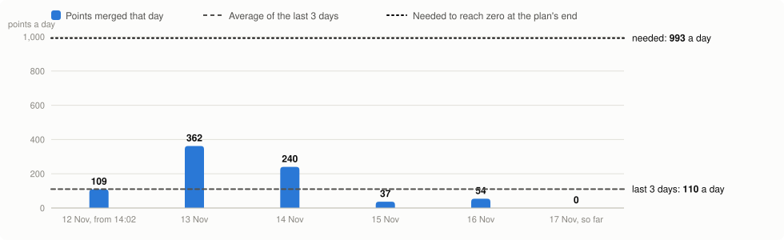

| Day (UTC) | Hours counted | Tasks merged | Points merged |
|---|---:|---:|---:|
| 12 Nov, from 14:02 | 10 | 51 | 109 |
| 13 Nov | 24 | 130 | 362 |
| 14 Nov | 24 | 97 | 240 |
| 15 Nov | 24 | 8 | 37 |
| 16 Nov | 24 | 25 | 54 |
| 17 Nov | 24 | 24 | 63 |
| 18 Nov | 24 | 52 | 140 |
| 19 Nov | 24 | 50 | 148 |
| 20 Nov | 24 | 33 | 114 |
| 21 Nov | 24 | 10 | 32 |
| 22 Nov | 24 | 3 | 12 |
| 23 Nov | 24 | 6 | 21 |
| 24 Nov, so far | 12 | 25 | 74 |
| Average of the last 72 hours | 72 | 35 | 37 a day |
| Needed from now to the plan's end | 0 |  | not measured |

How it is measured. Scope is the published plan on main as it stood at each of its 295 commits so far, the last at 24 Nov 11:52 UTC. It is exact at every commit; a change between two commits shows at the next one, so other figures on this page that read the plan in between can differ by a task or two. Merged means the task's done marker is on the main branch. The time is that of the merge that added it. A merged task keeps the points it merged with. Remaining is scope minus merged at every moment, so remaining can only rise when the scope grows. The ideal line runs from the scope at the start (12 Nov 14:02 UTC) to zero at the plan's end (19 Nov 05:02 UTC). That end comes from the schedule model of the first plan, as before. Days are UTC days. The first and the last day are part days.

### On the environment: deployed and validated

Read from git and the gate records on main at 12:00 UTC. A task counts as deployed when its merge commit is in the commit the environment runs (`rc/20261121T082107Z-da6a872` since 21 Nov 09:38 UTC), and as validated when the gate tool's verdict calls every check it delivers green, on a pair of gate runs made while the environment ran a candidate that holds it. The reader of the clusters below last ran at 12:00 UTC on 24 November.

| | Tasks |
|---|---|
| Merged tasks | 514 |
| **Deployed**: in the commit the environment runs, not yet tested | **479** |
| — of the merged, proven on a running environment (a test or a browser) | 238 |
| — of the merged, proven only by a fresh installation | 86 |
| **Validated**: passed the acceptance gate twice | **3** |
| Merged after the commit the environment runs, **not deployed** | **35** |

| Release to the installation wiped on 14 Nov 21:34 UTC | When | Running now (checked) | Tasks it carried | Seen working there, before the wipe | Evidence |
|---|---|---|---|---|---|
| hw307-ns.1 (umbrella 1.4.1906-hw307.23-ns.1) | 2026-11-13 05:10 | region a: NO, region b: NO | SVC-030, NET-041, NET-070, NET-072, SOV-030, SOV-220, BSS-035 | NET-041, NET-070, NET-072, BSS-035 | [record](screenshots/north-star/README.md) |

| Region | Releases ready | Switched off on purpose | Not ready | Umbrella chart | Images running |
|---|---|---|---|---|---|
| a | 69 of 69 | 5 | none | 1.4.2282 | catalyst-api `4166721`, catalyst-ui `4166721`, marketplace `495fbc1` |
| b | 62 of 62 | 8 | none | 1.4.2282 | none of the console images run in this region |

Not deployed (35): ACC-010, CMP-020, CMP-021, CMP-022, CMP-032, CMP-058, CMP-071, CTL-170, CTL-172, CTL-800, CTL-815, CTL-820, FND-161, FND-162, FND-163, FND-164, FND-183, FND-184, FND-191, FND-192, FND-201, FND-202, INF-054, INF-350, NET-081, NET-185, NET-253, SEC-060, SEC-180, SEC-190, SEC-200, SEC-205, SEC-261, SVC-180, SVC-230.

Since the wipe of 14 Nov 21:34 UTC the environment is installed from release candidates cut from main and updated in place by delivering a newer candidate through the product's release route; it runs `rc/20261121T082107Z-da6a872` now, and a merged task reaches it with the next candidate that holds it. The release in the table above ran on the installation that was wiped.

### Is it real? Delivery and quality, measured

A merged task has passed its checks in CI. It counts as **validated** only when the acceptance gate has passed twice on the installation that runs it. Today **3 of the 514** merged tasks are validated. hw307 runs candidate `rc/20261121T082107Z-da6a872` of main since 21 Nov 09:38 UTC, which holds 479 of the 514 merged tasks: they are deployed; 3 of them are validated by the gate tool's verdict, as no pair of gate runs was made on what runs there. The figures below are taken from GitHub and from main by script.

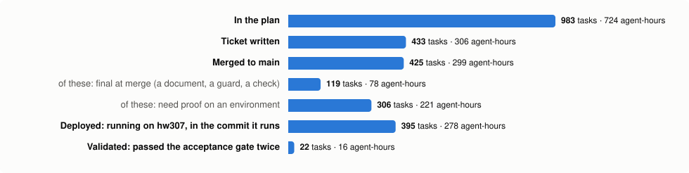

| Stage | Tasks | Agent-hours |
|---|---|---|
| In the plan | 1016 | 751 |
| Ticket written | 523 | 375 |
| Merged to main | 514 | 367 |
| — of these: final at merge (a document, a guard, a check) | 129 | 85 |
| — of these: need proof on an environment | 385 | 282 |
| Deployed: running on hw307, in the commit it runs | 479 | 341 |
| Validated: passed the acceptance gate twice | 3 | 2 |

**What kind of work is merged.** If the merged work were mostly records and checks while the plan is mostly product, the bars would differ.

| Kind of work | Merged: share of effort | Merged: tasks | Whole plan: share of effort | Whole plan: tasks |
|---|---|---|---|---|
| Product changes | 48% | 240 | 63% | 618 |
| Dead code removed | 10% | 55 | 10% | 106 |
| Guards and tests | 24% | 120 | 17% | 179 |
| Records and decisions | 18% | 99 | 10% | 113 |

| Measure | Now | What it tells |
|---|---|---|
| The plan's own checks (242) by state | 179 not-built, 19 expected-fail, 44 required | A check is the plan's definition of done for a capability. "required" means it must pass on a fresh install; none has been run on one yet. |
| Acceptance commands of merged tasks, run again on main (2026-11-13 19:00 UTC, commit b44ef5300) | **842 of 891** still pass. 49 do not: 45 replaced on purpose by a later task, 4 broken by a later merge, 0 not yet explained. 30 more compare a change with its base and can only run on the pull request. | A command that passed on its pull request and fails on today's main was either replaced by plan or broken by a later merge. Each failure is explained by name. |
| Workflow runs on main that ended red, per day | 12 Nov: 3 red of 982 (0.3%); 13 Nov: 8 red of 2508 (0.3%); 14 Nov: 64 red of 2564 (2.5%); 15 Nov: 8 red of 1216 (0.7%); 16 Nov: 4 red of 1066 (0.4%); 17 Nov: 8 red of 1124 (0.7%); 18 Nov: 19 red of 1774 (1.1%); 19 Nov: 38 red of 1825 (2.1%); 20 Nov: 11 red of 1750 (0.6%); 21 Nov: 6 red of 1032 (0.6%); 22 Nov: 1 red of 552 (0.2%); 23 Nov: 7 red of 971 (0.7%); 24 Nov: 14 red of 815 (1.7%) | Whether main is a base one can build on. A red run on main is a defect that reached main or a check that is not reliable. |
| Times an executor stopped and reported a ticket or main as wrong | 68 reports on 57 tasks, against 514 merged | A stop is the system refusing to guess. Many stops for one cause point at a defect of main or of the tickets. |
| Lines changed on main since the plan started | Product code and configuration: +207,320 −127,268; Tests: +148,201 −30,478; Checks and tooling: +56,761 −5,989; Plan, tickets and documents: +843,813 −9,261; Other: +13,613 −2,527 | How much of the change is the product itself. Tickets and the plan are large by nature. Generated files count too (one generated client is about 70,000 lines), and so do the release bot's version lines. |
| Fresh install from main: did it start, how long, how many releases ready | **9 fires from candidates of main**: fire 1 at 14 Nov 22:19 UTC, fire 1 failed at 22:22; fire 2 at 15 Nov 04:53 UTC, fire 2 stuck at 05:42; fire 3 at 15 Nov 15:58 UTC; fire 4 at 19 Nov 17:36 UTC, fire 4 chain stuck at 20:28; test install 1 (hw308) at 20 Nov 09:20 UTC, hw308 cutover stopped at step 3 at 11:30; test install 2 (hw309) at 20 Nov 14:21 UTC; test install 3 (hw310) at 20 Nov 19:51 UTC, hw310 chain stopped at step 8 at 22:31; test install 4 (hw311) at 21 Nov 00:40 UTC; test install 5 (hw312) at 21 Nov 09:38 UTC. None finished by itself; the events are at the top of this page. | The only proof that the merged first-boot changes work together. |
| Acceptance suite and walk on that install | **not run twice on the running installation yet** | That a person can do the thing: the five pillars. |

### The last 25 merged tasks

| Merged (UTC) | Task | What it did | Pull request |
|---|---|---|---|
| 24 Nov 11:01 | [CMP-071](plan/tickets/CMP-071.md) | refactor(compliance): policy files in every region folder: scopes, the write functions, the empty document | [#8766](https://github.com/openova-io/openova/pull/8766) |
| 24 Nov 10:29 | [FND-191](plan/tickets/FND-191.md) | refactor(api): remove the second matcher job handling from the API | [#8758](https://github.com/openova-io/openova/pull/8758) |
| 24 Nov 09:43 | [SVC-230](plan/tickets/SVC-230.md) | refactor(wizard): the component step shows the generated kit ring list and the hand list of components is deleted | [#8739](https://github.com/openova-io/openova/pull/8739) |
| 24 Nov 09:30 | [CMP-058](plan/tickets/CMP-058.md) | fix(kyverno): engine and command-line tool on v1.19.2, the newest patch of the 1.19 line | [#8751](https://github.com/openova-io/openova/pull/8751) |
| 24 Nov 08:48 | [SEC-205](plan/tickets/SEC-205.md) | feat(organization): every Organization namespace gets the External Secrets reader eso-reader and its namespaced store | [#8747](https://github.com/openova-io/openova/pull/8747) |
| 24 Nov 08:05 | [FND-164](plan/tickets/FND-164.md) | test(gate): the browser tests of the Organizations, users and access, sign-on and settings rows | [#8743](https://github.com/openova-io/openova/pull/8743) |
| 24 Nov 07:58 | [CMP-022](plan/tickets/CMP-022.md) | fix(console): the compliance pages drop the Security Lead page, the framework chips and the mode toggle | [#8703](https://github.com/openova-io/openova/pull/8703) |
| 24 Nov 06:59 | [NET-253](plan/tickets/NET-253.md) | docs(ledger): result of the lab test NET-253, the native firewall of the reference cloud with a load balancer | [#8742](https://github.com/openova-io/openova/pull/8742) |
| 24 Nov 06:54 | [CTL-815](plan/tickets/CTL-815.md) | chore(crds): keep the one Continuum definition file in the Continuum chart and delete the lockstep script | [#8738](https://github.com/openova-io/openova/pull/8738) |
| 24 Nov 06:53 | [INF-350](plan/tickets/INF-350.md) | docs(ledger): result of the spike INF-350, change events from the reference cloud | [#8741](https://github.com/openova-io/openova/pull/8741) |
| 24 Nov 06:42 | [CMP-021](plan/tickets/CMP-021.md) | test(gate): check CMP-G02 is required now that the pinned catalyst-api shows the engine mode | [#8733](https://github.com/openova-io/openova/pull/8733) |
| 24 Nov 06:31 | [CMP-032](plan/tickets/CMP-032.md) | refactor(api): the compliance aggregator scores through the read model of internal/compliance | [#8677](https://github.com/openova-io/openova/pull/8677) |
| 24 Nov 05:58 | [NET-081](plan/tickets/NET-081.md) | fix(provisioning): the provisioning service account gets no Secret write, the kubeconfig has one producer | [#8625](https://github.com/openova-io/openova/pull/8625) |
| 24 Nov 05:22 | [SEC-060](plan/tickets/SEC-060.md) | fix(keycloak): derive every Keycloak client secret with a random salt per Sovereign and add gate check SEC-G06 | [#8636](https://github.com/openova-io/openova/pull/8636) |
| 24 Nov 05:20 | [FND-163](plan/tickets/FND-163.md) | test(gate): the browser tests of the jobs, resource views and cloud and infrastructure read page rows | [#8719](https://github.com/openova-io/openova/pull/8719) |
| 24 Nov 05:13 | [CTL-820](plan/tickets/CTL-820.md) | test(gate): check CTL-G10 measures the region-loss bounds of decision record 0027 | [#8720](https://github.com/openova-io/openova/pull/8720) |
| 24 Nov 04:13 | [CTL-172](plan/tickets/CTL-172.md) | refactor(charts): the eleven chart-seeded Applications take placement and regions from bootstrapOwned.intent | [#8714](https://github.com/openova-io/openova/pull/8714) |
| 24 Nov 03:43 | [FND-202](plan/tickets/FND-202.md) | docs(adr): record 0035 on one telemetry pipeline per cluster, alert events on the bus and declared objectives | [#8721](https://github.com/openova-io/openova/pull/8721) |
| 24 Nov 03:16 | [CMP-020](plan/tickets/CMP-020.md) | fix(api): the compliance routes show the engine mode and only measured data | [#8621](https://github.com/openova-io/openova/pull/8621) |
| 24 Nov 02:34 | [ACC-010](plan/tickets/ACC-010.md) | fix(access): admit only sovereign-admins to the access gateway and add gate check ACC-G01 | [#8629](https://github.com/openova-io/openova/pull/8629) |
| 24 Nov 01:59 | [CTL-800](plan/tickets/CTL-800.md) | docs(adr): record 0027 on the region-loss contract, a follower Git server with its own database and promotion of the writer by one commit fenced by a lease outside both regions | [#8707](https://github.com/openova-io/openova/pull/8707) |
| 24 Nov 01:33 | [FND-162](plan/tickets/FND-162.md) | test(gate): the browser tests of the applications grid, application detail and catalogue rows | [#8692](https://github.com/openova-io/openova/pull/8692) |
| 24 Nov 01:28 | [FND-184](plan/tickets/FND-184.md) | feat(gitea): scheduled Git bundles of every repository to the bucket of the Sovereign | [#8704](https://github.com/openova-io/openova/pull/8704) |
| 24 Nov 01:12 | [CTL-170](plan/tickets/CTL-170.md) | docs(ledger): result of the inspection CTL-170, where chart-seeded Applications live and who reads them | [#8705](https://github.com/openova-io/openova/pull/8705) |
| 24 Nov 00:34 | [FND-201](plan/tickets/FND-201.md) | docs(ledger): result of the spike FND-201, what the telemetry pipeline delivers today and which collector stays | [#8697](https://github.com/openova-io/openova/pull/8697) |

### Merged changes a user can see

Of the 514 merged tasks, 129 are documents, decisions and checks that change no running product. The tasks below change a screen. The last column says whether the change has been seen working on hw307. The record of the walk, with screenshots, is [screenshots/north-star](screenshots/north-star/README.md).

| Task | What changes on the screen | Pull request | On hw307 |
|---|---|---|---|
| [FND-089](plan/tickets/FND-089.md) | The storefront offers no Sandbox agent picks and the order request carries no agents field | [#8051](https://github.com/openova-io/openova/pull/8051) | not proven yet |
| [FND-094](plan/tickets/FND-094.md) | Remove the Sandbox pages of the console | [#7181](https://github.com/openova-io/openova/pull/7181) | not proven yet |
| [FND-097](plan/tickets/FND-097.md) | Remove the unshipped console, the one job that drives it and the tests that only target it | [#7156](https://github.com/openova-io/openova/pull/7156) | not proven yet |
| [FND-161](plan/tickets/FND-161.md) | Row map and browser harness | [#8672](https://github.com/openova-io/openova/pull/8672) | not proven yet |
| [FND-162](plan/tickets/FND-162.md) | Console regression: applications grid, application detail, catalogue | [#8692](https://github.com/openova-io/openova/pull/8692) | not proven yet |
| [FND-163](plan/tickets/FND-163.md) | Console regression: jobs, resource views, cloud and infrastructure read pages | [#8719](https://github.com/openova-io/openova/pull/8719) | not proven yet |
| [FND-164](plan/tickets/FND-164.md) | Console regression: Organizations, users and access, settings | [#8743](https://github.com/openova-io/openova/pull/8743) | not proven yet |
| [FND-192](plan/tickets/FND-192.md) | Remove the second matcher from the console | [#8686](https://github.com/openova-io/openova/pull/8686) | not proven yet |
| [CLD-022](plan/tickets/CLD-022.md) | Delete the infrastructure mutation dialogs from the console | [#7366](https://github.com/openova-io/openova/pull/7366) | not proven yet |
| [SOV-030](plan/tickets/SOV-030.md) | Wipe refuses a handed-over Sovereign without confirmation | [#7205](https://github.com/openova-io/openova/pull/7205) | not proven yet |
| [SOV-190](plan/tickets/SOV-190.md) | The console reads the mode from the API | [#7532](https://github.com/openova-io/openova/pull/7532) | not proven yet |
| [SOV-220](plan/tickets/SOV-220.md) | The console's step list comes from the status response | [#7303](https://github.com/openova-io/openova/pull/7303) | not proven yet |
| [SOV-242](plan/tickets/SOV-242.md) | The cutover repeats a failed step a few times with a growing pause, then stops in a failed state the sovereign-admin resumes | [#8457](https://github.com/openova-io/openova/pull/8457) | not proven yet |
| [SEC-103](plan/tickets/SEC-103.md) | Remove the SealedSecret templates from the guacamole and netbird charts | [#8031](https://github.com/openova-io/openova/pull/8031) | not proven yet |
| [SEC-105](plan/tickets/SEC-105.md) | Delete Sealed Secrets | [#8064](https://github.com/openova-io/openova/pull/8064) | not proven yet |
| [NET-041](plan/tickets/NET-041.md) | Remove the firewall claims from the storefront and the console | [#7288](https://github.com/openova-io/openova/pull/7288) | **seen working, ticket closed** |
| [NET-070](plan/tickets/NET-070.md) | Wizard shows what the provisioner builds | [#7256](https://github.com/openova-io/openova/pull/7256) | **seen working, ticket closed** |
| [NET-071](plan/tickets/NET-071.md) | Remove the zone virtual-cluster dialog, tab and stub kind | [#7733](https://github.com/openova-io/openova/pull/7733) | not proven yet |
| [NET-072](plan/tickets/NET-072.md) | Placement selectors offer the host only | [#7245](https://github.com/openova-io/openova/pull/7245) | **seen working, ticket closed** |
| [NET-213](plan/tickets/NET-213.md) | The console states the region separation | [#8484](https://github.com/openova-io/openova/pull/8484) | not proven yet |
| [SVC-030](plan/tickets/SVC-030.md) | The Catalog page honours visibility and refuses what has no chart | [#7273](https://github.com/openova-io/openova/pull/7273) | not proven yet |
| [SVC-180](plan/tickets/SVC-180.md) | Screens group by class; the dead branch goes | [#8610](https://github.com/openova-io/openova/pull/8610) | not proven yet |
| [SVC-230](plan/tickets/SVC-230.md) | The wizard shows the generated kit list | [#8739](https://github.com/openova-io/openova/pull/8739) | not proven yet |
| [CTL-030](plan/tickets/CTL-030.md) | Delete the endpoint pipeline and the two duplicate registrations | [#7361](https://github.com/openova-io/openova/pull/7361) | not proven yet |
| [CTL-223](plan/tickets/CTL-223.md) | Settings, Menu accepts console pages as menu candidates | [#8004](https://github.com/openova-io/openova/pull/8004) | not proven yet |
| [CTL-233](plan/tickets/CTL-233.md) | Console: Git-owned objects show Managed by Git | [#8073](https://github.com/openova-io/openova/pull/8073) | not proven yet |
| [CTL-347](plan/tickets/CTL-347.md) | The flow server and adapter sources, charts and builds are deleted | [#8076](https://github.com/openova-io/openova/pull/8076) | not proven yet |
| [CTL-350](plan/tickets/CTL-350.md) | Applications views from the informer cache | [#7875](https://github.com/openova-io/openova/pull/7875) | not proven yet |
| [CTL-355](plan/tickets/CTL-355.md) | Delete the second showback meter | [#7833](https://github.com/openova-io/openova/pull/7833) | not proven yet |
| [CMP-022](plan/tickets/CMP-022.md) | The console stops claiming what does not exist | [#8703](https://github.com/openova-io/openova/pull/8703) | not proven yet |
| [BSS-035](plan/tickets/BSS-035.md) | The storefront says when prices are unavailable | [#7202](https://github.com/openova-io/openova/pull/7202) | **seen working, ticket closed** |
| [BSS-040](plan/tickets/BSS-040.md) | Delete core/marketplace-api | [#7787](https://github.com/openova-io/openova/pull/7787) | not proven yet |
| [AIP-070](plan/tickets/AIP-070.md) | Delete the hollow gateway charts | [#8442](https://github.com/openova-io/openova/pull/8442) | not proven yet |
| [INF-040](plan/tickets/INF-040.md) | Chart bp-kured with the node patch configuration | [#7817](https://github.com/openova-io/openova/pull/7817) | not proven yet |
| [INF-110](plan/tickets/INF-110.md) | Kinds Machine and MachineSource; inventory controller with the node source | [#7647](https://github.com/openova-io/openova/pull/7647) | not proven yet |
| [PRD-206](plan/tickets/PRD-206.md) | cortex screens | [#8473](https://github.com/openova-io/openova/pull/8473) | not proven yet |

### Merged changes that show on the next fresh install

| Task | What changes | Pull request |
|---|---|---|
| [CLD-023](plan/tickets/CLD-023.md) | Delete the Hetzner-only Compositions, their definitions and orphan manifests | [#7652](https://github.com/openova-io/openova/pull/7652) |
| [CLD-030](plan/tickets/CLD-030.md) | Per-Organization databases use the Sovereign's storage class | [#7818](https://github.com/openova-io/openova/pull/7818) |
| [CLD-040](plan/tickets/CLD-040.md) | Run the shared render test in CI and pin a golden render | [#7127](https://github.com/openova-io/openova/pull/7127) |
| [CLD-064](plan/tickets/CLD-064.md) | Convert the adoption Composition to pipeline mode | [#8050](https://github.com/openova-io/openova/pull/8050) |
| [CLD-066](plan/tickets/CLD-066.md) | provider-opentofu v1.1.11 by digest | [#8268](https://github.com/openova-io/openova/pull/8268) |
| [CLD-070](plan/tickets/CLD-070.md) | Decision record and truthful contract documents | [#7129](https://github.com/openova-io/openova/pull/7129) |
| [CLD-075](plan/tickets/CLD-075.md) | Generator for the provider and profile tables | [#7309](https://github.com/openova-io/openova/pull/7309) |
| [CLD-080](plan/tickets/CLD-080.md) | Contract directory: module contract, profile schema, pack schema, conventions, two profiles | [#7297](https://github.com/openova-io/openova/pull/7297) |
| [CLD-086](plan/tickets/CLD-086.md) | local module and reduced kit | [#7481](https://github.com/openova-io/openova/pull/7481) |
| [CLD-089](plan/tickets/CLD-089.md) | Local pack: the console in the kit core, its address and an owner session file for the suite | [#7956](https://github.com/openova-io/openova/pull/7956) |
| [CLD-090](plan/tickets/CLD-090.md) | The three modules meet contract version 1; conformance tests | [#8074](https://github.com/openova-io/openova/pull/8074) |
| [CLD-092](plan/tickets/CLD-092.md) | Seal hook conformance and the profile's seal section | [#8081](https://github.com/openova-io/openova/pull/8081) |
| [CLD-113](plan/tickets/CLD-113.md) | Mesh and topology read the profile | [#7459](https://github.com/openova-io/openova/pull/7459) |
| [CLD-131](plan/tickets/CLD-131.md) | Provider substitutes move from the template into the modules (pure move) | [#8089](https://github.com/openova-io/openova/pull/8089) |
| [CLD-132](plan/tickets/CLD-132.md) | Remaining provider tests become injected inputs | [#8109](https://github.com/openova-io/openova/pull/8109) |
| [CLD-133](plan/tickets/CLD-133.md) | Secondary-region suspend keys are set for every provider | [#8430](https://github.com/openova-io/openova/pull/8430) |
| [CLD-134](plan/tickets/CLD-134.md) | The reference cloud's profile declares its user-data limit; the guard checks it | [#8010](https://github.com/openova-io/openova/pull/8010) |
| [CLD-141](plan/tickets/CLD-141.md) | Protect provider releases from pruning before they move | [#7466](https://github.com/openova-io/openova/pull/7466) |
| [CLD-142](plan/tickets/CLD-142.md) | Neutral storage gate | [#7455](https://github.com/openova-io/openova/pull/7455) |
| [CLD-185](plan/tickets/CLD-185.md) | Hetzner control-plane cloud-init with the post-back on fits the module size guard | [#7485](https://github.com/openova-io/openova/pull/7485) |
| [SOV-020](plan/tickets/SOV-020.md) | One default for the zero-touch switch | [#7789](https://github.com/openova-io/openova/pull/7789) |
| [SOV-130](plan/tickets/SOV-130.md) | Substrate window, part 1: modules and cloud-init take the variables document | [#7363](https://github.com/openova-io/openova/pull/7363) |
| [SOV-131](plan/tickets/SOV-131.md) | Provider modules take the variables map of the upstream contract | [#7452](https://github.com/openova-io/openova/pull/7452) |
| [SOV-132](plan/tickets/SOV-132.md) | Nodes boot with a local-first registry file, a wildcard entry and the public fallback off | [#8438](https://github.com/openova-io/openova/pull/8438) |
| [SOV-133](plan/tickets/SOV-133.md) | The boot template and the provider contract take the variables document | [#7475](https://github.com/openova-io/openova/pull/7475) |
| [SOV-134](plan/tickets/SOV-134.md) | The contract keys of the variables document land in the sovereign-variables ConfigMap | [#7510](https://github.com/openova-io/openova/pull/7510) |
| [SOV-136](plan/tickets/SOV-136.md) | Nodes share the images they hold: the k3s embedded registry mirror is on from first boot | [#8541](https://github.com/openova-io/openova/pull/8541) |
| [SOV-140](plan/tickets/SOV-140.md) | Substrate window, part 2: revocable bootstrap access, peer tokens, node artifacts from the registry | [#7406](https://github.com/openova-io/openova/pull/7406) |
| [SOV-141](plan/tickets/SOV-141.md) | Each peer region gets its own handover-peer token, given to the primary once at hand-over | [#7474](https://github.com/openova-io/openova/pull/7474) |
| [SOV-142](plan/tickets/SOV-142.md) | New nodes fetch k3s, Flux and Gateway API install files from the registry, with fallback | [#8142](https://github.com/openova-io/openova/pull/8142) |
| [SOV-144](plan/tickets/SOV-144.md) | The post-back failure codes leave the exit code that the seal contract reserves | [#7778](https://github.com/openova-io/openova/pull/7778) |
| [SOV-145](plan/tickets/SOV-145.md) | Two node files that nothing reads leave first boot | [#8007](https://github.com/openova-io/openova/pull/8007) |
| [SOV-146](plan/tickets/SOV-146.md) | The child Kustomizations of first boot are also files under clusters/_template/root | [#8097](https://github.com/openova-io/openova/pull/8097) |
| [SOV-149](plan/tickets/SOV-149.md) | The image pre-pull leaves first boot | [#8405](https://github.com/openova-io/openova/pull/8405) |
| [SOV-151](plan/tickets/SOV-151.md) | Kit pull Secret names and the hand-over switch read the Sovereign's variables | [#7748](https://github.com/openova-io/openova/pull/7748) |
| [SOV-154](plan/tickets/SOV-154.md) | First boot applies one root Kustomization; its children come from Git | [#8371](https://github.com/openova-io/openova/pull/8371) |
| [SOV-155](plan/tickets/SOV-155.md) | A roll of the registry never removes both copies: harbor-registry rolls one copy at a time, jobservice keeps Recreate | [#8565](https://github.com/openova-io/openova/pull/8565) |
| [SOV-160](plan/tickets/SOV-160.md) | Registry projects, the Organization Git token and the two repositories are created at install | [#7425](https://github.com/openova-io/openova/pull/7425) |
| [SOV-161](plan/tickets/SOV-161.md) | The pull robot of the local registry joins the pull secret at install | [#7808](https://github.com/openova-io/openova/pull/7808) |
| [SOV-175](plan/tickets/SOV-175.md) | The Sovereign object gets its writer | [#7941](https://github.com/openova-io/openova/pull/7941) |
| [SOV-322](plan/tickets/SOV-322.md) | Sign-in mail from the Sovereign's own server: kit slot, settings, and the parent seed deleted | [#8383](https://github.com/openova-io/openova/pull/8383) |
| [SOV-335](plan/tickets/SOV-335.md) | The variables document carries the path of the vulnerability database | [#7729](https://github.com/openova-io/openova/pull/7729) |
| [SOV-336](plan/tickets/SOV-336.md) | The registry install creates the proxy project of the vulnerability database | [#7780](https://github.com/openova-io/openova/pull/7780) |
| [SOV-337](plan/tickets/SOV-337.md) | The scanner reads the vulnerability database from the Sovereign's own registry | [#7856](https://github.com/openova-io/openova/pull/7856) |
| [SOV-342](plan/tickets/SOV-342.md) | The provider pod installs OpenTofu providers only from an OCI mirror of listed, digest-pinned packages | [#8545](https://github.com/openova-io/openova/pull/8545) |
| [SEC-020](plan/tickets/SEC-020.md) | Random k3s server token and separate agent token | [#7178](https://github.com/openova-io/openova/pull/7178) |
| [SEC-030](plan/tickets/SEC-030.md) | etcd encryption on at first boot | [#7400](https://github.com/openova-io/openova/pull/7400) |
| [SEC-040](plan/tickets/SEC-040.md) | Bootstrap secret hygiene on the node and reflector scope | [#8221](https://github.com/openova-io/openova/pull/8221) |
| [SEC-060](plan/tickets/SEC-060.md) | Keycloak secrets no longer computable | [#8636](https://github.com/openova-io/openova/pull/8636) |
| [SEC-100](plan/tickets/SEC-100.md) | Delete the abandoned OpenBao multi-region mechanisms | [#7499](https://github.com/openova-io/openova/pull/7499) |
| [SEC-104](plan/tickets/SEC-104.md) | Unwire bootstrap-kit slot 05 | [#8033](https://github.com/openova-io/openova/pull/8033) |
| [SEC-150](plan/tickets/SEC-150.md) | Seal hook of contract C8 in the three provider packs, with its call and the provisioner staging | [#7847](https://github.com/openova-io/openova/pull/7847) |
| [SEC-152](plan/tickets/SEC-152.md) | Shared template writes the seal key files and the seal profile; seal volume on the reference pack | [#8387](https://github.com/openova-io/openova/pull/8387) |
| [SEC-153](plan/tickets/SEC-153.md) | Flux renders bootstrap Secrets from one seed: robot token, pool-domain login, DNS key, hand-over key | [#8477](https://github.com/openova-io/openova/pull/8477) |
| [SEC-154](plan/tickets/SEC-154.md) | Flux renders bootstrap Secrets from one seed: pull login, object storage | [#8502](https://github.com/openova-io/openova/pull/8502) |
| [SEC-162](plan/tickets/SEC-162.md) | OpenBao 2.7.2, static seal, self-initialisation and declared audit device, as one change | [#8460](https://github.com/openova-io/openova/pull/8460) |
| [NET-010](plan/tickets/NET-010.md) | Close peer and stale ports on the reference provider | [#7195](https://github.com/openova-io/openova/pull/7195) |
| [NET-011](plan/tickets/NET-011.md) | API port limited to declared sources | [#8055](https://github.com/openova-io/openova/pull/8055) |
| [NET-012](plan/tickets/NET-012.md) | Second provider firewall to the same rule | [#8056](https://github.com/openova-io/openova/pull/8056) |
| [NET-020](plan/tickets/NET-020.md) | Disable the k3s kube-proxy | [#7302](https://github.com/openova-io/openova/pull/7302) |
| [NET-031](plan/tickets/NET-031.md) | Stop reflecting the object-storage Secret to retired namespaces | [#7103](https://github.com/openova-io/openova/pull/7103) |
| [NET-040](plan/tickets/NET-040.md) | Remove the unwired firewall and the unused SPIRE chart | [#8027](https://github.com/openova-io/openova/pull/8027) |
| [NET-096](plan/tickets/NET-096.md) | Turn the metadata deny on in the kit | [#8127](https://github.com/openova-io/openova/pull/8127) |
| [NET-100](plan/tickets/NET-100.md) | Network registry output and validator | [#7318](https://github.com/openova-io/openova/pull/7318) |
| [NET-110](plan/tickets/NET-110.md) | Cilium base values to target | [#8207](https://github.com/openova-io/openova/pull/8207) |
| [NET-153](plan/tickets/NET-153.md) | Allow-list of the hand-over proof's deny-egress object | [#8242](https://github.com/openova-io/openova/pull/8242) |
| [NET-185](plan/tickets/NET-185.md) | The Sovereign's name servers answer on public port 53, over UDP and TCP, in every region | [#8595](https://github.com/openova-io/openova/pull/8595) |
| [NET-190](plan/tickets/NET-190.md) | Route admission by owner | [#8000](https://github.com/openova-io/openova/pull/8000) |
| [NET-210](plan/tickets/NET-210.md) | Availability zone per region and a separation output | [#8104](https://github.com/openova-io/openova/pull/8104) |
| [SVC-060](plan/tickets/SVC-060.md) | Function-test convention and the data charts | [#7401](https://github.com/openova-io/openova/pull/7401) |
| [SVC-130](plan/tickets/SVC-130.md) | Enable function tests on the foundation slots | [#8143](https://github.com/openova-io/openova/pull/8143) |
| [SVC-137](plan/tickets/SVC-137.md) | The function tests wait for their subject in their own region within the bound of their release | [#8529](https://github.com/openova-io/openova/pull/8529) |
| [SVC-138](plan/tickets/SVC-138.md) | Every foundation release has a function test that check SVC-G06 can read | [#8571](https://github.com/openova-io/openova/pull/8571) |
| [SVC-139](plan/tickets/SVC-139.md) | The function tests of bp-openbao, bp-reloader and bp-valkey wait for their subject within the bound | [#8552](https://github.com/openova-io/openova/pull/8552) |
| [SVC-159](plan/tickets/SVC-159.md) | The Blueprint files say what the seed says | [#8241](https://github.com/openova-io/openova/pull/8241) |
| [SVC-160](plan/tickets/SVC-160.md) | One generator, part 2: the seed becomes generated | [#8271](https://github.com/openova-io/openova/pull/8271) |
| [SVC-170](plan/tickets/SVC-170.md) | Contract C1: class and lifecycle on every Blueprint, with their readers | [#8288](https://github.com/openova-io/openova/pull/8288) |
| [SVC-220](plan/tickets/SVC-220.md) | Ring labels on the kit | [#8370](https://github.com/openova-io/openova/pull/8370) |
| [CTL-041](plan/tickets/CTL-041.md) | Bootstrap-kit HelmRepository documents to source v1 | [#7492](https://github.com/openova-io/openova/pull/7492) |
| [CTL-346](plan/tickets/CTL-346.md) | Kit slots 56 and 57 (flow server and emitter) leave the kit | [#8026](https://github.com/openova-io/openova/pull/8026) |
| [CTL-348](plan/tickets/CTL-348.md) | The flow host leaves the sign-in gate and the DNS name list | [#8028](https://github.com/openova-io/openova/pull/8028) |
| [CMP-036](plan/tickets/CMP-036.md) | Kit slot 27a: values document, hand-over variable, definitions on upgrade | [#7277](https://github.com/openova-io/openova/pull/7277) |
| [AIP-201](plan/tickets/AIP-201.md) | Node preparation for the sandbox class, exactly as the spike recorded | [#8314](https://github.com/openova-io/openova/pull/8314) |
| [INF-050](plan/tickets/INF-050.md) | Install kured | [#7846](https://github.com/openova-io/openova/pull/7846) |
| [INF-054](plan/tickets/INF-054.md) | The node maintenance window is a setting of the sovereign-admin, at night in the Sovereign's own time zone by default | [#8602](https://github.com/openova-io/openova/pull/8602) |
| [INF-055](plan/tickets/INF-055.md) | Leave the kured slot out of the local reduced kit | [#8113](https://github.com/openova-io/openova/pull/8113) |
| [INF-060](plan/tickets/INF-060.md) | Remove the reboot settings from cloud-init | [#8343](https://github.com/openova-io/openova/pull/8343) |
| [ACC-010](plan/tickets/ACC-010.md) | Close the default-install exposure of the access gateway | [#8629](https://github.com/openova-io/openova/pull/8629) |

A further 261 merged tasks change a running service without a screen of their own; they are proven by a test on the environment.

## What was built before the baseline

Status on 13 November 2026. The baseline is the platform as it stood on 12 November 2026, after nine months of work by its agents. All work is done by agents; effort is in agent-hours and tokens, from the tasks that were actually run.

This is the ground the plan stands on. It is measured from the repository.

| | |
|---|---|
| Commits on the main branch since February 2026 | **25,978** |
| Pull requests merged | **4,464** |
| Issues closed | 1,929 |
| Blueprint charts | 100 |
| Go source files | 1,877, of which 1,032 are tests |
| Console source files | 1,139 |
| Browser test specs | 56 |
| CI workflows and guard scripts | 133 and 77 |

Against the target of this plan, that work stands at **24% built** across the 14 product areas, from 60% in billing to nothing yet in migration. The plan below is the remaining distance.

| | |
|---|---|
| Built before the baseline | **24%** of the target, by the code audit |
| Tasks of the plan delivered since | **514 of 1016** |
| Epics in the backlog | 101, plus single fixes in 14 areas |
| Still to spend | about 383 agent-hours and 384 million tokens |
| Last feature done, six agents in parallel | about 28 Nov (244 running hours at 16 a day) |
| Releases | 50 updates of the environment and 10 fresh installs |

## Where we started and where we are, to scale

The length of a bar is the size of that area, so a long bar is a big area and a short bar a small one. Dark blue is what was already built on 12 November. Green is what has been merged since. Grey is still to do. Sizes are in agent-hours: the green and grey parts are the plan's own estimate; the dark part is scaled from the audit percentage, so it is an estimate of size, not a record of hours spent.

All 14 areas together: 24% was built before the baseline, and the target is now 61.2% built. 367 agent-hours of the plan are merged and 383 are still to do.

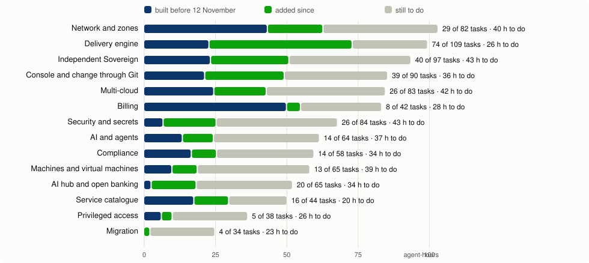

| Product area | Built before | Tasks merged | Agent-hours merged | Agent-hours to do | Share of all remaining work |
|---|---:|---:|---:|---:|---:|
| Network and zones | 42% | 55 of 95 | 38 | 31 | 8% |
| Independent Sovereign | 25% | 63 of 114 | 45 | 39 | 10% |
| Delivery engine | 23% | 95 of 115 | 65 | 15 | 4% |
| Multi-cloud | 29% | 50 of 88 | 36 | 29 | 7% |
| Console and change through Git | 25% | 46 of 92 | 33 | 33 | 9% |
| Billing | 60% | 10 of 42 | 6 | 27 | 7% |
| Security and secrets | 10% | 38 of 86 | 28 | 35 | 9% |
| AI and agents | 22% | 38 of 71 | 28 | 25 | 6% |
| Compliance | 28% | 20 of 61 | 13 | 32 | 8% |
| Service catalogue | 35% | 35 of 51 | 28 | 12 | 3% |
| Machines and virtual machines | 17% | 27 of 64 | 18 | 29 | 8% |
| AI hub and open banking | 5% | 27 of 65 | 22 | 28 | 7% |
| Privileged access | 17% | 6 of 38 | 4 | 26 | 7% |
| Migration | 0% | 4 of 34 | 2 | 23 | 6% |

## Every epic, to scale

Every piece of work in the plan, grouped by product area. A large tile is one epic; a small square is one single task that belongs to no epic. The area of a tile is its size in agent-hours, so the big tiles are the big pieces of work. Green is merged: a whole green square is a merged task, and the green part of an epic tile is the share of it already merged. An epic tile shows tasks merged of tasks in the epic, and its hours. The table of every epic is further down.

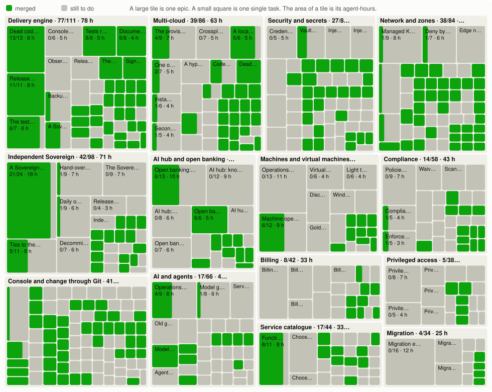

## The product: where it started and where it is now

Score from 0 to 100 against the target. The red, orange or yellow part is where the area stood on 12 November, measured from the code by the audit: red is a critical gap, orange a serious one, yellow partly there. The green part is what has been added since. Each row reads start → now.

The number for now is the start score plus the share of the remaining distance that is merged, counted in agent-hours. It counts work merged to the main branch. A task counts as proven only when it runs on the live environment, and the block at the top of this page says how much of it does.

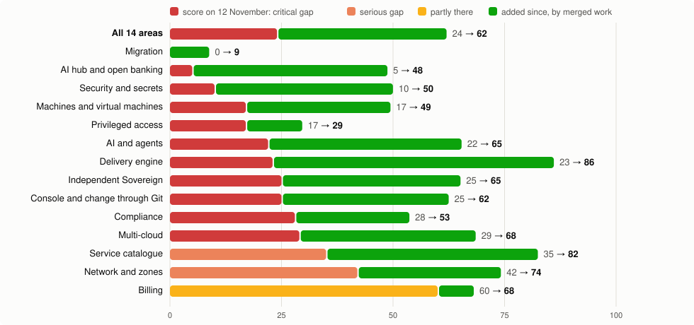

| Product area (start → now) | At the start | Target | Epics | Tasks | Agent-hours to do | Tokens to do, M | Done by |
|---|---|---|---:|---:|---:|---:|---|
| **Independent Sovereign** (25 → 65) | Installs and runs in two regions, but still depends on its parent after hand-over. | Local from first boot, owns its keys, upgrades in place, can create a child Sovereign. | 9 | 114 | 39 | 39 | 25 Nov |
| **Multi-cloud** (29 → 68) | Runs on the National Cloud and one other cloud by special cases in shared code. | A cloud is a pack of files behind one contract. A second cloud and a hyperscaler proven. Managed Kubernetes as an option. | 13 | 88 | 29 | 28 | 27 Nov |
| **Security and secrets** (10 → 50) | The vault runs, but every application credential is still stored in etcd. | Credentials are mounted from the vault into the running workload. Urgent holes closed first. | 7 | 86 | 35 | 35 | 25 Nov |
| **Network and zones** (42 → 74) | The data plane is sound. The network is open by default. | Deny by default, mesh declared in Git, edge nodes and a load balancer per region. | 6 | 95 | 31 | 32 | 28 Nov |
| **Console and change through Git** (25 → 62) | Delivery goes through Git. Most console actions write straight to the cluster. | Every change is a commit. Screens update by push. | 2 | 92 | 33 | 33 | 28 Nov |
| **Service catalogue** (35 → 81) | The bootstrap kit is real. Users cannot choose a cloud's native service. | Every Blueprint has a class. Object storage and PostgreSQL offered as native or self-hosted. | 3 | 51 | 12 | 12 | 22 Nov |
| **Compliance** (28 → 49) | 24 policies and one proven score. | Posture hub, waivers, scanner reports, runtime and resilience views, frameworks. | 8 | 61 | 32 | 32 | 24 Nov |
| **Billing** (60 → 68) | The strongest area. Works on the live environment, structurally tangled. | One plan source, metered model usage, collectors per cloud, standalone option for a cloud operator. | 7 | 42 | 27 | 27 | 23 Nov |
| **AI and agents** (22 → 64) | Four model gateways, one agent workspace, no usable metering. | One gateway with Axon as simulator, an agent runtime, metering, service-management agents. | 7 | 71 | 25 | 25 | 25 Nov |
| **Machines and virtual machines** (17 → 49) | No virtual-machine service exists. | Virtual machines, machine operations over SSH, golden images. | 8 | 64 | 29 | 29 | 27 Nov |
| **Privileged access** (17 → 29) | Access control, approval and recording are not in place yet. | Controlled sessions with approval, recording and review. | 7 | 38 | 26 | 26 | 27 Nov |
| **Migration** (0 → 9) | Nothing exists. | A migration engine with landing on the National Cloud and network extension. | 4 | 34 | 23 | 23 | 26 Nov |
| **AI hub and open banking** (5 → 47) | Scaffolds only. | AI hub with knowledge search and chat. Open banking sandbox, payments, portal. | 7 | 65 | 28 | 28 | 22 Nov |
| **Delivery engine** (23 → 85) | The acceptance suite exists. Very little is proven on the live environment. | Every feature proven by automatic checks on a real environment, twice, before it counts. | 13 | 115 | 15 | 15 | 21 Nov |

## When each product area is worked on

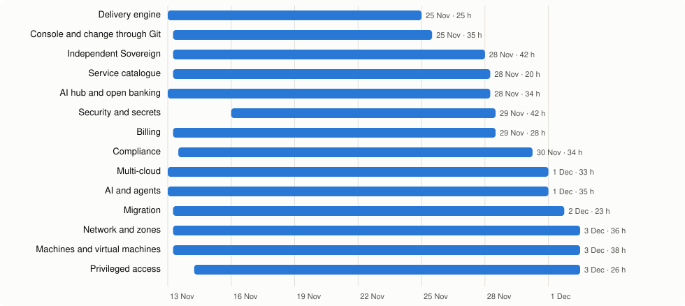

Dates come from a simulation of six agents over the plan's dependencies, 16 running hours a day, the environment updated every 4 hours and one fresh install a day. They are estimates.

## The backlog: every epic

<b>Independent Sovereign</b>: 9 epics, 114 tasks, 39 agent-hours, done by 25 Nov

| Feature (epic) | Tasks | Delivered | Agent-hours | Tokens, M | Starts | Done by |
|---|---:|---:|---:|---:|---|---|
| A Sovereign is local from its first boot | 30 | 28 | 1.3 | 1.3 | 13 Nov | 15 Nov |
| Ties to the parent cut at boot | 16 | 12 | 3.2 | 3.2 | 16 Nov | 19 Nov |
| Hand-over in one short ordered step | 10 | 2 | 6.6 | 6.7 | 14 Nov | 21 Nov |
| The Sovereign owns its own infrastructure state | 9 | 0 | 6.8 | 6.8 | 18 Nov | 21 Nov |
| Release channel and in-place upgrade | 7 | 3 | 3.2 | 3.2 | 17 Nov | 21 Nov |
| Sovereign: single fixes and lab tests | 22 | 17 | 3.2 | 3.2 | 15 Nov | 21 Nov |
| Independence proven and frozen | 2 | 0 | 1.6 | 1.6 | 21 Nov | 21 Nov |
| Mothership mode: a Sovereign creates a child | 2 | 0 | 1.8 | 1.9 | 19 Nov | 21 Nov |
| Decommission, mothership rebuild, add a region | 7 | 0 | 5.5 | 5.6 | 20 Nov | 22 Nov |
| Daily operation with the parent switched off | 9 | 1 | 5.8 | 5.7 | 15 Nov | 25 Nov |

<b>Multi-cloud</b>: 13 epics, 88 tasks, 29 agent-hours, done by 27 Nov

| Feature (epic) | Tasks | Delivered | Agent-hours | Tokens, M | Starts | Done by |
|---|---:|---:|---:|---:|---|---|
| Dead infrastructure code removed | 3 | 3 | 0.0 | 0 | 13 Nov | 13 Nov |
| Code stops naming cloud providers | 4 | 4 | 0.0 | 0 | 13 Nov | 13 Nov |
| One boot template with no provider special cases | 3 | 3 | 0.0 | 0 | 13 Nov | 13 Nov |
| The console reads the cloud's profile | 4 | 0 | 2.8 | 2.7 | 15 Nov | 15 Nov |
| A local test cloud on every pull request | 6 | 5 | 0.9 | 0.9 | 17 Nov | 17 Nov |
| One overlay per cloud | 7 | 2 | 3.4 | 3.4 | 16 Nov | 17 Nov |
| The provisioning engine no longer names a cloud | 10 | 8 | 1.6 | 1.6 | 15 Nov | 18 Nov |
| The Huawei cloud controller runs inside the Sovereign | 2 | 0 | 1.6 | 1.6 | 19 Nov | 19 Nov |
| Crossplane owns node pools and infrastructure | 7 | 0 | 5.2 | 5.2 | 16 Nov | 21 Nov |
| Installation settings leave the code | 6 | 1 | 3.2 | 3.1 | 13 Nov | 21 Nov |
| No cloud name left in shared code | 2 | 1 | 0.7 | 0.7 | 21 Nov | 21 Nov |
| Second cloud proven (Hetzner, one region) | 5 | 1 | 3.2 | 3.2 | 18 Nov | 22 Nov |
| Cloud: single fixes and lab tests | 25 | 22 | 2.8 | 2.8 | 20 Nov | 22 Nov |
| A hyperscaler proven (AWS), by adding files only | 4 | 0 | 3.2 | 3.2 | 22 Nov | 27 Nov |

<b>Security and secrets</b>: 7 epics, 86 tasks, 35 agent-hours, done by 25 Nov

| Feature (epic) | Tasks | Delivered | Agent-hours | Tokens, M | Starts | Done by |
|---|---:|---:|---:|---:|---|---|
| Injection rolled out: data and platform services | 6 | 0 | 3.8 | 3.7 | 15 Nov | 15 Nov |
| Credentials injected into workloads, not stored in etcd | 5 | 0 | 4.6 | 4.8 | 15 Nov | 15 Nov |
| Vault upgraded, its seal out of etcd | 5 | 4 | 0.9 | 0.9 | 16 Nov | 16 Nov |
| Third-party charts moved to injection | 5 | 0 | 3.3 | 3.2 | 15 Nov | 16 Nov |
| Injection rolled out: identity | 4 | 0 | 3.0 | 3.0 | 16 Nov | 17 Nov |
| Injection rolled out: remaining charts | 6 | 0 | 3.5 | 3.3 | 15 Nov | 17 Nov |
| Security: urgent fixes and hardening, one by one | 52 | 33 | 14.2 | 14.2 | 15 Nov | 25 Nov |
| External Secrets upgrade | 3 | 1 | 1.6 | 1.6 | 25 Nov | 25 Nov |

<b>Network and zones</b>: 6 epics, 95 tasks, 31 agent-hours, done by 28 Nov

| Feature (epic) | Tasks | Delivered | Agent-hours | Tokens, M | Starts | Done by |
|---|---:|---:|---:|---:|---|---|
| The mesh between regions declared in Git | 4 | 1 | 2.1 | 2.1 | 16 Nov | 19 Nov |
| Deny by default in every platform namespace | 7 | 1 | 5.0 | 5.1 | 18 Nov | 19 Nov |
| Managed Kubernetes (CCE) as a cluster class | 9 | 1 | 6.8 | 7.0 | 15 Nov | 19 Nov |
| Placement without the old tiers | 7 | 1 | 4.3 | 4.3 | 15 Nov | 21 Nov |
| Network: port closures, clean-up and single fixes | 53 | 47 | 4.2 | 4.2 | 13 Nov | 21 Nov |
| Edge nodes and a load balancer per region | 6 | 0 | 5.0 | 5.1 | 21 Nov | 27 Nov |
| A web application firewall in the path | 9 | 4 | 3.8 | 3.8 | 22 Nov | 28 Nov |

<b>Console and change through Git</b>: 2 epics, 92 tasks, 33 agent-hours, done by 28 Nov

| Feature (epic) | Tasks | Delivered | Agent-hours | Tokens, M | Starts | Done by |
|---|---:|---:|---:|---:|---|---|
| Epic: the intent lock | 3 | 2 | 0.5 | 0.5 | 17 Nov | 17 Nov |
| One pipeline for an Organization, every change through Git | 8 | 1 | 5.0 | 5.0 | 17 Nov | 19 Nov |
| Control plane: every screen writes through Git, one by one | 81 | 43 | 27.6 | 27.4 | 13 Nov | 28 Nov |

<b>Service catalogue</b>: 3 epics, 51 tasks, 12 agent-hours, done by 22 Nov

| Feature (epic) | Tasks | Delivered | Agent-hours | Tokens, M | Starts | Done by |
|---|---:|---:|---:|---:|---|---|
| Function tests for the core services | 15 | 12 | 1.5 | 1.4 | 13 Nov | 13 Nov |
| Service model: classes on every Blueprint, single fixes | 27 | 22 | 3.2 | 3.2 | 13 Nov | 15 Nov |
| Choose native or self-hosted: object storage | 7 | 1 | 5.2 | 5.4 | 15 Nov | 20 Nov |
| Choose native or self-hosted: PostgreSQL | 2 | 0 | 1.8 | 1.9 | 21 Nov | 22 Nov |

<b>Compliance</b>: 8 epics, 61 tasks, 32 agent-hours, done by 24 Nov

| Feature (epic) | Tasks | Delivered | Agent-hours | Tokens, M | Starts | Done by |
|---|---:|---:|---:|---:|---|---|
| Policies moved to the new model | 9 | 1 | 6.1 | 6.1 | 13 Nov | 17 Nov |
| Scanner reports | 4 | 0 | 3.0 | 3.0 | 15 Nov | 17 Nov |
| Resilience view | 3 | 0 | 2.5 | 2.5 | 15 Nov | 17 Nov |
| Compliance posture hub | 6 | 1 | 4.3 | 4.5 | 13 Nov | 17 Nov |
| Waivers and remediation requests | 4 | 0 | 3.2 | 3.2 | 15 Nov | 17 Nov |
| Runtime security view | 2 | 0 | 1.4 | 1.4 | 17 Nov | 17 Nov |
| Compliance frameworks | 3 | 0 | 2.5 | 2.5 | 16 Nov | 17 Nov |
| Enforcement mode owned in Git | 6 | 2 | 2.8 | 2.7 | 15 Nov | 19 Nov |
| Compliance: single fixes and screens | 24 | 16 | 6.3 | 6.4 | 16 Nov | 24 Nov |

<b>Billing</b>: 7 epics, 42 tasks, 27 agent-hours, done by 23 Nov

| Feature (epic) | Tasks | Delivered | Agent-hours | Tokens, M | Starts | Done by |
|---|---:|---:|---:|---:|---|---|
| Billing: model usage metered | 3 | 0 | 2.2 | 2.2 | 20 Nov | 20 Nov |
| Billing: one source for plans and prices | 9 | 0 | 8.0 | 8.2 | 13 Nov | 20 Nov |
| Billing: cost collector plug-ins per cloud | 3 | 0 | 2.5 | 2.5 | 20 Nov | 20 Nov |
| Billing: decisions as events | 3 | 0 | 2.5 | 2.5 | 19 Nov | 21 Nov |
| Billing: one owner per money record | 5 | 0 | 4.3 | 4.5 | 13 Nov | 21 Nov |
| Billing: its secrets secured | 2 | 1 | 0.7 | 0.7 | 21 Nov | 21 Nov |
| Billing: standalone for a cloud operator | 3 | 0 | 2.5 | 2.5 | 21 Nov | 21 Nov |
| Billing: single fixes | 14 | 9 | 4.2 | 4.2 | 13 Nov | 23 Nov |

<b>AI and agents</b>: 7 epics, 71 tasks, 25 agent-hours, done by 25 Nov

| Feature (epic) | Tasks | Delivered | Agent-hours | Tokens, M | Starts | Done by |
|---|---:|---:|---:|---:|---|---|
| Model usage meter | 4 | 4 | 0.0 | 0 | 13 Nov | 13 Nov |
| Model gateway with Axon as simulator | 8 | 6 | 1.6 | 1.6 | 16 Nov | 16 Nov |
| Agent runtime (kagent) | 3 | 1 | 1.6 | 1.6 | 18 Nov | 18 Nov |
| Old gateways retired | 5 | 0 | 3.2 | 3.1 | 18 Nov | 19 Nov |
| Operations records for agents | 9 | 7 | 1.8 | 1.9 | 19 Nov | 19 Nov |
| AI platform: single fixes and lab tests | 34 | 20 | 10.1 | 10.0 | 13 Nov | 20 Nov |
| Service-management agents | 5 | 0 | 4.1 | 4.2 | 19 Nov | 20 Nov |
| Self-hosted model serving, when GPUs exist | 3 | 0 | 2.2 | 2.2 | 22 Nov | 25 Nov |

<b>Machines and virtual machines</b>: 8 epics, 64 tasks, 29 agent-hours, done by 27 Nov

| Feature (epic) | Tasks | Delivered | Agent-hours | Tokens, M | Starts | Done by |
|---|---:|---:|---:|---:|---|---|
| Native machine engine | 1 | 1 | 0.0 | 0 | 13 Nov | 13 Nov |
| Machines: lab tests | 14 | 14 | 0.0 | 0 | 13 Nov | 13 Nov |
| Machine operations on the platform's own nodes | 12 | 8 | 2.5 | 2.4 | 17 Nov | 19 Nov |
| Virtual machines | 6 | 1 | 3.8 | 3.8 | 21 Nov | 23 Nov |
| Discovery and ownership of machines | 5 | 1 | 2.9 | 2.9 | 18 Nov | 23 Nov |
| Windows and hypervisor sources | 3 | 0 | 2.8 | 2.8 | 23 Nov | 25 Nov |
| Operations on machines over SSH | 13 | 0 | 11.0 | 11.2 | 18 Nov | 25 Nov |
| Light testing of machines | 6 | 2 | 2.8 | 2.7 | 25 Nov | 25 Nov |
| Golden images and rotation | 4 | 0 | 3.2 | 3.2 | 23 Nov | 27 Nov |

<b>Privileged access</b>: 7 epics, 38 tasks, 26 agent-hours, done by 27 Nov

| Feature (epic) | Tasks | Delivered | Agent-hours | Tokens, M | Starts | Done by |
|---|---:|---:|---:|---:|---|---|
| Privileged access: controlled sessions | 8 | 0 | 6.8 | 7.0 | 14 Nov | 22 Nov |
| Privileged access: recording | 2 | 0 | 1.8 | 1.9 | 22 Nov | 23 Nov |
| Privileged access: requests and approvals | 3 | 0 | 2.5 | 2.5 | 22 Nov | 23 Nov |
| Privileged access: SSH and databases | 3 | 0 | 2.5 | 2.5 | 23 Nov | 23 Nov |
| Privileged access: web and graphical workbenches | 3 | 0 | 2.2 | 2.2 | 23 Nov | 24 Nov |
| Privileged access: Windows and RDP | 2 | 0 | 1.6 | 1.6 | 23 Nov | 24 Nov |
| Privileged access: session review | 5 | 0 | 4.1 | 4.2 | 23 Nov | 24 Nov |
| Privileged access: urgent fixes and lab tests | 12 | 6 | 4.3 | 4.3 | 23 Nov | 27 Nov |

<b>Migration</b>: 4 epics, 34 tasks, 23 agent-hours, done by 26 Nov

| Feature (epic) | Tasks | Delivered | Agent-hours | Tokens, M | Starts | Done by |
|---|---:|---:|---:|---:|---|---|
| Migration engine | 16 | 0 | 12.4 | 12.5 | 22 Nov | 25 Nov |
| Migration: landing on the National Cloud | 1 | 0 | 0.7 | 0.7 | 25 Nov | 25 Nov |
| Migration: screens | 4 | 0 | 3.2 | 3.2 | 25 Nov | 25 Nov |
| Migration: lab tests and single fixes | 8 | 4 | 2.9 | 2.9 | 13 Nov | 26 Nov |
| Migration: network extension | 5 | 0 | 3.6 | 3.5 | 23 Nov | 26 Nov |

<b>AI hub and open banking</b>: 7 epics, 65 tasks, 28 agent-hours, done by 22 Nov

| Feature (epic) | Tasks | Delivered | Agent-hours | Tokens, M | Starts | Done by |
|---|---:|---:|---:|---:|---|---|
| Open banking: specification kit | 6 | 6 | 0.0 | 0 | 13 Nov | 13 Nov |
| Products: preparation | 11 | 9 | 1.6 | 1.6 | 13 Nov | 20 Nov |
| AI hub: knowledge search without GPUs | 12 | 6 | 4.2 | 4.1 | 13 Nov | 21 Nov |
| Open banking: sandbox, account information | 13 | 6 | 5.2 | 5.2 | 14 Nov | 21 Nov |
| AI hub: connectors, tools, chat, speech | 8 | 0 | 5.9 | 5.9 | 13 Nov | 22 Nov |
| Open banking: portal and onboarding | 3 | 0 | 2.2 | 2.2 | 21 Nov | 22 Nov |
| AI hub: GPU runtime and model choice | 5 | 0 | 3.4 | 3.3 | 20 Nov | 22 Nov |
| Open banking: payments, funds confirmation, events | 7 | 0 | 5.7 | 5.8 | 21 Nov | 22 Nov |

<b>Delivery engine</b>: 13 epics, 115 tasks, 15 agent-hours, done by 21 Nov

| Feature (epic) | Tasks | Delivered | Agent-hours | Tokens, M | Starts | Done by |
|---|---:|---:|---:|---:|---|---|
| Release rails: CI owns versions and the merge queue | 11 | 11 | 0.0 | 0 | 13 Nov | 13 Nov |
| The plan as data and the tools that guard it | 3 | 3 | 0.0 | 0 | 13 Nov | 13 Nov |
| Tests run on every pull request | 8 | 8 | 0.0 | 0 | 13 Nov | 13 Nov |
| Signed releases | 3 | 3 | 0.0 | 0 | 13 Nov | 13 Nov |
| Dead code removed (foundation) | 13 | 13 | 0.0 | 0 | 13 Nov | 13 Nov |
| Documents match the code | 6 | 6 | 0.0 | 0 | 13 Nov | 13 Nov |
| Console regression tests as code | 6 | 4 | 1.6 | 1.6 | 13 Nov | 13 Nov |
| The test gate: one list of automatic checks and their records | 8 | 7 | 0.7 | 0.7 | 15 Nov | 15 Nov |
| Foundation: single fixes and lab tests | 33 | 27 | 4.2 | 4.2 | 13 Nov | 15 Nov |
| Backup and restore drills | 5 | 3 | 1.6 | 1.6 | 15 Nov | 15 Nov |
| One vulnerability scanner, not two | 3 | 2 | 0.9 | 0.9 | 16 Nov | 16 Nov |
| Observability pipeline | 5 | 2 | 2.8 | 2.8 | 16 Nov | 17 Nov |
| A Sovereign checks itself | 7 | 6 | 0.7 | 0.7 | 19 Nov | 19 Nov |
| Releases as one automatic workflow | 4 | 0 | 2.9 | 2.9 | 13 Nov | 21 Nov |

## Releases: which tickets ship in which batch

A product change ships in an **update** of the running environment (R). A change to first-boot files ships in a **fresh install** (F), which creates the next environment. The batch of a ticket follows from what it depends on. Environment names and dates are indicative: they move when an environment is replaced earlier or a provisioning fails.

How tickets are proven: 103 in a browser as an end user (Playwright with a screenshot), 547 by a test on the environment, 206 by a fresh install, 160 in CI only.

<b>R-001</b> Update of hw307 · 13 tickets · about 13 Nov

| Ticket | What it does | Proven by |
|---|---|---|
| AIP-156 | Delete the long-lived bearer seed | test on the environment |
| BSS-070 | BSS-G01 becomes required | test on the environment |
| CLD-166 | The mothership holds the checked installation document of the installation in use | test on the environment |
| CMP-041 | ComplianceModel: definition, data files, chart template, exemptions, guard | test on the environment |
| CMP-061 | Engine values, informer kinds and mode adapter for the current policy kinds | test on the environment |
| FND-120 | W0 exit: two consecutive records on one candidate; freeze the topology surface | test on the environment |
| FND-165 | Console regression: compliance, sovereignty and hand-over pages, storefront pages | browser, as an end user |
| FND-900 | Topology soak fixes (standing package) | test on the environment |
| MIG-020 | Spike: the disk-library read path and change tracking | test on the environment |
| MIG-040 | Spike: address preservation while a subnet is split | test on the environment |
| NET-191 | Organization listeners admit only their Organization | test on the environment |
| PRD-201 | bp-bge chart to the serving rules | browser, as an end user |
| SVC-135 | The Blueprint proofs check becomes required | test on the environment |

<b>R-002</b> Update of hw307 · 15 tickets · about 13 Nov · waits for R-001

| Ticket | What it does | Proven by |
|---|---|---|
| AIP-157 | Nothing reads the long-lived bearer | test on the environment |
| BSS-101 | Package offer, the default offer, and the controller's table built from it | test on the environment |
| BSS-121 | Checkout books exact amounts in the wallet | test on the environment |
| CMP-062 | Validate policies to ValidatingPolicy, batch 1 (7 policies) | test on the environment |
| CTL-232 | Operations audited; reconciler suspend and resume refused | test on the environment |
| CTL-816 | A peer region's serving verdict reaches the Application, and the API sees a running move | test on the environment |
| FND-038 | Suite helper: a test Organization and a Blueprint install | test on the environment |
| FND-141 | Flight workflow: one fresh installation with pre-flight and leftover sweep | test on the environment |
| PRD-050 | Spike: client certificates on the Organization listener | test on the environment |
| PRD-304 | bp-speech chart on CPU | test on the environment |
| SOV-182 | The API takes its company-host fallbacks from the Sovereign's variables | test on the environment |
| SVC-110 | Function tests: topology charts (after the topology freeze) | test on the environment |
| SVC-140 | Applications get the test stanza (after the topology freeze) | test on the environment |
| SVC-185 | Conditional: a Blueprint declaration that pins an Application to its region | test on the environment |
| SVC-200 | Catalogue edits may change card fields only | test on the environment |

<b>R-003</b> Update of hw307 · 9 tickets · about 14 Nov · waits for R-001, R-002

| Ticket | What it does | Proven by |
|---|---|---|
| ACC-101 | Delete the fabricated session surface in the API and the console | browser, as an end user |
| BSS-124 | The debit port: found by order, no overdraft, engine only | test on the environment |
| CMP-063 | Validate policies to ValidatingPolicy, batch 2 (7 policies) | test on the environment |
| CMP-068 | Pod security: enforce baseline on Organization namespaces | test on the environment |
| CTL-242 | Catalogue edits are stored as the edited card fields only | test on the environment |
| NET-195 | Organization listener: client-certificate validation or TLS passthrough, by the outcome of PRD-050 (conditiona | test on the environment |
| PRD-207 | Gate checks for slice A1 | test on the environment |
| PRD-506 | Gate checks for slice B1 | test on the environment |
| SOV-225 | The release builder, and the root origin check | test on the environment |

<b>R-004</b> Update of hw307 · 2 tickets · about 14 Nov · waits for R-001, R-002, R-003

| Ticket | What it does | Proven by |
|---|---|---|
| CMP-064 | Validate policies to ValidatingPolicy, batch 3 (7 policies) | test on the environment |
| FND-144 | The train publishes the release | test on the environment |

<b>R-005</b> Update of hw307 · 1 tickets · about 14 Nov · waits for R-001, R-004

| Ticket | What it does | Proven by |
|---|---|---|
| CMP-065 | Mutate policies to MutatingPolicy | test on the environment |

<b>F-01</b> Fresh install, creates hw308 · 7 tickets · about 15 Nov · waits for R-001

| Ticket | What it does | Proven by |
|---|---|---|
| CMP-075 | Policy files in every region's folder: the alignment function at start-up, the local pack's document kept | fresh install |
| CTL-120 | Fleet intent path and its Kustomization | fresh install |
| FND-037 | Retire the shell verifier | fresh install |
| FND-170 | Remove the outside-witness worker, if the region-loss record does not use it | fresh install |
| FND-182 | Scheduled etcd snapshots to the Sovereign's object store | fresh install |
| SEC-211 | Blueprint bp-secrets-store-csi and the injection negative check | fresh install |
| SOV-721 | The kit's k3s moves to v1.31.14+k3s1, whose node mirror gives up on a peer that does not answer | fresh install |

<b>R-006</b> Update of hw308 · 1 tickets · about 15 Nov · waits for R-005

| Ticket | What it does | Proven by |
|---|---|---|
| CMP-066 | Delete what is left: stub and test-only set; move the access policy home | test on the environment |

<b>R-007</b> Update of hw308 · 12 tickets · about 15 Nov · waits for F-01, R-001, R-002

| Ticket | What it does | Proven by |
|---|---|---|
| BSS-102 | catalyst-api commits and serves the offer | test on the environment |
| CLD-106 | Operator credentials from mounted files | test on the environment |
| CLD-121 | Providers routes | test on the environment |
| CMP-042 | ComplianceModel: the per-cluster loader of catalyst-api, and check CMP-G03 | test on the environment |
| CTL-032 | Remove kubectl and helm from the API image | test on the environment |
| CTL-122 | Organization intent path, its Kustomization and its account | test on the environment |
| FND-185 | Restore drills as gate checks | test on the environment |
| NET-322 | Class file, schema and conformance probe as a suite profile | test on the environment |
| SEC-192 | Producer identities and the simulation back end's own-path role | test on the environment |
| SEC-196 | Hand-over identity sovereign-ops and the hand-over inputs Secret | test on the environment |
| SEC-212 | First-party proof: the marketplace API reads its signing secret from a mounted file | browser, as an end user |
| SEC-335 | Spike: injection route for each upstream chart | test on the environment |

<b>R-008</b> Update of hw308 · 15 tickets · about 15 Nov · waits for F-01, R-001, R-007

| Ticket | What it does | Proven by |
|---|---|---|
| CLD-122 | The wizard renders providers, credentials, regions and flavors from the profile | browser, as an end user |
| CMP-045 | Posture routes and the change stream | test on the environment |
| NET-223 | Application controller without the tier pivot | test on the environment |
| SEC-213 | First Application proof: WordPress runs with its database password injected | test on the environment |
| SEC-231 | Roll-out: platform/postgres | test on the environment |
| SEC-232 | Roll-out: platform/valkey | test on the environment |
| SEC-235 | Roll-out: platform/powerdns | test on the environment |
| SEC-242 | Roll-out: platform/stalwart-tenant | test on the environment |
| SEC-244 | Roll-out: products/agenity | test on the environment |
| SEC-245 | Roll-out: platform/guacamole | test on the environment |
| SEC-246 | Roll-out: products/chargeback master key | test on the environment |
| SEC-247 | Roll-out: seven driver charts with one credential Secret each | test on the environment |
| SEC-344 | Upstream pods to injection: Grafana | test on the environment |
| SOV-170 | The Sovereign repository is seeded at bootstrap and serves the root | test on the environment |
| SVC-260 | provides, requires, the contract format, the registry and the install API | browser, as an end user |

<b>R-009</b> Update of hw308 · 15 tickets · about 15 Nov · waits for F-01, R-001, R-003, R-004, R-007, R-008

| Ticket | What it does | Proven by |
|---|---|---|
| CLD-123 | Wipe, decommission and cloud pages without provider names | browser, as an end user |
| CMP-081 | ComplianceDecision: kind, admission rule, routes, effect on findings | test on the environment |
| CMP-091 | Scanner kinds in the cache; vulnerabilities by workload | test on the environment |
| CMP-111 | Derived checks on events and deadlines; backup recency | test on the environment |
| NET-224 | API without the tier gate | test on the environment |
| NET-226 | Organization controller stops writing buildingBlock | test on the environment |
| SEC-214 | Marketplace Organization path, single-cluster databases: credentials injected, nothing in Git | test on the environment |
| SEC-233 | Roll-out: platform/gitea | test on the environment |
| SEC-234 | Roll-out: platform/harbor | test on the environment |
| SEC-236 | Roll-out: platform/powerdns-admin | test on the environment |
| SEC-290 | Database engine: mount, binder, static and dynamic roles | test on the environment |
| SOV-230 | closure-copy, and the harbor-prewarm step body replaced by it | test on the environment |
| SOV-760 | Kit keys are set by commit and at provisioning | test on the environment |
| SVC-270 | In-cluster object storage and the capability probe | browser, as an end user |
| SVC-360 | Delete the unused backing-service generator (after the topology freeze) | test on the environment |

<b>R-010</b> Update of hw308 · 11 tickets · about 15 Nov · waits for F-01, R-001, R-006, R-007, R-008, R-009

| Ticket | What it does | Proven by |
|---|---|---|
| CLD-124 | Remove the legacy credential aliases | test on the environment |
| CMP-083 | Engine exception for a waiver on an enforcing policy | test on the environment |
| CMP-088 | Scanner to the current line | test on the environment |
| CMP-092 | Configuration audit, secrets in images, risky roles, benchmark | test on the environment |
| CMP-114 | Stability, certificate and delivery checks | test on the environment |
| SEC-215 | Marketplace Organization path, database pair: credentials out of Git | test on the environment |
| SEC-300 | Dynamic database users for one first-party service | test on the environment |
| SEC-342 | Upstream pods to injection: Gitea | test on the environment |
| SEC-343 | Upstream pods to injection: Harbor | test on the environment |
| SEC-345 | Upstream pods to injection: PowerDNS and its administration interface | test on the environment |
| SVC-280 | The dialog offers the implementation; capabilities routes | browser, as an end user |

<b>R-011</b> Update of hw308 · 2 tickets · about 16 Nov · waits for R-009, R-010

| Ticket | What it does | Proven by |
|---|---|---|
| CMP-121 | Framework mappings, native benchmarks and per-framework scores | test on the environment |
| CMP-154 | Secrets axis: the signals of the secrets area | test on the environment |

<b>F-02</b> Fresh install, creates hw309 · 21 tickets · about 16 Nov · waits for R-001, R-002, R-003, R-007, R-008, R-009 and 1 earlier

| Ticket | What it does | Proven by |
|---|---|---|
| ACC-102 | The web application, its database, the seed Job and the CronJob leave the chart | fresh install |
| AIP-106 | bp-axon: chart, Blueprint file and kit slot 82 | fresh install |
| CLD-144 | Provider overlays replace provider-named flags | fresh install |
| CLD-171 | State in the bucket, encrypted; ProviderConfig cloud | fresh install |
| CTL-130 | Receiver and system webhook | fresh install |
| CTL-620 | Flux upgrade to the 2.10 line | fresh install |
| CTL-801 | Git copy: each region's Git server has its own database, and the writer push-mirrors to every follower | fresh install |
| FND-193 | Remove the chart `bp-syft-grype`, its slot and its pins | fresh install |
| FND-203 | One collector pipeline per cluster | fresh install |
| NET-323 | Managed cluster on the reference cloud: the cluster and its node pools from the provider pack | fresh install |
| SEC-061 | A sign-in succeeds while the node that runs a region's Keycloak is drained | fresh install |
| SEC-155 | Key-service seal on the reference cloud (only if SEC-135 answered YES) | fresh install |
| SEC-181 | OpenBao restore drill: a known key is read back from a restored snapshot | fresh install |
| SEC-221 | Roll-out: platform/keycloak | fresh install |
| SEC-250 | PKI engine, internal issuer and mesh issuer | fresh install |
| SEC-272 | Image-signature rule for platform images, in audit, verified with the release key | fresh install |
| SEC-330 | TLS on the OpenBao listener | fresh install |
| SOV-147 | Duplicate keys leave the variables ConfigMap of first boot | fresh install |
| SOV-310 | DNS zones delegated to the Sovereign: its own zone, the webhook on its own PowerDNS, the parent's name-server  | fresh install |
| SOV-765 | Ring switches by commit | fresh install |
| SVC-275 | Platform buckets: one kit instance of bp-object-bucket | fresh install |

<b>R-012</b> Update of hw309 · 11 tickets · about 16 Nov · waits for F-02, R-001, R-002, R-007

| Ticket | What it does | Proven by |
|---|---|---|
| AIP-107 | Images and structured output in Axon | test on the environment |
| AIP-160 | Simulation credential routes | test on the environment |
| CLD-145 | Give live Sovereigns their provider-pack Kustomization | test on the environment |
| CTL-162 | Batch A: Application intent from Git | test on the environment |
| FND-204 | Alerts leave the cluster as events on the bus | test on the environment |
| NET-134 | Mesh role on the PKI engine and the issuer sovereign-mesh-ca | test on the environment |
| PRD-512 | OpenBao: partner client-certificate role and its policy line | test on the environment |
| SEC-222 | Roll-out: platform/sso-bridge | test on the environment |
| SEC-273 | Image verification denies; check SEC-G14 | test on the environment |
| SEC-310 | SSH certificate authority | test on the environment |
| SEC-341 | Upstream pods to injection: Keycloak | test on the environment |

<b>R-013</b> Update of hw309 · 11 tickets · about 17 Nov · waits for F-01, F-02, R-001, R-006, R-007, R-012

| Ticket | What it does | Proven by |
|---|---|---|
| CLD-143 | One Velero chart | test on the environment |
| CTL-126 | One robot per Organization as committer | test on the environment |
| CTL-174 | Platform placement is committed, not patched | test on the environment |
| CTL-180 | Batch B1: Organization record from Git | test on the environment |
| CTL-210 | Batch C: access grants from Git | test on the environment |
| CTL-224 | Batch D3: ad-hoc schedules from Git | test on the environment |
| CTL-250 | Retire giteapr and the iac repository; guard for Git writers | test on the environment |
| CTL-360 | Live-query hook and removal of the first-rank polls | browser, as an end user |
| PRD-504 | Registrar | test on the environment |
| SEC-223 | Roll-out: platform/oidc-gate | test on the environment |
| SEC-275 | The image-signature rule moves to the newer policy kind | test on the environment |

<b>R-014</b> Update of hw309 · 14 tickets · about 17 Nov · waits for R-006, R-007, R-008, R-009, R-012, R-013 and 1 earlier

| Ticket | What it does | Proven by |
|---|---|---|
| CMP-052 | Posture hub: Overview, Workload, Readiness | browser, as an end user |
| CMP-069 | Engine to the 1.20 line | test on the environment |
| CTL-176 | Remove lookup from the platform Application templates | test on the environment |
| CTL-182 | Batch B3: Environment objects from Git | test on the environment |
| CTL-190 | Batch B2: suspend, resume and overage by commit | test on the environment |
| CTL-202 | DNS records as a step of the organization-controller | test on the environment |
| CTL-260 | Controllers' Git writes onto the library | test on the environment |
| CTL-370 | Second-rank polls: Application detail pages | browser, as an end user |
| CTL-372 | Second-rank polls: resources pages | browser, as an end user |
| CTL-374 | Second-rank polls: networking page | browser, as an end user |
| CTL-376 | Second-rank polls: architecture, readiness chip, cloud-list panes | browser, as an end user |
| CTL-610 | Rebuild-from-Git drill | test on the environment |
| INF-170 | Console: Machines | browser, as an end user |
| SEC-224 | Roll-out: products/catalyst | test on the environment |

<b>R-015</b> Update of hw309 · 10 tickets · about 17 Nov · waits for R-009, R-010, R-011, R-012, R-013, R-014 and 3 earlier

| Ticket | What it does | Proven by |
|---|---|---|
| CMP-072 | Mode change from the screen | browser, as an end user |
| CMP-082 | Decisions screen and the request dialogs | browser, as an end user |
| CMP-093 | Security tab | browser, as an end user |
| CMP-101 | Runtime detections by push: side-car to NATS, consumer, view | browser, as an end user |
| CMP-113 | Continuity and the Resilience screen | browser, as an end user |
| CMP-123 | Frameworks screen | browser, as an end user |
| CMP-131 | Daily snapshot, history route and screen; the unread history bucket goes | browser, as an end user |
| CTL-203 | Identity clients as a step of the organization-controller | test on the environment |
| CTL-410 | Application controller on controller-runtime | test on the environment |
| SEC-207 | Fence the legacy cluster-wide store | test on the environment |

<b>R-016</b> Update of hw309 · 7 tickets · about 17 Nov · waits for R-009, R-014, R-015

| Ticket | What it does | Proven by |
|---|---|---|
| CMP-053 | Delete the old compliance pages and the old stream frames | browser, as an end user |
| CMP-085 | Remediation requests | browser, as an end user |
| CMP-098 | Sensor to the current line | test on the environment |
| CMP-125 | OSCAL export | browser, as an end user |
| CMP-150 | Regions and producers: the Clusters view | browser, as an end user |
| CTL-204 | Console certificate as a step of the organization-controller | test on the environment |
| CTL-415 | Identity values reach every Application of a customer Organization | test on the environment |

<b>F-03</b> Fresh install, creates hw310 · 16 tickets · about 17 Nov · waits for R-003, R-004, R-007, R-008, R-009, R-012 and 3 earlier

| Ticket | What it does | Proven by |
|---|---|---|
| ACC-103 | The target and grant kinds, their controller and the grant life cycle | fresh install |
| AIP-140 | bp-model-gateway: chart and kit slot 81 | fresh install |
| CLD-088 | local pack: profile, adapter, overlay (first files-only proof) | fresh install |
| CLD-146 | Hetzner values leave the shared network slot; storage driver name from the profile | fresh install |
| CLD-162 | The Huawei module and adapter take installation values as inputs | fresh install |
| CLD-172 | The ClusterProviderConfig cloud and the provisioning engine read the OpenTofu provider mirror | fresh install |
| CTL-132 | Ten-minute safety interval | fresh install |
| CTL-220 | Batch D1: the marketplace setting from Git | fresh install |
| FND-205 | Declared objectives, and the observability gate check | fresh install |
| INF-160 | Install bp-machine-operations; flip INF-G02 | fresh install |
| NET-131 | Mesh layer from Git with the shared authority | fresh install |
| NET-324 | First boot on a managed cluster: the platform installs and owns Cilium | fresh install |
| PRD-511 | Keycloak chart option and its kit key | fresh install |
| SEC-274 | Delete the second image verifier: kit slot 32 and platform/sigstore | fresh install |
| SOV-330 | The pool-domain manager is used only when a parent allocates a child | fresh install |
| SOV-510 | The catalogue is the verified kit artifact | fresh install |

<b>R-017</b> Update of hw310 · 3 tickets · about 17 Nov · waits for R-001, R-002, R-011, R-015, R-016

| Ticket | What it does | Proven by |
|---|---|---|
| CMP-141 | Organization view | browser, as an end user |
| CMP-152 | Break-glass uses on the Clusters view | browser, as an end user |
| CTL-205 | Initial Applications and the storefront path through the API | test on the environment |

<b>R-018</b> Update of hw310 · 20 tickets · about 18 Nov · waits for R-001, R-012, R-013, R-014, R-016, R-017 and 3 earlier

| Ticket | What it does | Proven by |
|---|---|---|
| ACC-105 | OpenBao roles for the access plane | test on the environment |
| ACC-106 | Session agent and session images | test on the environment |
| AIP-135 | Nightly record for the checks that need a real model | test on the environment |
| AIP-145 | Task routes: embeddings, rerank and transcription, with their metering | test on the environment |
| AIP-170 | Model gateway and tool server resolve inside Organization vclusters | test on the environment |
| AIP-270 | Virtual keys for Organization Applications (built on first need) | test on the environment |
| AIP-275 | The meter refuses a stopped Organization | test on the environment |
| CLD-107 | Command provider-identity and capability IdentityManager | test on the environment |
| CLD-181 | Hetzner pack: inventory by name prefix | test on the environment |
| CMP-170 | Efficiency measure | test on the environment |
| CTL-207 | Delete the legacy overlay, the pipeline state and the second client | test on the environment |
| CTL-222 | Batch D2: console sidebar overrides from Git | test on the environment |
| CTL-710 | Push for the Organization console and the storefront | browser, as an end user |
| INF-175 | Browser specifications for the machine pages; check INF-G12 | browser, as an end user |
| INF-310 | Provider capability InventoryLister | test on the environment |
| INF-410 | OpenBao SSH role and sign policy for runners | test on the environment |
| NET-127 | Mesh and encryption evidence without exec | test on the environment |
| NET-161 | Audit run and flow report | test on the environment |
| NET-326 | A managed cluster joins the mesh of a Sovereign | test on the environment |
| SOV-340 | The parent's standing loops end at hand-over | test on the environment |

<b>R-019</b> Update of hw310 · 7 tickets · about 18 Nov · waits for F-01, F-02, F-03, R-001, R-018

| Ticket | What it does | Proven by |
|---|---|---|
| AIP-181 | Remove the per-Organization gateway and the proxy shell from the funnel | test on the environment |
| AIP-202 | Host-side fence: every namespace of an Organization reaches the model gateway and the tool server; callers of  | test on the environment |
| BSS-170 | The storefront's application list is generated | test on the environment |
| NET-162 | Allow rules and enforcement, ring 1 (observability and scanners) | test on the environment |
| SOV-405 | The parent provisions with a per-child identity | test on the environment |
| SOV-410 | ownership-pivot, part 1: own key, encrypted state push, plan gate | test on the environment |
| SOV-430 | Parent side of the release: release token, purge, custody scan and report | test on the environment |

<b>R-020</b> Update of hw310 · 4 tickets · about 18 Nov · waits for R-001, R-008, R-018, R-019

| Ticket | What it does | Proven by |
|---|---|---|
| AIP-171 | The signer key set resolves inside Organization virtual clusters | test on the environment |
| AIP-182 | Delete the gateway client, per-user key issuing and the administrator-token seed | test on the environment |
| AIP-203 | Chart platform/kagent, Blueprint file, conformance agent and check | test on the environment |
| NET-163 | Allow rules and enforcement, ring 2 (platform services) | test on the environment |

<b>R-021</b> Update of hw310 · 4 tickets · about 19 Nov · waits for F-02, R-001, R-012, R-020

| Ticket | What it does | Proven by |
|---|---|---|
| AIP-190 | Delete credential seeding and refresh outside Axon | test on the environment |
| AIP-280 | Traces from gateway and agent runtime to the cluster collector | test on the environment |
| NET-164 | Allow rules and enforcement, ring 3 (identity, data, edge helpers) | test on the environment |
| PRD-212 | Allow file for namespace model-serving | test on the environment |

<b>R-022</b> Update of hw310 · 2 tickets · about 19 Nov · waits for R-021

| Ticket | What it does | Proven by |
|---|---|---|
| NET-165 | Allow rules and enforcement, ring 4 (kernel) | test on the environment |
| NET-171 | Organization fence: two labelled exceptions for the open-banking product (conditional, dropped until epic PRD- | test on the environment |

<b>F-04</b> Fresh install, creates hw311 · 19 tickets · about 19 Nov · waits for R-010, R-016, R-018, R-020, R-021, R-022 and 8 earlier

| Ticket | What it does | Proven by |
|---|---|---|
| ACC-104 | Session kind and reconciler, kind pod, and the exec certificate scoped to one pod | fresh install |
| AIP-183 | Delete kit slot 80 and what points at it | fresh install |
| AIP-226 | bp-ops-records: chart, Blueprint file, slot 83, caller entry and check | fresh install |
| AIP-320 | Model access for a Sovereign that holds no login: backend kind upstream through the parent's gateway | fresh install |
| BSS-090 | The engine's bus client and outbox | fresh install |
| CLD-151 | Huawei plug-in chart; the route job leaves the shared network chart | fresh install |
| CLD-163 | Installation literals leave shared charts and scripts | fresh install |
| CLD-173 | Facts for unit modules: day2_facts, the facts ConfigMap, the join token | fresh install |
| CLD-183 | Second provider: dedicated seal volume on control-plane nodes | fresh install |
| FND-152 | Chart `bp-conformance` and its slot | fresh install |
| INF-145 | Flip INF-G11 once the database is reachable after hand-over | fresh install |
| NET-132 | Mesh authentication mode cluster | fresh install |
| NET-166 | Enforce everywhere and delete the old policy charts | fresh install |
| NET-325 | Public entry on a managed cluster: a load balancer on host ports, no NodePort | fresh install |
| NET-327 | Bootstrap kit profile for a managed cluster | fresh install |
| PRD-208 | Embeddings and rerank in the model plane: slot 42, kit key, aliases | fresh install |
| SOV-152 | The GitHub address pins leave first boot | fresh install |
| SOV-240 | The upstream-flip step; steps 5, 6, 7, 9 and 10 deleted | fresh install |
| SOV-311 | The central DNS provider's key and endpoint are deleted from the kit, the modules and the Sovereign's engine | fresh install |

<b>R-023</b> Update of hw311 · 14 tickets · about 19 Nov · waits for R-001, R-007, R-009, R-014, R-018, R-019 and 4 earlier

| Ticket | What it does | Proven by |
|---|---|---|
| AIP-184 | Delete the charts, the bridge sidecar and their builds | test on the environment |
| AIP-185 | Remove the old gateway from the umbrella chart's policies | test on the environment |
| AIP-228 | Console pages: incident list, incident with timeline and actions, judgements | browser, as an end user |
| AIP-241 | Correlator: template, schema, prompt, evaluation set, and the evaluation runner | test on the environment |
| BSS-106 | The engine publishes the offer and catalyst-api commits it | test on the environment |
| BSS-111 | Decisions are recorded with an identifier and a sequence, and can be published | test on the environment |
| CLD-152 | cloud-controller: load-balancer members and route runs follow Node events | test on the environment |
| CLD-174 | Unit module nodepool for the local and Huawei packs, proven as plain unit Workspaces | test on the environment |
| CMP-076 | Delete the parent's enforce patch | test on the environment |
| CTL-208 | Delete the org-tenants Flux source | test on the environment |
| NET-310 | Cilium 1.20 | test on the environment |
| NET-328 | Console: the cluster class is a choice, and features follow its capabilities | browser, as an end user |
| SOV-260 | Steps 1, 2 and 8 deleted; the sequencer loses the code of all eight | test on the environment |
| SOV-420 | ownership-pivot, part 2: facts and base Workspace committed, step added to the chain | test on the environment |

<b>R-024</b> Update of hw311 · 12 tickets · about 19 Nov · waits for R-010, R-014, R-015, R-018, R-019, R-023 and 5 earlier

| Ticket | What it does | Proven by |
|---|---|---|
| AIP-242 | Investigator | test on the environment |
| BSS-107 | An engine without packages adopts the committed offer; publication outcome; no restated prices | test on the environment |
| BSS-113 | Spend limit and budget are evaluated when the ledger is written | test on the environment |
| BSS-150 | Provider modules follow a setting | browser, as an end user |
| CLD-175 | NodePool definition with its two Compositions | test on the environment |
| CMP-074 | Lock stage policy to deny | test on the environment |
| CTL-195 | Entitlement decisions arrive as events | test on the environment |
| NET-329 | The managed class passes the acceptance suite on the National Cloud | test on the environment |
| SOV-435 | parent-release: key revocation, access revocation, release call, custody proof | test on the environment |
| SOV-440 | The offline-key restore drill | test on the environment |
| SOV-740 | Maintenance window on the base Workspace | test on the environment |
| SOV-810 | Mothership mode complete | browser, as an end user |

<b>R-025</b> Update of hw311 · 7 tickets · about 20 Nov · waits for F-03, F-04, R-009, R-023, R-024

| Ticket | What it does | Proven by |
|---|---|---|
| AIP-243 | Scribe; the Blueprint file; the evaluation check | test on the environment |
| BSS-104 | Order capture prices from the committed offer | test on the environment |
| BSS-131 | The engine books model usage events | test on the environment |
| CLD-221 | Object storage, native side: unit module day2/objectbucket and Composition objectbucket-native | test on the environment |
| PRD-090 | Spike: GPU node on the National Cloud gate environment | test on the environment |
| SOV-710 | Node scaling by Git commit | browser, as an end user |
| SOV-910 | Decommission by the owner, outside the cluster | test on the environment |

<b>R-026</b> Update of hw311 · 9 tickets · about 20 Nov · waits for F-03, R-002, R-010, R-025

| Ticket | What it does | Proven by |
|---|---|---|
| AIP-244 | Coordinator and problem-manager, with their rule functions | test on the environment |
| AIP-285 | A usage record lands in the billing engine | test on the environment |
| BSS-105 | The storefront reads one offer | browser, as an end user |
| BSS-109 | The Organization console and the back office read the offer | browser, as an end user |
| BSS-132 | Delete the money path of model usage in order capture | test on the environment |
| BSS-133 | The engine books request counts and audio seconds | test on the environment |
| BSS-202 | Bill file collector (FOCUS) | test on the environment |
| PRD-401 | bp-gpu-runtime chart | test on the environment |
| SVC-290 | Native object bucket and the swap test | test on the environment |

<b>R-027</b> Update of hw311 · 5 tickets · about 20 Nov · waits for F-01, R-025, R-026

| Ticket | What it does | Proven by |
|---|---|---|
| AIP-245 | Fixer; tool propose_change; change-proposal route; change_links | test on the environment |
| BSS-108 | Delete plans and add-ons from the catalog service | test on the environment |
| BSS-203 | Neutral meter class | test on the environment |
| PRD-404 | Allow file for the namespace of bp-gpu-runtime | test on the environment |
| SVC-300 | Catalogue choices on the Sovereign kind and the admin screen | browser, as an end user |

<b>F-05</b> Fresh install, creates hw312 · 20 tickets · about 21 Nov · waits for R-018, R-021, R-023, R-024, R-026, R-027 and 8 earlier

| Ticket | What it does | Proven by |
|---|---|---|
| ACC-108 | Admission and the session fence | fresh install |
| BSS-112 | Enforcement runs on events; the HTTP doors are deleted | fresh install |
| BSS-122 | On a Sovereign the engine settles invoices from the wallet | fresh install |
| CLD-165 | Billing engine: the cloud endpoint is a required setting | fresh install |
| CLD-176 | Bootstrap unit provisioner-access: the provisioner's API-port rule leaves the bootstrap module | fresh install |
| CLD-177 | Admission rule on the module address of a Workspace | fresh install |
| CLD-182 | Re-prove Hetzner, single region | fresh install |
| INF-220 | Unit module day2/virtualmachine for the reference and local packs | fresh install |
| NET-140 | Delete mesh establishment from the API | fresh install |
| NET-181 | Edge node pool, added beside the current entry | fresh install |
| NET-228 | Cutover branches, generator branch and stale comments | fresh install |
| PRD-306 | Transcription in the model plane: slot 85, kit key, alias | fresh install |
| PRD-403 | GPU runtime in the kit: slot 84, two kit keys, check | fresh install |
| SEC-198 | Remove the transitional cloud-credential Secrets | fresh install |
| SOV-153 | The gz+b64 packing of the control-plane user data is removed | fresh install |
| SOV-250 | registry-pivot only removes the origin endpoint | fresh install |
| SOV-436 | No static SSH key on a Sovereign's nodes | fresh install |
| SOV-450 | Read-only adoption and the parent's post-hand-over hooks are deleted | fresh install |
| SOV-520 | release-sync: closure first, then the local tag | fresh install |
| SOV-730 | Cloud credential rotation on schedule and on request | fresh install |

<b>R-028</b> Update of hw312 · 2 tickets · about 21 Nov · waits for R-002, R-027

| Ticket | What it does | Proven by |
|---|---|---|
| BSS-301 | Instance identity and the usage statement intake (parent side) | browser, as an end user |
| SVC-320 | The postgres contract, in-cluster | test on the environment |

<b>R-029</b> Update of hw312 · 12 tickets · about 21 Nov · waits for R-016, R-018, R-019, R-022, R-024, R-028 and 15 earlier

| Ticket | What it does | Proven by |
|---|---|---|
| BSS-123 | Delete the recurring card subscription and the second invoice system | browser, as an end user |
| BSS-125 | A credited wallet settles open invoices at once | test on the environment |
| BSS-302 | An instance reports its usage (child side) | browser, as an end user |
| FND-142 | The upgrade leg | test on the environment |
| PRD-209 | Publish bp-cortex | test on the environment |
| PRD-307 | The release train switches transcription on and declares model-transcription | test on the environment |
| PRD-405 | The release train provisions a GPU pool and declares gpu | test on the environment |
| PRD-507 | Publish bp-fingate and bp-fingate-sandbox | test on the environment |
| SEC-238 | Delete the cross-region Secret copies of the API | test on the environment |
| SOV-270 | The proof exercises certificate, mail, Organization and inbound | test on the environment |
| SOV-437 | The provisioner's access rule is moved and emptied at hand-over | test on the environment |
| SOV-530 | Offline bundle load | test on the environment |

<b>R-030</b> Update of hw312 · 6 tickets · about 21 Nov · waits for F-03, F-05, R-002, R-018, R-024, R-029

| Ticket | What it does | Proven by |
|---|---|---|
| BSS-142 | Payment-provider keys leave the database | test on the environment |
| BSS-303 | The standalone installation option is proven in CI | test on the environment |
| PRD-210 | The release train installs the AI hub and declares product-ai-hub | test on the environment |
| PRD-510 | The release train installs open banking and declares product-open-banking | test on the environment |
| SOV-540 | The refresh refusal and the day-two reconcilers are deleted | test on the environment |
| SOV-610 | Lifecycle journey L1, zero touch, on the train | test on the environment |

<b>R-031</b> Update of hw312 · 8 tickets · about 21 Nov · waits for R-007, R-019, R-020, R-024, R-025, R-030 and 1 earlier

| Ticket | What it does | Proven by |
|---|---|---|
| PRD-301 | MCP tools for agents | test on the environment |
| PRD-303 | Chat front end with the user's identity | test on the environment |
| PRD-308 | Route that stores a user-supplied credential for an Application | test on the environment |
| PRD-607 | OpenBao: transit signing lines for an Application | test on the environment |
| PRD-701 | Portal: catalogue from the documents, application form, status, sandbox console | browser, as an end user |
| SOV-820 | The child walk with company hosts blocked | test on the environment |
| SOV-950 | The residual sequencer moves to a controller (conditional) | test on the environment |
| SOV-970 | Add a region by Git commit | test on the environment |

<b>R-032</b> Update of hw312 · 4 tickets · about 21 Nov · waits for R-007, R-022, R-030, R-031

| Ticket | What it does | Proven by |
|---|---|---|
| PRD-302 | Sandboxed fetch Job and the Git connector | test on the environment |
| PRD-601 | Domestic payments with detached signatures and idempotency | test on the environment |
| PRD-702 | Bank-admin screens: approvals, pins, delivery replay | browser, as an end user |
| SOV-920 | A replacement mothership is provisioned and proven | test on the environment |

<b>R-033</b> Update of hw312 · 6 tickets · about 22 Nov · waits for R-032

| Ticket | What it does | Proven by |
|---|---|---|
| PRD-305 | Web connector and scheduled sync | test on the environment |
| PRD-602 | Domestic scheduled payments and standing orders | test on the environment |
| PRD-603 | Funds confirmation and variable recurring payments | test on the environment |
| PRD-605 | Outbox relay and the events operations | test on the environment |
| PRD-703 | Release the portal | test on the environment |
| SOV-930 | Child records and public names move to the replacement | test on the environment |

<b>F-06</b> Fresh install, creates hw313 · 9 tickets · about 22 Nov · waits for R-009, R-020, R-024, R-025, R-028, R-029 and 4 earlier

| Ticket | What it does | Proven by |
|---|---|---|
| ACC-107 | Broker, tunnel and client page: a pod session from the browser | fresh install |
| AIP-291 | bp-vllm with tool-call parser, API key file and model cache on a GPU pool | fresh install |
| CLD-184 | Second provider: front doors declared by the module on host ports; the value controller leaves the schema | fresh install |
| CLD-190 | Retire Hetzner (only if CLD-182 fails or the founder chooses retirement) | fresh install |
| CLD-201 | AWS bootstrap module | fresh install |
| CLD-222 | PostgreSQL, native side: unit module day2/postgresinstance and Composition postgresinstance-native | fresh install |
| INF-230 | VirtualMachine definition, two Compositions, catalogue format | fresh install |
| NET-182 | Gateway listeners bind on edge nodes only | fresh install |
| SOV-720 | Kubernetes upgrade by system-upgrade-controller | fresh install |

<b>R-034</b> Update of hw313 · 2 tickets · about 22 Nov · waits for F-01, R-001, R-033

| Ticket | What it does | Proven by |
|---|---|---|
| PRD-604 | Release payments, funds confirmation and recurring payments | test on the environment |
| SOV-940 | The Kustomize twins and the transitional keys are deleted | test on the environment |

<b>R-035</b> Update of hw313 · 11 tickets · about 22 Nov · waits for R-026, R-028, R-029, R-031, R-033, R-034 and 8 earlier

| Ticket | What it does | Proven by |
|---|---|---|
| ACC-111 | Recording store: bucket, ingest, chain, manifest, signature | browser, as an end user |
| ACC-121 | Intent routes for targets and grants | browser, as an end user |
| INF-240 | Blueprint bp-virtual-machine; flip INF-G03 | test on the environment |
| INF-250 | Image catalogue routes | test on the environment |
| INF-320 | Sources declared and cloud-account; remaining rules; check INF-G04 | test on the environment |
| MIG-101 | Module skeleton and API types | test on the environment |
| NET-254 | The Coraza filter file on every edge node, read by cilium-envoy from a read-only host path | test on the environment |
| PRD-402 | Choose the default self-hosted chat model by measurement | test on the environment |
| PRD-606 | Release events | test on the environment |
| SOV-960 | The parent's provisioning watch moves to the same controller (conditional) | test on the environment |
| SVC-330 | Native PostgreSQL | test on the environment |

<b>R-036</b> Update of hw313 · 8 tickets · about 23 Nov · waits for R-013, R-014, R-016, R-018, R-027, R-035 and 3 earlier

| Ticket | What it does | Proven by |
|---|---|---|
| ACC-112 | Playback, the player page and the integrity checks | browser, as an end user |
| ACC-122 | Console: targets, requests, approvals, sessions | browser, as an end user |
| BSS-160 | The platform collector meters a virtual machine Application | test on the environment |
| CMP-156 | Machine reports in the read model | test on the environment |
| INF-340 | Console: ownership and inventory health | browser, as an end user |
| INF-610 | Spike: bake by capture on the reference cloud and the local pack | test on the environment |
| MIG-111 | `vmcopy`: copy loop, result format, `file` reader, `fetch` | test on the environment |
| MIG-141 | `l2relay` agent: data plane | test on the environment |

<b>R-037</b> Update of hw313 · 7 tickets · about 23 Nov · waits for F-03, R-001, R-012, R-035, R-036

| Ticket | What it does | Proven by |
|---|---|---|
| ACC-123 | The console pod shell opens an access session | browser, as an end user |
| ACC-131 | Kind ssh with signed certificates | browser, as an end user |
| ACC-201 | Spike: text for review, and the model's fit | test on the environment |
| ACC-230 | Live observation | browser, as an end user |
| MIG-112 | Worker image and conversion | test on the environment |
| MIG-113 | vSphere control and change tracking | test on the environment |
| MIG-146 | `l2relay` control interface and image | test on the environment |

<b>R-038</b> Update of hw313 · 5 tickets · about 23 Nov · waits for F-01, F-06, R-001, R-009, R-035, R-037

| Ticket | What it does | Proven by |
|---|---|---|
| ACC-132 | Kind database: PostgreSQL command-line workbench | browser, as an end user |
| ACC-240 | Platform nodes as SSH targets, without the static key | test on the environment |
| INF-930 | Source type hypervisor | test on the environment |
| MIG-114 | `vddk` reader and the library init contract | test on the environment |
| MIG-121 | Controller manager, `SourceProvider` reconciler, chart templates | test on the environment |

<b>R-039</b> Update of hw313 · 2 tickets · about 23 Nov · waits for R-038

| Ticket | What it does | Proven by |
|---|---|---|
| ACC-133 | Organization isolation journey | browser, as an end user |
| MIG-128 | `NetworkMap` and `StorageMap` reconcilers | test on the environment |

<b>F-07</b> Fresh install, creates hw314 · 9 tickets · about 23 Nov · waits for F-06, R-014, R-018, R-023, R-035, R-037 and 2 earlier

| Ticket | What it does | Proven by |
|---|---|---|
| ACC-260 | Remove the shared-secret leg of the exec proxy | fresh install |
| AIP-292 | Alias document repointed to selfhosted; evaluation sets re-run | fresh install |
| CLD-202 | AWS profile, adapter and overlay | fresh install |
| INF-260 | Console: Virtual machines | fresh install |
| INF-330 | Account source on by default, coverage rule; flip INF-G04 | fresh install |
| INF-420 | Runner SSH mode, trust on declared machines, identity rules; check INF-G05 | fresh install |
| MIG-124 | Landing contract on the `local` pack | fresh install |
| NET-183 | Close the old entry | fresh install |
| SOV-725 | k3s default moves to the 1.32 line | fresh install |

<b>R-040</b> Update of hw314 · 4 tickets · about 23 Nov · waits for R-037, R-039

| Ticket | What it does | Proven by |
|---|---|---|
| ACC-202 | Rule file, matcher, findings | browser, as an end user |
| ACC-211 | Kind web: a recorded browser per session | browser, as an end user |
| ACC-221 | Spike: RDP with a directory account checked out for the session | test on the environment |
| MIG-122 | Plan validation | test on the environment |

<b>R-041</b> Update of hw314 · 6 tickets · about 24 Nov · waits for F-07, R-038, R-040

| Ticket | What it does | Proven by |
|---|---|---|
| ACC-203 | Tool server for the review agents | test on the environment |
| ACC-212 | Sign-in fill for web targets | browser, as an end user |
| ACC-213 | Graphical database tool | browser, as an end user |
| ACC-222 | Kind rdp | browser, as an end user |
| INF-430 | Scans over SSH; flip INF-G05 | test on the environment |
| MIG-120 | Package `landing`: the landing Workspace in Go | test on the environment |

<b>R-042</b> Update of hw314 · 5 tickets · about 24 Nov · waits for R-036, R-037, R-040, R-041

| Ticket | What it does | Proven by |
|---|---|---|
| ACC-204 | End and hold; dispositions; review screen | browser, as an end user |
| ACC-205 | Frame tool for the review agents | test on the environment |
| INF-440 | Runner patch task | test on the environment |
| INF-450 | MaintenanceWindow, PatchPolicy and the roll-out logic | test on the environment |
| MIG-123 | `Migration` reconciler: prepare, initial copy, synchronisation | test on the environment |

<b>R-043</b> Update of hw314 · 3 tickets · about 24 Nov · waits for F-03, R-016, R-042

| Ticket | What it does | Proven by |
|---|---|---|
| CMP-155 | Access signals on the posture hub | browser, as an end user |
| INF-455 | Run routes; check INF-G06 | test on the environment |
| MIG-129 | Hooks, events, and the helper sub-commands of cutover | test on the environment |

<b>R-044</b> Update of hw314 · 7 tickets · about 25 Nov · waits for F-07, R-018, R-035, R-037, R-041, R-043

| Ticket | What it does | Proven by |
|---|---|---|
| INF-460 | Enrolment of discovered machines | test on the environment |
| INF-480 | Hardening remediation | test on the environment |
| INF-490 | Policy intent routes and screens | browser, as an end user |
| INF-495 | Hold operations on a machine under migration | test on the environment |
| INF-510 | TestScope, scope rules, generated egress and kill handling | test on the environment |
| INF-910 | Windows Server 2022 and later over SSH: facts, pending-update report, patch | test on the environment |
| MIG-125 | Cutover and landing | test on the environment |

<b>R-045</b> Update of hw314 · 3 tickets · about 25 Nov · waits for R-044

| Ticket | What it does | Proven by |
|---|---|---|
| INF-515 | Kill route; check INF-G07 | test on the environment |
| INF-920 | Windows before 2022 over HTTPS remote management with a rotated password | test on the environment |
| MIG-126 | Rollback, acceptance, cancel, rehearsal | test on the environment |

<b>F-08</b> Fresh install, creates hw315 · 8 tickets · about 25 Nov · waits for R-023, R-035, R-036, R-037, R-043, R-044 and 3 earlier

| Ticket | What it does | Proven by |
|---|---|---|
| ACC-245 | Machines as SSH targets | fresh install |
| AIP-293 | Delete Axon, slot 82, the credential routes and their guard entries | fresh install |
| CLD-203 | AWS unit module nodepool and its Composition | fresh install |
| INF-465 | Adoption of discovered machines | fresh install |
| INF-470 | VirtualMachineSnapshot and pre-patch snapshots | fresh install |
| INF-620 | Kind MachineImage, capture module, catalogue commit | fresh install |
| NET-184 | A load balancer per region | fresh install |
| SOV-726 | k3s default moves to the 1.33 line | fresh install |

<b>R-046</b> Update of hw315 · 4 tickets · about 25 Nov · waits for F-01, F-02, R-037, R-044, R-045

| Ticket | What it does | Proven by |
|---|---|---|
| INF-520 | Agent tool and approval screens | browser, as an end user |
| MIG-127 | Hermetic journeys on the local pack; function test | test on the environment |
| MIG-143 | Controller wiring for extensions | test on the environment |
| MIG-151 | Intent routes, credentials route, route-table entries | test on the environment |

<b>R-047</b> Update of hw315 · 5 tickets · about 25 Nov · waits for F-08, R-002, R-013, R-018, R-038, R-046 and 2 earlier

| Ticket | What it does | Proven by |
|---|---|---|
| MIG-133 | Live journeys on the reference cloud | test on the environment |
| MIG-152 | Console: Sources and Plans pages | browser, as an end user |
| MIG-156 | Intent round-trip check | test on the environment |
| SEC-170 | Existing clusters: tokens, etcd encryption, seal migration, salt | test on the environment |
| SEC-262 | External Secrets to 0.16.2 and every manifest to the v1 API | test on the environment |

<b>R-048</b> Update of hw315 · 3 tickets · about 25 Nov · waits for R-046, R-047

| Ticket | What it does | Proven by |
|---|---|---|
| MIG-144 | Extension gate checks | test on the environment |
| MIG-153 | Console: Migrations page | browser, as an end user |
| SEC-263 | External Secrets to the current 2.x minor | test on the environment |

<b>R-049</b> Update of hw315 · 1 tickets · about 26 Nov · waits for R-048

| Ticket | What it does | Proven by |
|---|---|---|
| MIG-154 | Console: Extensions page | browser, as an end user |

<b>F-09</b> Fresh install, creates hw316 · 7 tickets · about 27 Nov · waits for F-08, R-014, R-023, R-024, R-039, R-043 and 2 earlier

| Ticket | What it does | Proven by |
|---|---|---|
| ACC-250 | Regional brokers | fresh install |
| CLD-204 | AWS live walk | fresh install |
| INF-630 | Node pools from a baked image | fresh install |
| INF-640 | Engine image-rotation; check INF-G08 | fresh install |
| NET-186 | DNS front end on the edge pool | fresh install |
| NET-200 | Entry failover by DNS | fresh install |
| NET-256 | The native firewall's unit module for the reference pack, proven as a plain unit Workspace | fresh install |

<b>F-10</b> Fresh install, creates hw317 · 2 tickets · about 28 Nov · waits for F-01, F-02, F-09, R-001, R-035

| Ticket | What it does | Proven by |
|---|---|---|
| CTL-802 | Promotion: a writer lease on the witness and a one-commit writer value | fresh install |
| NET-257 | The WebApplicationFirewall definition with waf-coraza and waf-native, and the Gateway's port move | fresh install |

<b>R-050</b> Update of hw317 · 3 tickets · about 28 Nov · waits for F-10

| Ticket | What it does | Proven by |
|---|---|---|
| CTL-810 | Delete the legacy promoter and failback templates | test on the environment |
| NET-258 | An hourly proof of WAF-1 and WAF-2 for each firewall writes its status | test on the environment |
| NET-259 | The console shows each Gateway's firewall state and commits the sovereign-admin's choice | browser, as an end user |

<b>Merged one by one, no deployment</b> · 31 tickets

| Ticket | What it does | About |
|---|---|---|
| FND-910 | Dependency updates (standing package) | 13 Nov |
| FND-166 | Retire the ledger tooling | 13 Nov |
| SVC-365 | Stop serving v1alpha1 of the Blueprint definition | 13 Nov |
| FND-143 | Release-writer commits batch at the cut | 14 Nov |
| FND-065 | A workflow started by hand signs every pinned image and chart with the release key | 14 Nov |
| NET-222 | Blueprint data without tiers | 15 Nov |
| SVC-350 | Promote proven Blueprints to supported | 15 Nov |
| SEC-115 | SECURITY.md section 5 rewritten to the built state | 15 Nov |
| SOV-210 | Hand-over scenario, part 1: fixture parent and bootstrap on the hermetic local provider pack | 15 Nov |
| SOV-212 | Hand-over scenario, part 2: parent stub, hand-over run and assertions | 15 Nov |
| NET-227 | Narrow the kinds | 15 Nov |
| CLD-147 | Remove the prune protection | 16 Nov |
| CTL-212 | Lock stage access to deny | 17 Nov |
| CTL-178 | Lock stage applications to deny | 17 Nov |
| CTL-213 | Lock stage environments to deny | 17 Nov |
| SEC-248 | Census limit lowered after the chart roll-out | 17 Nov |
| PRD-505 | Authorisation conformance workflow | 18 Nov |
| CTL-209 | Lock stage organizations to deny | 18 Nov |
| CTL-264 | Lock stage flux to deny | 19 Nov |
| BSS-103 | The organization-controller reads the committed offer | 20 Nov |
| BSS-201 | Collector interface and registry; the existing collector behind it | 20 Nov |
| CLD-164 | Installation-literal check | 21 Nov |
| SOV-265 | Lock stage flux to deny | 21 Nov |
| CLD-212 | Hard-zero directories; retire the old guard | 21 Nov |
| SOV-620 | Freeze the proven lifecycle paths | 21 Nov |
| MIG-102 | Definitions, chart skeleton, Blueprint file | 22 Nov |
| ACC-140 | Framework mapping as data; runbook | 23 Nov |
| INF-540 | Lock stage machine-ops to deny | 25 Nov |
| INF-530 | Rules of engagement and provider terms in the runbook | 25 Nov |
| MIG-170 | `MigrationWave` | 25 Nov |
| MIG-180 | Runbook and status | 26 Nov |

## Delivered since the baseline

`ACC-010`, `ACC-020`, `ACC-030`, `ACC-040`, `ACC-050`, `ACC-060`, `AIP-010`, `AIP-020`, `AIP-030`, `AIP-031`, `AIP-040`, `AIP-041`, `AIP-042`, `AIP-050`, `AIP-060`, `AIP-070`, `AIP-101`, `AIP-102`, `AIP-103`, `AIP-104`, `AIP-105`, `AIP-108`, `AIP-111`, `AIP-112`, `AIP-113`, `AIP-114`, `AIP-120`, `AIP-130`, `AIP-131`, `AIP-150`, `AIP-151`, `AIP-152`, `AIP-153`, `AIP-154`, `AIP-155`, `AIP-201`, `AIP-221`, `AIP-222`, `AIP-223`, `AIP-224`, `AIP-225`, `AIP-227`, `AIP-229`, `AIP-250`, `BSS-010`, `BSS-020`, `BSS-030`, `BSS-035`, `BSS-040`, `BSS-050`, `BSS-060`, `BSS-141`, `BSS-S1`, `BSS-S2`, `CLD-010`, `CLD-021`, `CLD-022`, `CLD-023`, `CLD-030`, `CLD-040`, `CLD-050`, `CLD-055`, `CLD-061`, `CLD-062`, `CLD-063`, `CLD-064`, `CLD-065`, `CLD-066`, `CLD-067`, `CLD-070`, `CLD-071`, `CLD-075`, `CLD-076`, `CLD-080`, `CLD-086`, `CLD-087`, `CLD-089`, `CLD-090`, `CLD-091`, `CLD-092`, `CLD-093`, `CLD-094`, `CLD-101`, `CLD-102`, `CLD-103`, `CLD-104`, `CLD-105`, `CLD-108`, `CLD-109`, `CLD-111`, `CLD-112`, `CLD-113`, `CLD-114`, `CLD-115`, `CLD-116`, `CLD-131`, `CLD-132`, `CLD-133`, `CLD-134`, `CLD-141`, `CLD-142`, `CLD-161`, `CLD-185`, `CLD-211`, `CMP-005`, `CMP-010`, `CMP-012`, `CMP-014`, `CMP-016`, `CMP-020`, `CMP-021`, `CMP-022`, `CMP-030`, `CMP-032`, `CMP-036`, `CMP-058`, `CMP-071`, `CMP-073`, `CMP-S1`, `CMP-S2`, `CMP-S3`, `CMP-S4`, `CMP-S5`, `CMP-S6`, `CTL-010`, `CTL-020`, `CTL-025`, `CTL-030`, `CTL-035`, `CTL-038`, `CTL-039`, `CTL-040`, `CTL-041`, `CTL-044`, `CTL-045`, `CTL-050`, `CTL-055`, `CTL-060`, `CTL-061`, `CTL-110`, `CTL-112`, `CTL-150`, `CTL-151`, `CTL-160`, `CTL-170`, `CTL-172`, `CTL-201`, `CTL-223`, `CTL-230`, `CTL-231`, `CTL-233`, `CTL-240`, `CTL-300`, `CTL-320`, `CTL-330`, `CTL-331`, `CTL-332`, `CTL-333`, `CTL-340`, `CTL-345`, `CTL-346`, `CTL-347`, `CTL-348`, `CTL-350`, `CTL-355`, `CTL-420`, `CTL-700`, `CTL-800`, `CTL-815`, `CTL-820`, `FND-001`, `FND-002`, `FND-011`, `FND-012`, `FND-013`, `FND-014`, `FND-015`, `FND-017`, `FND-018`, `FND-019`, `FND-020`, `FND-021`, `FND-022`, `FND-023`, `FND-024`, `FND-025`, `FND-026`, `FND-027`, `FND-028`, `FND-029`, `FND-031`, `FND-032`, `FND-033`, `FND-034`, `FND-035`, `FND-036`, `FND-039`, `FND-040`, `FND-041`, `FND-051`, `FND-052`, `FND-053`, `FND-054`, `FND-055`, `FND-056`, `FND-057`, `FND-058`, `FND-059`, `FND-061`, `FND-062`, `FND-063`, `FND-064`, `FND-070`, `FND-071`, `FND-072`, `FND-073`, `FND-074`, `FND-075`, `FND-076`, `FND-077`, `FND-078`, `FND-079`, `FND-080`, `FND-088`, `FND-089`, `FND-091`, `FND-092`, `FND-093`, `FND-094`, `FND-095`, `FND-096`, `FND-097`, `FND-098`, `FND-099`, `FND-101`, `FND-102`, `FND-103`, `FND-104`, `FND-105`, `FND-106`, `FND-107`, `FND-110`, `FND-130`, `FND-131`, `FND-151`, `FND-153`, `FND-154`, `FND-155`, `FND-156`, `FND-157`, `FND-161`, `FND-162`, `FND-163`, `FND-164`, `FND-171`, `FND-173`, `FND-181`, `FND-183`, `FND-184`, `FND-191`, `FND-192`, `FND-201`, `FND-202`, `FND-206`, `FND-207`, `INF-010`, `INF-020`, `INF-030`, `INF-040`, `INF-050`, `INF-051`, `INF-052`, `INF-053`, `INF-054`, `INF-055`, `INF-056`, `INF-057`, `INF-060`, `INF-070`, `INF-110`, `INF-112`, `INF-120`, `INF-130`, `INF-132`, `INF-133`, `INF-135`, `INF-140`, `INF-210`, `INF-350`, `INF-512`, `INF-513`, `INF-710`, `MIG-010`, `MIG-030`, `MIG-050`, `MIG-060`, `NET-010`, `NET-011`, `NET-012`, `NET-013`, `NET-020`, `NET-030`, `NET-031`, `NET-032`, `NET-033`, `NET-040`, `NET-041`, `NET-042`, `NET-050`, `NET-052`, `NET-055`, `NET-060`, `NET-070`, `NET-071`, `NET-072`, `NET-080`, `NET-081`, `NET-090`, `NET-095`, `NET-096`, `NET-097`, `NET-098`, `NET-100`, `NET-102`, `NET-103`, `NET-110`, `NET-120`, `NET-121`, `NET-125`, `NET-133`, `NET-135`, `NET-150`, `NET-153`, `NET-170`, `NET-172`, `NET-185`, `NET-190`, `NET-210`, `NET-212`, `NET-213`, `NET-221`, `NET-251`, `NET-252`, `NET-253`, `NET-255`, `NET-270`, `NET-280`, `NET-290`, `NET-300`, `NET-321`, `NET-330`, `PRD-010`, `PRD-020`, `PRD-030`, `PRD-040`, `PRD-060`, `PRD-061`, `PRD-070`, `PRD-080`, `PRD-101`, `PRD-102`, `PRD-103`, `PRD-104`, `PRD-105`, `PRD-106`, `PRD-202`, `PRD-203`, `PRD-204`, `PRD-205`, `PRD-206`, `PRD-211`, `PRD-501`, `PRD-502`, `PRD-503`, `PRD-508`, `PRD-509`, `PRD-513`, `PRD-800`, `SEC-005`, `SEC-006`, `SEC-010`, `SEC-020`, `SEC-030`, `SEC-040`, `SEC-060`, `SEC-071`, `SEC-073`, `SEC-080`, `SEC-090`, `SEC-095`, `SEC-096`, `SEC-100`, `SEC-103`, `SEC-104`, `SEC-105`, `SEC-110`, `SEC-120`, `SEC-125`, `SEC-126`, `SEC-127`, `SEC-130`, `SEC-135`, `SEC-140`, `SEC-150`, `SEC-152`, `SEC-153`, `SEC-154`, `SEC-161`, `SEC-162`, `SEC-180`, `SEC-190`, `SEC-200`, `SEC-205`, `SEC-261`, `SEC-271`, `SEC-280`, `SOV-010`, `SOV-020`, `SOV-030`, `SOV-035`, `SOV-040`, `SOV-050`, `SOV-060`, `SOV-070`, `SOV-080`, `SOV-090`, `SOV-110`, `SOV-120`, `SOV-121`, `SOV-130`, `SOV-131`, `SOV-132`, `SOV-133`, `SOV-134`, `SOV-135`, `SOV-136`, `SOV-137`, `SOV-138`, `SOV-139`, `SOV-140`, `SOV-141`, `SOV-142`, `SOV-143`, `SOV-144`, `SOV-145`, `SOV-146`, `SOV-148`, `SOV-149`, `SOV-150`, `SOV-151`, `SOV-154`, `SOV-155`, `SOV-160`, `SOV-161`, `SOV-162`, `SOV-175`, `SOV-180`, `SOV-181`, `SOV-183`, `SOV-190`, `SOV-220`, `SOV-241`, `SOV-242`, `SOV-320`, `SOV-321`, `SOV-322`, `SOV-323`, `SOV-335`, `SOV-336`, `SOV-337`, `SOV-338`, `SOV-341`, `SOV-342`, `SOV-343`, `SOV-344`, `SOV-521`, `SOV-522`, `SOV-523`, `SOV-750`, `SVC-010`, `SVC-020`, `SVC-030`, `SVC-040`, `SVC-041`, `SVC-060`, `SVC-070`, `SVC-080`, `SVC-090`, `SVC-100`, `SVC-120`, `SVC-125`, `SVC-130`, `SVC-136`, `SVC-137`, `SVC-138`, `SVC-139`, `SVC-150`, `SVC-159`, `SVC-160`, `SVC-161`, `SVC-162`, `SVC-163`, `SVC-164`, `SVC-166`, `SVC-170`, `SVC-180`, `SVC-190`, `SVC-205`, `SVC-210`, `SVC-220`, `SVC-230`, `SVC-250`, `SVC-315`, `SVC-340`.

The same page with hover and filters is the file `north-star-dashboard.html` beside this one: download it and open it in a browser.
