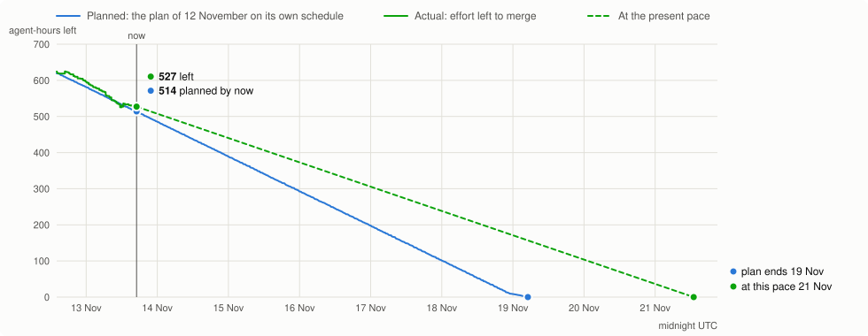
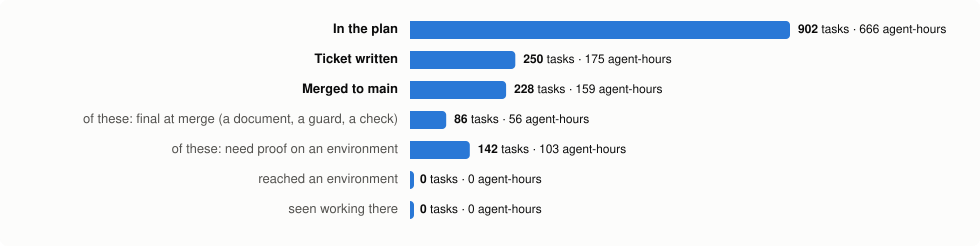
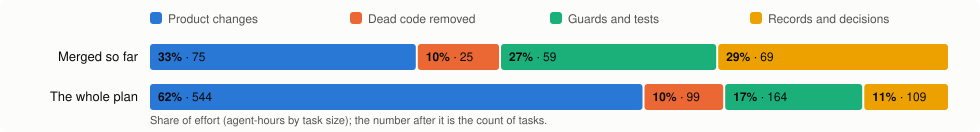
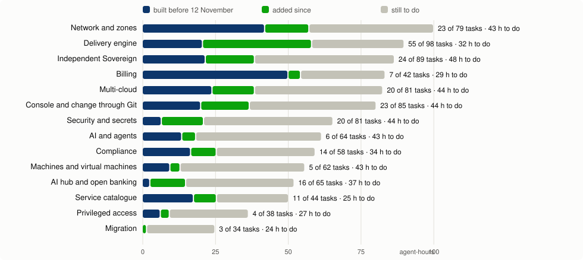
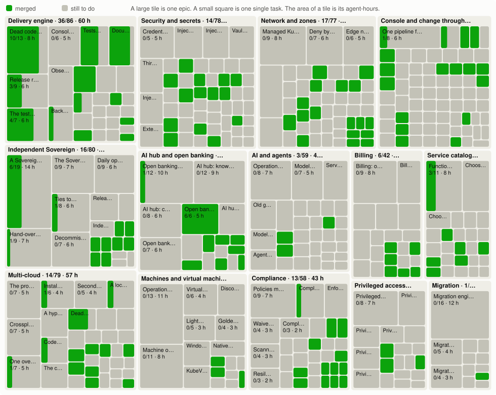
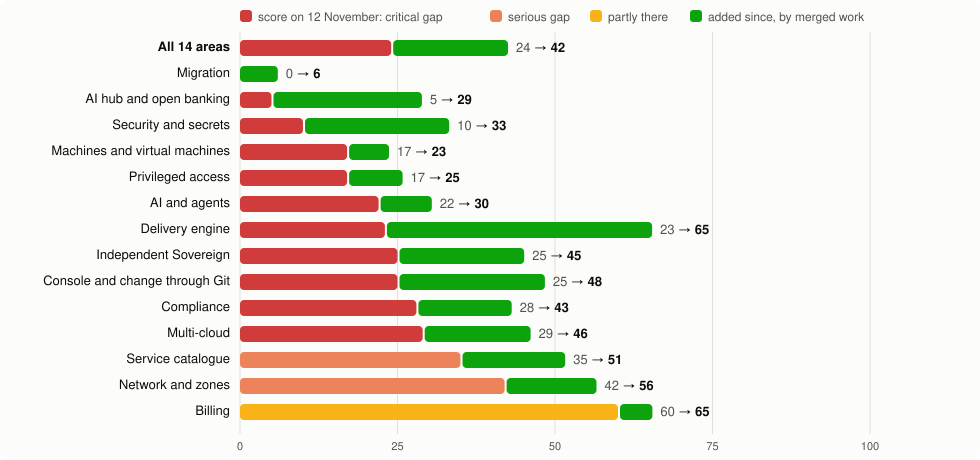
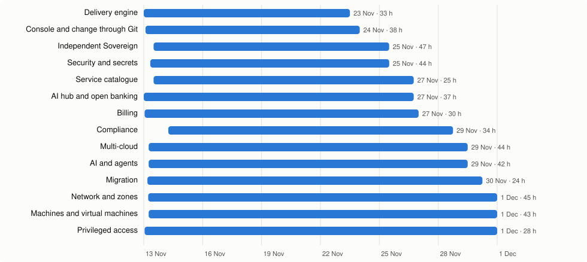

# North star dashboard

Status on 13 November 2026. The baseline is the platform as it stood on 12 November 2026, after nine months of work by its agents. All work is done by agents; effort is in agent-hours and tokens, from the tasks that were actually run.

## On the environment: what is deployed and what is not

Read from the environment hw307 itself at 19:30 UTC on 13 November. Merged means the code is on the main branch with green checks. Deployed means the release that carries it runs on the environment in both regions. Validated means it was seen working there, with evidence.

| State of the merged tasks | Tasks |
|---|---|
| **Validated** on the environment | **4** |
| **Deployed** on the environment, not yet validated | **3** |
| **Merged, NOT deployed** (can be proven on the running environment) | **44** |
| Merged, proven only by a fresh installation: not done yet | 22 |
| Merged, needs no environment (CI checks, guards, tests, records, lab results) | 104 |
| Merged in total | 177 |

**The next release to the environment.** One catch-up update brings the environment to main, region b first, then region a. Its fixes are already on main (checked commit by commit on 14 November), so it follows main itself and no side branch. The delivery tool is written and its read-only plan step ran against both regions. After the catch-up, the environment is updated once per release candidate cut from main.

### Deployed (7)

| Task | What it does | State on the environment |
|---|---|---|
| [BSS-035](plan/tickets/BSS-035.md) | The storefront says when prices are unavailable | **validated**, release hw307-ns.1 |
| [NET-041](plan/tickets/NET-041.md) | Remove the firewall claims from the storefront and the console | **validated**, release hw307-ns.1 |
| [NET-070](plan/tickets/NET-070.md) | Wizard shows what the provisioner builds | **validated**, release hw307-ns.1 |
| [NET-072](plan/tickets/NET-072.md) | Placement selectors offer the host only | **validated**, release hw307-ns.1 |
| [SOV-030](plan/tickets/SOV-030.md) | Wipe refuses a handed-over Sovereign without confirmation | deployed, not yet validated, release hw307-ns.1 |
| [SOV-220](plan/tickets/SOV-220.md) | The console's step list comes from the status response | deployed, not yet validated, release hw307-ns.1 |
| [SVC-030](plan/tickets/SVC-030.md) | The Catalog page honours visibility and refuses what has no chart | deployed, not yet validated, release hw307-ns.1 |

### Merged and NOT deployed (44)

| Task | What it does | State on the environment |
|---|---|---|
| [BSS-030](plan/tickets/BSS-030.md) | Order capture never prices from a second list | **not deployed** |
| [CLD-021](plan/tickets/CLD-021.md) | Delete the 24 infrastructure mutation routes and the claim writer | **not deployed** |
| [CLD-022](plan/tickets/CLD-022.md) | Delete the infrastructure mutation dialogs from the console | **not deployed** |
| [CLD-161](plan/tickets/CLD-161.md) | Installation document for the installation in use | **not deployed** |
| [CMP-010](plan/tickets/CMP-010.md) | Gate checks: the score moves by push; the shown mode is the engine's mode | **not deployed** |
| [CMP-016](plan/tickets/CMP-016.md) | An optional informer kind starts when its definition arrives | **not deployed** |
| [CMP-030](plan/tickets/CMP-030.md) | Package internal/compliance: types and pure score functions | **not deployed** |
| [CTL-030](plan/tickets/CTL-030.md) | Delete the endpoint pipeline and the two duplicate registrations | **not deployed** |
| [CTL-035](plan/tickets/CTL-035.md) | Route registration leaves main() | **not deployed** |
| [CTL-040](plan/tickets/CTL-040.md) | Flux manifests to stable API versions | **not deployed** |
| [CTL-110](plan/tickets/CTL-110.md) | Commit library gitwrite | **not deployed** |
| [CTL-112](plan/tickets/CTL-112.md) | Region scopes of the commit library | **not deployed** |
| [CTL-150](plan/tickets/CTL-150.md) | Intent lock in audit mode, with its report | **not deployed** |
| [CTL-160](plan/tickets/CTL-160.md) | Package intent: validate, serialise, commit, wait | **not deployed** |
| [CTL-240](plan/tickets/CTL-240.md) | Batch G: catalogue writers onto the library | **not deployed** |
| [FND-014](plan/tickets/FND-014.md) | A deployment may name the Git ref it follows | **not deployed** |
| [FND-032](plan/tickets/FND-032.md) | Record version 2 and the check registry | **not deployed** |
| [FND-033](plan/tickets/FND-033.md) | Checks: candidate identity, zero touch, nodes, releases and pods | **not deployed** |
| [FND-034](plan/tickets/FND-034.md) | Checks: NodePort, front doors, mesh, encryption, clean wipe; journeys as checks | **not deployed** |
| [FND-093](plan/tickets/FND-093.md) | Remove the Sandbox surface of the API | **not deployed** |
| [FND-094](plan/tickets/FND-094.md) | Remove the Sandbox pages of the console | **not deployed** |
| [FND-095](plan/tickets/FND-095.md) | Remove the Sandbox orchestrator, grants and cutover entries | **not deployed** |
| [FND-097](plan/tickets/FND-097.md) | Remove the unshipped console, the one job that drives it and the tests that only target it | **not deployed** |
| [FND-171](plan/tickets/FND-171.md) | Remove the fabricated playback route and its preflight route | **not deployed** |
| [NET-030](plan/tickets/NET-030.md) | Retired names lose their policy privileges | **not deployed** |
| [NET-042](plan/tickets/NET-042.md) | Retire the two legacy per-Sovereign overlays | **not deployed** |
| [NET-060](plan/tickets/NET-060.md) | Read-only census of the network posture | **not deployed** |
| [NET-125](plan/tickets/NET-125.md) | Mesh status read, and a mode switch, in the API | **not deployed** |
| [PRD-101](plan/tickets/PRD-101.md) | Vendor the six public documents and write the profile | **not deployed** |
| [PRD-102](plan/tickets/PRD-102.md) | Generated types and server interfaces (oapi-codegen, strict server) | **not deployed** |
| [PRD-103](plan/tickets/PRD-103.md) | Ledger port and conformance kit | **not deployed** |
| [PRD-104](plan/tickets/PRD-104.md) | Consent package | **not deployed** |
| [PRD-105](plan/tickets/PRD-105.md) | Token package | **not deployed** |
| [PRD-502](plan/tickets/PRD-502.md) | Sandbox ledger | **not deployed** |
| [SEC-071](plan/tickets/SEC-071.md) | Ratchet on passwords the provisioning service writes to Git | **not deployed** |
| [SEC-080](plan/tickets/SEC-080.md) | External Secrets quick scope | **not deployed** |
| [SEC-120](plan/tickets/SEC-120.md) | etcd dump check and node hygiene check, as check files | **not deployed** |
| [SOV-035](plan/tickets/SOV-035.md) | Delete the ProvisioningState kind and its unwired store | **not deployed** |
| [SOV-110](plan/tickets/SOV-110.md) | Contract C5: schema, kit key list, the upstream package and its validator | **not deployed** |
| [SOV-120](plan/tickets/SOV-120.md) | The sovereign-ops command and its image | **not deployed** |
| [SOV-150](plan/tickets/SOV-150.md) | Kit sources become substitutions, with a render-equivalence test | **not deployed** |
| [SOV-180](plan/tickets/SOV-180.md) | The API serves the Sovereign's mode and variables, with the contract's defaults | **not deployed** |
| [SOV-320](plan/tickets/SOV-320.md) | Sign-in mail without the parent's credential | **not deployed** |
| [SVC-125](plan/tickets/SVC-125.md) | Blueprint proofs check: the function-test result in the gate record | **not deployed** |

Merged, proven only by a fresh installation (22): none proven yet

| Task | What it does | State |
|---|---|---|
| [CLD-040](plan/tickets/CLD-040.md) | Run the shared render test in CI and pin a golden render | waits for a fresh installation |
| [CLD-080](plan/tickets/CLD-080.md) | Contract directory: module contract, profile schema, pack schema, conventions, two profiles | waits for a fresh installation |
| [CLD-086](plan/tickets/CLD-086.md) | local module and reduced kit | waits for a fresh installation |
| [CLD-113](plan/tickets/CLD-113.md) | Mesh and topology read the profile | waits for a fresh installation |
| [CLD-141](plan/tickets/CLD-141.md) | Protect provider releases from pruning before they move | waits for a fresh installation |
| [CLD-142](plan/tickets/CLD-142.md) | Neutral storage gate | waits for a fresh installation |
| [CLD-185](plan/tickets/CLD-185.md) | Hetzner control-plane cloud-init with the post-back on fits the module size guard | waits for a fresh installation |
| [CMP-036](plan/tickets/CMP-036.md) | Kit slot 27a: values document, hand-over variable, definitions on upgrade | waits for a fresh installation |
| [CTL-041](plan/tickets/CTL-041.md) | Bootstrap-kit HelmRepository documents to source v1 | waits for a fresh installation |
| [NET-010](plan/tickets/NET-010.md) | Close peer and stale ports on the reference provider | waits for a fresh installation |
| [NET-020](plan/tickets/NET-020.md) | Disable the k3s kube-proxy | waits for a fresh installation |
| [NET-031](plan/tickets/NET-031.md) | Stop reflecting the object-storage Secret to retired namespaces | waits for a fresh installation |
| [NET-100](plan/tickets/NET-100.md) | Network registry output and validator | waits for a fresh installation |
| [SEC-020](plan/tickets/SEC-020.md) | Random k3s server token and separate agent token | waits for a fresh installation |
| [SEC-030](plan/tickets/SEC-030.md) | etcd encryption on at first boot | waits for a fresh installation |
| [SOV-130](plan/tickets/SOV-130.md) | Substrate window, part 1: modules and cloud-init take the variables document | waits for a fresh installation |
| [SOV-131](plan/tickets/SOV-131.md) | Provider modules take the variables map of the upstream contract | waits for a fresh installation |
| [SOV-133](plan/tickets/SOV-133.md) | The boot template and the provider contract take the variables document | waits for a fresh installation |
| [SOV-140](plan/tickets/SOV-140.md) | Substrate window, part 2: revocable bootstrap access, peer tokens, node artifacts from the registry | waits for a fresh installation |
| [SOV-141](plan/tickets/SOV-141.md) | Each peer region gets its own handover-peer token, given to the primary once at hand-over | waits for a fresh installation |
| [SOV-160](plan/tickets/SOV-160.md) | Registry projects, the Organization Git token and the two repositories are created at install | waits for a fresh installation |
| [SVC-060](plan/tickets/SVC-060.md) | Function-test convention and the data charts | waits for a fresh installation |

Merged, needs no environment (104)

ACC-020, ACC-030, [ACC-060](plan/tickets/ACC-060.md), AIP-010, AIP-020, [AIP-060](plan/tickets/AIP-060.md), [BSS-010](plan/tickets/BSS-010.md), [BSS-020](plan/tickets/BSS-020.md), [BSS-050](plan/tickets/BSS-050.md), BSS-S2, [CLD-010](plan/tickets/CLD-010.md), CLD-050, CLD-055, [CLD-063](plan/tickets/CLD-063.md), [CLD-070](plan/tickets/CLD-070.md), [CLD-071](plan/tickets/CLD-071.md), [CLD-075](plan/tickets/CLD-075.md), [CMP-005](plan/tickets/CMP-005.md), [CMP-012](plan/tickets/CMP-012.md), [CMP-014](plan/tickets/CMP-014.md), CMP-S1, CMP-S2, CMP-S3, CMP-S4, CMP-S5, CMP-S6, [CTL-010](plan/tickets/CTL-010.md), [CTL-020](plan/tickets/CTL-020.md), [CTL-025](plan/tickets/CTL-025.md), [CTL-044](plan/tickets/CTL-044.md), [CTL-045](plan/tickets/CTL-045.md), CTL-050, CTL-055, [CTL-060](plan/tickets/CTL-060.md), [CTL-201](plan/tickets/CTL-201.md), FND-001, FND-002, [FND-011](plan/tickets/FND-011.md), [FND-013](plan/tickets/FND-013.md), [FND-018](plan/tickets/FND-018.md), [FND-020](plan/tickets/FND-020.md), [FND-021](plan/tickets/FND-021.md), [FND-022](plan/tickets/FND-022.md), [FND-023](plan/tickets/FND-023.md), [FND-031](plan/tickets/FND-031.md), [FND-040](plan/tickets/FND-040.md), [FND-051](plan/tickets/FND-051.md), [FND-052](plan/tickets/FND-052.md), [FND-053](plan/tickets/FND-053.md), [FND-054](plan/tickets/FND-054.md), [FND-055](plan/tickets/FND-055.md), [FND-061](plan/tickets/FND-061.md), [FND-091](plan/tickets/FND-091.md), [FND-092](plan/tickets/FND-092.md), [FND-096](plan/tickets/FND-096.md), [FND-098](plan/tickets/FND-098.md), [FND-099](plan/tickets/FND-099.md), [FND-101](plan/tickets/FND-101.md), [FND-102](plan/tickets/FND-102.md), [FND-103](plan/tickets/FND-103.md), [FND-105](plan/tickets/FND-105.md), [FND-106](plan/tickets/FND-106.md), [FND-110](plan/tickets/FND-110.md), [FND-173](plan/tickets/FND-173.md), [FND-181](plan/tickets/FND-181.md), [INF-010](plan/tickets/INF-010.md), INF-030, [INF-070](plan/tickets/INF-070.md), MIG-050, [NET-033](plan/tickets/NET-033.md), [NET-050](plan/tickets/NET-050.md), [NET-052](plan/tickets/NET-052.md), [NET-090](plan/tickets/NET-090.md), NET-290, NET-300, [PRD-010](plan/tickets/PRD-010.md), [PRD-020](plan/tickets/PRD-020.md), [PRD-030](plan/tickets/PRD-030.md), PRD-040, PRD-060, PRD-070, PRD-080, [PRD-106](plan/tickets/PRD-106.md), [SEC-005](plan/tickets/SEC-005.md), [SEC-006](plan/tickets/SEC-006.md), [SEC-110](plan/tickets/SEC-110.md), [SEC-125](plan/tickets/SEC-125.md), SEC-130, SEC-135, SEC-140, SEC-271, SEC-280, [SOV-040](plan/tickets/SOV-040.md), [SOV-050](plan/tickets/SOV-050.md), SOV-060, SOV-070, SOV-080, SOV-090, [SVC-010](plan/tickets/SVC-010.md), [SVC-020](plan/tickets/SVC-020.md), SVC-120, SVC-210, SVC-315, SVC-340.

## Right now

Measured from GitHub at 19:30 UTC on 13 November 2026. This block is rebuilt automatically every 30 minutes.

| | |
|---|---|
| **Overall completion** | **20.1%** of the tasks are merged (177 of 879). By effort that is 19.2% (124 of 649 agent-hours). Proven on a live environment: 4 tasks (0.5%). |
| **Estimated time still needed** | About **179 running hours** until every task is merged (about 7 days if the agents run day and night). About **264 running hours** until every task is also proven on an environment. Agent effort still to spend: about 525 agent-hours. |
| How the estimate is made | Merged: 702 tasks are left; the last 12 hours merged 3.9 tasks an hour, lab results not counted, which gives 179 hours; the longest row of tasks that must follow one another is 28 long, at about 2 hours each, which gives 56 hours; the larger number is shown. Proven: the plan's simulation of six agents with an update of the environment every 4 hours and a fresh install every 24. Both move as the work goes; a stop or an interruption adds to them. |
| **Tokens used so far** | **11.7 billion** tokens, nearly all of them since 11 November: 3.2 billion to design the plan and 8.5 billion to carry it out so far. Of the total, 11.4 billion are re-reads of text the models had already read once, which is the cheap kind; 231 million are text read for the first time and 56 million are text the models wrote. By model: Opus 5.5 7.5 billion, Fable 5.2 4.2 billion. At the published pay-as-you-go prices these tokens would cost about $5,500. |
| **Tokens still expected** | About **36 billion** more until every task is merged, which makes about 48 billion in all; 25% of that is spent. Basis: carrying out the plan has used 69 million tokens for each agent-hour of merged work, and 525 agent-hours are left. Proving the tasks on an environment comes on top; too few are proven to measure it. |
| **Accounts needed on the $200 plan** | Two accounts are used, one at a time. The first stood at **72%** when the work moved to the second on 13 Nov 19:20 UTC; its remaining 28% can be used until 18 Nov 12:00 UTC. Together about **99 points** are left before the two are filled again. The account in use now (plan Max 20x) has spent **29%** of this week's allowance, 62 hours into the week (the week runs from 11 Nov 06:00 to 18 Nov 06:00 UTC). In the last 24 hours the work used 46% of one weekly allowance, which is 3.2 accounts' worth a week: **4 accounts** keep that pace without a stop. At that rise this account's allowance is used up around **15 Nov 08:00 UTC**, 3 days before it is filled again. Paid extra usage is switched off on the account, so the agents stop there unless another account is logged in. This is taken from the tokens; the meter has been read for less than an hour. The work still to merge needs about 2.1 weekly allowances by the token measure. |
| How the tokens and the allowance are measured | Tokens are counted from the transcripts on the build machine, each model call once, for every agent of this work. Anthropic states no token figure for the plan, so the share of the weekly allowance that is used is read from the account's own usage meter every 30 minutes and set against the tokens counted in the same hours; by that measure one weekly allowance is about 17 billion tokens of this mix. The meter counts Fable and Opus differently, so each is weighed on its own. The pace is taken from the meter itself once it has been read for an hour (the oldest reading of the last six hours); until then from the tokens. Every session on the account counts, also work that is not this plan. |
| Tasks merged to the main branch | **177 of 879** |
| Tasks with a written ticket | 143 |
| Being worked on by an agent now | CLD-087 ([#7498](https://github.com/openova-io/openova/pull/7498)), FND-015 ([#7497](https://github.com/openova-io/openova/pull/7497)) |
| Lab-test results waiting to merge | none |
| Lab tests started, each on its own branch in CI | 27: ACC-020, ACC-030, AIP-010, AIP-020, CLD-050, CLD-055, CMP-S1, CMP-S2, CMP-S3, CMP-S4, CMP-S5, CMP-S6, CTL-050, CTL-055, INF-030, MIG-050, PRD-040, PRD-060, PRD-070, PRD-080, SEC-130, SEC-140, SEC-280, SOV-060, SVC-120, SVC-210, SVC-340 |
| Merged per day | 2026-11-12: 8, 2026-11-13: 159, 2026-11-14: 10 |
| Proven on the live environment hw307 | **4**: BSS-035, NET-041, NET-070, NET-072. Each was seen working in a browser there and its ticket is closed. hw307 does not follow the main branch: a merged task reaches it by a separate release, and only then counts as proven. |
| Milestone: replacement mothership on Hetzner (SOV-920) | 88 tasks before it are not merged yet. The three proofs it needs: SOV-810 open, SOV-820 open, CLD-182 open. The founder is told on issue #7087 when it starts. |
| Board with every task as a card | [github.com/orgs/openova-io/projects/2](https://github.com/orgs/openova-io/projects/2) |

### Burndown: effort left to merge, planned and actual

**525 agent-hours** are left to merge; the plan's own schedule expected **504** by now. The work is **21 agent-hours behind** that schedule. The plan's schedule ends on 19 November; at the present pace the last task merges around 21 November.

How to read it. Planned: the plan as first published on 12 November (843 tasks, 619 agent-hours), run through the roadmap's schedule model (six agents over the plan's dependencies, 16 running hours a day). Actual: the tasks of the plan at each moment, less those merged by then, in the same agent-hours by task size. 36 tasks were added to the plan since; the actual line steps up where each appears. The dashed line runs from now to the estimate above. Both lines count merging; proof on an environment is not in this chart.

| Midnight UTC | Planned left | Actual left |
|---|---|---|
| 13 Nov | 582 | 597 |
| now (13 Nov 19:30) | 504 | 525 |

### On the environment: deployed and validated

Read from the standing environment hw307 itself at 19:30 UTC on 13 November. A task counts as deployed only when the release that carried it is the one running there, and as validated only when it was seen working there.

| | Tasks |
|---|---|
| Merged tasks that can be proven on the running environment | 51 |
| — **deployed** there (their release is running, checked against the cluster) | **7** |
| — **validated** there (seen working, with evidence) | **4** |
| — merged and **waiting for a release** to the environment | **44** |
| Merged tasks that change first boot: proven only by a fresh install | 24, none proven |

| Release to the environment | When | Running now (checked) | Tasks it carried | Validated | Evidence |
|---|---|---|---|---|---|
| hw307-ns.1 (umbrella 1.4.1906-hw307.23-ns.1) | 2026-11-13 05:10 | region a: yes, region b: yes | SVC-030, NET-041, NET-070, NET-072, SOV-030, SOV-220, BSS-035 | NET-041, NET-070, NET-072, BSS-035 | [record](screenshots/north-star/README.md) |

| Region | Releases ready | Switched off on purpose | Not ready | Umbrella chart | Images running |
|---|---|---|---|---|---|
| a | 73 of 75 | 5 | **2**: acmewalk307/bp-agenity, acmewalk307/bp-wordpress-tenant | 1.4.1906-hw307.23-ns.1 | catalyst-api `hw307-b98777d`, catalyst-ui `hw307-2e1d885`, marketplace `hw307-2e1d885`, marketplace-api `0d9531a` |
| b | 67 of 67 | 7 | none | 1.4.1906-hw307.23-ns.1 | none of the console images run in this region |

Waiting for a release to the environment (44): BSS-030, CLD-021, CLD-022, CLD-161, CMP-010, CMP-016, CMP-030, CTL-030, CTL-035, CTL-040, CTL-110, CTL-112, CTL-150, CTL-160, CTL-240, FND-014, FND-032, FND-033, FND-034, FND-093, FND-094, FND-095, FND-097, FND-171, NET-030, NET-042, NET-060, NET-125, PRD-101, PRD-102, PRD-103, PRD-104, PRD-105, PRD-502, SEC-071, SEC-080, SEC-120, SOV-035, SOV-110, SOV-120, SOV-150, SOV-180, SOV-320, SVC-125.

The environment runs its own line of the code, not main, so a merged task reaches it only by a release built for it. The plan's release train (cut a candidate, update the environment in place, run the gate twice) is tasks FND-015, FND-035 and FND-073; until they are merged a release is built by hand.

### Is it real? Delivery and quality, measured

A merged task has passed its checks in CI. It is **delivered** only when it has been seen working on a running Sovereign. Today **4 of the 113** merged tasks that need an environment have been seen working on one. Nothing merged since 12 November runs on an environment yet: no Sovereign has been installed from main, and hw307 runs a separate line. The figures below are taken from GitHub and from main by script.

| Stage | Tasks | Agent-hours |
|---|---|---|
| In the plan | 879 | 649 |
| Ticket written | 180 | 126 |
| Merged to main | 177 | 124 |
| — of these: final at merge (a document, a guard, a check) | 64 | 42 |
| — of these: need proof on an environment | 113 | 83 |
| — reached an environment | 7 | 4 |
| — seen working there | 4 | 2 |

**What kind of work is merged.** If the merged work were mostly records and checks while the plan is mostly product, the bars would differ.

| Kind of work | Merged: share of effort | Merged: tasks | Whole plan: share of effort | Whole plan: tasks |
|---|---|---|---|---|
| Product changes | 28% | 47 | 62% | 525 |
| Dead code removed | 11% | 21 | 10% | 93 |
| Guards and tests | 26% | 44 | 17% | 154 |
| Records and decisions | 35% | 65 | 11% | 107 |

| Measure | Now | What it tells |
|---|---|---|
| The plan's own checks (237) by state | 213 not-built, 17 expected-fail, 7 required | A check is the plan's definition of done for a capability. "required" means it must pass on a fresh install; none has been run on one yet. |
| Acceptance commands of merged tasks, run again on main (2026-11-13 19:00 UTC, commit b44ef5300) | **842 of 891** still pass. 49 do not: 0 replaced on purpose by a later task, 0 broken by a later merge, 49 not yet explained. 30 more compare a change with its base and can only run on the pull request. | A command that passed on its pull request and fails on today's main was either replaced by plan or broken by a later merge. Each failure is explained by name. |
| Workflow runs on main that ended red, per day | 12 Nov: 3 red of 982 (0.3%); 13 Nov: 8 red of 2508 (0.3%) | Whether main is a base one can build on. A red run on main is a defect that reached main or a check that is not reliable. |
| Times an executor stopped and reported a ticket or main as wrong | 23 reports on 20 tasks, against 177 merged | A stop is the system refusing to guess. Many stops for one cause point at a defect of main or of the tickets. |
| Lines changed on main since the plan started | Product code and configuration: +122,275 −54,573; Tests: +20,521 −18,553; Checks and tooling: +22,634 −1,214; Plan, tickets and documents: +165,422 −1,814; Other: +29 −2,507 | How much of the change is the product itself. Tickets and the plan are large by nature. Generated files count too (one generated client is about 70,000 lines), and so do the release bot's version lines. |
| Fresh install from main: did it start, how long, how many releases ready | **not measured: no environment installed from main exists** | The only proof that the merged first-boot changes work together. |
| Acceptance suite and walk on that install | **not measured, same reason** | That a person can do the thing: the five pillars. |

### The last 25 merged tasks

| Merged (UTC) | Task | What it did | Pull request |
|---|---|---|---|
| 13 Nov 18:35 | [SOV-180](plan/tickets/SOV-180.md) | feat(catalyst-api): the self route reports the mode and phase that the API reads at run time | [#7491](https://github.com/openova-io/openova/pull/7491) |
| 13 Nov 18:35 | [CTL-041](plan/tickets/CTL-041.md) | refactor(bootstrap-kit): declare every kit HelmRepository at source v1 | [#7492](https://github.com/openova-io/openova/pull/7492) |
| 13 Nov 18:34 | [SOV-120](plan/tickets/SOV-120.md) | feat(sovereign): the sovereign-ops command with its result line, exit codes and image | [#7490](https://github.com/openova-io/openova/pull/7490) |
| 13 Nov 18:04 | [CLD-185](plan/tickets/CLD-185.md) | fix(cloud-init): pack seven boot files so a Hetzner render with the post-back fits its size guard | [#7485](https://github.com/openova-io/openova/pull/7485) |
| 13 Nov 17:44 | [CLD-086](plan/tickets/CLD-086.md) | feat(providers): local provider pack module, reduced kit and its generator | [#7481](https://github.com/openova-io/openova/pull/7481) |
| 13 Nov 17:43 | [FND-096](plan/tickets/FND-096.md) | chore: remove the withdrawn Sandbox sources and count the remaining mentions | [#7482](https://github.com/openova-io/openova/pull/7482) |
| 13 Nov 17:43 | [FND-013](plan/tickets/FND-013.md) | ci: one aggregate check, merge-group triggers, rulesets and code owners as files | [#7480](https://github.com/openova-io/openova/pull/7480) |
| 13 Nov 16:34 | [SOV-133](plan/tickets/SOV-133.md) | refactor(cloud-init): the boot template and the provider contract take the variables document | [#7475](https://github.com/openova-io/openova/pull/7475) |
| 13 Nov 16:22 | [SOV-141](plan/tickets/SOV-141.md) | feat(cloud-init): each peer region posts its own handover-peer kubeconfig and the parent forwards it at hand-over | [#7474](https://github.com/openova-io/openova/pull/7474) |
| 13 Nov 16:03 | [FND-020](plan/tickets/FND-020.md) | ci: the pin audit and the umbrella republish gate judge a pull request on the drift it adds | [#7469](https://github.com/openova-io/openova/pull/7469) |
| 13 Nov 15:38 | [CLD-141](plan/tickets/CLD-141.md) | chore(bootstrap-kit): keep the four provider releases when Flux stops listing them | [#7466](https://github.com/openova-io/openova/pull/7466) |
| 13 Nov 15:26 | [CLD-113](plan/tickets/CLD-113.md) | refactor(api): the mesh port and the topology front door stop naming providers | [#7459](https://github.com/openova-io/openova/pull/7459) |
| 13 Nov 15:03 | [CTL-045](plan/tickets/CTL-045.md) | feat(contracts): publish contract C9, the mutating-route table, with its generator and router test | [#7463](https://github.com/openova-io/openova/pull/7463) |
| 13 Nov 14:26 | [SOV-035](plan/tickets/SOV-035.md) | refactor: delete the ProvisioningState kind and its unwired store | [#7456](https://github.com/openova-io/openova/pull/7456) |
| 13 Nov 14:26 | [CLD-142](plan/tickets/CLD-142.md) | refactor(kit): neutral storage gate storage-ready replaces the disk-driver dependencies of bp-cnpg | [#7455](https://github.com/openova-io/openova/pull/7455) |
| 13 Nov 14:24 | [FND-018](plan/tickets/FND-018.md) | ci: the release writer never moves a version back, and the umbrella chart follows a catalogue move | [#7458](https://github.com/openova-io/openova/pull/7458) |
| 13 Nov 14:13 | [SOV-131](plan/tickets/SOV-131.md) | refactor(providers): the modules take the variables document and the provisioner passes it | [#7452](https://github.com/openova-io/openova/pull/7452) |
| 13 Nov 13:51 | [FND-098](plan/tickets/FND-098.md) | chore: remove one retired chart folder and one dead harness | [#7447](https://github.com/openova-io/openova/pull/7447) |
| 13 Nov 13:12 | [CTL-150](plan/tickets/CTL-150.md) | feat(chart): install the intent lock in audit mode with guard G6 | [#7441](https://github.com/openova-io/openova/pull/7441) |
| 13 Nov 13:11 | [CTL-040](plan/tickets/CTL-040.md) | refactor(flux): declare HelmRepository at source v1 outside the bootstrap kit | [#7442](https://github.com/openova-io/openova/pull/7442) |
| 13 Nov 13:04 | [SOV-320](plan/tickets/SOV-320.md) | fix(stalwart-sovereign): a bounded setup job that is no install hook, reaches the admin API and takes no parent password | [#7440](https://github.com/openova-io/openova/pull/7440) |
| 13 Nov 13:03 | [SOV-160](plan/tickets/SOV-160.md) | feat(sovereign): Harbor and Gitea create the registry projects and the platform repositories at install | [#7425](https://github.com/openova-io/openova/pull/7425) |
| 13 Nov 12:37 | [FND-095](plan/tickets/FND-095.md) | chore(tenant): remove the Sandbox orchestrator, its grants and its cutover entries | [#7432](https://github.com/openova-io/openova/pull/7432) |
| 13 Nov 12:21 | [NET-030](plan/tickets/NET-030.md) | chore(policy): retired names lose their policy privileges | [#7428](https://github.com/openova-io/openova/pull/7428) |
| 13 Nov 12:21 | [CTL-035](plan/tickets/CTL-035.md) | refactor(api): move route registration out of main into one register function per concern | [#7427](https://github.com/openova-io/openova/pull/7427) |

### Merged changes a user can see

Of the 177 merged tasks, 64 are documents, decisions and checks that change no running product. The tasks below change a screen. The last column says whether the change has been seen working on hw307. The record of the walk, with screenshots, is [screenshots/north-star](screenshots/north-star/README.md).

| Task | What changes on the screen | Pull request | On hw307 |
|---|---|---|---|
| [FND-094](plan/tickets/FND-094.md) | Remove the Sandbox pages of the console | [#7181](https://github.com/openova-io/openova/pull/7181) | not proven yet |
| [FND-097](plan/tickets/FND-097.md) | Remove the unshipped console, the one job that drives it and the tests that only target it | [#7156](https://github.com/openova-io/openova/pull/7156) | not proven yet |
| [CLD-022](plan/tickets/CLD-022.md) | Delete the infrastructure mutation dialogs from the console | [#7366](https://github.com/openova-io/openova/pull/7366) | not proven yet |
| [SOV-030](plan/tickets/SOV-030.md) | Wipe refuses a handed-over Sovereign without confirmation | [#7205](https://github.com/openova-io/openova/pull/7205) | not proven yet |
| [SOV-220](plan/tickets/SOV-220.md) | The console's step list comes from the status response | [#7303](https://github.com/openova-io/openova/pull/7303) | not proven yet |
| [NET-041](plan/tickets/NET-041.md) | Remove the firewall claims from the storefront and the console | [#7288](https://github.com/openova-io/openova/pull/7288) | **seen working, ticket closed** |
| [NET-070](plan/tickets/NET-070.md) | Wizard shows what the provisioner builds | [#7256](https://github.com/openova-io/openova/pull/7256) | **seen working, ticket closed** |
| [NET-072](plan/tickets/NET-072.md) | Placement selectors offer the host only | [#7245](https://github.com/openova-io/openova/pull/7245) | **seen working, ticket closed** |
| [SVC-030](plan/tickets/SVC-030.md) | The Catalog page honours visibility and refuses what has no chart | [#7273](https://github.com/openova-io/openova/pull/7273) | not proven yet |
| [CTL-030](plan/tickets/CTL-030.md) | Delete the endpoint pipeline and the two duplicate registrations | [#7361](https://github.com/openova-io/openova/pull/7361) | not proven yet |
| [BSS-035](plan/tickets/BSS-035.md) | The storefront says when prices are unavailable | [#7202](https://github.com/openova-io/openova/pull/7202) | **seen working, ticket closed** |

### Merged changes that show on the next fresh install

| Task | What changes | Pull request |
|---|---|---|
| [CLD-040](plan/tickets/CLD-040.md) | Run the shared render test in CI and pin a golden render | [#7127](https://github.com/openova-io/openova/pull/7127) |
| [CLD-070](plan/tickets/CLD-070.md) | Decision record and truthful contract documents | [#7129](https://github.com/openova-io/openova/pull/7129) |
| [CLD-075](plan/tickets/CLD-075.md) | Generator for the provider and profile tables | [#7309](https://github.com/openova-io/openova/pull/7309) |
| [CLD-080](plan/tickets/CLD-080.md) | Contract directory: module contract, profile schema, pack schema, conventions, two profiles | [#7297](https://github.com/openova-io/openova/pull/7297) |
| [CLD-086](plan/tickets/CLD-086.md) | local module and reduced kit | [#7481](https://github.com/openova-io/openova/pull/7481) |
| [CLD-113](plan/tickets/CLD-113.md) | Mesh and topology read the profile | [#7459](https://github.com/openova-io/openova/pull/7459) |
| [CLD-141](plan/tickets/CLD-141.md) | Protect provider releases from pruning before they move | [#7466](https://github.com/openova-io/openova/pull/7466) |
| [CLD-142](plan/tickets/CLD-142.md) | Neutral storage gate | [#7455](https://github.com/openova-io/openova/pull/7455) |
| [CLD-185](plan/tickets/CLD-185.md) | Hetzner control-plane cloud-init with the post-back on fits the module size guard | [#7485](https://github.com/openova-io/openova/pull/7485) |
| [SOV-130](plan/tickets/SOV-130.md) | Substrate window, part 1: modules and cloud-init take the variables document | [#7363](https://github.com/openova-io/openova/pull/7363) |
| [SOV-131](plan/tickets/SOV-131.md) | Provider modules take the variables map of the upstream contract | [#7452](https://github.com/openova-io/openova/pull/7452) |
| [SOV-133](plan/tickets/SOV-133.md) | The boot template and the provider contract take the variables document | [#7475](https://github.com/openova-io/openova/pull/7475) |
| [SOV-140](plan/tickets/SOV-140.md) | Substrate window, part 2: revocable bootstrap access, peer tokens, node artifacts from the registry | [#7406](https://github.com/openova-io/openova/pull/7406) |
| [SOV-141](plan/tickets/SOV-141.md) | Each peer region gets its own handover-peer token, given to the primary once at hand-over | [#7474](https://github.com/openova-io/openova/pull/7474) |
| [SOV-160](plan/tickets/SOV-160.md) | Registry projects, the Organization Git token and the two repositories are created at install | [#7425](https://github.com/openova-io/openova/pull/7425) |
| [SEC-020](plan/tickets/SEC-020.md) | Random k3s server token and separate agent token | [#7178](https://github.com/openova-io/openova/pull/7178) |
| [SEC-030](plan/tickets/SEC-030.md) | etcd encryption on at first boot | [#7400](https://github.com/openova-io/openova/pull/7400) |
| [NET-010](plan/tickets/NET-010.md) | Close peer and stale ports on the reference provider | [#7195](https://github.com/openova-io/openova/pull/7195) |
| [NET-020](plan/tickets/NET-020.md) | Disable the k3s kube-proxy | [#7302](https://github.com/openova-io/openova/pull/7302) |
| [NET-031](plan/tickets/NET-031.md) | Stop reflecting the object-storage Secret to retired namespaces | [#7103](https://github.com/openova-io/openova/pull/7103) |
| [NET-100](plan/tickets/NET-100.md) | Network registry output and validator | [#7318](https://github.com/openova-io/openova/pull/7318) |
| [SVC-060](plan/tickets/SVC-060.md) | Function-test convention and the data charts | [#7401](https://github.com/openova-io/openova/pull/7401) |
| [CTL-041](plan/tickets/CTL-041.md) | Bootstrap-kit HelmRepository documents to source v1 | [#7492](https://github.com/openova-io/openova/pull/7492) |
| [CMP-036](plan/tickets/CMP-036.md) | Kit slot 27a: values document, hand-over variable, definitions on upgrade | [#7277](https://github.com/openova-io/openova/pull/7277) |

A further 78 merged tasks change a running service without a screen of their own; they are proven by a test on the environment.

## What was built before the baseline

This is the ground the plan stands on. It is measured from the repository.

| | |
|---|---|
| Commits on the main branch since February 2026 | **25,978** |
| Pull requests merged | **4,464** |
| Issues closed | 1,929 |
| Blueprint charts | 100 |
| Go source files | 1,877, of which 1,032 are tests |
| Console source files | 1,139 |
| Browser test specs | 56 |
| CI workflows and guard scripts | 133 and 77 |

Against the target of this plan, that work stands at **24% built** across the 14 product areas, from 60% in billing to nothing yet in migration. The plan below is the remaining distance.

| | |
|---|---|
| Built before the baseline | **24%** of the target, by the code audit |
| Tasks of the plan delivered since | **177 of 879** |
| Epics in the backlog | 102, plus single fixes in 14 areas |
| Still to spend | about 524 agent-hours and 525 million tokens |
| Last feature done, six agents in parallel | about 29 Nov (264 running hours at 16 a day) |
| Releases | 55 updates of the environment and 11 fresh installs |

## Where we started and where we are, to scale

The length of a bar is the size of that area, so a long bar is a big area and a short bar a small one. Dark blue is what was already built on 12 November. Green is what has been merged since. Grey is still to do. Sizes are in agent-hours: the green and grey parts are the plan's own estimate; the dark part is scaled from the audit percentage, so it is an estimate of size, not a record of hours spent.

All 14 areas together: 24% was built before the baseline, and the target is now 38.6% built. 124 agent-hours of the plan are merged and 524 are still to do.

| Product area | Built before | Tasks merged | Agent-hours merged | Agent-hours to do | Share of all remaining work |
|---|---:|---:|---:|---:|---:|
| Network and zones | 42% | 17 of 77 | 11 | 46 | 9% |
| Billing | 60% | 6 of 42 | 4 | 30 | 6% |
| Independent Sovereign | 25% | 20 of 84 | 14 | 47 | 9% |
| Multi-cloud | 29% | 17 of 79 | 12 | 45 | 9% |
| Delivery engine | 23% | 39 of 86 | 27 | 33 | 6% |
| Console and change through Git | 25% | 18 of 77 | 13 | 41 | 8% |
| Security and secrets | 10% | 14 of 78 | 10 | 46 | 9% |
| Compliance | 28% | 13 of 58 | 8 | 35 | 7% |
| AI and agents | 22% | 3 of 59 | 2 | 42 | 8% |
| Machines and virtual machines | 17% | 3 of 61 | 2 | 44 | 8% |
| AI hub and open banking | 5% | 14 of 63 | 11 | 37 | 7% |
| Service catalogue | 35% | 9 of 43 | 6 | 25 | 5% |
| Privileged access | 17% | 3 of 38 | 2 | 28 | 5% |
| Migration | 0% | 1 of 34 | 0 | 24 | 5% |

## Every epic, to scale

Every piece of work in the plan, grouped by product area. A large tile is one epic; a small square is one single task that belongs to no epic. The area of a tile is its size in agent-hours, so the big tiles are the big pieces of work. Green is merged: a whole green square is a merged task, and the green part of an epic tile is the share of it already merged. An epic tile shows tasks merged of tasks in the epic, and its hours. The table of every epic is further down.

## The product: where it started and where it is now

Score from 0 to 100 against the target. The red, orange or yellow part is where the area stood on 12 November, measured from the code by the audit: red is a critical gap, orange a serious one, yellow partly there. The green part is what has been added since. Each row reads start → now.

The number for now is the start score plus the share of the remaining distance that is merged, counted in agent-hours. It counts work merged to the main branch. A task counts as proven only when it runs on the live environment, and the block at the top of this page says how much of it does.

| Product area (start → now) | At the start | Target | Epics | Tasks | Agent-hours to do | Tokens to do, M | Done by |
|---|---|---|---:|---:|---:|---:|---|
| **Independent Sovereign** (25 → 42) | Installs and runs in two regions, but still depends on its parent after hand-over. | Local from first boot, owns its keys, upgrades in place, can create a child Sovereign. | 9 | 84 | 47 | 47 | 25 Nov |
| **Multi-cloud** (29 → 44) | Runs on the National Cloud and one other cloud by special cases in shared code. | A cloud is a pack of files behind one contract. A second cloud and a hyperscaler proven. Managed Kubernetes as an option. | 13 | 79 | 45 | 44 | 28 Nov |
| **Security and secrets** (10 → 26) | The vault runs, but every application credential is still stored in etcd. | Credentials are mounted from the vault into the running workload. Urgent holes closed first. | 7 | 78 | 46 | 46 | 25 Nov |
| **Network and zones** (42 → 53) | The data plane is sound. The network is open by default. | Deny by default, mesh declared in Git, edge nodes and a load balancer per region. | 6 | 77 | 46 | 46 | 29 Nov |
| **Console and change through Git** (25 → 43) | Delivery goes through Git. Most console actions write straight to the cluster. | Every change is a commit. Screens update by push. | 2 | 77 | 41 | 41 | 23 Nov |
| **Service catalogue** (35 → 48) | The bootstrap kit is real. Users cannot choose a cloud's native service. | Every Blueprint has a class. Object storage and PostgreSQL offered as native or self-hosted. | 3 | 43 | 25 | 25 | 25 Nov |
| **Compliance** (28 → 42) | 24 policies and one proven score. | Posture hub, waivers, scanner reports, runtime and resilience views, frameworks. | 8 | 58 | 35 | 35 | 27 Nov |
| **Billing** (60 → 64) | The strongest area. Works on the live environment, structurally tangled. | One plan source, metered model usage, collectors per cloud, standalone option for a cloud operator. | 7 | 42 | 30 | 30 | 25 Nov |
| **AI and agents** (22 → 26) | Four model gateways, one agent workspace, no usable metering. | One gateway with Axon as simulator, an agent runtime, metering, service-management agents. | 7 | 59 | 42 | 42 | 28 Nov |
| **Machines and virtual machines** (17 → 20) | No virtual-machine service exists. | Virtual machines, machine operations over SSH, golden images. | 9 | 61 | 44 | 44 | 29 Nov |
| **Privileged access** (17 → 24) | Access control, approval and recording are not in place yet. | Controlled sessions with approval, recording and review. | 7 | 38 | 28 | 28 | 29 Nov |
| **Migration** (0 → 2) | Nothing exists. | A migration engine with landing on the National Cloud and network extension. | 4 | 34 | 24 | 24 | 29 Nov |
| **AI hub and open banking** (5 → 26) | Scaffolds only. | AI hub with knowledge search and chat. Open banking sandbox, payments, portal. | 7 | 63 | 37 | 37 | 25 Nov |
| **Delivery engine** (23 → 58) | The acceptance suite exists. Very little is proven on the live environment. | Every feature proven by automatic checks on a real environment, twice, before it counts. | 13 | 86 | 33 | 33 | 22 Nov |

## When each product area is worked on

Dates come from a simulation of six agents over the plan's dependencies, 16 running hours a day, the environment updated every 4 hours and one fresh install a day. They are estimates.

## The backlog: every epic

<b>Independent Sovereign</b>: 9 epics, 84 tasks, 47 agent-hours, done by 25 Nov

| Feature (epic) | Tasks | Delivered | Agent-hours | Tokens, M | Starts | Done by |
|---|---:|---:|---:|---:|---|---|
| A Sovereign is local from its first boot | 23 | 10 | 8.8 | 8.7 | 13 Nov | 16 Nov |
| Hand-over in one short ordered step | 9 | 1 | 6.6 | 6.7 | 15 Nov | 21 Nov |
| Ties to the parent cut at boot | 8 | 1 | 5.2 | 5.2 | 13 Nov | 21 Nov |
| Release channel and in-place upgrade | 4 | 0 | 3.2 | 3.2 | 17 Nov | 21 Nov |
| Sovereign: single fixes and lab tests | 11 | 8 | 1.5 | 1.4 | 14 Nov | 21 Nov |
| Independence proven and frozen | 2 | 0 | 1.6 | 1.6 | 21 Nov | 22 Nov |
| Mothership mode: a Sovereign creates a child | 2 | 0 | 1.8 | 1.9 | 22 Nov | 23 Nov |
| The Sovereign owns its own infrastructure state | 9 | 0 | 6.8 | 6.8 | 19 Nov | 24 Nov |
| Decommission, mothership rebuild, add a region | 7 | 0 | 5.5 | 5.6 | 21 Nov | 24 Nov |
| Daily operation with the parent switched off | 9 | 0 | 6.4 | 6.4 | 13 Nov | 25 Nov |

<b>Multi-cloud</b>: 13 epics, 79 tasks, 45 agent-hours, done by 28 Nov

| Feature (epic) | Tasks | Delivered | Agent-hours | Tokens, M | Starts | Done by |
|---|---:|---:|---:|---:|---|---|
| Code stops naming cloud providers | 4 | 1 | 2.2 | 2.2 | 14 Nov | 15 Nov |
| The console reads the cloud's profile | 4 | 0 | 2.8 | 2.7 | 15 Nov | 16 Nov |
| Dead infrastructure code removed | 3 | 2 | 0.7 | 0.7 | 16 Nov | 16 Nov |
| One boot template with no provider special cases | 3 | 0 | 1.8 | 1.8 | 15 Nov | 17 Nov |
| A local test cloud on every pull request | 4 | 2 | 1.6 | 1.6 | 13 Nov | 19 Nov |
| One overlay per cloud | 7 | 2 | 3.4 | 3.4 | 17 Nov | 19 Nov |
| The provisioning engine no longer names a cloud | 7 | 0 | 5.4 | 5.5 | 14 Nov | 19 Nov |
| The Huawei cloud controller runs inside the Sovereign | 2 | 0 | 1.6 | 1.6 | 21 Nov | 21 Nov |
| Installation settings leave the code | 6 | 1 | 3.2 | 3.1 | 13 Nov | 22 Nov |
| No cloud name left in shared code | 2 | 0 | 1.3 | 1.3 | 14 Nov | 22 Nov |
| Crossplane owns node pools and infrastructure | 7 | 0 | 5.2 | 5.2 | 21 Nov | 23 Nov |
| Second cloud proven (Hetzner, one region) | 5 | 1 | 3.2 | 3.2 | 19 Nov | 23 Nov |
| Cloud: single fixes and lab tests | 21 | 8 | 9.0 | 8.9 | 13 Nov | 25 Nov |
| A hyperscaler proven (AWS), by adding files only | 4 | 0 | 3.2 | 3.2 | 23 Nov | 28 Nov |

<b>Security and secrets</b>: 7 epics, 78 tasks, 46 agent-hours, done by 25 Nov

| Feature (epic) | Tasks | Delivered | Agent-hours | Tokens, M | Starts | Done by |
|---|---:|---:|---:|---:|---|---|
| Vault upgraded, its seal out of etcd | 4 | 0 | 3.4 | 3.5 | 15 Nov | 19 Nov |
| Credentials injected into workloads, not stored in etcd | 5 | 0 | 4.6 | 4.8 | 19 Nov | 20 Nov |
| Injection rolled out: data and platform services | 6 | 0 | 3.8 | 3.7 | 19 Nov | 20 Nov |
| Third-party charts moved to injection | 5 | 0 | 3.3 | 3.2 | 19 Nov | 21 Nov |
| Injection rolled out: identity | 4 | 0 | 3.0 | 3.0 | 21 Nov | 21 Nov |
| Injection rolled out: remaining charts | 6 | 0 | 3.5 | 3.3 | 19 Nov | 21 Nov |
| Security: urgent fixes and hardening, one by one | 45 | 14 | 22.6 | 22.4 | 13 Nov | 25 Nov |
| External Secrets upgrade | 3 | 0 | 2.2 | 2.2 | 18 Nov | 25 Nov |

<b>Network and zones</b>: 6 epics, 77 tasks, 46 agent-hours, done by 29 Nov

| Feature (epic) | Tasks | Delivered | Agent-hours | Tokens, M | Starts | Done by |
|---|---:|---:|---:|---:|---|---|
| A web application firewall in the path | 1 | 0 | 0.5 | 0.5 | 14 Nov | 14 Nov |
| Managed Kubernetes (CCE) as a cluster class | 9 | 0 | 7.5 | 7.7 | 13 Nov | 18 Nov |
| Placement without the old tiers | 7 | 0 | 5.0 | 5.0 | 13 Nov | 21 Nov |
| The mesh between regions declared in Git | 4 | 0 | 2.8 | 2.7 | 13 Nov | 22 Nov |
| Deny by default in every platform namespace | 7 | 0 | 5.9 | 6.1 | 15 Nov | 22 Nov |
| Network: port closures, clean-up and single fixes | 43 | 17 | 19.2 | 19.1 | 13 Nov | 23 Nov |
| Edge nodes and a load balancer per region | 6 | 0 | 5.0 | 5.1 | 23 Nov | 29 Nov |

<b>Console and change through Git</b>: 2 epics, 77 tasks, 41 agent-hours, done by 23 Nov

| Feature (epic) | Tasks | Delivered | Agent-hours | Tokens, M | Starts | Done by |
|---|---:|---:|---:|---:|---|---|
| Epic: the intent lock | 3 | 1 | 1.2 | 1.1 | 14 Nov | 21 Nov |
| One pipeline for an Organization, every change through Git | 8 | 1 | 5.0 | 5.0 | 21 Nov | 23 Nov |
| Control plane: every screen writes through Git, one by one | 66 | 16 | 35.2 | 34.8 | 13 Nov | 23 Nov |

<b>Service catalogue</b>: 3 epics, 43 tasks, 25 agent-hours, done by 25 Nov

| Feature (epic) | Tasks | Delivered | Agent-hours | Tokens, M | Starts | Done by |
|---|---:|---:|---:|---:|---|---|
| Function tests for the core services | 11 | 3 | 5.8 | 5.8 | 13 Nov | 15 Nov |
| Service model: classes on every Blueprint, single fixes | 23 | 6 | 11.9 | 11.7 | 15 Nov | 20 Nov |
| Choose native or self-hosted: object storage | 7 | 0 | 5.9 | 6.0 | 19 Nov | 23 Nov |
| Choose native or self-hosted: PostgreSQL | 2 | 0 | 1.8 | 1.9 | 23 Nov | 25 Nov |

<b>Compliance</b>: 8 epics, 58 tasks, 35 agent-hours, done by 27 Nov

| Feature (epic) | Tasks | Delivered | Agent-hours | Tokens, M | Starts | Done by |
|---|---:|---:|---:|---:|---|---|
| Policies moved to the new model | 9 | 0 | 6.6 | 6.6 | 15 Nov | 17 Nov |
| Scanner reports | 4 | 0 | 3.0 | 3.0 | 16 Nov | 21 Nov |
| Resilience view | 3 | 0 | 2.5 | 2.5 | 16 Nov | 21 Nov |
| Compliance posture hub | 5 | 1 | 3.4 | 3.5 | 15 Nov | 22 Nov |
| Enforcement mode owned in Git | 5 | 0 | 3.4 | 3.4 | 13 Nov | 22 Nov |
| Waivers and remediation requests | 4 | 0 | 3.2 | 3.2 | 16 Nov | 22 Nov |
| Runtime security view | 2 | 0 | 1.4 | 1.4 | 21 Nov | 22 Nov |
| Compliance frameworks | 3 | 0 | 2.5 | 2.5 | 16 Nov | 22 Nov |
| Compliance: single fixes and screens | 23 | 12 | 8.6 | 8.7 | 15 Nov | 27 Nov |

<b>Billing</b>: 7 epics, 42 tasks, 30 agent-hours, done by 25 Nov

| Feature (epic) | Tasks | Delivered | Agent-hours | Tokens, M | Starts | Done by |
|---|---:|---:|---:|---:|---|---|
| Billing: model usage metered | 3 | 0 | 2.2 | 2.2 | 23 Nov | 23 Nov |
| Billing: one source for plans and prices | 9 | 0 | 8.0 | 8.2 | 15 Nov | 23 Nov |
| Billing: cost collector plug-ins per cloud | 3 | 0 | 2.5 | 2.5 | 23 Nov | 23 Nov |
| Billing: decisions as events | 3 | 0 | 2.5 | 2.5 | 22 Nov | 23 Nov |
| Billing: one owner per money record | 5 | 0 | 4.3 | 4.5 | 15 Nov | 24 Nov |
| Billing: its secrets secured | 2 | 0 | 1.3 | 1.3 | 13 Nov | 24 Nov |
| Billing: standalone for a cloud operator | 3 | 0 | 2.5 | 2.5 | 23 Nov | 24 Nov |
| Billing: single fixes | 14 | 6 | 6.4 | 6.5 | 14 Nov | 25 Nov |

<b>AI and agents</b>: 7 epics, 59 tasks, 42 agent-hours, done by 28 Nov

| Feature (epic) | Tasks | Delivered | Agent-hours | Tokens, M | Starts | Done by |
|---|---:|---:|---:|---:|---|---|
| Model usage meter | 3 | 0 | 2.2 | 2.2 | 15 Nov | 16 Nov |
| Model gateway with Axon as simulator | 7 | 0 | 5.2 | 5.2 | 15 Nov | 21 Nov |
| Agent runtime (kagent) | 3 | 0 | 2.2 | 2.2 | 14 Nov | 23 Nov |
| AI platform: single fixes and lab tests | 25 | 3 | 16.1 | 16.0 | 13 Nov | 23 Nov |
| Old gateways retired | 5 | 0 | 3.2 | 3.1 | 23 Nov | 24 Nov |
| Operations records for agents | 8 | 0 | 6.8 | 7.0 | 13 Nov | 24 Nov |
| Service-management agents | 5 | 0 | 4.1 | 4.2 | 24 Nov | 25 Nov |
| Self-hosted model serving, when GPUs exist | 3 | 0 | 2.2 | 2.2 | 25 Nov | 28 Nov |

<b>Machines and virtual machines</b>: 9 epics, 61 tasks, 44 agent-hours, done by 29 Nov

| Feature (epic) | Tasks | Delivered | Agent-hours | Tokens, M | Starts | Done by |
|---|---:|---:|---:|---:|---|---|
| Machines: lab tests | 8 | 3 | 2.8 | 2.7 | 13 Nov | 16 Nov |
| Machine operations on the platform's own nodes | 11 | 0 | 8.0 | 8.0 | 13 Nov | 23 Nov |
| KubeVirt, if a cloud supports it | 3 | 0 | 2.5 | 2.5 | 15 Nov | 25 Nov |
| Virtual machines | 6 | 0 | 4.5 | 4.5 | 19 Nov | 27 Nov |
| Discovery and ownership of machines | 5 | 0 | 3.6 | 3.5 | 15 Nov | 27 Nov |
| Windows and hypervisor sources | 3 | 0 | 2.8 | 2.8 | 26 Nov | 28 Nov |
| Operations on machines over SSH | 13 | 0 | 11.0 | 11.2 | 22 Nov | 28 Nov |
| Light testing of machines | 5 | 0 | 3.4 | 3.4 | 14 Nov | 28 Nov |
| Native machine engine | 3 | 0 | 2.2 | 2.2 | 15 Nov | 28 Nov |
| Golden images and rotation | 4 | 0 | 3.2 | 3.2 | 25 Nov | 29 Nov |

<b>Privileged access</b>: 7 epics, 38 tasks, 28 agent-hours, done by 29 Nov

| Feature (epic) | Tasks | Delivered | Agent-hours | Tokens, M | Starts | Done by |
|---|---:|---:|---:|---:|---|---|
| Privileged access: controlled sessions | 8 | 0 | 6.8 | 7.0 | 15 Nov | 25 Nov |
| Privileged access: recording | 2 | 0 | 1.8 | 1.9 | 25 Nov | 25 Nov |
| Privileged access: requests and approvals | 3 | 0 | 2.5 | 2.5 | 25 Nov | 26 Nov |
| Privileged access: SSH and databases | 3 | 0 | 2.5 | 2.5 | 26 Nov | 26 Nov |
| Privileged access: web and graphical workbenches | 3 | 0 | 2.2 | 2.2 | 27 Nov | 27 Nov |
| Privileged access: Windows and RDP | 2 | 0 | 1.6 | 1.6 | 27 Nov | 27 Nov |
| Privileged access: session review | 5 | 0 | 4.1 | 4.2 | 26 Nov | 27 Nov |
| Privileged access: urgent fixes and lab tests | 12 | 3 | 6.3 | 6.3 | 13 Nov | 29 Nov |

<b>Migration</b>: 4 epics, 34 tasks, 24 agent-hours, done by 29 Nov

| Feature (epic) | Tasks | Delivered | Agent-hours | Tokens, M | Starts | Done by |
|---|---:|---:|---:|---:|---|---|
| Migration engine | 16 | 0 | 12.4 | 12.5 | 25 Nov | 28 Nov |
| Migration: landing on the National Cloud | 1 | 0 | 0.7 | 0.7 | 28 Nov | 28 Nov |
| Migration: screens | 4 | 0 | 3.2 | 3.2 | 28 Nov | 29 Nov |
| Migration: lab tests and single fixes | 8 | 1 | 4.6 | 4.5 | 13 Nov | 29 Nov |
| Migration: network extension | 5 | 0 | 3.6 | 3.5 | 25 Nov | 29 Nov |

<b>AI hub and open banking</b>: 7 epics, 63 tasks, 37 agent-hours, done by 25 Nov

| Feature (epic) | Tasks | Delivered | Agent-hours | Tokens, M | Starts | Done by |
|---|---:|---:|---:|---:|---|---|
| Open banking: specification kit | 6 | 6 | 0.0 | 0 | 13 Nov | 13 Nov |
| Products: preparation | 10 | 7 | 2.2 | 2.2 | 13 Nov | 23 Nov |
| AI hub: knowledge search without GPUs | 12 | 0 | 9.2 | 9.2 | 13 Nov | 24 Nov |
| Open banking: sandbox, account information | 12 | 1 | 8.7 | 8.8 | 13 Nov | 24 Nov |
| Open banking: portal and onboarding | 3 | 0 | 2.2 | 2.2 | 24 Nov | 25 Nov |
| AI hub: connectors, tools, chat, speech | 8 | 0 | 5.9 | 5.9 | 15 Nov | 25 Nov |
| AI hub: GPU runtime and model choice | 5 | 0 | 3.4 | 3.3 | 23 Nov | 25 Nov |
| Open banking: payments, funds confirmation, events | 7 | 0 | 5.7 | 5.8 | 24 Nov | 25 Nov |

<b>Delivery engine</b>: 13 epics, 86 tasks, 33 agent-hours, done by 22 Nov

| Feature (epic) | Tasks | Delivered | Agent-hours | Tokens, M | Starts | Done by |
|---|---:|---:|---:|---:|---|---|
| The plan as data and the tools that guard it | 3 | 3 | 0.0 | 0 | 13 Nov | 13 Nov |
| Release rails: CI owns versions and the merge queue | 9 | 5 | 2.3 | 2.2 | 13 Nov | 13 Nov |
| Tests run on every pull request | 8 | 5 | 1.7 | 1.6 | 13 Nov | 13 Nov |
| Dead code removed (foundation) | 13 | 11 | 1.2 | 1.1 | 13 Nov | 13 Nov |
| Signed releases | 2 | 1 | 0.9 | 0.9 | 14 Nov | 14 Nov |
| Documents match the code | 6 | 5 | 0.7 | 0.7 | 15 Nov | 15 Nov |
| The test gate: one list of automatic checks and their records | 7 | 4 | 2.0 | 2.0 | 14 Nov | 16 Nov |
| Foundation: single fixes and lab tests | 14 | 4 | 6.8 | 6.6 | 14 Nov | 16 Nov |
| Console regression tests as code | 6 | 0 | 5.2 | 5.4 | 15 Nov | 16 Nov |
| Backup and restore drills | 5 | 1 | 2.9 | 2.9 | 15 Nov | 16 Nov |
| One vulnerability scanner, not two | 3 | 0 | 2.2 | 2.2 | 15 Nov | 17 Nov |
| Observability pipeline | 5 | 0 | 4.1 | 4.2 | 15 Nov | 17 Nov |
| Releases as one automatic workflow | 3 | 0 | 2.0 | 2.0 | 15 Nov | 21 Nov |
| A Sovereign checks itself | 2 | 0 | 1.3 | 1.3 | 14 Nov | 22 Nov |

## Releases: which tickets ship in which batch

A product change ships in an **update** of the running environment (R). A change to first-boot files ships in a **fresh install** (F), which creates the next environment. The batch of a ticket follows from what it depends on. Environment names and dates are indicative: they move when an environment is replaced earlier or a provisioning fails.

How tickets are proven: 94 in a browser as an end user (Playwright with a screenshot), 478 by a test on the environment, 167 by a fresh install, 140 in CI only.

<b>R-001</b> Update of hw307 · 15 tickets · about 13 Nov

| Ticket | What it does | Proven by |
|---|---|---|
| AIP-030 | Spike: agent runtime proof (kagent 1.x on k3s, Cilium, vcluster) | test on the environment |
| AIP-221 | Service skeleton, schema with migrations, outbox table, health | test on the environment |
| CLD-166 | The mothership holds the checked installation document of the installation in use | test on the environment |
| CMP-073 | The bootstrap window follows the hand-over variable | test on the environment |
| CTL-038 | The API accepts a Job's service-account token, confined to one Organization | test on the environment |
| CTL-039 | Read routes for the region registry and the Environment list | test on the environment |
| CTL-300 | The running stream is the declared one | test on the environment |
| CTL-340 | Jobs store subscribe; flow stream event-driven; jobs stream route | test on the environment |
| CTL-350 | Applications views from the informer cache | browser, as an end user |
| CTL-420 | Watches in the organization and environment controllers | test on the environment |
| CTL-700 | Pull-request mode of the commit library | test on the environment |
| FND-089 | The storefront offers no Sandbox agent picks and the order request carries no agents field | browser, as an end user |
| INF-040 | Chart bp-kured with the node patch configuration | test on the environment |
| INF-110 | Kinds Machine and MachineSource; inventory controller with the node source | test on the environment |
| MIG-030 | Spike: a written volume boots on the reference cloud, through a unit Workspace | test on the environment |

<b>R-002</b> Update of hw307 · 20 tickets · about 13 Nov

| Ticket | What it does | Proven by |
|---|---|---|
| AIP-040 | Switch off the header-trusting metering sidecar | test on the environment |
| CLD-090 | The three modules meet contract version 1; conformance tests | test on the environment |
| NET-032 | Reserve platform namespace names as Organization slugs | test on the environment |
| NET-071 | Remove the zone virtual-cluster dialog, tab and stub kind | browser, as an end user |
| NET-080 | Pin the Organization virtual cluster chart | test on the environment |
| NET-133 | A local-affinity decision on every global Service | test on the environment |
| NET-270 | Spike: firewall attachment | test on the environment |
| PRD-202 | cortex store: migrations, roles, trimmed query | test on the environment |
| PRD-501 | Resource server base: store, definitions loader, router with the token check, account-access consent resources | test on the environment |
| PRD-503 | Keycloak consent extension | test on the environment |
| PRD-800 | Adapter template for a second bank | test on the environment |
| SOV-121 | The seed-repo command of sovereign-ops | test on the environment |
| SOV-181 | The provisioning routes refuse a Sovereign that is not a mothership | test on the environment |
| SOV-190 | The console reads the mode from the API | browser, as an end user |
| SOV-321 | Spike: the Sovereign's own mail server on a running Sovereign | test on the environment |
| SOV-750 | Spike: an auto-scaling group worker pool on the reference cloud | test on the environment |
| SVC-070 | Function tests: identity and secrets charts | test on the environment |
| SVC-080 | Function tests: GitOps, registry and certificate charts | test on the environment |
| SVC-090 | Function tests: network, names and edge charts | test on the environment |
| SVC-100 | Function tests: admission, infrastructure and control-plane charts | test on the environment |

<b>R-003</b> Update of hw307 · 18 tickets · about 14 Nov · waits for R-001, R-002

| Ticket | What it does | Proven by |
|---|---|---|
| AIP-201 | Node preparation for the sandbox class, exactly as the spike recorded | test on the environment |
| AIP-222 | Signal intake, grouping, candidate scoring, rule results | test on the environment |
| AIP-224 | Guard library agentguard and its adversarial corpus | test on the environment |
| CLD-101 | Golden files for the variables the engine writes | test on the environment |
| CTL-151 | Intent-lock report and the check that the lock holds | test on the environment |
| CTL-320 | Durable audit | test on the environment |
| FND-035 | The gate workflow | test on the environment |
| FND-130 | The gate suite runs on the local provider pack on every pull request | test on the environment |
| INF-112 | Chart templates and image for the inventory controller | test on the environment |
| INF-120 | Runner image and node-mode tasks | test on the environment |
| MIG-020 | Spike: the disk-library read path and change tracking | test on the environment |
| MIG-040 | Spike: address preservation while a subnet is split | test on the environment |
| NET-280 | Spike: overlay profile | test on the environment |
| NET-322 | Class file, schema and conformance probe as a suite profile | test on the environment |
| PRD-203 | cortex query process: token check, gateway client, search, definitions loader | test on the environment |
| PRD-508 | Account-information read operations and the ledger client | test on the environment |
| SEC-010 | Close the public route to OpenBao system paths | test on the environment |
| SEC-272 | ImageValidatingPolicy for platform images, in audit | test on the environment |

<b>R-004</b> Update of hw307 · 10 tickets · about 14 Nov · waits for R-001, R-003

| Ticket | What it does | Proven by |
|---|---|---|
| BSS-S1 | Spike: suite sign-in, suite access to the engine API, and the price list a fresh Sovereign shows | test on the environment |
| CLD-102 | Port interface, capability interfaces, generated registry | test on the environment |
| CTL-230 | Batch F: resource browser | browser, as an end user |
| FND-036 | Sign-in as a gate check | test on the environment |
| FND-073 | The gate runs against the standing environment after each candidate, with no wipe | test on the environment |
| FND-151 | The suite as an image, with the `self` selection | test on the environment |
| INF-130 | Kinds ScanPolicy, HardeningBaseline, MachineRun; operations controller | test on the environment |
| INF-512 | Runner test task and its tools | test on the environment |
| PRD-204 | cortex ingestion of uploads: job table, upload and document routes, index process, text parser, chunker, event | test on the environment |
| PRD-509 | Internal authorisation API | test on the environment |

<b>R-005</b> Update of hw307 · 7 tickets · about 14 Nov · waits for R-003, R-004

| Ticket | What it does | Proven by |
|---|---|---|
| AIP-120 | Agent tokens and the signer key set route | test on the environment |
| BSS-060 | Gate check: self-service onboarding | test on the environment |
| CLD-103 | Credentials map, validation through the port, storage class from the profile | test on the environment |
| FND-070 | Baseline: one fresh provision of `main` as it stands | test on the environment |
| INF-132 | Chart templates for the operations controller; check INF-G02 | test on the environment |
| PRD-205 | Assistants: models list, answers with citations, residency refusal | test on the environment |
| PRD-211 | Document conversion parser | test on the environment |

<b>F-01</b> Fresh install, creates hw308 · 19 tickets · about 15 Nov · waits for R-001, R-002, R-003

| Ticket | What it does | Proven by |
|---|---|---|
| ACC-010 | Close the default-install exposure of the access gateway | fresh install |
| CLD-030 | Per-Organization databases use the Sovereign's storage class | fresh install |
| CLD-076 | Documents link to the generated provider tables | fresh install |
| CLD-093 | Contract rule: adding a region plans only additions | fresh install |
| CLD-131 | Provider substitutes move from the template into the modules (pure move) | fresh install |
| FND-900 | Topology soak fixes (standing package) | fresh install |
| INF-050 | Install kured; check INF-G01 | fresh install |
| NET-011 | API port limited to declared sources | fresh install |
| NET-095 | Block the instance metadata address from pods | fresh install |
| NET-110 | Cilium base values to target | fresh install |
| NET-190 | Route admission by owner | fresh install |
| NET-210 | Availability zone per region and a separation output | fresh install |
| NET-323 | Managed cluster on the reference cloud: the cluster and its node pools from the provider pack | fresh install |
| SEC-040 | Bootstrap secret hygiene on the node and reflector scope | fresh install |
| SEC-100 | Delete the abandoned OpenBao multi-region mechanisms | fresh install |
| SOV-020 | One default for the zero-touch switch | fresh install |
| SOV-134 | The contract keys of the variables document land in the sovereign-variables ConfigMap | fresh install |
| SOV-310 | DNS zones delegated to the Sovereign | fresh install |
| SOV-322 | Sign-in mail from the Sovereign's own server: kit slot, settings, and the parent seed deleted | fresh install |

<b>R-006</b> Update of hw308 · 15 tickets · about 15 Nov · waits for R-002, R-003, R-005

| Ticket | What it does | Proven by |
|---|---|---|
| AIP-150 | The tool server accepts agent tokens | test on the environment |
| AIP-223 | Judge dispatcher: lanes, deadlines, agent tokens, A2A call, validation, late revision | test on the environment |
| AIP-250 | Spike: agent workspace on the Organization's own sign-in with a short-lived tool identity | test on the environment |
| BSS-070 | BSS-G01 becomes required | test on the environment |
| CLD-104 | The engine writes neutral variables; adapters write their own | test on the environment |
| CLD-112 | Credential check from the profile; one registry | test on the environment |
| CLD-121 | Providers routes | test on the environment |
| CMP-020 | The API tells the truth: live mode, no fixture data, no invented list | test on the environment |
| FND-120 | W0 exit: two consecutive records on one candidate; freeze the topology surface | test on the environment |
| INF-020 | Spike: hardware virtualisation on worker nodes | test on the environment |
| INF-140 | Vulnerability matching and daily re-matching | test on the environment |
| INF-350 | Spike: change events from the reference cloud | test on the environment |
| INF-710 | Spike: the host security service on the operator-hosted stack | test on the environment |
| PRD-206 | cortex screens | browser, as an end user |
| SVC-130 | Enable function tests on the foundation slots | test on the environment |

<b>R-007</b> Update of hw308 · 22 tickets · about 15 Nov · waits for F-01, R-001, R-003, R-004, R-006

| Ticket | What it does | Proven by |
|---|---|---|
| ACC-101 | Delete the fabricated session surface in the API and the console | browser, as an end user |
| AIP-101 | Shrink Axon and give it a test rail | test on the environment |
| AIP-155 | Agent workspace: the Organization's own sign-in by mount and a short-lived tool identity, as the spike record  | test on the environment |
| AIP-225 | MCP endpoint and console HTTP routes inside the service | test on the environment |
| BSS-040 | Delete core/marketplace-api | browser, as an end user |
| BSS-101 | Package offer, the default offer, and the controller's table built from it | test on the environment |
| BSS-121 | Checkout books exact amounts in the wallet | test on the environment |
| CLD-105 | Hook variables become capability interfaces | test on the environment |
| CLD-122 | The wizard renders providers, credentials, regions and flavors from the profile | browser, as an end user |
| CMP-022 | The console stops claiming what does not exist | browser, as an end user |
| CMP-032 | The aggregator uses the package: subjects, one judge, seven results; duplicate evaluators deleted | test on the environment |
| CMP-058 | Engine to the 1.19 line | test on the environment |
| CMP-071 | Policy files in every region's folder: scopes, the alignment function, the empty document | test on the environment |
| CTL-170 | Inspection: where chart-seeded Applications live and who reads them | test on the environment |
| CTL-330 | Delete the Kafka client | test on the environment |
| CTL-355 | Delete the second showback meter | browser, as an end user |
| FND-038 | Suite helper: a test Organization and a Blueprint install | test on the environment |
| FND-141 | Flight workflow: one fresh installation with pre-flight and leftover sweep | test on the environment |
| FND-161 | Row map and browser harness | browser, as an end user |
| FND-183 | Scheduled backups of the platform databases | test on the environment |
| FND-184 | Scheduled Git bundles of the Sovereign's repositories | test on the environment |
| FND-191 | Remove the second matcher's job handling from the API | test on the environment |

<b>R-008</b> Update of hw308 · 17 tickets · about 15 Nov · waits for F-01, R-002, R-006

| Ticket | What it does | Proven by |
|---|---|---|
| FND-192 | Remove the second matcher from the console | browser, as an end user |
| FND-201 | Spike: what the telemetry pipeline delivers today, and which collector stays | test on the environment |
| INF-055 | Leave the kured slot out of the local reduced kit | test on the environment |
| INF-810 | Blueprints bp-kubevirt and bp-cdi | test on the environment |
| NET-150 | Default-deny scaffolding and dial checks | test on the environment |
| NET-170 | Organization fence and isolation proof | test on the environment |
| NET-212 | Show the separation; refuse the claim when it is none | browser, as an end user |
| NET-330 | Spike: a bridged secondary network for virtual machines (conditional, dropped until INF-810 is scheduled) | test on the environment |
| SEC-073 | Remove the committed database passwords and rotate them | test on the environment |
| SEC-161 | Reconciler: secrets mounts and accessor substitution | test on the environment |
| SOV-170 | The Sovereign repository is seeded at bootstrap and serves the root | test on the environment |
| SOV-182 | The API takes its company-host fallbacks from the Sovereign's variables | test on the environment |
| SOV-183 | The Organization controller and the provisioning service render sources and the pull secret from the variables | test on the environment |
| SOV-323 | Relay mode: sign-in mail through a relay with a credential for that child alone | test on the environment |
| SVC-110 | Function tests: topology charts (after the topology freeze) | test on the environment |
| SVC-135 | The Blueprint proofs check becomes required | test on the environment |
| SVC-140 | Applications get the test stanza (after the topology freeze) | test on the environment |

<b>R-009</b> Update of hw308 · 21 tickets · about 15 Nov · waits for F-01, R-002, R-003, R-006, R-007, R-008

| Ticket | What it does | Proven by |
|---|---|---|
| AIP-102 | Tool calls passed through; no shared sessions | test on the environment |
| AIP-111 | Move the sidecar, take identity from the gateway, publish quantity | test on the environment |
| AIP-156 | Delete the long-lived bearer seed | test on the environment |
| AIP-227 | Console read path: reverse proxy /api/v1/ops/* in catalyst-api | test on the environment |
| BSS-124 | The debit port: found by order, no overdraft, engine only | test on the environment |
| CLD-111 | Wipe and janitor through capabilities | test on the environment |
| CMP-041 | ComplianceModel: definition, data files, chart template, loader, exemptions | test on the environment |
| CMP-061 | Engine values, informer kinds and mode adapter for the current policy kinds | test on the environment |
| CTL-172 | Platform charts take placement from values | test on the environment |
| CTL-810 | Delete the legacy promoter and failback templates | test on the environment |
| CTL-820 | Region-loss gate check | test on the environment |
| FND-162 | Console regression: applications grid, application detail, catalogue | browser, as an end user |
| NET-081 | One producer of the Organization kubeconfig | test on the environment |
| NET-191 | Organization listeners admit only their Organization | test on the environment |
| PRD-207 | Gate checks for slice A1 | test on the environment |
| PRD-506 | Gate checks for slice B1 | test on the environment |
| SEC-273 | Image verification denies; check SEC-G14 | test on the environment |
| SOV-225 | The release builder, and the root origin check | test on the environment |
| SOV-760 | Kit keys are set by commit and at provisioning | test on the environment |
| SVC-190 | Delete the Blueprint controller | test on the environment |
| SVC-220 | Ring labels on the kit | browser, as an end user |

<b>R-010</b> Update of hw308 · 14 tickets · about 15 Nov · waits for F-01, R-001, R-007, R-009

| Ticket | What it does | Proven by |
|---|---|---|
| AIP-070 | Delete the hollow gateway charts | test on the environment |
| AIP-103 | Real streaming and real usage | test on the environment |
| AIP-112 | Streamed responses are metered | test on the environment |
| CLD-123 | Wipe, decommission and cloud pages without provider names | browser, as an end user |
| CMP-045 | Posture routes and the change stream | test on the environment |
| CMP-062 | Validate policies to ValidatingPolicy, batch 1 (7 policies) | test on the environment |
| CMP-068 | Pod security: enforce baseline on Organization namespaces | test on the environment |
| FND-144 | The train publishes the release | test on the environment |
| FND-163 | Console regression: jobs, resource views, cloud and infrastructure read pages | browser, as an end user |
| PRD-050 | Spike: client certificates on the Organization listener | test on the environment |
| PRD-201 | bp-bge chart to the serving rules | test on the environment |
| PRD-304 | bp-speech chart on CPU | test on the environment |
| SVC-180 | Screens group by class; the dead branch goes | browser, as an end user |
| SVC-200 | Catalogue edits may change card fields only | test on the environment |

<b>R-011</b> Update of hw308 · 13 tickets · about 16 Nov · waits for F-01, R-007, R-009, R-010

| Ticket | What it does | Proven by |
|---|---|---|
| AIP-104 | Limits, queue, time-outs, admin listener | test on the environment |
| AIP-113 | Durable spool, admin routes, scripted backend | test on the environment |
| CLD-124 | Remove the legacy credential aliases | test on the environment |
| CMP-063 | Validate policies to ValidatingPolicy, batch 2 (7 policies) | test on the environment |
| CMP-081 | ComplianceDecision: kind, admission rule, routes, effect on findings | test on the environment |
| CMP-091 | Scanner kinds in the cache; vulnerabilities by workload | test on the environment |
| CMP-111 | Derived checks on events and deadlines; backup recency | test on the environment |
| CTL-242 | Catalogue edits are stored as the edited card fields only | test on the environment |
| FND-164 | Console regression: Organizations, users and access, settings | browser, as an end user |
| NET-195 | Organization listener: client-certificate validation or TLS passthrough, by the outcome of PRD-050 (conditiona | test on the environment |
| NET-223 | Application controller without the tier pivot | test on the environment |
| SOV-230 | closure-copy, and the harbor-prewarm step body replaced by it | test on the environment |
| SVC-230 | The wizard shows the generated kit list | browser, as an end user |

<b>F-02</b> Fresh install, creates hw309 · 27 tickets · about 16 Nov · waits for R-003, R-004, R-006, R-007, R-008, R-009 and 3 earlier

| Ticket | What it does | Proven by |
|---|---|---|
| ACC-102 | The web application, its database, the seed Job and the CronJob leave the chart | fresh install |
| CLD-023 | Delete the Hetzner-only Compositions, their definitions and orphan manifests | fresh install |
| CLD-132 | Remaining provider tests become injected inputs | fresh install |
| CTL-120 | Fleet intent path and its Kustomization | fresh install |
| CTL-345 | One flow path: the flow server and the emitter leave the default kit | fresh install |
| CTL-620 | Flux upgrade to the 2.10 line | fresh install |
| FND-037 | Retire the shell verifier | fresh install |
| FND-170 | Remove the outside-witness worker, if the region-loss record does not use it | fresh install |
| FND-182 | Scheduled etcd snapshots to the Sovereign's object store | fresh install |
| FND-203 | One collector pipeline per cluster | fresh install |
| INF-060 | Remove the reboot settings from cloud-init | fresh install |
| NET-012 | Second provider firewall to the same rule | fresh install |
| NET-040 | Remove the unwired firewall and the unused SPIRE chart | fresh install |
| NET-153 | Allow-list of the hand-over proof's deny-egress object | fresh install |
| NET-324 | First boot on a managed cluster: the platform installs and owns Cilium | fresh install |
| SEC-060 | Keycloak secrets no longer computable | fresh install |
| SEC-105 | Delete Sealed Secrets | fresh install |
| SEC-150 | Seal-provider contract and the static node-file implementation | fresh install |
| SEC-274 | Delete the second image verifier: kit slot 32 and platform/sigstore | fresh install |
| SOV-132 | Nodes boot with a local-first registry file, a wildcard entry and the public fallback off | fresh install |
| SOV-142 | New nodes fetch k3s, Flux and Gateway API install files from the registry, with fallback | fresh install |
| SOV-151 | Kit chart sources, pull Secret names and the hand-over switch read the Sovereign's variables | fresh install |
| SOV-161 | The pull robot of the local registry joins the pull secret at install | fresh install |
| SOV-175 | The Sovereign object gets its writer | fresh install |
| SOV-330 | The pool-domain manager is used only when a parent allocates a child | fresh install |
| SOV-335 | The vulnerability database is served from the Sovereign's own registry | fresh install |
| SOV-765 | Ring switches by commit | fresh install |

<b>R-012</b> Update of hw309 · 9 tickets · about 16 Nov · waits for R-005, R-007, R-011

| Ticket | What it does | Proven by |
|---|---|---|
| AIP-105 | One owner of the credential | test on the environment |
| AIP-130 | Model contract conformance client and checks | test on the environment |
| CMP-064 | Validate policies to ValidatingPolicy, batch 3 (7 policies) | test on the environment |
| CMP-088 | Scanner to the current line | test on the environment |
| CMP-092 | Configuration audit, secrets in images, risky roles, benchmark | test on the environment |
| CMP-114 | Stability, certificate and delivery checks | test on the environment |
| FND-165 | Console regression: compliance, sovereignty and hand-over pages, storefront pages | browser, as an end user |
| NET-224 | API without the tier gate | test on the environment |
| NET-226 | Organization controller stops writing buildingBlock | test on the environment |

<b>R-013</b> Update of hw309 · 10 tickets · about 16 Nov · waits for F-01, F-02, R-006, R-007, R-011, R-012

| Ticket | What it does | Proven by |
|---|---|---|
| BSS-102 | catalyst-api commits and serves the offer | test on the environment |
| CLD-061 | Crossplane 1.18 to 1.19 | test on the environment |
| CMP-065 | Mutate policies to MutatingPolicy | test on the environment |
| CMP-121 | Framework mappings, native benchmarks and per-framework scores | test on the environment |
| CMP-154 | Secrets axis: the signals of the secrets area | test on the environment |
| CTL-032 | Remove kubectl and helm from the API image | test on the environment |
| CTL-122 | Organization intent path, its Kustomization and its account | test on the environment |
| FND-185 | Restore drills as gate checks | test on the environment |
| FND-204 | Alerts leave the cluster as events on the bus | test on the environment |
| NET-326 | A managed cluster joins the mesh of a Sovereign | test on the environment |

<b>R-014</b> Update of hw309 · 2 tickets · about 17 Nov · waits for R-013

| Ticket | What it does | Proven by |
|---|---|---|
| CLD-062 | Crossplane 1.19 to 1.20 | test on the environment |
| CMP-066 | Delete what is left: stub, disabled image policy, test-only set; move the access policy home | test on the environment |

<b>R-015</b> Update of hw309 · 2 tickets · about 17 Nov · waits for R-004, R-009, R-011, R-014

| Ticket | What it does | Proven by |
|---|---|---|
| CMP-069 | Engine to the 1.20 line | test on the environment |
| CMP-083 | Engine exception for a waiver on an enforcing policy | test on the environment |

<b>F-03</b> Fresh install, creates hw310 · 11 tickets · about 17 Nov · waits for R-007, R-008, R-009, R-010, R-013, R-014 and 6 earlier

| Ticket | What it does | Proven by |
|---|---|---|
| ACC-103 | The target and grant kinds, their controller and the grant life cycle | fresh install |
| CLD-064 | Convert the adoption Composition to pipeline mode | fresh install |
| CLD-092 | Seal hook conformance and the profile's seal section | fresh install |
| CLD-133 | Secondary-region suspend keys are set for every provider | fresh install |
| CLD-144 | Provider overlays replace provider-named flags | fresh install |
| FND-193 | Remove the chart `bp-syft-grype`, its slot and its pins | fresh install |
| FND-205 | Declared objectives, and the observability gate check | fresh install |
| NET-325 | Public entry on a managed cluster: a load balancer on host ports, no NodePort | fresh install |
| NET-327 | Bootstrap kit profile for a managed cluster | fresh install |
| SEC-162 | OpenBao 2.7.2, static seal, self-initialisation and declared audit device, as one change | fresh install |
| SOV-510 | The catalogue is the verified kit artifact | fresh install |

<b>R-016</b> Update of hw310 · 6 tickets · about 18 Nov · waits for F-03, R-003

| Ticket | What it does | Proven by |
|---|---|---|
| ACC-106 | Session agent and session images | test on the environment |
| CLD-065 | Crossplane 1.20 to 2.4 | test on the environment |
| CLD-145 | Give live Sovereigns their provider-pack Kustomization | test on the environment |
| NET-328 | Console: the cluster class is a choice, and features follow its capabilities | browser, as an end user |
| SEC-180 | OpenBao snapshot backup and restore drill | test on the environment |
| SEC-190 | Mounts, templated policies and generic roles | test on the environment |

<b>R-017</b> Update of hw310 · 4 tickets · about 18 Nov · waits for F-03, R-013, R-016

| Ticket | What it does | Proven by |
|---|---|---|
| CLD-143 | One Velero chart | test on the environment |
| NET-329 | The managed class passes the acceptance suite on the National Cloud | test on the environment |
| SEC-196 | Hand-over identity sovereign-ops and the hand-over inputs Secret | test on the environment |
| SEC-200 | Library chart and namespaced stores for platform namespaces | test on the environment |

<b>R-018</b> Update of hw310 · 1 tickets · about 18 Nov · waits for R-006, R-017

| Ticket | What it does | Proven by |
|---|---|---|
| SEC-205 | Stores in Organization namespaces | test on the environment |

<b>F-04</b> Fresh install, creates hw311 · 8 tickets · about 19 Nov · waits for R-006, R-008, R-009, R-010, R-011, R-016 and 3 earlier

| Ticket | What it does | Proven by |
|---|---|---|
| CLD-066 | provider-opentofu v1.1.11 by digest | fresh install |
| CLD-088 | local pack: profile, adapter, overlay (first files-only proof) | fresh install |
| CLD-146 | Hetzner values leave the shared network slot; storage driver name from the profile | fresh install |
| CLD-162 | The Huawei module and adapter take installation values as inputs | fresh install |
| SEC-155 | Key-service seal on the reference cloud (only if SEC-135 answered YES) | fresh install |
| SEC-211 | Blueprint bp-secrets-store-csi and the injection negative check | fresh install |
| SEC-250 | PKI engine, internal issuer and mesh issuer | fresh install |
| SOV-240 | The upstream-flip step; steps 5, 6, 7, 9 and 10 deleted | fresh install |

<b>R-019</b> Update of hw311 · 15 tickets · about 19 Nov · waits for R-005, R-006, R-008, R-009, R-016, R-017 and 6 earlier

| Ticket | What it does | Proven by |
|---|---|---|
| ACC-105 | OpenBao roles for the access plane | test on the environment |
| CLD-106 | Operator credentials from mounted files | test on the environment |
| CLD-107 | Command provider-identity and capability IdentityManager | test on the environment |
| CLD-181 | Hetzner pack: inventory by name prefix | test on the environment |
| CMP-076 | Delete the parent's enforce patch | test on the environment |
| INF-310 | Provider capability InventoryLister | test on the environment |
| NET-134 | Mesh role on the PKI engine and the issuer sovereign-mesh-ca | test on the environment |
| PRD-512 | OpenBao: partner client-certificate role and its policy line | test on the environment |
| SEC-192 | Producer identities and the simulation back end's own-path role | test on the environment |
| SEC-212 | First-party proof: the marketplace API reads its signing secret from a mounted file | browser, as an end user |
| SEC-213 | First Application proof: WordPress runs with its database password injected | test on the environment |
| SEC-310 | SSH certificate authority | test on the environment |
| SEC-335 | Spike: injection route for each upstream chart | test on the environment |
| SOV-260 | Steps 1, 2 and 8 deleted; the sequencer loses the code of all eight | test on the environment |
| SVC-250 | Spike: composite resources in a release; bucket provisioning for an Organization | test on the environment |

<b>R-020</b> Update of hw311 · 15 tickets · about 19 Nov · waits for R-002, R-007, R-016, R-017, R-018, R-019 and 1 earlier

| Ticket | What it does | Proven by |
|---|---|---|
| INF-210 | Spike: composite resource in an Organization's release, changed placement, moved Primary | test on the environment |
| PRD-504 | Registrar | test on the environment |
| SEC-214 | Marketplace Organization path, single-cluster databases: credentials injected, nothing in Git | test on the environment |
| SEC-231 | Roll-out: platform/postgres | test on the environment |
| SEC-232 | Roll-out: platform/valkey | test on the environment |
| SEC-235 | Roll-out: platform/powerdns | test on the environment |
| SEC-242 | Roll-out: platform/stalwart-tenant | test on the environment |
| SEC-244 | Roll-out: products/agenity | test on the environment |
| SEC-245 | Roll-out: platform/guacamole | test on the environment |
| SEC-246 | Roll-out: products/chargeback master key | test on the environment |
| SEC-247 | Roll-out: seven driver charts with one credential Secret each | test on the environment |
| SEC-344 | Upstream pods to injection: Grafana | test on the environment |
| SOV-405 | The parent provisions with a per-child identity | test on the environment |
| SOV-410 | ownership-pivot, part 1: own key, encrypted state push, plan gate | test on the environment |
| SVC-260 | provides, requires, the contract format, the registry and the install API | browser, as an end user |

<b>R-021</b> Update of hw311 · 8 tickets · about 20 Nov · waits for R-006, R-017, R-019, R-020

| Ticket | What it does | Proven by |
|---|---|---|
| SEC-215 | Marketplace Organization path, database pair: credentials out of Git | test on the environment |
| SEC-233 | Roll-out: platform/gitea | test on the environment |
| SEC-234 | Roll-out: platform/harbor | test on the environment |
| SEC-236 | Roll-out: platform/powerdns-admin | test on the environment |
| SEC-290 | Database engine: mount, binder, static and dynamic roles | test on the environment |
| SVC-185 | Conditional: a Blueprint declaration that pins an Application to its region | test on the environment |
| SVC-270 | In-cluster object storage and the capability probe | browser, as an end user |
| SVC-360 | Delete the unused backing-service generator (after the topology freeze) | test on the environment |

<b>R-022</b> Update of hw311 · 5 tickets · about 20 Nov · waits for R-019, R-020, R-021

| Ticket | What it does | Proven by |
|---|---|---|
| SEC-300 | Dynamic database users for one first-party service | test on the environment |
| SEC-342 | Upstream pods to injection: Gitea | test on the environment |
| SEC-343 | Upstream pods to injection: Harbor | test on the environment |
| SEC-345 | Upstream pods to injection: PowerDNS and its administration interface | test on the environment |
| SVC-280 | The dialog offers the implementation; capabilities routes | browser, as an end user |

<b>F-05</b> Fresh install, creates hw312 · 13 tickets · about 21 Nov · waits for R-011, R-012, R-016, R-017, R-019, R-021 and 5 earlier

| Ticket | What it does | Proven by |
|---|---|---|
| AIP-106 | bp-axon: chart, Blueprint file and kit slot 82 | fresh install |
| CLD-151 | Huawei plug-in chart; the route job leaves the shared network chart | fresh install |
| CLD-163 | Installation literals leave shared charts and scripts | fresh install |
| CLD-171 | State in the bucket, encrypted; ProviderConfig cloud | fresh install |
| CLD-183 | Second provider: dedicated seal volume on control-plane nodes | fresh install |
| CTL-130 | Receiver and system webhook | fresh install |
| NET-131 | Mesh layer from Git with the shared authority | fresh install |
| NET-228 | Cutover branches, generator branch and stale comments | fresh install |
| SEC-221 | Roll-out: platform/keycloak | fresh install |
| SEC-330 | TLS on the OpenBao listener | fresh install |
| SOV-250 | registry-pivot only removes the origin endpoint | fresh install |
| SOV-520 | release-sync: closure first, then the local tag | fresh install |
| SVC-275 | Platform buckets: one kit instance of bp-object-bucket | fresh install |

<b>R-023</b> Update of hw312 · 13 tickets · about 21 Nov · waits for R-009, R-010, R-013, R-017, R-019, R-020 and 9 earlier

| Ticket | What it does | Proven by |
|---|---|---|
| AIP-107 | Images and structured output in Axon | test on the environment |
| AIP-160 | Simulation credential routes | test on the environment |
| CLD-152 | cloud-controller: load-balancer members and route runs follow Node events | test on the environment |
| CTL-162 | Batch A: Application intent from Git | test on the environment |
| FND-142 | The upgrade leg | test on the environment |
| NET-127 | Mesh and encryption evidence without exec | test on the environment |
| NET-161 | Audit run and flow report | test on the environment |
| SEC-222 | Roll-out: platform/sso-bridge | test on the environment |
| SEC-341 | Upstream pods to injection: Keycloak | test on the environment |
| SOV-270 | The proof exercises certificate, mail, Organization and inbound | test on the environment |
| SOV-340 | The parent's standing loops end at hand-over | test on the environment |
| SOV-420 | ownership-pivot, part 2: facts and base Workspace committed, step added to the chain | test on the environment |
| SOV-530 | Offline bundle load | test on the environment |

<b>R-024</b> Update of hw312 · 13 tickets · about 21 Nov · waits for R-006, R-007, R-009, R-016, R-019, R-023 and 6 earlier

| Ticket | What it does | Proven by |
|---|---|---|
| CTL-126 | One robot per Organization as committer | test on the environment |
| CTL-174 | Platform placement is committed, not patched | test on the environment |
| CTL-180 | Batch B1: Organization record from Git | test on the environment |
| CTL-210 | Batch C: access grants from Git | test on the environment |
| CTL-224 | Batch D3: ad-hoc schedules from Git | test on the environment |
| CTL-250 | Retire giteapr and the iac repository; guard for Git writers | test on the environment |
| CTL-360 | Live-query hook and removal of the first-rank polls | browser, as an end user |
| NET-162 | Allow rules and enforcement, ring 1 (observability and scanners) | test on the environment |
| SEC-223 | Roll-out: platform/oidc-gate | test on the environment |
| SOV-430 | Parent side of the release: release token, purge, custody scan and report | test on the environment |
| SOV-440 | The offline-key restore drill | test on the environment |
| SOV-540 | The refresh refusal and the day-two reconcilers are deleted | test on the environment |
| SOV-740 | Maintenance window on the base Workspace | test on the environment |

<b>R-025</b> Update of hw312 · 14 tickets · about 21 Nov · waits for R-010, R-013, R-019, R-020, R-023, R-024 and 6 earlier

| Ticket | What it does | Proven by |
|---|---|---|
| CMP-052 | Posture hub: Overview, Workload, Readiness | browser, as an end user |
| CTL-176 | Remove lookup from the platform Application templates | test on the environment |
| CTL-190 | Batch B2: suspend, resume and overage by commit | test on the environment |
| CTL-202 | DNS records as a step of the organization-controller | test on the environment |
| CTL-260 | Controllers' Git writes onto the library | test on the environment |
| CTL-370 | Second-rank polls: Application detail pages | browser, as an end user |
| CTL-372 | Second-rank polls: resources pages | browser, as an end user |
| CTL-374 | Second-rank polls: networking page | browser, as an end user |
| CTL-376 | Second-rank polls: architecture, readiness chip, cloud-list panes | browser, as an end user |
| CTL-610 | Rebuild-from-Git drill | test on the environment |
| INF-170 | Console: Machines | browser, as an end user |
| NET-163 | Allow rules and enforcement, ring 2 (platform services) | test on the environment |
| SEC-224 | Roll-out: products/catalyst | test on the environment |
| SOV-435 | parent-release: key revocation, access revocation, release call, custody proof | test on the environment |

<b>R-026</b> Update of hw312 · 14 tickets · about 21 Nov · waits for R-019, R-020, R-021, R-023, R-024, R-025 and 10 earlier

| Ticket | What it does | Proven by |
|---|---|---|
| CMP-072 | Mode change from the screen | browser, as an end user |
| CMP-082 | Decisions screen and the request dialogs | browser, as an end user |
| CMP-093 | Security tab | browser, as an end user |
| CMP-101 | Runtime detections by push: side-car to NATS, consumer, view | browser, as an end user |
| CMP-113 | Continuity and the Resilience screen | browser, as an end user |
| CMP-123 | Frameworks screen | browser, as an end user |
| CMP-131 | Daily snapshot, history route and screen; the unread history bucket goes | browser, as an end user |
| CTL-203 | Identity clients as a step of the organization-controller | test on the environment |
| CTL-410 | Application controller on controller-runtime | test on the environment |
| NET-164 | Allow rules and enforcement, ring 3 (identity, data, edge helpers) | test on the environment |
| PRD-212 | Allow file for namespace model-serving | test on the environment |
| SEC-207 | Fence the legacy cluster-wide store | test on the environment |
| SOV-610 | Lifecycle journey L1, zero touch, on the train | test on the environment |
| SOV-910 | Decommission by the owner, outside the cluster | test on the environment |

<b>R-027</b> Update of hw312 · 12 tickets · about 22 Nov · waits for R-011, R-015, R-019, R-024, R-025, R-026 and 6 earlier

| Ticket | What it does | Proven by |
|---|---|---|
| CMP-053 | Delete the old compliance pages and the old stream frames | browser, as an end user |
| CMP-074 | Lock stage policy to deny | test on the environment |
| CMP-085 | Remediation requests | browser, as an end user |
| CMP-098 | Sensor to the current line | test on the environment |
| CMP-125 | OSCAL export | browser, as an end user |
| CMP-150 | Regions and producers: the Clusters view | browser, as an end user |
| CTL-204 | Console certificate as a step of the organization-controller | test on the environment |
| CTL-415 | Identity values reach every Application of a customer Organization | test on the environment |
| NET-165 | Allow rules and enforcement, ring 4 (kernel) | test on the environment |
| NET-171 | Organization fence: two labelled exceptions for the open-banking product (conditional, dropped until epic PRD- | test on the environment |
| SOV-950 | The residual sequencer moves to a controller (conditional) | test on the environment |
| SOV-970 | Add a region by Git commit | test on the environment |

<b>F-06</b> Fresh install, creates hw313 · 18 tickets · about 22 Nov · waits for R-019, R-020, R-022, R-023, R-025, R-027 and 16 earlier

| Ticket | What it does | Proven by |
|---|---|---|
| ACC-104 | Session kind and reconciler, kind pod, and the exec certificate scoped to one pod | fresh install |
| AIP-140 | bp-model-gateway: chart and kit slot 81 | fresh install |
| BSS-090 | The engine's bus client and outbox | fresh install |
| CLD-165 | Billing engine: the cloud endpoint is a required setting | fresh install |
| CLD-172 | OpenTofu provider binaries from the Sovereign's registry | fresh install |
| CLD-173 | Facts for unit modules: day2_facts, the facts ConfigMap, the join token | fresh install |
| CLD-182 | Re-prove Hetzner, single region | fresh install |
| CTL-132 | Ten-minute safety interval | fresh install |
| CTL-220 | Batch D1: the marketplace setting from Git | fresh install |
| FND-152 | Chart `bp-conformance` and its slot | fresh install |
| INF-160 | Install bp-machine-operations; flip INF-G02 | fresh install |
| NET-132 | Mesh authentication mode cluster | fresh install |
| NET-166 | Enforce everywhere and delete the old policy charts | fresh install |
| PRD-511 | Keycloak chart option and its kit key | fresh install |
| SOV-436 | No static SSH key on a Sovereign's nodes | fresh install |
| SOV-450 | Read-only adoption and the parent's post-hand-over hooks are deleted | fresh install |
| SOV-720 | Kubernetes upgrade by system-upgrade-controller | fresh install |
| SOV-730 | Cloud credential rotation on schedule and on request | fresh install |

<b>R-028</b> Update of hw313 · 4 tickets · about 22 Nov · waits for R-003, R-004, R-007, R-013, R-026, R-027 and 2 earlier

| Ticket | What it does | Proven by |
|---|---|---|
| CMP-141 | Organization view | browser, as an end user |
| CMP-152 | Break-glass uses on the Clusters view | browser, as an end user |
| CMP-170 | Efficiency measure | test on the environment |
| CTL-205 | Initial Applications and the storefront path through the API | test on the environment |

<b>R-029</b> Update of hw313 · 16 tickets · about 22 Nov · waits for R-019, R-020, R-023, R-024, R-025, R-028 and 16 earlier

| Ticket | What it does | Proven by |
|---|---|---|
| AIP-135 | Nightly record for the checks that need a real model | test on the environment |
| AIP-145 | Task routes: embeddings, rerank and transcription, with their metering | test on the environment |
| AIP-170 | Model gateway and tool server resolve inside Organization vclusters | test on the environment |
| AIP-270 | Virtual keys for Organization Applications (built on first need) | test on the environment |
| AIP-275 | The meter refuses a stopped Organization | test on the environment |
| BSS-106 | The engine publishes the offer and catalyst-api commits it | test on the environment |
| BSS-111 | Decisions are recorded with an identifier and a sequence, and can be published | test on the environment |
| CLD-174 | Unit module nodepool for the local and Huawei packs, proven as plain unit Workspaces | test on the environment |
| CTL-207 | Delete the legacy overlay, the pipeline state and the second client | test on the environment |
| CTL-222 | Batch D2: console sidebar overrides from Git | test on the environment |
| CTL-710 | Push for the Organization console and the storefront | browser, as an end user |
| INF-175 | Browser specifications for the machine pages; check INF-G12 | browser, as an end user |
| INF-410 | OpenBao SSH role and sign policy for runners | test on the environment |
| NET-310 | Cilium 1.20 | test on the environment |
| SEC-198 | Remove the transitional cloud-credential Secrets | test on the environment |
| SOV-810 | Mothership mode complete | browser, as an end user |

<b>R-030</b> Update of hw313 · 9 tickets · about 23 Nov · waits for F-06, R-003, R-006, R-008, R-025, R-029 and 1 earlier

| Ticket | What it does | Proven by |
|---|---|---|
| AIP-181 | Remove the per-Organization gateway and the proxy shell from the funnel | test on the environment |
| AIP-202 | Host-side fence: every namespace of an Organization reaches the model gateway and the tool server; callers of  | test on the environment |
| BSS-107 | An engine without packages adopts the committed offer; publication outcome; no restated prices | test on the environment |
| BSS-113 | Spend limit and budget are evaluated when the ledger is written | test on the environment |
| BSS-150 | Provider modules follow a setting | browser, as an end user |
| BSS-170 | The storefront's application list is generated | test on the environment |
| CLD-175 | NodePool definition with its two Compositions | test on the environment |
| CTL-195 | Entitlement decisions arrive as events | test on the environment |
| CTL-208 | Delete the org-tenants Flux source | test on the environment |

<b>R-031</b> Update of hw313 · 8 tickets · about 23 Nov · waits for R-012, R-019, R-021, R-025, R-029, R-030 and 5 earlier

| Ticket | What it does | Proven by |
|---|---|---|
| AIP-171 | The signer key set resolves inside Organization virtual clusters | test on the environment |
| AIP-182 | Delete the gateway client, per-user key issuing and the administrator-token seed | test on the environment |
| AIP-203 | Chart platform/kagent, Blueprint file, conformance agent and check | test on the environment |
| BSS-104 | Order capture prices from the committed offer | test on the environment |
| BSS-131 | The engine books model usage events | test on the environment |
| CLD-221 | Object storage, native side: unit module day2/objectbucket and Composition objectbucket-native | test on the environment |
| PRD-090 | Spike: GPU node on the National Cloud gate environment | test on the environment |
| SOV-710 | Node scaling by Git commit | browser, as an end user |

<b>R-032</b> Update of hw313 · 11 tickets · about 23 Nov · waits for R-009, R-022, R-023, R-026, R-029, R-031 and 4 earlier

| Ticket | What it does | Proven by |
|---|---|---|
| AIP-190 | Delete credential seeding and refresh outside Axon | test on the environment |
| AIP-280 | Traces from gateway and agent runtime to the cluster collector | test on the environment |
| AIP-285 | A usage record lands in the billing engine | test on the environment |
| BSS-105 | The storefront reads one offer | browser, as an end user |
| BSS-109 | The Organization console and the back office read the offer | browser, as an end user |
| BSS-132 | Delete the money path of model usage in order capture | test on the environment |
| BSS-133 | The engine books request counts and audio seconds | test on the environment |
| BSS-202 | Bill file collector (FOCUS) | test on the environment |
| PRD-401 | bp-gpu-runtime chart | test on the environment |
| SOV-820 | The child walk with company hosts blocked | test on the environment |
| SVC-290 | Native object bucket and the swap test | test on the environment |

<b>R-033</b> Update of hw313 · 5 tickets · about 23 Nov · waits for F-02, R-008, R-031, R-032

| Ticket | What it does | Proven by |
|---|---|---|
| BSS-108 | Delete plans and add-ons from the catalog service | test on the environment |
| BSS-203 | Neutral meter class | test on the environment |
| PRD-404 | Allow file for the namespace of bp-gpu-runtime | test on the environment |
| SOV-920 | A replacement mothership is provisioned and proven | test on the environment |
| SVC-300 | Catalogue choices on the Sovereign kind and the admin screen | browser, as an end user |

<b>F-07</b> Fresh install, creates hw314 · 18 tickets · about 23 Nov · waits for R-026, R-029, R-030, R-031, R-032, R-033 and 11 earlier

| Ticket | What it does | Proven by |
|---|---|---|
| ACC-108 | Admission and the session fence | fresh install |
| AIP-183 | Delete kit slot 80 and what points at it | fresh install |
| AIP-226 | bp-ops-records: chart, Blueprint file, slot 83, caller entry and check | fresh install |
| AIP-320 | Model access for a Sovereign that holds no login: backend kind upstream through the parent's gateway | fresh install |
| BSS-112 | Enforcement runs on events; the HTTP doors are deleted | fresh install |
| BSS-122 | On a Sovereign the engine settles invoices from the wallet | fresh install |
| CLD-176 | Bootstrap unit provisioner-access: the provisioner's API-port rule leaves the bootstrap module | fresh install |
| CLD-177 | Admission rule on the module address of a Workspace | fresh install |
| CLD-184 | Second provider: front doors declared by the module on host ports; the value controller leaves the schema | fresh install |
| CLD-190 | Retire Hetzner (only if CLD-182 fails or the founder chooses retirement) | fresh install |
| CLD-201 | AWS bootstrap module | fresh install |
| INF-145 | Flip INF-G11 once the database is reachable after hand-over | fresh install |
| INF-220 | Unit module day2/virtualmachine for the reference and local packs | fresh install |
| NET-140 | Delete mesh establishment from the API | fresh install |
| NET-181 | Edge node pool, added beside the current entry | fresh install |
| PRD-208 | Embeddings and rerank in the model plane: slot 42, kit key, aliases | fresh install |
| PRD-403 | GPU runtime in the kit: slot 84, two kit keys, check | fresh install |
| SOV-725 | k3s default moves to the 1.32 line | fresh install |

<b>R-034</b> Update of hw314 · 3 tickets · about 23 Nov · waits for R-007, R-033

| Ticket | What it does | Proven by |
|---|---|---|
| BSS-301 | Instance identity and the usage statement intake (parent side) | browser, as an end user |
| SOV-930 | Child records and public names move to the replacement | test on the environment |
| SVC-320 | The postgres contract, in-cluster | test on the environment |

<b>R-035</b> Update of hw314 · 13 tickets · about 24 Nov · waits for R-023, R-025, R-027, R-029, R-030, R-034 and 16 earlier

| Ticket | What it does | Proven by |
|---|---|---|
| AIP-184 | Delete the charts, the bridge sidecar and their builds | test on the environment |
| AIP-185 | Remove the old gateway from the umbrella chart's policies | test on the environment |
| AIP-228 | Console pages: incident list, incident with timeline and actions, judgements | browser, as an end user |
| AIP-241 | Correlator: template, schema, prompt, evaluation set, and the evaluation runner | test on the environment |
| BSS-123 | Delete the recurring card subscription and the second invoice system | browser, as an end user |
| BSS-125 | A credited wallet settles open invoices at once | test on the environment |
| BSS-302 | An instance reports its usage (child side) | browser, as an end user |
| PRD-209 | Publish bp-cortex | test on the environment |
| PRD-405 | The release train provisions a GPU pool and declares gpu | test on the environment |
| PRD-507 | Publish bp-fingate and bp-fingate-sandbox | test on the environment |
| SEC-238 | Delete the cross-region Secret copies of the API | test on the environment |
| SOV-437 | The provisioner's access rule is moved and emptied at hand-over | test on the environment |
| SOV-940 | The Kustomize twins and the transitional keys are deleted | test on the environment |

<b>R-036</b> Update of hw314 · 6 tickets · about 24 Nov · waits for F-06, R-007, R-027, R-035

| Ticket | What it does | Proven by |
|---|---|---|
| AIP-242 | Investigator | test on the environment |
| BSS-142 | Payment-provider keys leave the database | test on the environment |
| BSS-303 | The standalone installation option is proven in CI | test on the environment |
| PRD-210 | The release train installs the AI hub and declares product-ai-hub | test on the environment |
| PRD-510 | The release train installs open banking and declares product-open-banking | test on the environment |
| SOV-960 | The parent's provisioning watch moves to the same controller (conditional) | test on the environment |

<b>R-037</b> Update of hw314 · 6 tickets · about 24 Nov · waits for R-005, R-016, R-019, R-030, R-031, R-036

| Ticket | What it does | Proven by |
|---|---|---|
| AIP-243 | Scribe; the Blueprint file; the evaluation check | test on the environment |
| PRD-301 | MCP tools for agents | test on the environment |
| PRD-303 | Chat front end with the user's identity | test on the environment |
| PRD-308 | Route that stores a user-supplied credential for an Application | test on the environment |
| PRD-607 | OpenBao: transit signing lines for an Application | test on the environment |
| PRD-701 | Portal: catalogue from the documents, application form, status, sandbox console | browser, as an end user |

<b>R-038</b> Update of hw314 · 4 tickets · about 25 Nov · waits for R-016, R-019, R-027, R-036, R-037

| Ticket | What it does | Proven by |
|---|---|---|
| AIP-244 | Coordinator and problem-manager, with their rule functions | test on the environment |
| PRD-302 | Sandboxed fetch Job and the Git connector | test on the environment |
| PRD-601 | Domestic payments with detached signatures and idempotency | test on the environment |
| PRD-702 | Bank-admin screens: approvals, pins, delivery replay | browser, as an end user |

<b>R-039</b> Update of hw314 · 6 tickets · about 25 Nov · waits for R-001, R-038

| Ticket | What it does | Proven by |
|---|---|---|
| AIP-245 | Fixer; tool propose_change; change-proposal route; change_links | test on the environment |
| PRD-305 | Web connector and scheduled sync | test on the environment |
| PRD-602 | Domestic scheduled payments and standing orders | test on the environment |
| PRD-603 | Funds confirmation and variable recurring payments | test on the environment |
| PRD-605 | Outbox relay and the events operations | test on the environment |
| PRD-703 | Release the portal | test on the environment |

<b>F-08</b> Fresh install, creates hw315 · 8 tickets · about 25 Nov · waits for R-026, R-029, R-030, R-031, R-034, R-035 and 7 earlier

| Ticket | What it does | Proven by |
|---|---|---|
| ACC-107 | Broker, tunnel and client page: a pod session from the browser | fresh install |
| AIP-291 | bp-vllm with tool-call parser, API key file and model cache on a GPU pool | fresh install |
| CLD-202 | AWS profile, adapter and overlay | fresh install |
| CLD-222 | PostgreSQL, native side: unit module day2/postgresinstance and Composition postgresinstance-native | fresh install |
| INF-230 | VirtualMachine definition, two Compositions, catalogue format | fresh install |
| NET-182 | Gateway listeners bind on edge nodes only | fresh install |
| PRD-306 | Transcription in the model plane: slot 85, kit key, alias | fresh install |
| SOV-726 | k3s default moves to the 1.33 line | fresh install |

<b>R-040</b> Update of hw315 · 1 tickets · about 25 Nov · waits for R-039

| Ticket | What it does | Proven by |
|---|---|---|
| PRD-604 | Release payments, funds confirmation and recurring payments | test on the environment |

<b>R-041</b> Update of hw315 · 13 tickets · about 25 Nov · waits for R-023, R-032, R-034, R-035, R-039, R-040 and 11 earlier

| Ticket | What it does | Proven by |
|---|---|---|
| ACC-111 | Recording store: bucket, ingest, chain, manifest, signature | browser, as an end user |
| ACC-121 | Intent routes for targets and grants | browser, as an end user |
| INF-240 | Blueprint bp-virtual-machine; flip INF-G03 | test on the environment |
| INF-250 | Image catalogue routes | test on the environment |
| INF-320 | Sources declared and cloud-account; remaining rules; check INF-G04 | test on the environment |
| INF-820 | Composition virtualmachine-kubevirt, instance types, profile flag | test on the environment |
| MIG-101 | Module skeleton and API types | test on the environment |
| PRD-307 | The release train switches transcription on and declares model-transcription | test on the environment |
| PRD-402 | Choose the default self-hosted chat model by measurement | test on the environment |
| PRD-606 | Release events | test on the environment |
| SEC-170 | Existing clusters: tokens, etcd encryption, seal migration, salt | test on the environment |
| SEC-262 | External Secrets to 0.16.2 and every manifest to the v1 API | test on the environment |
| SVC-330 | Native PostgreSQL | test on the environment |

<b>R-042</b> Update of hw315 · 10 tickets · about 25 Nov · waits for R-024, R-025, R-027, R-029, R-033, R-041 and 4 earlier

| Ticket | What it does | Proven by |
|---|---|---|
| ACC-112 | Playback, the player page and the integrity checks | browser, as an end user |
| ACC-122 | Console: targets, requests, approvals, sessions | browser, as an end user |
| BSS-160 | The platform collector meters a virtual machine Application | test on the environment |
| CMP-156 | Machine reports in the read model | test on the environment |
| INF-340 | Console: ownership and inventory health | browser, as an end user |
| INF-610 | Spike: bake by capture on the reference cloud and the local pack | test on the environment |
| INF-830 | Check INF-G10 | test on the environment |
| MIG-111 | `vmcopy`: copy loop, result format, `file` reader, `fetch` | test on the environment |
| MIG-141 | `l2relay` agent: data plane | test on the environment |
| SEC-263 | External Secrets to the current 2.x minor | test on the environment |

<b>R-043</b> Update of hw315 · 7 tickets · about 26 Nov · waits for F-06, R-003, R-019, R-041, R-042

| Ticket | What it does | Proven by |
|---|---|---|
| ACC-123 | The console pod shell opens an access session | browser, as an end user |
| ACC-131 | Kind ssh with signed certificates | browser, as an end user |
| ACC-201 | Spike: text for review, and the model's fit | test on the environment |
| ACC-230 | Live observation | browser, as an end user |
| MIG-112 | Worker image and conversion | test on the environment |
| MIG-113 | vSphere control and change tracking | test on the environment |
| MIG-146 | `l2relay` control interface and image | test on the environment |

<b>R-044</b> Update of hw315 · 5 tickets · about 26 Nov · waits for R-003, R-008, R-016, R-021, R-041, R-043 and 2 earlier

| Ticket | What it does | Proven by |
|---|---|---|
| ACC-132 | Kind database: PostgreSQL command-line workbench | browser, as an end user |
| ACC-240 | Platform nodes as SSH targets, without the static key | test on the environment |
| INF-930 | Source type hypervisor | test on the environment |
| MIG-114 | `vddk` reader and the library init contract | test on the environment |
| MIG-121 | Controller manager, `SourceProvider` reconciler, chart templates | test on the environment |

<b>R-045</b> Update of hw315 · 2 tickets · about 26 Nov · waits for R-008, R-044

| Ticket | What it does | Proven by |
|---|---|---|
| ACC-133 | Organization isolation journey | browser, as an end user |
| MIG-128 | `NetworkMap` and `StorageMap` reconcilers | test on the environment |

<b>F-09</b> Fresh install, creates hw316 · 8 tickets · about 27 Nov · waits for R-002, R-010, R-025, R-029, R-041, R-043 and 2 earlier

| Ticket | What it does | Proven by |
|---|---|---|
| ACC-260 | Remove the shared-secret leg of the exec proxy | fresh install |
| AIP-292 | Alias document repointed to selfhosted; evaluation sets re-run | fresh install |
| CLD-203 | AWS unit module nodepool and its Composition | fresh install |
| INF-260 | Console: Virtual machines | fresh install |
| INF-330 | Account source on by default, coverage rule; flip INF-G04 | fresh install |
| INF-420 | Runner SSH mode, trust on declared machines, identity rules; check INF-G05 | fresh install |
| MIG-124 | Landing contract on the `local` pack | fresh install |
| NET-183 | Close the old entry | fresh install |

<b>R-046</b> Update of hw316 · 4 tickets · about 27 Nov · waits for R-043, R-045

| Ticket | What it does | Proven by |
|---|---|---|
| ACC-202 | Rule file, matcher, findings | browser, as an end user |
| ACC-211 | Kind web: a recorded browser per session | browser, as an end user |
| ACC-221 | Spike: RDP with a directory account checked out for the session | test on the environment |
| MIG-122 | Plan validation | test on the environment |

<b>R-047</b> Update of hw316 · 6 tickets · about 27 Nov · waits for F-09, R-044, R-046

| Ticket | What it does | Proven by |
|---|---|---|
| ACC-203 | Tool server for the review agents | test on the environment |
| ACC-212 | Sign-in fill for web targets | browser, as an end user |
| ACC-213 | Graphical database tool | browser, as an end user |
| ACC-222 | Kind rdp | browser, as an end user |
| INF-430 | Scans over SSH; flip INF-G05 | test on the environment |
| MIG-120 | Package `landing`: the landing Workspace in Go | test on the environment |

<b>R-048</b> Update of hw316 · 6 tickets · about 27 Nov · waits for R-006, R-042, R-043, R-046, R-047

| Ticket | What it does | Proven by |
|---|---|---|
| ACC-204 | End and hold; dispositions; review screen | browser, as an end user |
| ACC-205 | Frame tool for the review agents | test on the environment |
| INF-440 | Runner patch task | test on the environment |
| INF-450 | MaintenanceWindow, PatchPolicy and the roll-out logic | test on the environment |
| INF-720 | Capability HostSecurity; engine native for scans; check INF-G09 | test on the environment |
| MIG-123 | `Migration` reconciler: prepare, initial copy, synchronisation | test on the environment |

<b>R-049</b> Update of hw316 · 3 tickets · about 27 Nov · waits for F-03, R-001, R-003, R-027, R-048

| Ticket | What it does | Proven by |
|---|---|---|
| CMP-155 | Access signals on the posture hub | browser, as an end user |
| INF-455 | Run routes; check INF-G06 | test on the environment |
| MIG-129 | Hooks, events, and the helper sub-commands of cutover | test on the environment |

<b>R-050</b> Update of hw316 · 7 tickets · about 27 Nov · waits for R-016, R-029, R-041, R-043, R-047, R-049 and 2 earlier

| Ticket | What it does | Proven by |
|---|---|---|
| INF-460 | Enrolment of discovered machines | test on the environment |
| INF-480 | Hardening remediation | test on the environment |
| INF-490 | Policy intent routes and screens | browser, as an end user |
| INF-495 | Hold operations on a machine under migration | test on the environment |
| INF-510 | TestScope, scope rules, generated egress and kill handling | test on the environment |
| INF-910 | Windows Server 2022 and later over SSH: facts, pending-update report, patch | test on the environment |
| MIG-125 | Cutover and landing | test on the environment |

<b>R-051</b> Update of hw316 · 3 tickets · about 28 Nov · waits for R-004, R-016, R-050

| Ticket | What it does | Proven by |
|---|---|---|
| INF-515 | Kill route; check INF-G07 | test on the environment |
| INF-920 | Windows before 2022 over HTTPS remote management with a rotated password | test on the environment |
| MIG-126 | Rollback, acceptance, cancel, rehearsal | test on the environment |

<b>F-10</b> Fresh install, creates hw317 · 8 tickets · about 28 Nov · waits for R-041, R-042, R-043, R-048, R-049, R-050 and 3 earlier

| Ticket | What it does | Proven by |
|---|---|---|
| ACC-245 | Machines as SSH targets | fresh install |
| AIP-293 | Delete Axon, slot 82, the credential routes and their guard entries | fresh install |
| CLD-204 | AWS live walk | fresh install |
| INF-465 | Adoption of discovered machines | fresh install |
| INF-470 | VirtualMachineSnapshot and pre-patch snapshots | fresh install |
| INF-620 | Kind MachineImage, capture module, catalogue commit | fresh install |
| INF-730 | Profile section and console display of engine availability | fresh install |
| NET-184 | A load balancer per region | fresh install |

<b>R-052</b> Update of hw317 · 4 tickets · about 28 Nov · waits for F-04, R-003, R-016, R-043, R-050, R-051 and 1 earlier

| Ticket | What it does | Proven by |
|---|---|---|
| INF-520 | Agent tool and approval screens | browser, as an end user |
| MIG-127 | Hermetic journeys on the local pack; function test | test on the environment |
| MIG-143 | Controller wiring for extensions | test on the environment |
| MIG-151 | Intent routes, credentials route, route-table entries | test on the environment |

<b>R-053</b> Update of hw317 · 3 tickets · about 28 Nov · waits for F-02, R-007, R-019, R-024, R-044, R-052

| Ticket | What it does | Proven by |
|---|---|---|
| MIG-133 | Live journeys on the reference cloud | test on the environment |
| MIG-152 | Console: Sources and Plans pages | browser, as an end user |
| MIG-156 | Intent round-trip check | test on the environment |

<b>R-054</b> Update of hw317 · 2 tickets · about 29 Nov · waits for R-052, R-053

| Ticket | What it does | Proven by |
|---|---|---|
| MIG-144 | Extension gate checks | test on the environment |
| MIG-153 | Console: Migrations page | browser, as an end user |

<b>R-055</b> Update of hw317 · 1 tickets · about 29 Nov · waits for R-054

| Ticket | What it does | Proven by |
|---|---|---|
| MIG-154 | Console: Extensions page | browser, as an end user |

<b>F-11</b> Fresh install, creates hw318 · 5 tickets · about 29 Nov · waits for F-01, F-10, R-025, R-030, R-045, R-049

| Ticket | What it does | Proven by |
|---|---|---|
| ACC-250 | Regional brokers | fresh install |
| INF-630 | Node pools from a baked image | fresh install |
| INF-640 | Engine image-rotation; check INF-G08 | fresh install |
| NET-185 | DNS front end on the edge pool | fresh install |
| NET-200 | Entry failover by DNS | fresh install |

<b>Merged one by one, no deployment</b> · 76 tickets

| Ticket | What it does | About |
|---|---|---|
| BSS-141 | The cost-source credential is never a Kubernetes Secret | 13 Nov |
| AIP-050 | Agent-plane guards | 13 Nov |
| ACC-050 | Truth in the access documents | 13 Nov |
| CLD-087 | CI job conformance-local | 13 Nov |
| CTL-061 | A decision record names the one writer of Environment objects and the package that denies their stage | 13 Nov |
| FND-012 | Stop the tracker commits | 13 Nov |
| FND-015 | Candidate tool and cut workflow | 13 Nov |
| FND-017 | Every bot writer pushes under the release-writer identity; the queue is switched on | 13 Nov |
| FND-019 | The release writer moves the pin of a chart that several kit slots install | 13 Nov |
| FND-057 | The privacy guard fails closed and runs on every branch | 13 Nov |
| FND-058 | The guard-wiring meta-guard never reports a guard that a workflow runs as orphaned | 13 Nov |
| FND-056 | Pin the two moving actions; ratchets for actions and base images | 13 Nov |
| FND-088 | The event registry and the shared bus package no longer name the Sandbox request subject | 13 Nov |
| MIG-060 | Guard: no vendor disk library in the repository or in public images | 13 Nov |
| NET-102 | Registry in the Sovereign status, checked against the live cluster | 13 Nov |
| NET-221 | Delete the four retired charts and their seed entries | 13 Nov |
| NET-321 | Decision record: managed cluster class on the reference cloud | 13 Nov |
| SEC-090 | Guards | 13 Nov |
| SEC-126 | The runbook states how and when to rotate the etcd encryption key of a running Sovereign | 13 Nov |
| ACC-040 | Access guards with their baselines | 14 Nov |
| SEC-127 | The k3s bootstrap-flags test pins its checkout action by commit hash and its k3s image by digest | 14 Nov |
| FND-910 | Dependency updates (standing package) | 14 Nov |
| FND-062 | Every image and chart build signs through the action | 14 Nov |
| NET-251 | Decision record: firewall mechanism and the package list of epic NET-250 | 14 Nov |
| FND-071 | Flight checklist: pre-flight gate before every fresh installation, leftover sweep after every wipe | 14 Nov |
| CLD-114 | Adoption map, name lists and schema enums | 14 Nov |
| CLD-211 | Pack tokens and the additive check | 14 Nov |
| INF-135 | Lock stage machine-ops in audit | 14 Nov |
| FND-080 | Set the manifest from the baseline | 14 Nov |
| SOV-010 | Record the cutover result of the baseline provision and correct the lifecycle documents | 14 Nov |
| SEC-095 | Exception register, source guard and Secret census | 14 Nov |
| SOV-143 | The Secret register lists parent-bootstrap-token, with SOV-435 as the package that removes it | 14 Nov |
| SEC-096 | Census limit set from the baseline; SEC-G11 required | 14 Nov |
| CTL-800 | Decision record 0027: the region-loss contract | 15 Nov |
| FND-104 | Truth patch of the canonical documents | 15 Nov |
| NET-120 | Hermetic two-cluster mesh test | 15 Nov |
| SVC-040 | Normalise names, API version and visibility | 15 Nov |
| CTL-815 | One Continuum definition file | 15 Nov |
| MIG-010 | Decision record: migration is a platform product; correct the documents | 15 Nov |
| NET-055 | Canonical documents state the zone, firewall and default-deny design of record 0019 | 15 Nov |
| FND-202 | Decision record 0035: one telemetry pipeline, alert events, declared objectives | 15 Nov |
| SVC-150 | One generator, part 1: embedded and console catalogue | 15 Nov |
| SVC-160 | One generator, part 2: the seed becomes generated | 15 Nov |
| SOV-210 | Hand-over scenario, part 1: fixture parent and bootstrap on the hermetic local provider pack | 15 Nov |
| SVC-162 | Shelf deletion: README-only folders and scaffold Blueprint files | 15 Nov |
| SVC-166 | The umbrella chart's Blueprint file moves beside its chart | 15 Nov |
| SVC-164 | Delete the OpenMeter Blueprint | 15 Nov |
| SVC-205 | Lock stage blueprints to deny | 15 Nov |
| SVC-365 | Stop serving v1alpha1 of the Blueprint definition | 15 Nov |
| SOV-212 | Hand-over scenario, part 2: parent stub, hand-over run and assertions | 15 Nov |
| SVC-170 | Contract C1: class and lifecycle on every Blueprint, with their readers | 15 Nov |
| SVC-350 | Promote proven Blueprints to supported | 15 Nov |
| NET-222 | Blueprint data without tiers | 15 Nov |
| FND-166 | Retire the ledger tooling | 16 Nov |
| NET-227 | Narrow the kinds | 16 Nov |
| SEC-261 | Conformance test for External Secrets against OpenBao | 18 Nov |
| CLD-147 | Remove the prune protection | 18 Nov |
| SEC-115 | SECURITY.md section 5 rewritten to the built state | 19 Nov |
| CTL-212 | Lock stage access to deny | 21 Nov |
| SOV-265 | Lock stage flux to deny | 21 Nov |
| CTL-178 | Lock stage applications to deny | 21 Nov |
| SEC-248 | Census limit lowered after the chart roll-out | 21 Nov |
| CTL-264 | Lock stage flux to deny | 21 Nov |
| SOV-620 | Freeze the proven lifecycle paths | 22 Nov |
| CLD-164 | Installation-literal check | 22 Nov |
| PRD-505 | Authorisation conformance workflow | 22 Nov |
| CLD-212 | Hard-zero directories; retire the old guard | 22 Nov |
| CTL-209 | Lock stage organizations to deny | 22 Nov |
| BSS-103 | The organization-controller reads the committed offer | 23 Nov |
| BSS-201 | Collector interface and registry; the existing collector behind it | 23 Nov |
| MIG-102 | Definitions, chart skeleton, Blueprint file | 25 Nov |
| ACC-140 | Framework mapping as data; runbook | 26 Nov |
| INF-540 | Lock stage machine-ops to deny | 28 Nov |
| INF-530 | Rules of engagement and provider terms in the runbook | 28 Nov |
| MIG-170 | `MigrationWave` | 28 Nov |
| MIG-180 | Runbook and status | 29 Nov |

## Delivered since the baseline

`ACC-020`, `ACC-030`, `ACC-060`, `AIP-010`, `AIP-020`, `AIP-060`, `BSS-010`, `BSS-020`, `BSS-030`, `BSS-035`, `BSS-050`, `BSS-S2`, `CLD-010`, `CLD-021`, `CLD-022`, `CLD-040`, `CLD-050`, `CLD-055`, `CLD-063`, `CLD-070`, `CLD-071`, `CLD-075`, `CLD-080`, `CLD-086`, `CLD-113`, `CLD-141`, `CLD-142`, `CLD-161`, `CLD-185`, `CMP-005`, `CMP-010`, `CMP-012`, `CMP-014`, `CMP-016`, `CMP-030`, `CMP-036`, `CMP-S1`, `CMP-S2`, `CMP-S3`, `CMP-S4`, `CMP-S5`, `CMP-S6`, `CTL-010`, `CTL-020`, `CTL-025`, `CTL-030`, `CTL-035`, `CTL-040`, `CTL-041`, `CTL-044`, `CTL-045`, `CTL-050`, `CTL-055`, `CTL-060`, `CTL-110`, `CTL-112`, `CTL-150`, `CTL-160`, `CTL-201`, `CTL-240`, `FND-001`, `FND-002`, `FND-011`, `FND-013`, `FND-014`, `FND-018`, `FND-020`, `FND-021`, `FND-022`, `FND-023`, `FND-031`, `FND-032`, `FND-033`, `FND-034`, `FND-040`, `FND-051`, `FND-052`, `FND-053`, `FND-054`, `FND-055`, `FND-061`, `FND-091`, `FND-092`, `FND-093`, `FND-094`, `FND-095`, `FND-096`, `FND-097`, `FND-098`, `FND-099`, `FND-101`, `FND-102`, `FND-103`, `FND-105`, `FND-106`, `FND-110`, `FND-171`, `FND-173`, `FND-181`, `INF-010`, `INF-030`, `INF-070`, `MIG-050`, `NET-010`, `NET-020`, `NET-030`, `NET-031`, `NET-033`, `NET-041`, `NET-042`, `NET-050`, `NET-052`, `NET-060`, `NET-070`, `NET-072`, `NET-090`, `NET-100`, `NET-125`, `NET-290`, `NET-300`, `PRD-010`, `PRD-020`, `PRD-030`, `PRD-040`, `PRD-060`, `PRD-070`, `PRD-080`, `PRD-101`, `PRD-102`, `PRD-103`, `PRD-104`, `PRD-105`, `PRD-106`, `PRD-502`, `SEC-005`, `SEC-006`, `SEC-020`, `SEC-030`, `SEC-071`, `SEC-080`, `SEC-110`, `SEC-120`, `SEC-125`, `SEC-130`, `SEC-135`, `SEC-140`, `SEC-271`, `SEC-280`, `SOV-030`, `SOV-035`, `SOV-040`, `SOV-050`, `SOV-060`, `SOV-070`, `SOV-080`, `SOV-090`, `SOV-110`, `SOV-120`, `SOV-130`, `SOV-131`, `SOV-133`, `SOV-140`, `SOV-141`, `SOV-150`, `SOV-160`, `SOV-180`, `SOV-220`, `SOV-320`, `SVC-010`, `SVC-020`, `SVC-030`, `SVC-060`, `SVC-120`, `SVC-125`, `SVC-210`, `SVC-315`, `SVC-340`.

The same page with hover and filters is the file `north-star-dashboard.html` beside this one: download it and open it in a browser.
