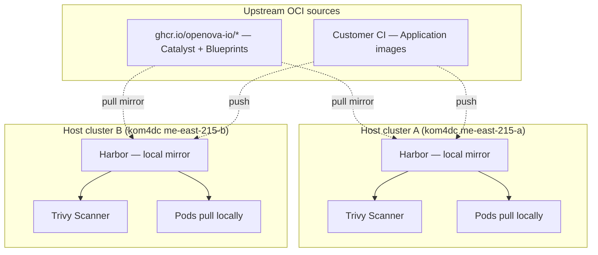
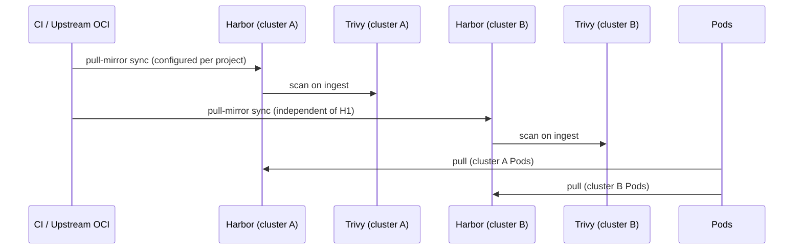
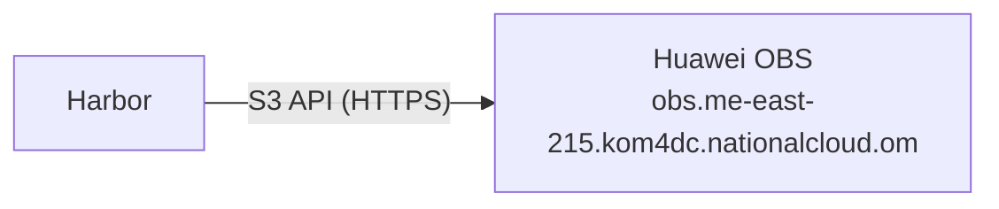
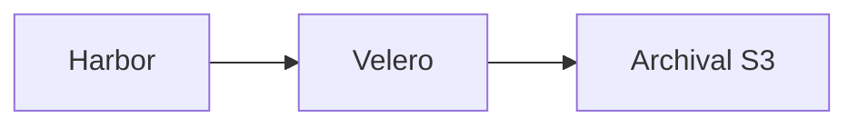

# Harbor

Container registry with vulnerability scanning. Per-host-cluster infrastructure (see [`docs/ARCHITECTURE.md`](../../docs/ARCHITECTURE.md) §3.5) — every host cluster runs a Harbor instance for Catalyst component images, mirrored Blueprint OCI artifacts, and customer images.

**Status:** Accepted | **Updated:** 2026-04-27

---

## Overview

**Harbor is mandatory** on every host cluster. Each host cluster runs its own Harbor instance that mirrors from upstream sources (`ghcr.io/openova-io/...` for Catalyst components and Blueprint OCI artifacts; the customer's own CI for application images). Local Harbor = fast Pod pulls, no cross-region traffic on every image pull, air-gap ready.



---

## Why Mandatory?

| Requirement | Harbor (per host cluster) | External Registry |
|-------------|---------------------------|-------------------|
| Local pulls (no cross-region traffic) | ✅ Each cluster's Pods pull from local Harbor | ❌ Pods pull cross-region |
| Vulnerability scanning | ✅ Trivy integrated | ⚠️ Depends on provider |
| Air-gap support | ✅ Self-hosted | ❌ |
| RBAC | ✅ Full control | ⚠️ Provider-specific |
| Audit logging | ✅ Complete | ⚠️ Limited |
| No external dependency at runtime | ✅ Once mirrored | ❌ |

---

## Features

| Feature | Support |
|---------|---------|
| Image storage | OCI-compliant |
| Vulnerability scanning | Trivy integration |
| Image signing | Cosign/Notary |
| Replication | Push/pull between regions |
| RBAC | Project-based access |
| Quotas | Per-project storage limits |
| Garbage collection | Automatic cleanup |

---

## Per-host-cluster mirroring (NOT primary-replica)

Catalyst's agreed model is **one Harbor per host cluster**, each independently pulling from upstream OCI sources. There is no Harbor-to-Harbor replication primary/replica.



**Why pull-mirror, not Harbor-to-Harbor replication:**
- Single source of truth = upstream (`ghcr.io/openova-io/...` or customer CI), not a "primary Harbor".
- Each cluster is its own failure domain — primary-replica drift between Harbors would be one more thing to fail.
- Air-gap path is the same shape: a one-time mirror import vs ongoing primary-pushed replication.

**Benefits:**
- Images available locally in each cluster.
- Survives any cluster (including the management cluster) going down — workload clusters keep pulling locally.
- Faster pulls (no cross-region traffic per Pod start).

---

## Storage Backend Options

| Backend | Use Case | Notes |
|---------|----------|-------|
| PVC (`type: filesystem`) | Dev / single-node | Default render — no S3 wiring |
| Cloud-native S3 | Production Sovereigns | Huawei OBS (kom4dc — current substrate) / AWS S3 / GCP / Azure (Hetzner Object Storage / contabo — legacy) |

### Recommended: Cloud-native S3 (per ADR-0001 §13)

S3-aware apps (Harbor is one) write DIRECTLY to the cloud-provider's
native S3 endpoint. SeaweedFS is reserved as a POSIX→S3 buffer for
legacy POSIX-only writers and is NOT in the minimal Sovereign set.



---

## Configuration

### Helm Values (per-Sovereign overlay shape — issue #383 / #425)

```yaml
gateway:
  host: registry.<sovereign-fqdn>

# Vendor-agnostic Object Storage seam — populated via Flux valuesFrom
# against the canonical flux-system/object-storage Sealed Secret.
objectStorage:
  enabled: true
  credentialsSecretName: harbor-objectstorage-credentials
  s3:
    accessKey: ""   # populated by Flux valuesFrom
    secretKey: ""   # populated by Flux valuesFrom

harbor:
  persistence:
    imageChartStorage:
      type: s3
      s3:
        # bucket / region / regionendpoint also populated by Flux valuesFrom
        existingSecret: harbor-objectstorage-credentials
        v4auth: true
        secure: true

trivy:
  enabled: true

database:
  type: internal  # or external for CNPG

redis:
  type: internal  # or external for Valkey

core:
  secretName: harbor-core-secret
```

### Multi-region: one session/queue/cache store per Sovereign (#5406)

A 2-region Sovereign runs a Harbor front-end on **both** control planes, and one
shared wildcard VIP fans `registry.<sovereign-fqdn>` at both regions' envoys —
so both regions serve. Harbor's three stateful stores are therefore anchored in
the **active** region and reached from the standby over Cilium ClusterMesh:

| Store | Contents | Anchor |
|---|---|---|
| Postgres | registry metadata | `shared-pg-mesh-rw.shared-data` (global-Service alias) |
| Object Storage | image + chart blobs | one bucket, written by both regions |
| **Redis** | OIDC **session** (db 0), jobservice queue (db 1), registry blob-descriptor cache (db 2) | **`harbor-redis-mesh.harbor`** (global-Service alias) |

Redis used to be the exception: upstream's `redis.type: internal` default gave
each region its own store, so a session minted by whichever region handled
`/c/oidc/callback` was invisible to the other and `/api/v2.0/users/current`
401'd on every request that landed on the other region — per-request, within a
single page load. The same split ran the jobservice queue and the registry blob
cache twice, uncoordinated, over one shared database and one shared bucket.

The chart now publishes `harbor-redis-mesh` as a Cilium ClusterMesh global
Service on both regions (`crossRegion.enabled`, wired by bootstrap-kit slot 19
to `SOVEREIGN_ENABLE_CNPG_PAIR`), and the standby's upstream redis is flipped to
`type: external` pointing at it — which both removes its duplicate store and
repoints every consumer. Ships alongside identity-based CiliumNetworkPolicies,
because a plain NetworkPolicy can never admit a ClusterMesh peer (Cilium
AND-injects the local cluster label into every selector it derives).

**Failover:** on an active-region kill the standby loses this Redis — it already
loses its Postgres the same way, so Harbor's control plane needs
`bp-continuum`'s switchover either way (see `blueprint.yaml`
`topology.perTopology.active-hot-standby.switchover`). The Redis anchor rides
the same substitute seam as `SOVEREIGN_HARBOR_PG_HOST`, so a switchover
repoints it exactly the way it repoints the database.

A **single-region** Sovereign never reaches the ClusterMesh gate: no global
Service, no policy, `redis.type: internal` — identical to the pre-#5406 render.

### Multi-region: one registry token key per Sovereign (#7908)

Harbor's core signs every registry token with one RSA key and drops a presented
token that this key does not verify; the request is then anonymous, and a push
is refused (`unauthorized ... action: push`). A push is many requests on several
connections, and `registry.<sovereign-fqdn>` sends them to both regions, so both
regions must hold the same key.

The core reads the key pair from `harbor/harbor-token-key`
(`harbor.core.secretName`). Left to itself, the upstream chart generates a new
key into `harbor-core` on every render: a different key per region, and a new
one at every upgrade.

- In the primary region, and on a single-region Sovereign, cert-manager issues
  `harbor-token-key` from a self-signed Issuer
  (`templates/token-key-certificate.yaml`), with `rotationPolicy: Never`, so a
  renewal keeps the key.
- A follower region (`crossRegion.role: secondary`, from
  `SOVEREIGN_REGION_ROLE`) issues nothing. The parent's cross-region
  orchestrator copies the primary's Secret to it
  (`products/catalyst/bootstrap/api/internal/crossregion`, `CopiedSecrets`) in
  the same early phase that delivers the follower's database Secret, so its
  core never starts with a key of its own.
- The core reads the key once, when its pod starts (a subPath mount).
  bp-reloader rolls `harbor-core` in either region when `harbor-token-key`
  changes: its pod template carries
  `secret.reloader.stakater.com/reload: harbor-token-key`
  (`harbor.core.podAnnotations`).

Check: both regions' `harbor-token-key` have the same `tls.crt` fingerprint.
The first upgrade to this layout gives each region a new key once (as every
upgrade did before): a pull or push that holds a token of the old key is
refused, and its next attempt fetches a token of the new one. On a two-region
Sovereign installed before this layout, the follower's core waits after that
upgrade until the parent's next pass has copied the key (its steady-state
heal runs every 5 minutes).

### No single Pod on the pull path (SOV-138)

After the sovereignty cutover every node pulls its images only from this
registry, through three components: the front (`harbor-nginx`), the core
(`harbor-core`) and the registry (`harbor-registry` with `registryctl`). When
one of them runs a single Pod, the drain of its node (kured's reboot of a
patched kernel) takes the pull path away for the whole region: the
replacement Pod, and every other Pod moved off that node whose image its new
node does not hold, can pull only through the component that is gone.
Measured on a fresh two-region install: the drained node ran the single front
and was the only node that held its image; 14 of the 21 Pods moved off it
waited on the front.

- `harbor.nginx`, `harbor.core` and `harbor.registry` run `replicas: 2`, spread
  by `kubernetes.io/hostname` (`maxSkew: 1`, `whenUnsatisfiable:
  DoNotSchedule`, `nodeTaintsPolicy: Honor`, so a cordoned node does not count
  and a region of two schedulable nodes still places the replacement). The
  upstream chart adds each component's own `labelSelector`.
- `templates/pull-path-disruption-budgets.yaml` renders a PodDisruptionBudget
  per component, named like its Deployment, `minAvailable: 1`,
  `unhealthyPodEvictionPolicy: AlwaysAllow`, with the upstream selector
  (`release`, `app`, `component`). A drain evicts one copy and waits while the
  other is not Ready; a copy that is not Ready is evicted without waiting. A
  component at one copy gets no budget, because a budget of `minAvailable: 1`
  at one copy refuses every eviction (`scripts/check-budgets-allow-drain.py`).
- Two registry copies need storage they share. Slot 19 sets
  `persistence.imageChartStorage.type: s3`, and the registry mounts no volume
  claim. A render that keeps `type: filesystem` on a ReadWriteOnce claim sets
  `harbor.registry.replicas: 1`.
- The cluster DNS is on the same path (the components and every caller of the
  registry resolve through it); bp-kured holds k3s's CoreDNS at two copies with
  a budget of its own (`platform/kured/chart/templates/coredns-availability.yaml`).
- Kept single: Harbor's redis, one StatefulSet with a ReadWriteOnce volume in
  the primary region that the other region reaches over the mesh (#5406); two
  unreplicated copies would split the sessions. `harbor-jobservice` and
  `harbor-portal` are not on the pull path and keep one copy.
- Cost, by the requests in `values.yaml`: 64 MiB (nginx), 256 MiB (core) and
  320 MiB (registry and registryctl) more per region.

Guarded by `tests/pull-path-availability.sh`.

### Proxy-cache integrity check (SOV-162)

A pull-through (proxy cache) project can hold a cached image index that answers
200 while a child it references answers `manifest unknown` (404), or a child's
config blob answers 404, although the upstream registry serves both. Every pull
of that image then fails, on every node that pulls it, until the cached
artifact is deleted; the next pull then fetches the image whole.

Why Harbor does not recover by itself (pinned upstream Harbor v2.14.3, chart
goharbor/harbor-helm 1.18.3; source at
<https://github.com/goharbor/harbor/tree/v2.14.3>):

- A pull by digest is served from the registry's own storage as soon as
  Harbor's database lists the artifact (`src/controller/proxy/controller.go`
  lines 172-180, `src/controller/proxy/local.go` lines 54-64); storage is not
  asked, and there is no fallback to upstream. A blob is served locally when
  storage answers that it exists (`local.go` lines 84-86). So a manifest or
  blob that storage has lost while the database still lists it stays broken.
- An index pulled by tag is served for 7 days from the cache of manifest lists
  (`controller.go` line 47, lines 209-228), whatever is left in storage, so the
  index keeps answering 200.
- Not the cause in this version: retention and the untagged clean-up of
  garbage collection. Every pull-through project gets a retention policy at
  creation (keep what was pulled in the last 7 days, daily;
  `src/server/v2.0/handler/project.go` lines 64-65 and 242-249,
  `src/pkg/retention/policy/models.go` lines 134-176), and garbage collection
  may delete untagged artifacts (`src/jobservice/job/impl/gc/garbage_collection.go`
  lines 533-538). Both list artifacts with the default filter, which leaves out
  a child that an index references (`src/pkg/artifact/dao/dao.go` lines 63-68;
  retention lists through the API, `src/pkg/clients/core/image.go` lines 24-32),
  and deleting a referenced child is refused (`src/controller/artifact/controller.go`
  lines 354-374). Neither removes a child while its tagged index stays. This
  chart sets no retention rule and schedules no garbage collection of its own.

The check, `templates/proxy-cache-integrity.yaml` (values
`proxyCacheIntegrity`, on by default): the CronJob
`<release>-proxy-cache-integrity` runs one pass on `schedule` (default
`17 * * * *`, hourly; one pass at a time). A pass lists the projects with a
`registry_id` (pull-through) and, for every tagged artifact there that is an
image index, reads each referenced child manifest and its config blob through
harbor-core's `/v2` with a pull token of the admin account, the path every
pull takes.

- A 404 is a miss. The pass deletes that cached index (and a missed child that
  is still listed because it carries its own tag), writes a Kubernetes Event
  `ProxyCacheArtifactHealed` (type Warning) on the CronJob that names the
  index, its tags and what was missing, and adds one to
  `harbor_proxy_cache_integrity_healed_total`.
- Any other answer, or none, is a failed read: nothing is deleted for that
  index, `harbor_proxy_cache_integrity_read_failures_total` grows, and the
  pass's Job ends failed.
- A hosted project (no `registry_id`) is never listed, read or changed. Untagged
  indexes and single-platform images are not read.
- Metrics (Prometheus text): `harbor_proxy_cache_integrity_healed_total`,
  `..._missing_total`, `..._read_failures_total`, `..._indexes_checked`,
  `..._children_checked`, `..._last_pass_ok`,
  `..._last_pass_timestamp_seconds`. Each pass adds its counts to the totals in
  the ConfigMap `<release>-proxy-cache-integrity-metrics` (key `metrics.txt`)
  and writes it with server-side apply; when the earlier totals cannot be read
  (any error but NotFound) the pass leaves the ConfigMap as it is and its Job
  ends failed. The pass creates that ConfigMap; the
  chart does not render it, so an upgrade never resets the totals. The
  Deployment of the same name (busybox httpd) serves it on `metricsPort` (9090)
  at `/metrics.txt`, announced by the `prometheus.io/*` pod annotations; until
  the first pass the path answers 404. Under the default deny of
  bp-plane-isolation a scraper in another namespace needs an ingress allow to
  port 9090 of this pod; it belongs with the scraper's configuration. The check
  itself needs no network rule: it reaches harbor-core in its own namespace and
  the API server, which the namespace's policies allow.
- The CronJob's ServiceAccount may only create Events, create ConfigMaps, and
  read and patch the counters ConfigMap, in the release namespace.

On a two-region Sovereign both regions run the check against one database; a
deletion the other region already made answers 404 and counts nothing. Test:
`tests/proxy-cache-integrity.sh` runs the rendered script against stand-ins for
harbor-core and kubectl.

### Pull-mirror policy

```json
{
  "name": "ghcr-openova-mirror",
  "src_registry": {
    "type": "harbor",
    "url": "https://ghcr.io",
    "credential": {
      "access_key": "",
      "access_secret": ""
    }
  },
  "trigger": {
    "type": "scheduled",
    "trigger_settings": {
      "cron": "0 */6 * * *"
    }
  },
  "filters": [
    {
      "type": "name",
      "value": "openova-io/**"
    }
  ],
  "enabled": true
}
```

---

## Security Scanning

### Trivy Integration

| Scan Type | Trigger |
|-----------|---------|
| On push | Automatic when image pushed |
| Scheduled | Daily full scan |
| Manual | On-demand via UI/API |

### Scan Policy

| Severity | Action |
|----------|--------|
| Critical | Block pull |
| High | Allow (configurable) |
| Medium | Allow |
| Low | Allow |

---

## Kyverno Policies

### Require Harbor Images

```yaml
apiVersion: kyverno.io/v1
kind: ClusterPolicy
metadata:
  name: require-harbor-images
spec:
  validationFailureAction: Enforce
  rules:
    - name: require-harbor-registry
      match:
        any:
          - resources:
              kinds:
                - Pod
      validate:
        message: "Images must be pulled from Harbor registry"
        pattern:
          spec:
            containers:
              - image: "harbor.<location-code>.<sovereign-domain>/*"
```

---

## Resource Requirements

| Component | CPU | Memory |
|-----------|-----|--------|
| Harbor Core | 0.5 | 512Mi |
| Registry | 0.5 | 512Mi |
| Database | 0.5 | 512Mi |
| Redis | 0.25 | 256Mi |
| Trivy | 0.5 | 1Gi |
| **Total** | **2.25** | **2.75Gi** |

---

## Backup Strategy

Harbor data backed up via Velero to Archival S3:



**Backed up:**
- Database (PostgreSQL)
- Registry storage (blobs)
- Configuration

---

## Consequences

**Positive:**
- Complete control over image lifecycle.
- Built-in vulnerability scanning (Trivy on ingest).
- Per-cluster mirror = no cross-region pull traffic; each cluster is an independent failure domain.
- Air-gap ready (one-time import works the same way as ongoing pull-mirror).
- Audit trail for compliance.

**Negative:**
- Resource overhead (~3GB RAM)
- Operational responsibility
- Backup requirements (handled by Velero)

---

*Part of [OpenOva](https://openova.io)*
