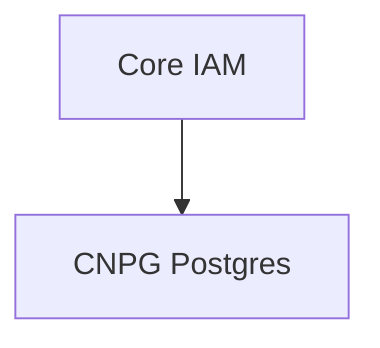

# Keycloak

User identity for Catalyst Sovereigns. Per-Sovereign supporting service in the Catalyst control plane (see [`docs/ARCHITECTURE.md`](../../docs/ARCHITECTURE.md) §2.3).

**Status:** Accepted | **Updated:** 2026-04-27

> **Catalyst topology** (set at Sovereign provisioning time, see [`docs/SECURITY.md`](../../docs/SECURITY.md) §6):
> - **`per-organization`** (multi-Org Sovereigns, e.g. omantel): one minimal Keycloak per Organization (single replica, embedded H2/sqlite, ~150 MB RAM, no HA). Blast radius limited to one Org.
> - **`shared-sovereign`** (corporate self-host): one HA Keycloak for the entire Sovereign with multiple realms (one per Organization), federating to the corporation's identity provider (Azure AD, Okta).

---

## Overview

Keycloak provides:
- **User identity** for the Catalyst console, marketplace, admin, REST/GraphQL API, and per-Application SSO.
- **OIDC / OAuth 2.0 / SAML** federation to corporate IdPs.
- Open banking is not built. Its design is in the later-products decision record.

---

## Architecture



---

## Configuration

### Keycloak Deployment

The deployment shape depends on Catalyst's `keycloakTopology` choice (see banner above):

**Corporate (`shared-sovereign`)** — one HA Keycloak per Sovereign in `catalyst-keycloak` namespace on the management cluster:

```yaml
apiVersion: k8s.keycloak.org/v2alpha1
kind: Keycloak
metadata:
  name: keycloak
  namespace: catalyst-keycloak
spec:
  instances: 3                          # HA, multiple replicas
  db:
    vendor: postgres
    host: keycloak-postgres-rw.catalyst-keycloak.svc
    port: 5432
    database: keycloak
    usernameSecret:                     # ESO-managed via OpenBao
      name: keycloak-db-credentials
      key: username
    passwordSecret:
      name: keycloak-db-credentials
      key: password
  http:
    tlsSecret: keycloak-tls
  hostname:
    hostname: auth.<location-code>.<sovereign-domain>
```

**Per-Org (`per-organization`)** — one minimal Keycloak per Organization in the Org's namespace on the management cluster:

```yaml
apiVersion: k8s.keycloak.org/v2alpha1
kind: Keycloak
metadata:
  name: keycloak
  namespace: <org>                     # per-Org namespace
spec:
  instances: 1                          # no HA at org tier
  db:
    vendor: postgres                    # or H2/sqlite for the smallest tier
    host: keycloak-postgres-rw.<org>.svc
    port: 5432
    database: keycloak
    # ... credentials
  hostname:
    hostname: auth.<org>.<location-code>.<sovereign-domain>
```

---

## High Availability

HA shape depends on Catalyst's `keycloakTopology`:

- **`shared-sovereign`** (corporate): 3 replicas behind a Service, CNPG PostgreSQL with WAL streaming to async standby, session replication via Infinispan.
- **`per-organization`** (per-Org): single replica, no session replication, restart-on-deploy is acceptable for org-tier SLAs. Larger Organizations can opt into HA via tier upgrade — same Catalyst CR shape, just bumped `instances`.

---

*Part of [OpenOva](https://openova.io)*
