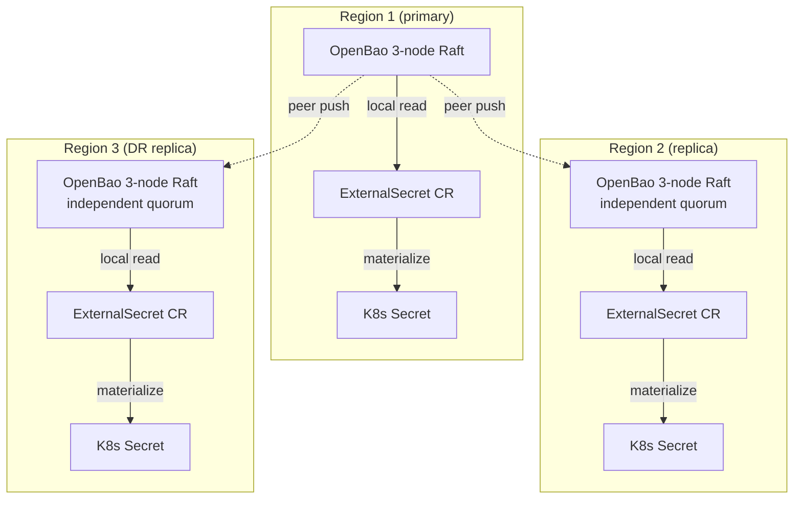

# OpenBao

Secrets management backend for Catalyst. Apache 2.0 / MPL 2.0 fork of HashiCorp Vault, drop-in API-compatible.

**Status:** Accepted | **Updated:** 2026-04-27

> **Catalyst role:** Per-Sovereign supporting service in the Catalyst control plane (see [`docs/ARCHITECTURE.md`](../../docs/ARCHITECTURE.md) §2.3). For multi-region semantics and rotation policy, [`docs/SECURITY.md`](../../docs/SECURITY.md) is canonical.

---

## Overview

OpenBao is a Linux Foundation project forked from HashiCorp Vault after HashiCorp changed Vault's license from MPL 2.0 to the Business Source License (BSL 1.1). OpenBao retains the open license and provides API-compatible secrets management.

OpenBao provides centralized secrets management with:
- Secrets stored securely outside of Git (Git holds only `ExternalSecret` references).
- **Independent Raft cluster per region** (no stretched cluster).
- An independent OpenBao per region with peer push: the primary region writes the shared material of a multi-region Application into the OpenBao of every region.
- Integration with External Secrets Operator (ESO).
- Workload authentication via Kubernetes ServiceAccount TokenReview (short-lived, auto-rotating tokens); pod-to-pod transport encrypted by Cilium WireGuard. (SPIFFE/SPIRE SVID issuance is deferred — PR #665.)

---

## Architecture: independent Raft per region (NOT a stretched cluster)

Each region runs its **own** OpenBao. Today that is one member (`replicas: 1` in `clusters/_template/bootstrap-kit/08-openbao.yaml`), not three. Region failures are independent failure domains. Between regions peer push is wired: the primary region writes the shared material of a multi-region Application into the OpenBao of each region (`peerTrust` in `chart/values.yaml`). On a Sovereign with a hot standby (the topology `active-hotstandby` or `active-active`), the bootstrap-kit slot also turns on a snapshot copy through object storage (`snapshotReplication`): every ten minutes the primary region saves a snapshot of its OpenBao, and the other region fetches it onto a staging volume without restoring it. OpenBao does not replicate between the clusters of two regions.



**Key design** (canonical in [`docs/SECURITY.md`](../../docs/SECURITY.md) §5):
- **Independent Raft per region.** No cross-region quorum. A whole-region failure does NOT block any other region.
- **Single-primary writes.** Rotations and new-secret writes go to the primary OpenBao only.
- **Peer push, not replication.** The primary region writes shared material into the OpenBao of every region. On a Sovereign with a hot standby, a snapshot of the primary region's OpenBao is also copied through object storage to the other region, and it is not restored there.
- **Explicit DR promotion.** Either `sovereign-admin`-approved or automated via failover-controller (with strict criteria — not on every blip).
- **Apps read locally.** Each region's ExternalSecret pulls from its local OpenBao replica.
- **No SOPS.** Plaintext never in Git.

> The earlier active-active bidirectional design was rejected as a stretched cluster — it would have made one region's network blip take down all writes. This file's architecture matches the agreed independent-Raft model.

---

## Deployment Options

| Option | Type | Notes |
|--------|------|-------|
| OpenBao Self-Hosted | Self-hosted | Full control, one per cluster |
| AWS Secrets Manager | Managed | If AWS chosen |
| GCP Secret Manager | Managed | If GCP chosen |
| Azure Key Vault | Managed | If Azure chosen |

**Recommended:** OpenBao Self-Hosted for full control

---

## Configuration

### OpenBao Deployment (Helm)

```yaml
server:
  ha:
    enabled: true
    replicas: 3
    raft:
      enabled: true
      config: |
        storage "raft" {
          path = "/openbao/data"
        }

  dataStorage:
    enabled: true
    size: 10Gi
    storageClass: <storage-class>

  ingress:
    enabled: true
    ingressClassName: cilium
    hosts:
      - host: bao.<location-code>.<sovereign-domain>

injector:
  enabled: false  # Using ESO instead
```

### ClusterSecretStore (local read)

Each region defines ONE ClusterSecretStore pointing at its local OpenBao replica. Apps in any region read from their local replica only. A value that every region needs is written into the OpenBao of each region by peer push; OpenBao does not replicate it.

```yaml
apiVersion: external-secrets.io/v1beta1
kind: ClusterSecretStore
metadata:
  name: bao-local
spec:
  provider:
    vault:                                # ESO provider type stays `vault` —
                                          # OpenBao is wire-compatible.
      server: "https://bao.<location-code>.<sovereign-domain>"
      path: "secret"
      version: "v2"
      auth:
        kubernetes:
          mountPath: "kubernetes"
          role: "external-secrets"
```

> **Note:** The ESO provider type remains `vault` because OpenBao is API-compatible and ESO uses the same provider configuration.

### Writes go to the primary region

Secret rotations, new-secret creates, and policy updates target the **primary** OpenBao only. The OpenBao of another region accepts from the primary region only writes under the peer-push subtree (`peerTrust.kvPathPrefix` in `chart/values.yaml`). The ESO `PushSecret` is configured to point at the primary's ClusterSecretStore explicitly:

```yaml
apiVersion: external-secrets.io/v1alpha1
kind: PushSecret
metadata:
  name: push-db-credentials
  namespace: databases
spec:
  refreshInterval: 1h
  secretStoreRefs:
    - name: bao-primary                   # writes target the primary region only
      kind: ClusterSecretStore
  selector:
    secret:
      name: db-credentials
  data:
    - match:
        secretKey: password
        remoteRef:
          remoteKey: databases/db-credentials
          property: password
```

### ExternalSecret (local read in every region)

Reads always pull from the local OpenBao replica.

```yaml
apiVersion: external-secrets.io/v1beta1
kind: ExternalSecret
metadata:
  name: db-credentials
  namespace: databases
spec:
  refreshInterval: 1h
  secretStoreRef:
    name: bao-local
    kind: ClusterSecretStore
  target:
    name: db-credentials
    creationPolicy: Owner
  data:
    - secretKey: password
      remoteRef:
        key: databases/db-credentials
        property: password
```

### DR promotion

If the primary region fails, a replica is explicitly promoted (sovereign-admin approval or failover-controller automation). New writes are blocked briefly during promotion (~30s), then the new primary accepts writes. See [`docs/SECURITY.md`](../../docs/SECURITY.md) §5.2.

---

## Bootstrap Procedure

1. Catalyst bootstrap (Phase 0 of Sovereign provisioning) deploys OpenBao as **independent Raft cluster per region** (no stretched cluster — see [`docs/SECURITY.md`](../../docs/SECURITY.md) §5).
2. **Unseal flow (chart v1.2.0+):** Cloud-init on the control-plane node writes a 32-byte recovery seed into the Secret `openbao-recovery-seed` in the `openbao` namespace. The bp-openbao Helm chart's post-install init Job (hook weight 5) runs `bao operator init` with one key share and a threshold of one, on the Shamir seal; the `-recovery-shares` form never worked with this seal. The Job keeps the one unseal key in the Secret `openbao-unseal-keys` and writes the first root token into the Secret `openbao-root-token`, both in the `openbao` namespace (`chart/templates/init-job.yaml`). The auth-bootstrap Job of step 3 revokes that root token at the end of its run and then tries to delete the Secret `openbao-root-token`; when the delete fails it logs a warning and the Secret stays (`chart/templates/auth-bootstrap-job.yaml`). After a pod restart the unseal reconciler unseals OpenBao with the key from `openbao-unseal-keys`, without sovereign-admin intervention. Set `autoUnseal.enabled=true` (default off; cluster overlay flips it on per-Sovereign).
3. **Kubernetes auth bootstrap (issue #316):** A second post-install Job (hook weight 10) enables the Kubernetes auth method and mounts kv-v2 at `secret/`. Since 1.2.72 it writes only one policy and one role, `openbao-config-admin` (see below). Configure under `autoUnseal.kubernetesAuth.*`.
3a. **Declarative configuration (1.2.72, ADR-0015, Refs #7067):** every ACL policy, auth role, auth mount and identity object the chart needs is desired state in ConfigMap `openbao-config-desired` (`chart/templates/_config.tpl`). The `openbao-config` Deployment applies it every 60 s, idempotently (`chart/files/openbao-config-reconcile.sh`). It logs in as k8s-auth role `openbao-config-admin`, whose policy covers configuration surfaces only: no secret data, no `sys/raw`, no seal, no delete, and it cannot rewrite its own grant. A chart bump is therefore the whole change; there is no manual root step.
    - **How the role is kept current:** the auth-bootstrap hook re-writes `openbao-config-admin` on every install/upgrade. The first time it uses the init root token. Later it generates a short-lived root from the `openbao-unseal-keys` shares (`chart/files/openbao-generate-root.sh`) and revokes it in the same run. Whoever can read that Secret can already unseal, so this adds no exposure. No root token is kept.
    - **One-time upgrade, only if `openbao-unseal-keys` is absent** (an init older than chart 1.2.4): the hook logs a WARN and exits 0. Write the `openbao-config-admin` policy and role once with an admin token. Either sign in through SSO at `bao.<fqdn>` (sovereign-admins get full rights) or use `bao operator generate-root` with your own key shares. The policy text is `openbao.configAdminPolicy` in `_config.tpl`; the role binds SA `openbao-config` in ns `openbao`.
4. Between regions peer push is configured, and on a Sovereign with a hot standby also a snapshot copy through object storage (see the architecture section above). OpenBao does not replicate.
5. ESO configured with local-region ClusterSecretStores; every region reads from its local OpenBao replica via ESO Kubernetes auth (TokenReview), never cross-region.
6. Initial secrets created via K8s + PushSecrets, never plaintext in Git.

**No SOPS:** Credentials entered interactively during bootstrap, never stored in Git. See [`docs/SECURITY.md`](../../docs/SECURITY.md).

### Auto-unseal alternatives (out of scope for solo Sovereign)

| Option | When applicable |
|--------|-----------------|
| **A. Shamir + cloud-init seed** | **Default for solo Sovereign — implemented in chart v1.2.0.** No managed-KMS dependency; the one unseal key is kept in the Secret `openbao-unseal-keys` (see step 2 of the bootstrap procedure). |
| B. Transit-seal via peer OpenBao | Multi-region tier-1 corporate cluster (one Sovereign unseals another). Out of scope for omantel/single-region. |
| C. Cloud-KMS auto-unseal (AWS KMS, GCP KMS, Azure Key Vault) | When the Sovereign runs on a hyperscaler that provides managed-KMS. On a substrate without managed-KMS, Option A is the only viable path. |
| D. Sovereign-admin-supplied recovery shards (air-gap) | Documented in [`docs/SECURITY.md`](../../docs/SECURITY.md). Used when no automated boot-time secret pipeline is acceptable. |

---

## Bootstrap KV-seed (#3888, Refs #3847)

### Why it exists

The founder mandate is *"keep every item possible in Flux"* — thin the control-plane
cloud-init. [#3890](https://github.com/openova-io/openova/issues/3890) evicted
`powerdns-api-credentials` from cloud-init into a Flux-reconciled Secret, but ~5
other inline Secrets STAYED because they are consumed by HelmReleases that
reconcile **at or before** the `openbao(08) → ESO(15) → ClusterSecretStore(15a)`
pipeline becomes functional, **and there was no way to land a per-deployment cred
into openbao KV at provision time** — the `auth-bootstrap` Job revokes the init
root token at the end of slot-08 install, after which no token can write to
`secret/*`. So an `ExternalSecret` had nothing to read FROM.

### The mechanism

`autoUnseal.bootstrapSeed` (default **OFF**) closes that gap. When enabled AND the
control-plane cloud-init writes a one-shot Secret (`openbao-bootstrap-seed`) into
the `openbao` namespace, the `auth-bootstrap` Job — which still holds the **valid
root token** — reads every `data` key from that Secret and writes it into KV at
`<kvMountPath>/<kvPrefix>/<key>` **BEFORE** revoking the root token. An
`ExternalSecret` referencing the `vault-region1` ClusterSecretStore can then
materialise the cred in any consumer namespace. The seed Secret is **single-use**:
its keys are deleted from K8s after a successful KV write so no plaintext cred
lingers in etcd (same posture as `openbao-recovery-seed`). Writes are idempotent
(`bao kv put` overwrites), so Job retries + chart upgrades are safe. Default-OFF
plus an `optional: true` seed mount means the prod-posture render is behaviourally
byte-identical to the pre-#3888 chart (only 3 inert env vars + an env-gated script
block are added). See `autoUnseal.bootstrapSeed.*` in `chart/values.yaml`.

**Seed Secret shape:** each `data` key is a KV path with `__` standing in for `/`
(k8s Secret keys cannot contain `/`); the value body is `field=value` lines. e.g.
a key `harbor-robot__token` with body `token=<robot-token>` lands at
`secret/bootstrap/harbor-robot` field `token`, readable by an ExternalSecret
`remoteRef.key: bootstrap/harbor-robot`, `property: token`.

### Eviction status of the #3890 STAY secrets

**#3888 ships the mechanism but evicts NO secret** — each of the 5 STAY secrets
still has an ordering or cycle blocker that cannot be closed without a change that
itself requires a fresh-prov walk to validate (out of #3888's no-prov scope). The
next eviction becomes a pure data change (one cloud-init `__`-key + one
ExternalSecret CR) once its blocker is cleared:

| Secret | Earliest consumer | Mechanism | Blocker (why not yet evictable) |
|--------|-------------------|-----------|---------------------------------|
| `object-storage` | openbao **slot 08** (its own HR), keycloak 09, gitea 10 | Flux `valuesFrom` | **Hard cycle** — openbao consumes it before openbao/ESO exist. Unbreakable via ESO. |
| `cloud-credentials` | cluster-autoscaler 50, hcloud-ccm 55, Crossplane | Flux `valuesFrom` | Not a flat cred — carries live IaC data (`hcloud-cloud-init: base64(worker-cloud-init)`, network/firewall/ssh-key names). Recomputed per-apply by Terraform; cannot be a static KV value. |
| `harbor-robot-token` | catalyst-api **slot 13** | Pod `secretKeyRef` (**required**) | Hard-required at Pod start (issue #557 `Validate()`), slot 13 < 15a, NOT in catalyst-api's reloader watch list → a late ESO delivery wedges the Pod (`CreateContainerConfigError`). Needs reloader wiring + a prov to prove. |
| `pdm-basicauth` | catalyst-api slot 13 | Pod `secretKeyRef` (optional) | Optional at start but NOT in the reloader watch list → late arrival is never picked up. Needs a reloader-annotation change to the bp-catalyst-platform umbrella + a prov. |
| `handover-jwt-public` | catalyst-api slot 13 | optional volume mount | Reloader annotation lists volume-name `handover-jwt-public`, but the actual Secret is `catalyst-handover-jwt-public` — the names mismatch, so a late ESO delivery does NOT roll the Pod. Needs the reloader name corrected in the umbrella chart + a prov. |

`ghcr-pull` + `openbao-recovery-seed` are genuine bootstrap chicken-and-egg
(the image-pull cred + the openbao recovery seed itself) and are **never**
evictable to ESO.

---

*Part of [OpenOva](https://openova.io)*
