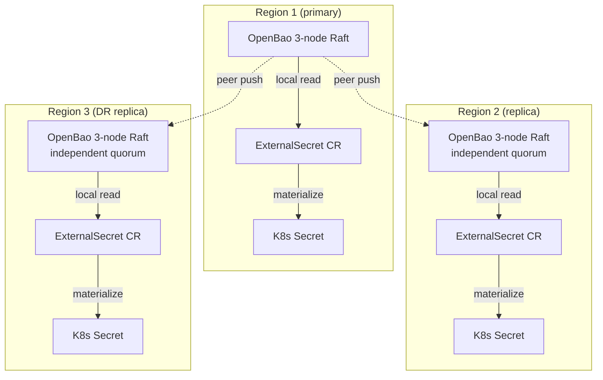

# OpenBao

Secrets management backend for Catalyst. Apache 2.0 / MPL 2.0 fork of HashiCorp Vault, drop-in API-compatible.

**Status:** Accepted | **Updated:** 2026-04-27

> **Catalyst role:** Per-Sovereign supporting service in the Catalyst control plane (see [`docs/ARCHITECTURE.md`](../../docs/ARCHITECTURE.md) §2.3). For multi-region semantics and rotation policy, [`docs/SECURITY.md`](../../docs/SECURITY.md) is canonical.

---

## Overview

OpenBao is a Linux Foundation project forked from HashiCorp Vault after HashiCorp changed Vault's license from MPL 2.0 to the Business Source License (BSL 1.1). OpenBao retains the open license and provides API-compatible secrets management.

OpenBao provides centralized secrets management with:
- Secrets stored securely outside of Git (Git holds only `ExternalSecret` references).
- **Independent Raft cluster per region** (no stretched cluster).
- An independent OpenBao per region with peer push: the primary region writes the shared material of a multi-region Application into the OpenBao of every region.
- Integration with External Secrets Operator (ESO).
- Workload authentication via Kubernetes ServiceAccount TokenReview (short-lived, auto-rotating tokens); pod-to-pod transport encrypted by Cilium WireGuard. (SPIFFE/SPIRE SVID issuance is deferred — PR #665.)

---

## Architecture: independent Raft per region (NOT a stretched cluster)

Each region runs its **own** OpenBao. Today that is one member (`replicas: 1` in `clusters/_template/bootstrap-kit/08-openbao.yaml`), not three. Region failures are independent failure domains. Between regions peer push is wired: the primary region writes the shared material of a multi-region Application into the OpenBao of each region (`peerTrust` in `chart/values.yaml`). OpenBao does not replicate between the clusters of two regions.



**Key design** (canonical in [`docs/SECURITY.md`](../../docs/SECURITY.md) §5):
- **Independent Raft per region.** No cross-region quorum. A whole-region failure does NOT block any other region.
- **Single-primary writes.** Rotations and new-secret writes go to the primary OpenBao only.
- **Peer push, not replication.** The primary region writes shared material into the OpenBao of every region.
- **Explicit DR promotion.** Either `sovereign-admin`-approved or automated via failover-controller (with strict criteria — not on every blip).
- **Apps read locally.** Each region's ExternalSecret pulls from its local OpenBao replica.
- **No SOPS.** Plaintext never in Git.

> The earlier active-active bidirectional design was rejected as a stretched cluster — it would have made one region's network blip take down all writes. This file's architecture matches the agreed independent-Raft model.

---

## Deployment Options

| Option | Type | Notes |
|--------|------|-------|
| OpenBao Self-Hosted | Self-hosted | Full control, one per cluster |
| AWS Secrets Manager | Managed | If AWS chosen |
| GCP Secret Manager | Managed | If GCP chosen |
| Azure Key Vault | Managed | If Azure chosen |

**Recommended:** OpenBao Self-Hosted for full control

---

## Configuration

### OpenBao Deployment (Helm)

```yaml
server:
  ha:
    enabled: true
    replicas: 3
    raft:
      enabled: true
      config: |
        storage "raft" {
          path = "/openbao/data"
        }

  dataStorage:
    enabled: true
    size: 10Gi
    storageClass: <storage-class>

  ingress:
    enabled: true
    ingressClassName: cilium
    hosts:
      - host: bao.<location-code>.<sovereign-domain>

injector:
  enabled: false  # Using ESO instead
```

### ClusterSecretStore (local read)

Each region defines ONE ClusterSecretStore pointing at its local OpenBao replica. Apps in any region read from their local replica only. A value that every region needs is written into the OpenBao of each region by peer push; OpenBao does not replicate it.

```yaml
apiVersion: external-secrets.io/v1beta1
kind: ClusterSecretStore
metadata:
  name: bao-local
spec:
  provider:
    vault:                                # ESO provider type stays `vault` —
                                          # OpenBao is wire-compatible.
      server: "https://bao.<location-code>.<sovereign-domain>"
      path: "secret"
      version: "v2"
      auth:
        kubernetes:
          mountPath: "kubernetes"
          role: "external-secrets"
```

> **Note:** The ESO provider type remains `vault` because OpenBao is API-compatible and ESO uses the same provider configuration.

### Writes go to the primary region

Secret rotations, new-secret creates, and policy updates target the **primary** OpenBao only. The OpenBao of another region accepts from the primary region only writes under the peer-push subtree (`peerTrust.kvPathPrefix` in `chart/values.yaml`). The ESO `PushSecret` is configured to point at the primary's ClusterSecretStore explicitly:

```yaml
apiVersion: external-secrets.io/v1alpha1
kind: PushSecret
metadata:
  name: push-db-credentials
  namespace: databases
spec:
  refreshInterval: 1h
  secretStoreRefs:
    - name: bao-primary                   # writes target the primary region only
      kind: ClusterSecretStore
  selector:
    secret:
      name: db-credentials
  data:
    - match:
        secretKey: password
        remoteRef:
          remoteKey: databases/db-credentials
          property: password
```

### ExternalSecret (local read in every region)

Reads always pull from the local OpenBao replica.

```yaml
apiVersion: external-secrets.io/v1beta1
kind: ExternalSecret
metadata:
  name: db-credentials
  namespace: databases
spec:
  refreshInterval: 1h
  secretStoreRef:
    name: bao-local
    kind: ClusterSecretStore
  target:
    name: db-credentials
    creationPolicy: Owner
  data:
    - secretKey: password
      remoteRef:
        key: databases/db-credentials
        property: password
```

### DR promotion

If the primary region fails, a replica is explicitly promoted (sovereign-admin approval or failover-controller automation). New writes are blocked briefly during promotion (~30s), then the new primary accepts writes. See [`docs/SECURITY.md`](../../docs/SECURITY.md) §5.2.

---

## Bootstrap Procedure

1. Catalyst bootstrap (Phase 0 of Sovereign provisioning) deploys OpenBao as **independent Raft cluster per region** (no stretched cluster — see [`docs/SECURITY.md`](../../docs/SECURITY.md) §5).
2. **Seal (SEC-162, OpenBao 2.7.2, upstream chart 0.30.7):** cloud-init writes a 32-byte key file `/var/lib/catalyst/seal/openbao-seal-<id>.key` (mode 400, owner `100:1000`) on every control-plane node and applies ConfigMap `flux-system/sovereign-seal-profile`, whose key `stanza` is the seal block (contract [`docs/contracts/c8-seal-provider.md`](../../docs/contracts/c8-seal-provider.md)). Bootstrap-kit slot 08 passes that stanza to `seal.stanza` through `valuesFrom`. The chart renders it into ConfigMap `openbao-seal-config` (`chart/templates/seal-config.yaml`); the server loads that ConfigMap as an extra configuration directory and mounts the node directory read-only at `/openbao/seal`. The server runs on control-plane nodes only and unseals itself on every start, with no step by anyone. No Secret holds a key, and there is no init Job and no unseal loop. Without a stanza no `openbao-seal-config` renders and the server pod does not start: it fails closed and never comes up with a Shamir seal.
3. **Self-initialisation:** on the first start of an empty store the `initialize` block of `openbao-seal-config` (`selfInit.enabled`, default on) enables the Kubernetes auth mount (`kubernetesAuth.mountPath`), points it at the in-cluster API server, writes policy `openbao-config-admin` and binds role `openbao-config-admin` to the service account `openbao-config` of the release namespace (token TTL 15m, max 1h). OpenBao runs it with a root token that it revokes at once, and it makes no recovery key. An initialised store never runs it again. The server's service account holds `system:auth-delegator` (`chart/templates/auth-delegator-rbac.yaml`) for the token reviews.
3a. **Declarative configuration (1.2.72, ADR-0015, Refs #7067):** every ACL policy, auth role, auth mount and identity object the chart needs is desired state in ConfigMap `openbao-config-desired` (`chart/templates/_config.tpl`). The `openbao-config` Deployment applies it every 60 s, idempotently (`chart/files/openbao-config-reconcile.sh`). It logs in as k8s-auth role `openbao-config-admin`, whose policy covers configuration surfaces only: no secret data, no `sys/raw`, no seal, no delete. It can rewrite its own policy, which is the first operation of the desired state, but not its own role, and the only secrets mount it may enable is `secret/`. In every payload it replaces the text `AUTH_ACCESSOR_KUBERNETES` by the accessor of its login mount. A chart bump is therefore the whole change; there is no root token and no manual root step. Configure under `kubernetesAuth.*`.
3b. **Audit:** the server configuration declares the file audit device `stdout/` writing to standard output (`audit.enabled`, default on). OpenBao 2.7 refuses an audit device enabled through the API.
4. Between regions peer push is configured (see the architecture section above). OpenBao does not replicate.
5. ESO configured with local-region ClusterSecretStores; every region reads from its local OpenBao replica via ESO Kubernetes auth (TokenReview), never cross-region.
6. Initial secrets created via K8s + PushSecrets, never plaintext in Git.

**No SOPS:** Credentials entered interactively during bootstrap, never stored in Git. See [`docs/SECURITY.md`](../../docs/SECURITY.md).

**Existing Sovereigns:** a store initialised with the Shamir seal of chart 1.2.x is not opened by this chart; its migration is a procedure of its own (SEC-170). A test Sovereign is provisioned again instead.

### Seal kinds

Contract C8 ranks two kinds; a provider pack implements exactly one, and the chart takes whichever stanza the pack's seal profile carries.

| Kind | Where the key rests |
|------|---------------------|
| `cloud-key-service` | In the cloud's key service; the node holds only a credential for one key (SEC-155, where the cloud provides a usable service). |
| `static-node-file` | 32 bytes in a file on a dedicated volume of each control-plane node, and in the Sovereign's encrypted infrastructure state. Every other case, including the local provider pack. |

---

## Bootstrap KV-seed (removed)

The prov-time KV seed (#3888) wrote cloud-init data into `secret/` with the init root token of the old auth-bootstrap Job. SEC-162 removed that Job with the root token it used; no Secret is seeded into OpenBao at provision time. The secrets that #3890 kept in cloud-init stay there until each gets a delivery of its own.

---

*Part of [OpenOva](https://openova.io)*
