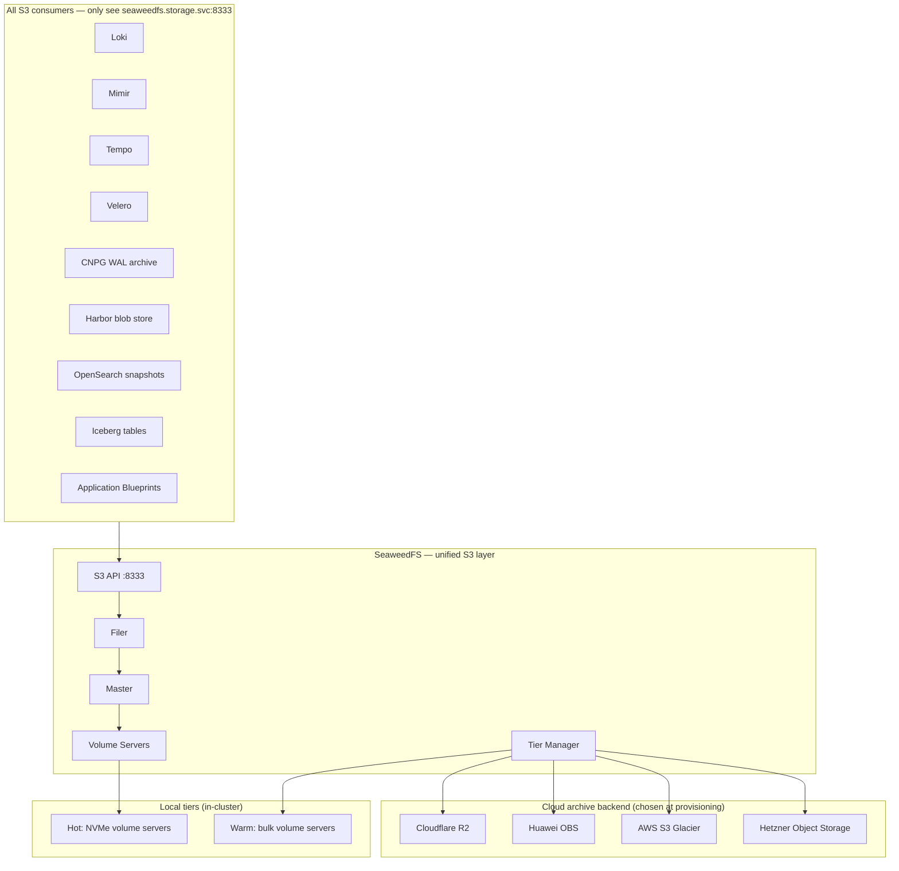
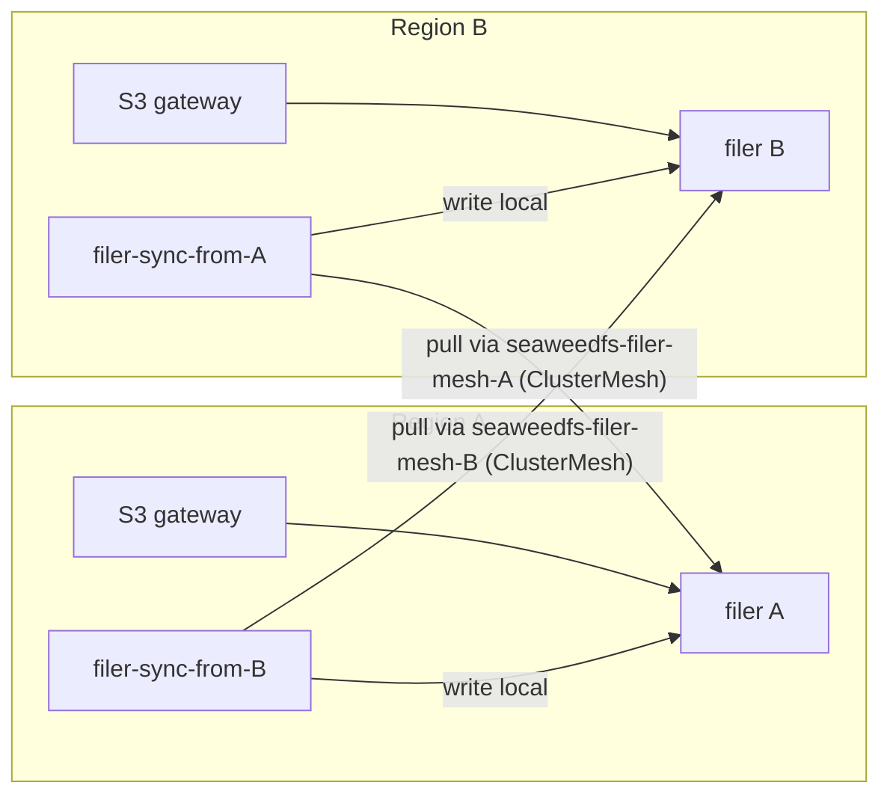

# SeaweedFS

S3-compatible object storage with native archive tiering. Per-host-cluster infrastructure (see [`docs/ARCHITECTURE.md`](../../docs/ARCHITECTURE.md) §3.5) — runs on every host cluster Catalyst manages. **Acts as the unified S3 encapsulation layer in front of cloud archival object storage** (Cloudflare R2 / Huawei OBS / AWS S3 Glacier / Hetzner Object Storage / etc.), so every Catalyst component sees a single S3 API while SeaweedFS transparently routes hot/warm/cold tiers.

**Status:** Accepted | **Updated:** 2026-04-28

---

## Overview

SeaweedFS provides a single S3-compatible API that Catalyst components and Application Blueprints consume uniformly, while internally:

- Stores hot data on local NVMe across the host cluster's volume servers
- Tiers warm data to in-cluster bulk storage
- Tiers cold/archival data to a cloud object-storage backend (configured at Sovereign provisioning time)

The encapsulation property is the architectural point: no Catalyst component talks to cloud S3 directly. Every consumer talks to `seaweedfs.storage.svc:8333`. SeaweedFS is the policy boundary for tiering, lifecycle, replication, and audit.

---

## Why SeaweedFS

| Factor | SeaweedFS |
|---|---|
| **License** | Apache 2.0 (truly open source) |
| **API** | S3-compatible (drop-in for any S3 client; no app changes when migrating off MinIO) |
| **Architecture** | Master + volume server split — scales to millions of files per node |
| **Native tiering** | Built-in tiered storage with cloud backends (S3, R2, Glacier, GCS, Azure Blob) — no MinIO ILM-style external policy engine needed |
| **Encryption** | AES-256 at rest, TLS in transit |
| **Replication** | Cross-region async, per-bucket replication policy |
| **Erasure coding** | Reed-Solomon (4+2, 6+3, 8+4) for cost-efficient durability |
| **FUSE / WebDAV / HDFS / Filer APIs** | Optional surfaces for non-S3 consumers |

---

## Architecture



---

## Tiered Storage Strategy

| Tier | Duration | Storage backend | Cost |
|---|---|---|---|
| Hot | 0–7 days | Local NVMe (in-cluster volume servers) | $$$ |
| Warm | 7–30 days | Local bulk (in-cluster volume servers) | $$ |
| Cold | 30d+ | Cloud archive backend (R2 / Huawei OBS / Glacier / Hetzner) | $ |

Tiering is **automatic and transparent** — the consumer's S3 GET/PUT call goes to the same endpoint regardless of which tier the object lives in. SeaweedFS resolves the tier transparently, fetching from cloud archive on demand if the object has aged past warm.

Cloudflare R2 is the default cold backend (zero egress cost). Huawei OBS (on the current Huawei kom4dc substrate) and AWS S3 Glacier are first-class alternatives chosen at Sovereign provisioning time; Hetzner Object Storage remains supported on legacy Hetzner-substrate Sovereigns.

---

## Configuration

### Deployment (StatefulSet via SeaweedFS Operator)

```yaml
apiVersion: seaweed.seaweedfs.com/v1
kind: Seaweed
metadata:
  name: seaweedfs
  namespace: storage
spec:
  image: chrislusf/seaweedfs:3.71
  master:
    replicas: 3
    volumeSizeLimitMB: 30000
    persistentVolumeClaim:
      storageClassName: fast-nvme
      resources: { requests: { storage: 10Gi } }
  volume:
    replicas: 6
    requests: { cpu: 1, memory: 4Gi }
    persistentVolumeClaim:
      storageClassName: bulk
      resources: { requests: { storage: 1Ti } }
  filer:
    replicas: 2
    config: |
      [postgres]
      enabled = true
      hostname = "seaweedfs-meta-rw.storage.svc"
      port = 5432
      username = "seaweedfs"
      password = "${POSTGRES_PASSWORD}"
      database = "seaweedfs"
  s3:
    replicas: 2
    enabled: true                     # S3 API on :8333 — what every consumer talks to
```

### Cloud archive tier (cold backend)

```yaml
# Configured by sovereign-admin at provisioning time
apiVersion: v1
kind: ConfigMap
metadata:
  name: seaweedfs-tier-config
  namespace: storage
data:
  remote.s3.cold: |
    [s3.cold]
    type = "s3"
    aws_access_key_id = "${R2_ACCESS_KEY}"
    aws_secret_access_key = "${R2_SECRET_KEY}"
    region = "auto"
    bucket = "openova-archive"
    endpoint = "https://<account>.r2.cloudflarestorage.com"
    storage_class = "STANDARD"
```

### Lifecycle policies (per-bucket)

```yaml
# Applied via SeaweedFS S3 API or CRD wrapper
apiVersion: seaweed.seaweedfs.com/v1
kind: BucketLifecycle
metadata:
  name: loki-data
spec:
  bucket: loki-data
  rules:
    - id: TierToCold
      status: Enabled
      filter: { prefix: "logs/" }
      transitions:
        - days: 7
          storageClass: WARM
        - days: 30
          storageClass: COLD          # routes to cold tier (R2/Glacier/etc.) automatically
    - id: ExpireAfterRetention
      status: Enabled
      filter: { prefix: "logs/" }
      expiration: { days: 365 }
```

---

## Buckets (canonical layout — same regardless of cloud backend)

| Bucket | Consumer | Default lifecycle |
|---|---|---|
| `loki-data` | Loki | Tier to cold after 7d, expire after 365d |
| `mimir-data` | Mimir (long-term metrics) | Tier to cold after 7d, expire after 365d |
| `tempo-data` | Tempo | Tier to cold after 7d, expire after 30d |
| `velero-backups` | Velero | Tier to cold after 30d, expire after 90d |
| `cnpg-wal` | CNPG WAL archive | Tier to warm after 1d, expire after 7d |
| `cnpg-base-backups` | CNPG base backups | Tier to cold after 7d, expire after 90d |
| `harbor-data` | Harbor blob store | Tier to cold after 90d, no expiry |
| `opensearch-snapshots` | OpenSearch snapshots | Tier to cold after 30d, expire after 365d |
| `iceberg-warehouse` | Iceberg analytic tables | No automatic transition (Iceberg manages compaction); cold after 90d |
| `livekit-recordings` | LiveKit egress | Tier to cold after 7d, expire after 90d |
| `ai-hub-models` | KServe / vLLM model weights | No automatic transition; pinned to warm |
| `<org>-<app>-*` | Per-Application buckets (auto-created on App install) | Inherits Org default; overridable |

---

## Multi-Region Replication

Each region runs its own independent SeaweedFS (bootstrap-kit slot 18). Nothing is shared between regions by default. Buckets in the **replicated scope** are kept identical in every region by SeaweedFS's native cross-cluster sync, `weed filer.sync` (chart ≥ 1.3.0, [ADR-0015](../../docs/adr/) D6a, #7067). This lets a multi-region Application keep its region-local files (first consumer: WordPress media) in every region, so a topology transition does not lose user files.



### How it works

| Piece | What it does |
|---|---|
| `Service seaweedfs-filer-mesh-<region-id>` (one per region, rendered in every region) | Cilium ClusterMesh global Service (ClusterIP, ports 8888 + 18888). In its own region it selects the local filer and exports it (`service.cilium.io/shared: "true"`). In other regions it is a zero-backend stub (`shared: "false"`), so the name resolves to that region's filer over the mesh. Same idiom as bp-cnpg-pair `-mesh` and bp-harbor `harbor-redis-mesh`. |
| `Deployment seaweedfs-filer-sync-from-<peer-id>` (one per peer) | Runs `weed filer.sync -isActivePassive -a=<peer mesh> -b=<local filer> -a.filerProxy`, one process per replicated bucket. It pulls peer → self. The peer runs the mirror image, so together the regions are active-active. `-a.filerProxy` reads chunks through the peer filer, because peer volume-server addresses do not resolve across clusters. |
| Init container `ensure-replicated-buckets` | Creates each replicated bucket on the local filer if it is missing. It is idempotent and runs on every pod start, so an Application can write in any region before the first replicated event arrives. |
| CiliumNetworkPolicies | Rendered only when `seaweedfsOverlay.networkPolicy.enabled=true`. A k8s NetworkPolicy cannot admit a ClusterMesh peer, so these admit the peer filer.sync → filer hop on 8888/18888. |

**Restarts are idempotent.** filer.sync stores its offset in the local (target) filer: every ~3 s while streaming, and on SIGTERM. A restart resumes from that offset. A new pair starts from the peer filer's earliest metadata log, so objects that existed before replication was enabled are copied too.

**No loops.** Each replicated event carries the source filer's signature. A follower skips events that already carry its target's signature, so a write is never echoed back.

**Conflicts.** For each object, the entry with the newer mtime wins. An incoming entry whose mtime is less than or equal to the existing one is skipped, and an identical ETag counts as already replicated. Deletes and overwrites propagate (`propagateDeletes: true`). Do not write the same key from two regions at the same time. WordPress media keys are unique per upload, so WordPress is safe.

**Three or more regions.** Each region pulls from every peer (a full mesh). A write is applied once per region. Copies that arrive by a second path are skipped as identical ETag.

### Replicated scope convention

filer.sync scopes by directory, so it cannot match a bucket-name wildcard. The scope is therefore an explicit list in `crossRegion.filerSync.buckets`, and every name in it must be `replicated` or `replicated-<suffix>`. The render fails for any other name, so a bucket's name alone tells you it is cross-region.

- Default: one shared bucket, `replicated`. Each Application writes under its own key prefix, `<org>/<app>/…`.
- If an Application needs its own bucket, add `replicated-<org>-<app>` to the list.
- Buckets outside the list stay region-local. All existing platform buckets (Loki, Mimir, Velero, Harbor, CNPG WAL, …) are unchanged.

### How an Application consumes it

1. Use the S3 gateway in your own region: `http://seaweedfs-s3.seaweedfs.svc.cluster.local:8333`. Your region's credentials and endpoint are unchanged, and there is no cross-region endpoint to configure.
2. Write objects into the replicated bucket under your prefix, for example `s3://replicated/<org>/<app>/uploads/2026/11/a.jpg` (the bp-wordpress-tenant ≥ 0.6.0 layout). To get credentials, add a Secret in your namespace annotated `reflector.v1.k8s.emberstack.com/reflects: seaweedfs/seaweedfs-s3-secret`; chart ≥ 1.3.1 marks the source `reflection-allowed` (`seaweedfs.s3.secretAnnotations`). The bucket already exists in every region because the init container creates it. For a dedicated bucket, add `replicated-<org>-<app>` to `crossRegion.filerSync.buckets`; it is created in every region the same way.
3. A write in either region appears in the other, usually within seconds. Reads can go to the local region's gateway.

### Values and delivery

The values follow the ADR-0015 D2 topology contract: the chart reads `openova.topology.self` / `openova.topology.peers[]` (region ids) first. bp-seaweedfs is currently delivered per region by bootstrap-kit slot 18, so the slot fills the fallback `crossRegion.*` seam from the per-region Flux substitutes that bp-cnpg-pair and bp-harbor already use:

| Value | Substitute |
|---|---|
| `crossRegion.enabled` | `SOVEREIGN_ENABLE_CNPG_PAIR` (set to true on both regions by catalyst-api only after ClusterMesh is established) |
| `crossRegion.self` | `SOVEREIGN_REGION_KEY` |
| `crossRegion.configuredRegions` | `SOVEREIGN_CONFIGURED_REGIONS_YAML` (peers = this list minus self) |
| `crossRegion.peerClusters` | `SOVEREIGN_PEER_CLUSTERMESH_NAMES` (used only by the CNPs) |

On a single-region Sovereign, or with no peers, nothing is rendered.

### Status: streaming or lagging

- **Ready.** A sync container is Ready only when its own metrics endpoint answers and the peer filer answers through the mesh. The Deployment's native `Available` condition therefore reads as "replication streaming" or not. If the peer is unreachable at start, filer.sync exits and kubelet restarts it with backoff until the peer returns.
- **Lag.** Each process exports `SeaweedFS_filerSync_sync_offset{path="/buckets/<bucket>"}`, the timestamp (ns) of the last applied event, on port `9340+i` through the `seaweedfs-filer-sync-metrics` Service (scraped when `seaweedfsOverlay.serviceMonitor.enabled`). `time() - SeaweedFS_filerSync_sync_offset / 1e9` is the age of the last replicated change. On an idle bucket this keeps growing even though nothing is behind, so read it together with write activity.

The cold backend is shared across regions. Each region writes warm-aged objects to the same archive bucket, deduplicated by content hash. On region failover, the surviving region reads cold objects directly from the cloud archive and does not need to re-replicate them.

---

## Monitoring

| Metric | Description |
|---|---|
| `seaweedfs_volume_server_disk_usage_bytes` | Per-volume-server disk usage |
| `seaweedfs_s3_request_total` | S3 request count by op |
| `seaweedfs_s3_request_seconds` | S3 request latency histogram |
| `seaweedfs_tier_transition_total` | Objects transitioned per tier |
| `seaweedfs_tier_remote_storage_bytes` | Bytes stored in each cold backend |
| `seaweedfs_master_topology_volume_count` | Volumes per data center / rack |

---

## Migration from MinIO

SeaweedFS is a drop-in S3 replacement:

1. **No application changes** — same S3 API surface (PUT, GET, MULTIPART, presigned URLs, ListObjectsV2, etc.).
2. **Same client libraries** — boto3, AWS SDK for Go/Java/JS, mc client all work unchanged against `seaweedfs.storage.svc:8333`.
3. **Bucket migration** — `mc mirror` from MinIO → SeaweedFS, or use SeaweedFS's `weed filer.remote.sync` to ingest existing data.
4. **Tiering simplification** — MinIO's external ILM + tier configuration is replaced by SeaweedFS's native tiered storage. One configuration boundary instead of two.
5. **Encapsulation upgrade** — direct S3 calls to cloud providers (which were scattered across components) are replaced by uniform calls to SeaweedFS, which routes to the right tier. Audit log, encryption, and lifecycle policy are now applied at one boundary.

---

*Part of [OpenOva](https://openova.io)*
